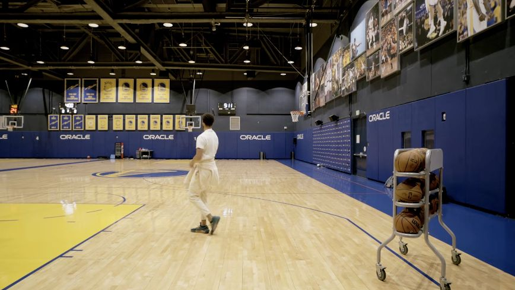
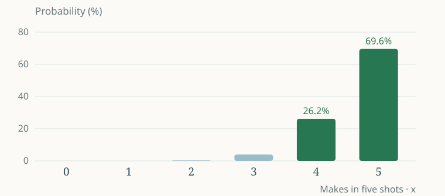
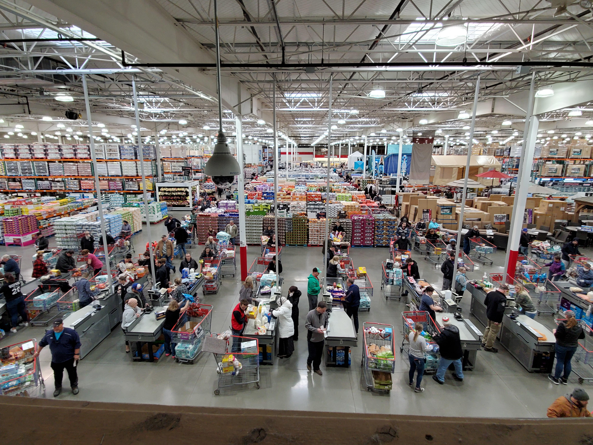
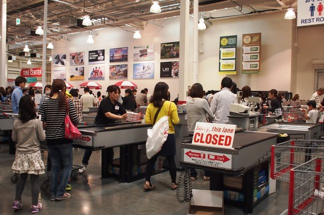
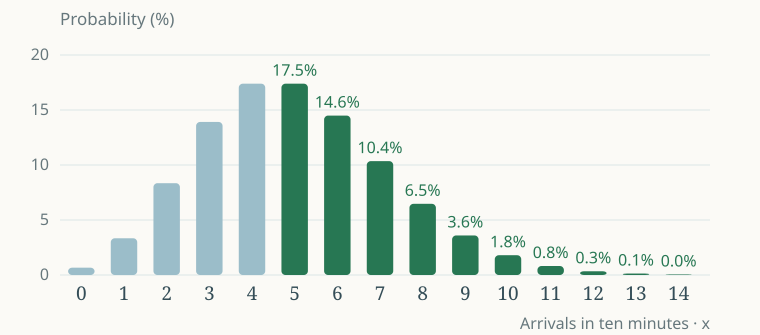

<!-- _class: video-opening -->

## 5本連続。本当に？

<!-- _footer: '' -->
<!-- _paginate: false -->

<a class="full-video" href="https://www.youtube.com/watch?v=xt5vzE0QCvk" aria-label="Curryの動画を見る">▶ 動画を見る / Watch video</a>

映像：Ari Fararooy

<!-- Screenshot from the supplied video, captured in-browser. Source: https://www.youtube.com/watch?v=xt5vzE0QCvk . Edited-video context: https://www.scrippsnews.com/sports/steph-curry-on-fake-viral-video-of-full-court-shots . Full-court footage is separate from the hypothetical free-throw model. -->

---

<!-- _class: opening -->

## 最後のフリースロー、誰に任せる？

<a class="player-stats" href="https://www.nba.com/stats/player/201939?SeasonType=Regular+Season">Curry · NBA公式成績 / Official stats ↗</a>

<a class="player-stats" href="https://www.nba.com/stats/player/203507?SeasonType=Regular+Season">Giannis · NBA公式成績 / Official stats ↗</a>

カリー？　ヤニス？　「上手そう」から、数字で考えてみる。

画像をクリックすると動画へ。公式成績では、シーズンとFT％（フリースロー成功率）を確認しよう。

---

## 93％なら、5本全部入る？

1本の成功率を **93％** として、5本のフリースローを考える。

チャンス

5本

何回投げるか

1本の成功率

93％

入る／外れる

知りたいこと

何本？

5本中の成功数

まず予想：全部成功する確率も93％？

π = 0.93 は授業用の設定。各投球は独立で、成功率は一定と仮定。

---

## 5本全部成功する確率は…

$$
\Pr(X=5)=(0.93)^5\approx0.6957
$$

約69.57％

1本ごとの93％と、5本全部の確率は違う。

成功・成功・成功・成功・成功 → 独立な5回の確率を掛ける。

---

<!-- _class: title -->

## Week 3 · 成功の回数、到着の人数

NBAからコストコへ。

**回数を固定する** → 二項分布

**時間を固定する** → ポアソン分布

4 離散確率分布　→　5 連続確率分布　→　6 平均値と分散

教科書 第2章 第2節「確率分布」p.118–129 ／ Week 2の続き

---

<!-- _class: book-divider -->

## 教科書 · 第2章 第2節

4　離散確率分布

p.118–120

成功した回数を数える。

まずは **二項分布**：決まった回数の中で、何回成功するか。

---

<!-- _class: book-reference -->

## 1本ならベルヌーイ、5本なら二項

1本の結果

0 または 1

外れる = 0 ／ 入る = 1

5本の成功数

0〜5

X = 5本のうち入った本数

$$
Y\sim\mathrm{Bernoulli}(\pi),\qquad X\sim B(n,\pi)
$$

大文字 X は成功数を表す確率変数。実際に3本入ったら、実現値 x = 3。

---

## 4本成功にも、5通りある

● ● ● ● × ● ● ● × ● ● ● × ● ● ● × ● ● ● × ● ● ● ●

$$
\Pr(X=4)=\underbrace{5}_{\text{並び方}}\times\underbrace{(0.93)^4(0.07)}_{\text{1通りの確率}}\approx26.18\%
$$

● = 成功 ／ × = 失敗。成功数は同じでも、失敗する位置が違う。

---

<!-- _class: book-reference -->

## 並び方を数える記号：C

$$
{}_nC_x=\frac{n!}{x!(n-x)!},\qquad {}_5C_4=5
$$

n

全部で何回？

5本投げる

x

成功は何回？

4本成功

C

何通り？

失敗する位置が5通り

階乗 n! は n × (n−1) × … × 1。0! = 1。教科書 p.119。

---

<!-- _class: challenge -->

## チャレンジ①　学園祭の受付チーム

自分で解く　10分　／　教科書 p.119

**6人** の学生から、受付を担当する **3人** を選ぶ。
役職はなく、選ぶ順番も区別しない。

**(1)** チームは何通り作れるか。使う $C$ と途中式を書け。

**(2)** Aさんが必ず入る場合、チームは何通りになるか。

**(3)** (1)で $6\times5\times4$ と計算するだけではいけない理由は？

教科書・電卓可。同じ3人を違う順番で選んだら、別のチームになるか考えよう。

<!--
進行：個人で10分。n=6、x=3を自分で特定し、階乗を約分する。
(1) C(6,3)=6!/(3!3!)=(6×5×4)/(3×2×1)=20通り。
(2) Aさんを先に固定し、残り5人から2人を選ぶ。C(5,2)=10通り。
(3) 6×5×4=120は同じ3人の選ぶ順番を3!=6回ずつ数えるため、6で割る。
確認ポイント：役職を割り当てないので順列ではない。Aさんを固定したら、選ぶ人数も候補者数も1減る。
-->

---

<!-- _class: challenge-check -->

## 答え合わせ①　同じ3人なら、同じチーム

$$
\begin{aligned}
{}_6C_3&=\frac{6!}{3!3!}=\frac{6\times5\times4}{3\times2\times1}=20\\
{}_5C_2&=\frac{5!}{2!3!}=10
\end{aligned}
$$

**自由に選ぶ：20通り　／　Aさんを含む：10通り**

同じ3人を並べる順番は $3!=6$ 通り。その重複を割って除く。

[やってみよう！](https://yohman.github.io/26-2-StatsB/agenda.html?activity=combinations#week-03)

並びのラボで n=6、ロボット3体に設定。ロボットの位置を「選ばれた学生」と読み替えると20通り。

---

<!-- _class: try -->

## ロボットとヤギで、並び方を見よう

🤖 🤖 🐐 🐐 🐐　　🤖 🐐 🤖 🐐 🐐

5か所にロボット2体を置く。順番は何通り？

$$
{}_5C_2=\frac{5!}{2!3!}=10
$$

[やってみよう！](https://yohman.github.io/26-2-StatsB/agenda.html?activity=combinations#week-03)

n と x のスライダーを動かす → 式の数字と、全ての並び方が変わる。

---

<!-- _class: book-reference formula-only -->

## 二項分布の公式

<!-- _footer: '' -->

$$
\Pr(X=x)={}_nC_x\,\pi^x(1-\pi)^{n-x}
$$

---

<!-- _class: book-reference -->

## 二項分布：式を3つに分ける

最重要 / VERY IMPORTANT

$$
\Pr(X=x)={}_nC_x\,\pi^x(1-\pi)^{n-x}
$$

並び方

ₙCₓ

成功の位置を選ぶ

成功

πˣ

x 回成功する

失敗

(1−π)ⁿ⁻ˣ

残り n−x 回は失敗

n 回・独立・成功率 π が一定。この条件がそろったときに使う。教科書 p.119。

---

<!-- _class: binomial-worked -->

## 「ちょうど4本」と「4本以上」は違う

$$
\begin{aligned}\Pr(X=4)&={}_5C_4(0.93)^4(0.07)^1\\&=5\times(0.93)^4\times0.07\approx0.2618\\[10pt]\Pr(X=5)&={}_5C_5(0.93)^5(0.07)^0\\&=1\times(0.93)^5\times1\approx0.6957\end{aligned}
$$

$$
\Pr(X\ge4)=\Pr(X=4)+\Pr(X=5)\approx0.9575=95.75\%
$$

n = 5、π = 0.93。「4本以上」は4本と5本の両方を含む。確率は丸める前の値で足す。

---

## 成功数の「地図」が、二項分布

$$
\Pr(X\ge4)=\Pr(X=4)+\Pr(X=5)\approx95.75\%
$$

横軸：5本のうち成功した本数。縦軸：その成功数になる確率。緑の2本を足す。

---

<!-- _class: try -->

## NBAラボ：予想して、投げて、比べる

$$
X\sim B(5,0.93),\qquad\Pr(X\ge4)\approx95.75\%
$$

**①** 1セット5本。何本入った？

**②** 100セット繰り返す。成功数の分布は？

**③** 成功率を65％に変える。どの棒が変わる？

[やってみよう！](https://yohman.github.io/26-2-StatsB/agenda.html?activity=nba#week-03)

線は理論の確率、棒は実測の割合。試行を増やしても毎回一致するわけではない。

---

<!-- _class: book-reference moments-important -->

## 二項分布の期待値と分散

最重要 / VERY IMPORTANT

<h3>期待値 E(X)：成功数の平均</h3>

$$
E(X)=n\pi=5\times0.93=4.65
$$

<h3>分散 Var(X)：成功数のばらつき</h3>

$$
\operatorname{Var}(X)=n\pi(1-\pi)=5\times0.93\times0.07=0.3255
$$

期待値4.65本は、5本のセットを何度も繰り返した平均。1セットで4.65本入るという意味ではない。分散の単位は本²。教科書 p.120。

---

<!-- _class: book-reference -->

## NBAの話が、教科書の野球につながる

打率32％の選手が5打席で **ちょうど3安打**。

$$
\Pr(X=3)={}_5C_3(0.32)^3(0.68)^2\approx0.151519
$$

約15.15％

フリースローの成功 → ヒットに置き換えただけ。教科書 p.118–120の例。

---

<!-- _class: try -->

## 野球ラボ：1打席と1試合を分ける

$$
\underbrace{\pi=0.32}_{\text{1打席のヒット率}}\quad\ne\quad\underbrace{\Pr(X=3)\approx0.1515}_{\text{5打席で3安打の確率}}
$$

1試合を5打席として、100試合を繰り返そう。

**3安打の棒**と15.15％を比較する。

[やってみよう！](https://yohman.github.io/26-2-StatsB/agenda.html?activity=batting#week-03)

---

<!-- _class: challenge -->

## チャレンジ②　6個のセンサーを検品

自分で解く　10分　／　教科書 p.118–120

ロボット工場で、センサーを **6個** 検査する。1個の合格率は **85％**。
各検査は独立で、合格率は一定とする。合格個数を $X$ とする。

**(1)** ちょうど5個が合格する確率を求めよ。

**(2)** 1個以上が不合格になる確率を求めよ。

**(3)** 合格個数の期待値と分散を求めよ。

授業用の仮想設定。教科書・電卓可。Xは「合格個数」。(2)をXの範囲に直してから、式を書こう。

<!--
進行：個人で10分。n=6、π=0.85。不合格の確率は0.15。
(1) P(X=5)=C(6,5)×0.85^5×0.15=0.39933478125、約39.93％。
(2) 1個以上不合格はX≤5。P(X≤5)=1-P(X=6)=1-0.85^6=0.622850484375、約62.29％。
(3) E(X)=6×0.85=5.1個、Var(X)=6×0.85×0.15=0.765個²。
確認ポイント：(2)をP(X≥1)としてはいけない。Xは合格個数なので、全て合格の反対を考える。
-->

---

<!-- _class: challenge-check -->

## 答え合わせ②　不合格は、全て合格の反対

$$
\begin{aligned}
\Pr(X=5)&={}_6C_5(0.85)^5(0.15)\approx0.3993\\
\Pr(X\le5)&=1-\Pr(X=6)=1-(0.85)^6\approx0.6229\\
E(X)&=6\times0.85=5.1\\
\operatorname{Var}(X)&=6\times0.85\times0.15=0.765
\end{aligned}
$$

**5個合格：約39.93％　／　1個以上不合格：約62.29％**

[やってみよう！](https://yohman.github.io/26-2-StatsB/agenda.html?activity=nba#week-03)

同じ二項モデルで確認：NBAラボの成功を合格と読み替え、n=6、成功率85％、x=5に設定。(2)はx=6の確率を1から引く。

---

## 今度は、回数が決まっていない

あなたはコストコでレジ担当。退勤まで、あと10分。

その10分間に、**新しく何人来る？**

一定時間に新しく到着する人数を考えよう。

---

## 平均5人。でも、今日は3人？8人？

10分で平均5人

0人、1人、2人、… 上限は決まっていない。

知りたいこと： <strong>ちょうど3人？　5人以上？</strong>

仮想の授業モデルです。実際のコストコの測定値ではありません。

---

<!-- _class: book-divider -->

## 教科書 · 第2章 第2節

4　ポアソン分布

p.120

固定した時間・範囲の中に、何件起こるか。

平均の発生数 **λ（ラムダ）** が、分布を決める。

---

<!-- _class: book-reference -->

## ポアソンの式と、表のつながり

$$
X\sim\mathrm{Poisson}(\lambda),\qquad \Pr(X=x)=\frac{\lambda^xe^{-\lambda}}{x!}
$$

**この式で計算した確率が、表の中に並んでいる。**

平均人数

λ = 5

表では μ = 5.0 の列

求めたい人数

x = 3

表では x = 3 の行

交点を読む

Pr(X = 3)

「ちょうど3人」の確率

配布表の μ と、スライドの λ は同じ平均発生数。授業では e を計算せず、表から確率を読む。教科書 p.120。

---

<!-- _class: table-reading -->

## ちょうど3人：列と行の交点を読む

配布ポアソン分布表の抜粋
<table class="poisson-lookup"><thead><tr><th><i>x</i> ＼ <i>μ</i></th><th class="">4.5</th><th class="lookup-column">5.0</th><th class="">5.5</th></tr></thead><tbody><tr><th class="">0</th><td class="">0.011</td><td class="lookup-column">0.007</td><td class="">0.004</td></tr><tr><th class="">1</th><td class="">0.050</td><td class="lookup-column">0.034</td><td class="">0.022</td></tr><tr><th class="">2</th><td class="">0.112</td><td class="lookup-column">0.084</td><td class="">0.062</td></tr><tr><th class="lookup-row">3</th><td class="">0.169</td><td class="lookup-cell">0.140</td><td class="">0.113</td></tr><tr><th class="">4</th><td class="">0.190</td><td class="lookup-column">0.175</td><td class="">0.156</td></tr></tbody></table>

<strong>① 平均5人</strong>：μ = 5.0 の列

<strong>② ちょうど3人</strong>：x = 3 の行

<strong>③ 交点の 0.140 を読む</strong>

$$
\Pr(X=3)\approx0.140
$$

約14.0％

[ポアソン分布表をビューアーで開く ↗](https://yohman.github.io/26-2-StatsB/viewer.html?file=other+material%2F2025+yoh%2F06_%5BAL%5D%E7%A2%BA%E7%8E%87%E5%88%86%E5%B8%83_1_%E9%9B%A2%E6%95%A3%E7%A2%BA%E7%8E%87%E5%88%86%E5%B8%83+%E3%83%9D%E3%82%A2%E3%82%BD%E3%83%B3%2F%E3%83%9D%E3%82%A2%E3%82%BD%E3%83%B3%E5%88%86%E5%B8%83%E8%A1%A8.pdf&title=%E3%83%9D%E3%82%A2%E3%82%BD%E3%83%B3%E5%88%86%E5%B8%83%E8%A1%A8+%2F+Poisson+table&week=W03&return=agenda.html%23week-03)

0.140 は「3人以下」ではなく「ちょうど3人」。表の値は小数第3位に丸めてある。

---

<!-- _class: table-reading -->

## 5人以上：0〜4人を足して、1から引く

$$
\Pr(X\ge5)=1-\{\Pr(X=0)+\cdots+\Pr(X=4)\}
$$

μ = 5.0 の列、x = 0〜4 の5マス
<table class="poisson-lookup"><thead><tr><th><i>x</i> ＼ <i>μ</i></th><th class="">4.5</th><th class="lookup-column">5.0</th><th class="">5.5</th></tr></thead><tbody><tr><th class="lookup-row">0</th><td class="">0.011</td><td class="lookup-cell">0.007</td><td class="">0.004</td></tr><tr><th class="lookup-row">1</th><td class="">0.050</td><td class="lookup-cell">0.034</td><td class="">0.022</td></tr><tr><th class="lookup-row">2</th><td class="">0.112</td><td class="lookup-cell">0.084</td><td class="">0.062</td></tr><tr><th class="lookup-row">3</th><td class="">0.169</td><td class="lookup-cell">0.140</td><td class="">0.113</td></tr><tr><th class="lookup-row">4</th><td class="">0.190</td><td class="lookup-cell">0.175</td><td class="">0.156</td></tr></tbody></table>

表の確率を<strong>小数のまま</strong>足す。

$$
\begin{aligned}\Pr(X\le4)&\approx0.007+0.034+0.084\\&\quad+0.140+0.175=0.440\\\Pr(X\ge5)&\approx1-0.440=0.560\end{aligned}
$$

約56.0％

「5人以上」なので、引くのは4人まで。x = 5 のマスは引かない。

---

## 式の中身を、人数で確かめる

| 求めたいこと | 表で読む場所 | 答えの出し方 |
| --- | --- | --- |
| ちょうど3人 | μ = 5.0、x = 3 | 0.140 ≈ 14.0％ |
| 4人以下 | μ = 5.0、x = 0〜4 | 5マスを足す ≈ 0.440 |
| 5人以上 | 4人以下の反対 | 1 − 0.440 ≈ 56.0％ |

[ポアソン分布表を開く](https://yohman.github.io/26-2-StatsB/other%20material/2025%20yoh/06_%5BAL%5D%E7%A2%BA%E7%8E%87%E5%88%86%E5%B8%83_1_%E9%9B%A2%E6%95%A3%E7%A2%BA%E7%8E%87%E5%88%86%E5%B8%83%20%E3%83%9D%E3%82%A2%E3%82%BD%E3%83%B3/%E3%83%9D%E3%82%A2%E3%82%BD%E3%83%B3%E5%88%86%E5%B8%83%E8%A1%A8.pdf)

表の各マスは「ちょうど x 人」の確率。表の丸めにより、計算機の値（約14.04％・55.95％）とは少し違う。表を使う問題では表の精度で答える。

---

## 5人以上は、右側の棒を全部足す

$$
\Pr(X\ge5)\approx55.95\%
$$

横軸：10分の到着人数。縦軸：その人数になる確率。図は14人まで。15人以上もあり、式では全て含める。

---

<!-- _class: try -->

## コストコラボ：10分間を何度も繰り返す

$$
\lambda=5,\qquad E(X)=\operatorname{Var}(X)=5
$$

**①** 1回の10分間を再生。いつ、何人来た？

**②** 100回繰り返して、人数の棒グラフを作る。

**③** 時間を20分に。平均人数はどう変わる？

[やってみよう！](https://yohman.github.io/26-2-StatsB/agenda.html?activity=costco#week-03)

到着時刻はランダム。平均到着率が一定なら、時間を2倍にするとλも2倍。

---

## 同じ「5」でも、二項とは違う

NBA

5本投げる

n = 5 ／ 成功数は0〜5

コストコ

平均5人来る

λ = 5 ／ 人数は0,1,2,…

$$
\text{二項}:\ E(X)=n\pi\qquad\text{ポアソン}:\ E(X)=\lambda
$$

**試行回数**と**平均発生数**を取り違えない。

---

## ポアソンを使う前に、条件を確認

**独立**：1人の到着が、次の到着を決めない。

**一定の率**：時間帯の途中で混雑度が急変しない。

**小さな時間では、複数の到着はまれ**。

団体客、セール開始、混雑による相互作用があるなら、このモデルが合わない可能性。到着人数だけでは退勤時刻は決まりません。

---

<!-- _class: book-reference -->

## 二項からポアソンへの橋

$$
n\ \text{が大きく},\quad\pi\ \text{が小さく},\quad n\pi=\lambda
$$

たくさんの小さなチャンスから、まれに発生する。

$$
B(n,\pi)\approx\mathrm{Poisson}(n\pi)
$$

[やってみよう！](https://yohman.github.io/26-2-StatsB/agenda.html?activity=probability#week-03)

ベルヌーイ・二項・ポアソンの棒を比較。教科書 p.120の近似の考え方。

---

<!-- _class: challenge -->

## チャレンジ③　サポート窓口への問い合わせ

自分で解く　10分　／　教科書 p.120

学内のサポート窓口に、平均 **10分あたり3件** の問い合わせが届く。
到着は一定の率で独立に起こるポアソン過程とする。
次の **15分間** に届く件数を $X$ とする。

**(1)** この15分間の平均件数 $\lambda$ を求めよ。

**(2)** ちょうど4件届く確率と、2件以上届く確率を求めよ。

**(3)** 期待値と分散を求めよ。平均件数が小数でもよい理由は？

教科書・電卓・配布ポアソン分布表を使用可。時間の単位をそろえ、表で読む列と行、途中計算を書く。

<!--
進行：個人で10分。λの時間単位と、2件以上の補集合を確認する。
λ=3×15/10=4.5。配布表のμ=4.5列、x=4行からP(X=4)≈0.190、約19.0％。
同じ列のx=0行は0.011、x=1行は0.050。P(X≥2)≈1-(0.011+0.050)=0.939、約93.9％。
E(X)=Var(X)=λ=4.5。期待値は4.5件、分散は4.5件²。
実現値は整数だが、多数の15分間の平均は小数でもよい。平均4.5件は、1回に4.5件届くという意味ではない。
確認ポイント：2件以上では0件と1件の両方を除く。15分を試行回数n=15と誤解しない。
-->

---

<!-- _class: challenge-check poisson-check -->

## 答え合わせ③　15分間の平均は4.5件

$$
\lambda=3\times\frac{15}{10}=4.5\quad\Rightarrow\quad\text{表の }\mu=4.5\text{ の列}
$$

μ = 4.5 の列を読む
<table class="poisson-lookup"><thead><tr><th><i>x</i> ＼ <i>μ</i></th><th class="lookup-column">4.5</th><th class="">5.0</th><th class="">5.5</th></tr></thead><tbody><tr><th class="lookup-row">0</th><td class="lookup-cell">0.011</td><td class="">0.007</td><td class="">0.004</td></tr><tr><th class="lookup-row">1</th><td class="lookup-cell">0.050</td><td class="">0.034</td><td class="">0.022</td></tr><tr><th class="">2</th><td class="lookup-column">0.112</td><td class="">0.084</td><td class="">0.062</td></tr><tr><th class="">3</th><td class="lookup-column">0.169</td><td class="">0.140</td><td class="">0.113</td></tr><tr><th class="lookup-row">4</th><td class="lookup-cell">0.190</td><td class="">0.175</td><td class="">0.156</td></tr></tbody></table>

$$
\begin{aligned}
\Pr(X=4)&\approx0.190=19.0\%\\
\Pr(X\ge2)&=1-\{\Pr(X=0)+\Pr(X=1)\}\\
&\approx1-(0.011+0.050)\\
&=0.939=93.9\%\\
E(X)&=\operatorname{Var}(X)=4.5
\end{aligned}
$$

[やってみよう！](https://yohman.github.io/26-2-StatsB/agenda.html?activity=costco#week-03)

表の丸め値で計算。件数は整数でも、繰り返した平均は小数でよい。ラボは10分あたり3、観察15分。

---

<!-- _class: book-divider -->

## 教科書 · 第2章 第2節

5　連続確率分布

p.121–128

ロボットは **何体？** から、身長は **何cm？** へ。

測定値には小数もある。**ある範囲に入る確率**を、面積で求める。

この後の例：高さ制限に通れる？　工場の平均は正しい？　品質は安定している？

---

<!-- _class: book-reference explained -->

## 連続の確率：身長がある範囲に入る割合

身長を $X$ とする。**160.000…cmぴったり**より、**155〜165cm**を考える。

$$
\Pr(155<X\le165)=\int_{155}^{165}f(x)\,dx=F(165)-F(155)
$$

**f(x)**：その付近への集まりやすさ。高さそのものは確率ではない。

**F(165) − F(155)**：165cm以下から155cm以下を除き、間の面積を残す。

連続モデルでは一点の確率は0、全範囲の面積は1。丸めた「160.0cm」という測定値は小さな区間を表す。Week 2 AL2の面積と同じ考え方。教科書 p.121。

---

<!-- _class: book-reference explained -->

## 正規分布：このロボット、ゲートを通れる？

**問題**　身長は正規分布、平均160cm・標準偏差5cm。高さ169.8cmの制限を超える確率は？

$$
X\sim N(160,5^2),\qquad Z=\frac{X-\mu}{\sigma}
$$

$$
z=\frac{169.8-160}{5}=1.96
$$

**9.8cmの差は、標準偏差1.96個分。** 次のスライドで、この右側の面積を読む。

[やってみよう！](https://yohman.github.io/26-2-StatsB/agenda.html?activity=normal-w2#week-03)

仮想の身長モデル。個体の高さ制限超過を計算するために正規分布を使う。測定値が何でも正規分布になるわけではない。教科書 p.122–124。

---

<!-- _class: book-reference explained -->

## 正規分布表：行1.9、列0.06を読む

**求めるもの：高さ制限169.8cmを超える割合。標準化すると z = 1.96。**

| zの行 ＼ 小数第2位の列 | 0.05 | **0.06** | 0.07 |
| --- | --- | --- | --- |
| **1.9** | 0.02559 | **0.02500** | 0.02442 |

$$
\Pr(X>169.8)=\Pr(Z>1.96)=0.025=2.5\%
$$

**このモデルでは約1,000体中25体が高さ制限を超える。**

$$
\Pr(X\le169.8)=0.975,\quad\Pr(150.2<X<169.8)=1-2(0.025)=0.95
$$

教科書の表は右側の面積。通れる割合は97.5％。中央95％は左右の2.5％ずつを除く。予測割合であり、必ず25体になるわけではない。教科書 p.124–125。

---

<!-- _class: book-reference explained -->

## なぜt分布？　工場の平均を標本で調べる

**問題**　工場は「平均60cm」と説明。でも全ロボットの身長や母標準偏差は分からない。

無作為に **9体** 測ると、平均 **64cm**、標本標準偏差 **6cm**。

$$
T=\frac{\bar X-\mu_0}{s/\sqrt n},\qquad\nu=n-1
$$

**σが未知なので s で推定する。** 広がりも推定する不確かさを、t分布で考慮する。

個体の身長でなく「標本平均のずれ」を評価する。小標本だから自動的にt、ではない。独立な正規母集団の標本を仮定。教科書 p.125–127。

---

<!-- _class: book-reference explained t-worked -->

## tの計算：平均のずれは、どのくらい大きい？

$$
\mathrm{SE}=\frac{s}{\sqrt n}=\frac6{\sqrt9}=2\ \mathrm{cm},\qquad t=\frac{64-60}{2}=2,\quad\nu=8
$$

**標準誤差SE**：標本平均の揺れの大きさを推定したもの。4cmの差はSEの2個分。

両側5％の目安：t表の **自由度8、上側確率0.025** から **2.306**。

$$
|t|=2<2.306
$$

**この標本だけでは、5％水準で「平均60cmと違う」とまでは言えない。**

[やってみよう！](https://yohman.github.io/26-2-StatsB/agenda.html?activity=t-w2#week-03)

t = 2 は確率2％ではない。「違いが示せない」は「平均60cmだと証明した」でもない。ここは後の仮説検定への導入。

<!-- Critical value checked against NIST Student t table: df=8, cumulative 0.975 (upper tail 0.025), 2.306. https://www.itl.nist.gov/div898/handbook/eda/section3/eda3672.htm -->

---

<!-- _class: book-reference explained -->

## なぜカイ二乗？　平均が合っても品質は違う

**問題**　工場の標準偏差は **10cm** という。9体を測ると標本標準偏差は **15cm**。

平均身長が同じでも、大きすぎる・小さすぎるロボットが多ければ、部品が合わない。

$$
\chi^2=\frac{(n-1)s^2}{\sigma_0^2},\qquad\nu=n-1
$$

**標本のばらつきを、工場が主張するばらつきと比べる。**

ここでは分散を調べるカイ二乗分布を使う。s²は不偏分散。平均との差を二乗するためχ²は負にならない。独立な正規母集団の標本を仮定。教科書 p.127–128。

---

<!-- _class: book-reference explained chi-worked -->

## カイ二乗の計算：ばらつきすぎていない？

$$
\chi^2=\frac{(9-1)\times15^2}{10^2}=\frac{8\times225}{100}=18,\qquad\nu=8
$$

「ばらつきが大きすぎる？」なので **右側** を見る。

χ²表の **自由度8、上側確率0.05** の境界は **15.507**。

$$
18>15.507
$$

**工場の標準偏差が10cmなら珍しい大きさ。上側5％の基準を超えた。**

[やってみよう！](https://yohman.github.io/26-2-StatsB/agenda.html?activity=chi-w2#week-03)

18は18％ではない。片側5％の検定の導入で、母標準偏差が10cmを超える証拠と考える。小さすぎる分散や両側の問いでは別の境界を使う。

<!-- Critical value checked against NIST Chi-square table: df=8, cumulative 0.95 (upper tail 0.05), 15.507. https://www.itl.nist.gov/div898/handbook/eda/section3/eda3674.htm -->

---

<!-- _class: book-divider -->

## 教科書 · 第2章 第2節

6　確率分布の平均値と分散

p.129

**なぜ重要？　「平均30分」だけでは、間に合うか分からない。**

配達ロボットAはいつも30分。Bは10分か50分、半々。平均は同じ。

**期待値で通常の水準を、分散で安定性を比べる。**

---

<!-- _class: book-reference explained -->

## 期待値：確率を使って、長期の平均を計算

$$
E(X)=\sum_x x\Pr(X=x)\quad\text{または}\quad E(X)=\int_{-\infty}^{\infty}xf(x)\,dx
$$

離散は足し算、連続は積分。どちらも **値を起こりやすさで重みづけ** する。

$$
E(B)=10\times0.5+50\times0.5=30\ \text{分}
$$

**Bを何度も使うと平均30分。でも1回の配達は10分か50分。**

期待値は予算・人員・平均待ち時間の計画に使える。1回の結果や締切内の到着を保証しない。くじの75円、二項のnπ、ポアソンのλも同じ考え方。教科書 p.129。

---

<!-- _class: book-reference explained variance-worked -->

## 分散：平均からの距離を二乗して平均

$$
\operatorname{Var}(X)=\sum_x(x-\mu_X)^2\Pr(X=x)\quad\text{または}\quad\int_{-\infty}^{\infty}(x-\mu_X)^2f(x)\,dx
$$

Bの配達は平均30分から **−20分か＋20分**。そのまま足すと0になってしまう。

$$
\operatorname{Var}(B)=(-20)^2(0.5)+(20)^2(0.5)=400\ \text{分}^2
$$

$$
\mathrm{SD}(B)=\sqrt{400}=20\ \text{分},\qquad\operatorname{Var}(A)=0
$$

二乗すると早い・遅いが打ち消されない。分散は分²、標準偏差は分。標準偏差20分は、常に±20分に収まるという意味ではない。教科書 p.129。

---

<!-- _class: try explained -->

## 同じ平均30分。40分後の授業に間に合う？

| 配達ロボット | 配達時間 | 期待値 | 分散 | 40分以内に到着 |
| --- | --- | --- | --- | --- |
| A | いつも30分 | 30分 | 0分² | **100％** |
| B | 10分か50分、半々 | 30分 | 400分² | **50％** |

**時間厳守ならA。平均だけで選ぶと、この差を見落とす。**

[やってみよう！](https://yohman.github.io/26-2-StatsB/agenda.html?activity=delivery#week-03)

このスライドは仮想の30分モデル。ラボの初期値はA=10分、B=2分/18分で同じ構造。平均と分散だけでは一般に締切内の確率は決まらない。ここでは全ての結果と確率が分かっている。

---

<!-- _class: explained selection-guide -->

## どの分布？　何を知りたいかで選ぶ

| 質問 | 使うモデル・道具 | 理由 |
| --- | --- | --- |
| 1回の成功？ n回中の成功数？ | ベルヌーイ・二項 | 独立・成功率一定 |
| 一定時間に何件来る？ | ポアソン | 一定の発生率で数える |
| 1体の身長が制限を超える？ | 正規モデルで標準化 | 個体の値の範囲を面積にする |
| 工場の平均は目標と違う？ | t：標本平均の統計量 | 母標準偏差が未知 |
| 工場のばらつきが大きすぎる？ | χ²：標本分散の統計量 | 主張する母分散と比べる |

正規・t・χ²は「好きな曲線を選ぶ」のではない。何を標準化した統計量かが違う。t・χ²の例は独立な正規母集団の標本を仮定。

---

## AL：式に入れる前に、4つ書く

何を数える？

X

成功数／発生数

条件は？

n, π ／ λ

試行回数と率／平均人数

どの結果？

x ／ 以上

ちょうど？　範囲？

**④** 選んだ式に代入 → 答えを確率・人数の言葉で説明する。

授業内のALワークシートに取り組み、指定セルの値を **UNIPA** で回答。

締切：次回授業前日の火曜日 23:59。遅れての提出は受け付けません。

