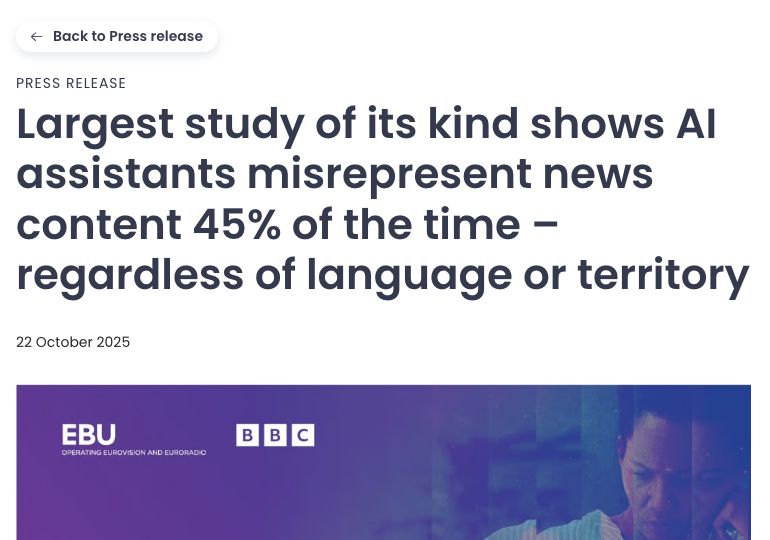

<!-- _class: news-opening -->

## AIニュース、3つ読んだら？

元調査の発表画面：EBU / BBC（2025.10.22）

Reuters　2025.10.22

AIの答えを、そのままレポートに使って大丈夫？

ニュースについてのAI回答の **20％** に、重大な正確性の問題。

[記事を読む](https://www.investing.com/news/stock-market-news/ai-assistants-make-widespread-errors-about-the-news-new-research-shows-4300409)　[元データ](https://www.ebu.ch/news/2025/10/ai-s-systemic-distortion-of-news-is-consistent-across-languages-and-territories-international-study-by-public-service-broadcaste)

45％は「何らかの重大な問題」。今回は、その内訳の「重大な正確性の問題20％」を使う。

<!-- Sources: https://www.investing.com/news/stock-market-news/ai-assistants-make-widespread-errors-about-the-news-new-research-shows-4300409
Data and thumbnail: https://www.ebu.ch/news/2025/10/ai-s-systemic-distortion-of-news-is-consistent-across-languages-and-territories-international-study-by-public-service-broadcaste
Reported p=0.2. Classroom model n=3, p=0.2, independent trials, constant p. -->

---

<!-- _class: news-given -->

## AI回答3件のうち、ちょうど1件に問題？

GIVEN / 与えられた条件と問題

$X$＝重大な正確性の問題を含む回答の件数。

同じ条件で作られたAI回答を3件読む。各回答の問題発生率を20％とし、独立と仮定する。

$$
n=3,\qquad\pi=0.20,\qquad x=1
$$

重大な正確性の問題を含む回答が、ちょうど1件ある確率を求めよ。

20％は調査の報告値。3件・独立・一定の確率は授業用の仮定。「その問題なし」は完全に正しいという意味ではない。

---

<!-- _class: book-reference news-formula -->

## 公式に、ニュースの数値を代入

FORMULA / 文字の公式、そして代入

$$
\Pr(X=x)={}_nC_x\pi^x(1-\pi)^{n-x}
$$

$$
\Pr(X=1)={}_3C_1(0.20)^1(0.80)^2
$$

**問題のある1件の位置 × 問題あり1件 × その問題なし2件**

教科書 p.118–119：二項分布は、同じ確率の独立な試行で、該当する件数を数える。

---

<!-- _class: news-answer -->

## 計算と、答えの意味

SOLUTION / 途中計算と答え

$$
\begin{aligned}{}_3C_1&=3\\\Pr(X=1)&=3\times0.20\times0.64\\&=0.384=\boxed{38.4\%}\end{aligned}
$$

3件の回答を1組とすると、ちょうど1件にこの問題がある組は38.4％。

20％は1件についての割合。38.4％は「3件中ちょうど1件」の確率。

2025年の調査条件を使う練習用モデル。現在の全AIや全質問の誤答率ではない。同じ話題の回答は独立とは限らない。

---

<!-- _class: answer-visual -->

## 図で確認　答えに含める棒

求めた確率：約38.40％

青：求めた結果　灰：それ以外

<svg class="answer-visual-chart" xmlns="http://www.w3.org/2000/svg" viewBox="0 0 1120 325" role="img" aria-label="図で確認　答えに含める棒"><g font-family="Hiragino Sans,Noto Sans JP,sans-serif" fill="#40555f"><path d="M95 246H1080" stroke="#d9e1e3"/><text x="80" y="252" text-anchor="end" font-size="18">0%</text><path d="M95 198.5H1080" stroke="#d9e1e3"/><text x="80" y="204.5" text-anchor="end" font-size="18">15%</text><path d="M95 151H1080" stroke="#d9e1e3"/><text x="80" y="157" text-anchor="end" font-size="18">30%</text><path d="M95 103.5H1080" stroke="#d9e1e3"/><text x="80" y="109.5" text-anchor="end" font-size="18">45%</text><path d="M95 56H1080" stroke="#d9e1e3"/><text x="80" y="62" text-anchor="end" font-size="18">60%</text><rect data-count="0" data-probability="0.5120000000000001" x="134.39999999999998" y="83.86666666666662" width="167.45000000000002" height="162.13333333333338" fill="#bdcbd0"/><text x="218.125" y="73.86666666666662" text-anchor="middle" fill="#40555f" font-size="19">51.2%</text><text x="218.125" y="275" text-anchor="middle" font-size="18">0</text><rect data-count="1" data-probability="0.3840000000000001" x="380.65" y="124.39999999999995" width="167.45000000000002" height="121.60000000000005" fill="#176d82"/><text x="464.375" y="114.39999999999995" text-anchor="middle" fill="#176d82" font-size="19">38.4%</text><text x="464.375" y="275" text-anchor="middle" font-size="18">1</text><rect data-count="2" data-probability="0.09600000000000003" x="626.9" y="215.6" width="167.45000000000002" height="30.400000000000013" fill="#bdcbd0"/><text x="710.625" y="205.6" text-anchor="middle" fill="#40555f" font-size="19">9.6%</text><text x="710.625" y="275" text-anchor="middle" font-size="18">2</text><rect data-count="3" data-probability="0.008000000000000002" x="873.15" y="243.46666666666667" width="167.45000000000002" height="2.533333333333334" fill="#bdcbd0"/><text x="956.875" y="233.46666666666667" text-anchor="middle" fill="#40555f" font-size="19">0.8%</text><text x="956.875" y="275" text-anchor="middle" font-size="18">3</text><path d="M95 246H1080" stroke="#71848e"/><text x="1080" y="314" text-anchor="end" font-size="20">X（件）</text></g></svg>

 20％は調査の報告値。3件・独立・一定の確率は授業用の仮定。「その問題なし」は完全に正しいという意味ではない。

---

<!-- _class: challenge -->

## チャレンジ①　平均個数と、ばらつきは？

自分で解く　3分 ／ 教科書 p.119–120

$X$＝重大な正確性の問題を含む回答の件数。

$n=3,\quad\pi=0.2$。独立・一定の確率を仮定する。

**(1)** 同じ条件の組・期間を繰り返すとき、$X$ の期待値と分散を求めよ。

**(2)** 期待値を「起こる確率」と言い換えてよいか？

**(3)** 現実では、独立・一定の確率という仮定が崩れるのはどんな場合か？

期待値は個数の単位、分散はその単位の2乗。前の確率問題と同じXを使う。

---

<!-- _class: challenge-check worked-answer -->

## 答え合わせ　期待値は、確率ではなく個数

① 与えられた条件

$X$＝重大な正確性の問題を含む回答の件数。

$n=3,\quad\pi=0.2$。独立・一定の確率を仮定する。

② 公式（文字のまま）

$$
\begin{aligned}E(X)&=n\pi\\\operatorname{Var}(X)&=n\pi(1-\pi)\end{aligned}
$$

③ 数値を代入・計算

$$
\begin{aligned}E(X)&=3\times0.2=0.6\\\operatorname{Var}(X)&=3\times0.2\times0.8\\&=0.48\end{aligned}
$$

④ 答え・意味

期待値 0.6件。分散 0.48件²。

同じ条件を繰り返した平均であり、毎回この個数になる保証ではない。

期待値を％にしても、事象の確率にはならない。仮定が崩れる例：同じニュースの回答は、共通の情報源によって誤りが重なる。

---

<!-- _class: answer-visual -->

## 図で確認　平均と、結果のばらつき

期待値 0.6件。分散 0.48件²。

灰：各結果の確率　赤い破線：期待値

<svg class="answer-visual-chart" xmlns="http://www.w3.org/2000/svg" viewBox="0 0 1120 325" role="img" aria-label="図で確認　平均と、結果のばらつき"><g font-family="Hiragino Sans,Noto Sans JP,sans-serif" fill="#40555f"><path d="M95 246H1080" stroke="#d9e1e3"/><text x="80" y="252" text-anchor="end" font-size="18">0%</text><path d="M95 198.5H1080" stroke="#d9e1e3"/><text x="80" y="204.5" text-anchor="end" font-size="18">15%</text><path d="M95 151H1080" stroke="#d9e1e3"/><text x="80" y="157" text-anchor="end" font-size="18">30%</text><path d="M95 103.5H1080" stroke="#d9e1e3"/><text x="80" y="109.5" text-anchor="end" font-size="18">45%</text><path d="M95 56H1080" stroke="#d9e1e3"/><text x="80" y="62" text-anchor="end" font-size="18">60%</text><rect data-count="0" data-probability="0.5120000000000001" x="134.39999999999998" y="83.86666666666662" width="167.45000000000002" height="162.13333333333338" fill="#bdcbd0"/><text x="218.125" y="73.86666666666662" text-anchor="middle" fill="#40555f" font-size="19">51.2%</text><text x="218.125" y="275" text-anchor="middle" font-size="18">0</text><rect data-count="1" data-probability="0.3840000000000001" x="380.65" y="124.39999999999995" width="167.45000000000002" height="121.60000000000005" fill="#bdcbd0"/><text x="464.375" y="114.39999999999995" text-anchor="middle" fill="#40555f" font-size="19">38.4%</text><text x="464.375" y="275" text-anchor="middle" font-size="18">1</text><rect data-count="2" data-probability="0.09600000000000003" x="626.9" y="215.6" width="167.45000000000002" height="30.400000000000013" fill="#bdcbd0"/><text x="710.625" y="205.6" text-anchor="middle" fill="#40555f" font-size="19">9.6%</text><text x="710.625" y="275" text-anchor="middle" font-size="18">2</text><rect data-count="3" data-probability="0.008000000000000002" x="873.15" y="243.46666666666667" width="167.45000000000002" height="2.533333333333334" fill="#bdcbd0"/><text x="956.875" y="233.46666666666667" text-anchor="middle" fill="#40555f" font-size="19">0.8%</text><text x="956.875" y="275" text-anchor="middle" font-size="18">3</text><path d="M365.875 42V250" stroke="#9b5146" stroke-width="3" stroke-dasharray="7 5"/><text x="365.875" y="26" text-anchor="middle" fill="#9b5146" font-size="21">平均 0.6件</text><path d="M95 246H1080" stroke="#71848e"/><text x="1080" y="314" text-anchor="end" font-size="20">X（件）</text></g></svg>

平均は赤い破線。分散 0.48件² は、この平均からの距離の2乗を確率で重みづけした値。 一番高い棒と、期待値の位置は同じとは限らない。

