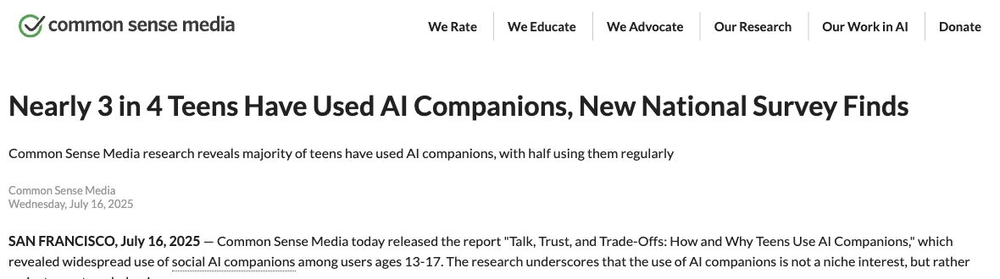
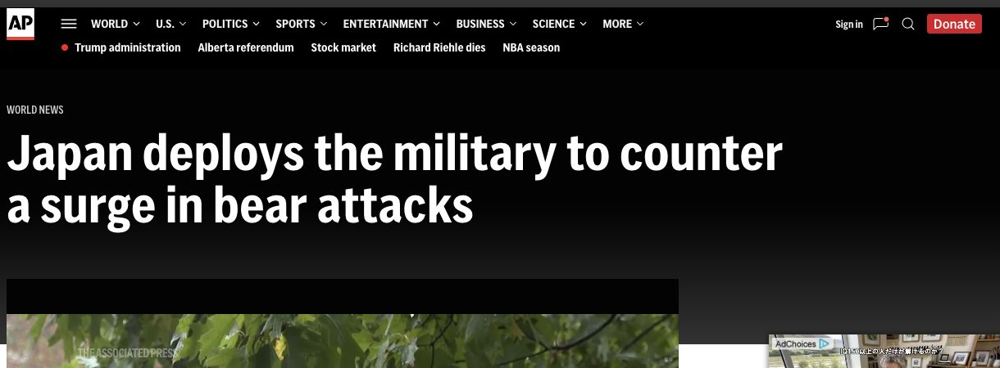
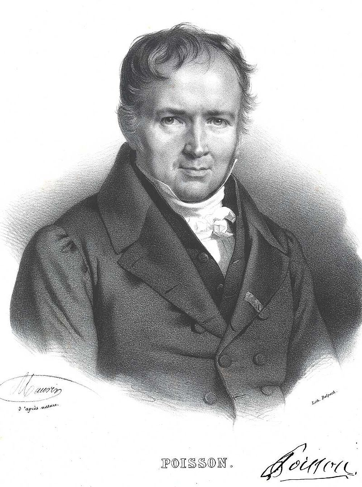

<!-- _class: news-opening -->

## AIの友だち、もう普通？

元調査の発表画面：Common Sense Media（2025.07.16）

Associated Press　2025.07.23

相談相手は、人間？ それともチャットボット？

米国13〜17歳の **72％** が、AIコンパニオンを使った経験あり。

[記事を読む](https://apnews.com/article/9ce59a2b250f3bd0187a717ffa2ad21f)　[元データ](https://www.commonsensemedia.org/press-releases/nearly-3-in-4-teens-have-used-ai-companions-new-national-survey-finds)

「少なくとも1回使った経験」を数えた調査。毎日使う割合や、恋愛関係にある割合ではない。

<!-- Sources: https://apnews.com/article/9ce59a2b250f3bd0187a717ffa2ad21f
Data and thumbnail: https://www.commonsensemedia.org/press-releases/nearly-3-in-4-teens-have-used-ai-companions-new-national-survey-finds
Reported p=0.72. Classroom model n=6, p=0.75, independent trials, constant p. -->

---

<!-- _class: news-given companion-given -->

## 6人の選択授業、AIの友だちを使った人は？

米国の高校の少人数の選択授業。6人の生徒に、AIコンパニオンの利用経験を匿名で尋ねる。計算練習では、利用経験率を75％と仮定する。

$X$＝6人のクラスのうち、AIコンパニオンの利用経験がある人数。

$$
n=6,\qquad\pi=\frac34,\qquad1-\pi=\frac14
$$

(1) ちょうど5人：$\Pr(X=5)$ は？

(2) 5人以上：$\Pr(X\ge5)$ は？

記事の実測値は72％。75％は手計算のための授業用の仮定で、調査結果ではない。各人は独立・確率一定とする。

---

<!-- _class: book-reference companion-formula -->

## チャレンジ①　「5人」と「5人以上」

自分で解く　5分 ／ 教科書 p.118–119

$$
\Pr(X=x)={}_nC_x\pi^x(1-\pi)^{n-x}
$$

**ヒント：「ちょうど」と「以上」で、含める人数はどう違う？**

前のスライドから $n$・$\pi$・$x$ を読み取り、自分で公式に代入しよう。

「以上」に含まれる人数をすべて書き出し、それぞれの確率をどう組み合わせるか考えよう。

---

<!-- _class: challenge-check worked-answer -->

## 答え合わせ①　同じ分母で、2つの確率を足す

① 与えられた条件

$n=6,\ \pi=\frac34$。独立・確率一定の授業モデル。$3^5=243,\ 3^6=729,\ 4^6=4096$。

② 公式（文字のまま）

$$
\begin{aligned}\Pr(X=x)&={}_nC_x\pi^x(1-\pi)^{n-x}\\\Pr(X\ge k)&=\sum_{x=k}^{n}\Pr(X=x)\end{aligned}
$$

③ 数値を代入・計算

$$
\begin{aligned}\Pr(X=5)&={}_6C_5\left(\frac34\right)^5\left(\frac14\right)^{6-5}\\&=6\times\frac{243}{1024}\times\frac14\approx35.60\%\\\Pr(X=6)&={}_6C_6\left(\frac34\right)^6\left(\frac14\right)^{6-6}\\&=1\times\frac{729}{4096}\times1\approx17.80\%\\\Pr(X\ge5)&=\frac{1458+729}{4096}=\frac{2187}{4096}\approx53.39\%\end{aligned}
$$

④ 答え・意味

ちょうど5人：1458/4096 ≈ 35.60％。5人以上：2187/4096 ≈ 53.39％。

分数のままで正解。％表示は参考。記事の72％と、授業モデルの75％を区別する。

---

<!-- _class: companion-chart -->

## 「5人以上」は、この2本の棒を足す

$$
\Pr(X=5)\approx35.60\%,\qquad\Pr(X\ge5)\approx53.39\%
$$

<strong>青：ちょうど5人</strong>　＋　<em>黄：6人全員</em>　＝　5人以上

<svg class="companion-distribution" xmlns="http://www.w3.org/2000/svg" viewBox="0 0 1120 315" role="img" aria-label="6人のクラスの二項分布。ちょうど5人は35.60％。5人と6人の合計は53.39％。"><g font-family="Hiragino Sans,Noto Sans JP,sans-serif" font-size="20" fill="#40555f"><path d="M90 240H1070" stroke="#d9e1e3"/><text x="76" y="247" text-anchor="end">0%</text><path d="M90 192.5H1070" stroke="#d9e1e3"/><text x="76" y="199.5" text-anchor="end">10%</text><path d="M90 145H1070" stroke="#d9e1e3"/><text x="76" y="152" text-anchor="end">20%</text><path d="M90 97.5H1070" stroke="#d9e1e3"/><text x="76" y="104.5" text-anchor="end">30%</text><path d="M90 50H1070" stroke="#d9e1e3"/><text x="76" y="57" text-anchor="end">40%</text><rect data-count="0" data-probability="0.000244140625" x="115" y="239.884033203125" width="80" height="0.115966796875" fill="#bdcbd0"/><text x="155" y="225.884033203125" text-anchor="middle" font-weight="700" fill="#40555f">0.02%</text><text x="155" y="268" text-anchor="middle">0</text><rect data-count="1" data-probability="0.00439453125" x="255" y="237.91259765625" width="80" height="2.08740234375" fill="#bdcbd0"/><text x="295" y="223.91259765625" text-anchor="middle" font-weight="700" fill="#40555f">0.44%</text><text x="295" y="268" text-anchor="middle">1</text><rect data-count="2" data-probability="0.032958984375" x="395" y="224.344482421875" width="80" height="15.655517578125" fill="#bdcbd0"/><text x="435" y="210.344482421875" text-anchor="middle" font-weight="700" fill="#40555f">3.30%</text><text x="435" y="268" text-anchor="middle">2</text><rect data-count="3" data-probability="0.1318359375" x="535" y="177.3779296875" width="80" height="62.6220703125" fill="#bdcbd0"/><text x="575" y="163.3779296875" text-anchor="middle" font-weight="700" fill="#40555f">13.18%</text><text x="575" y="268" text-anchor="middle">3</text><rect data-count="4" data-probability="0.296630859375" x="675" y="99.100341796875" width="80" height="140.899658203125" fill="#bdcbd0"/><text x="715" y="85.100341796875" text-anchor="middle" font-weight="700" fill="#40555f">29.66%</text><text x="715" y="268" text-anchor="middle">4</text><rect data-count="5" data-probability="0.35595703125" x="815" y="70.92041015625" width="80" height="169.07958984375" fill="#176d82"/><text x="855" y="56.92041015625" text-anchor="middle" font-weight="700" fill="#176d82">35.60%</text><text x="855" y="268" text-anchor="middle">5</text><rect data-count="6" data-probability="0.177978515625" x="955" y="155.460205078125" width="80" height="84.539794921875" fill="#be8530"/><text x="995" y="141.460205078125" text-anchor="middle" font-weight="700" fill="#be8530">17.80%</text><text x="995" y="268" text-anchor="middle">6</text><path d="M90 240H1070" stroke="#71848e"/><text x="1068" y="305" text-anchor="end">利用経験者数 X（人）</text></g></svg>

6人の選択授業。利用経験率75％は手計算用の仮定。記事の実測値は72％。0〜6人の全ての確率を足すと100％。

---

<!-- _class: challenge -->

## チャレンジ②　期待値と分散を求めよう

自分で解く　3分 ／ 教科書 p.119–120

$X$＝6人のクラスのうち、AIコンパニオンの利用経験がある人数。

$n=6,\quad\pi=0.75$。独立・一定の確率を仮定する。

**(1)** 同じ条件の組・期間を繰り返すとき、$X$ の期待値と分散を求めよ。

**(2)** 期待値を「起こる確率」と言い換えてよいか？

**(3)** 現実では、独立・一定の確率という仮定が崩れるのはどんな場合か？

期待値は個数の単位、分散はその単位の2乗。前の確率問題と同じXを使う。

---

<!-- _class: challenge-check worked-answer -->

## 答え合わせ②　期待値は、確率ではなく個数

① 与えられた条件

$X$＝6人のクラスのうち、AIコンパニオンの利用経験がある人数。

$n=6,\quad\pi=0.75$。独立・一定の確率を仮定する。

② 公式（文字のまま）

$$
\begin{aligned}E(X)&=n\pi\\\operatorname{Var}(X)&=n\pi(1-\pi)\end{aligned}
$$

③ 数値を代入・計算

$$
\begin{aligned}E(X)&=6\times\frac34=\frac92=4.5\\\operatorname{Var}(X)&=6\times\frac34\times\frac14\\&=\frac98=1.125\end{aligned}
$$

④ 答え・意味

期待値 4.5人。分散 1.125人²。

同じ条件を繰り返した平均であり、毎回この個数になる保証ではない。

期待値を％にしても、事象の確率にはならない。仮定が崩れる例：友人同士で利用行動が似る。集団によって利用率も違う。

---

<!-- _class: answer-visual -->

## 図で確認　平均と、結果のばらつき

期待値 4.5人。分散 1.125人²。

灰：各結果の確率　赤い破線：期待値

<svg class="answer-visual-chart" xmlns="http://www.w3.org/2000/svg" viewBox="0 0 1120 325" role="img" aria-label="図で確認　平均と、結果のばらつき"><g font-family="Hiragino Sans,Noto Sans JP,sans-serif" fill="#40555f"><path d="M95 246H1080" stroke="#d9e1e3"/><text x="80" y="252" text-anchor="end" font-size="18">0%</text><path d="M95 198.5H1080" stroke="#d9e1e3"/><text x="80" y="204.5" text-anchor="end" font-size="18">10%</text><path d="M95 151H1080" stroke="#d9e1e3"/><text x="80" y="157" text-anchor="end" font-size="18">20%</text><path d="M95 103.5H1080" stroke="#d9e1e3"/><text x="80" y="109.5" text-anchor="end" font-size="18">30%</text><path d="M95 56H1080" stroke="#d9e1e3"/><text x="80" y="62" text-anchor="end" font-size="18">40%</text><rect data-count="0" data-probability="0.000244140625" x="117.5142857142857" y="245.884033203125" width="95.6857142857143" height="0.115966796875" fill="#bdcbd0"/><text x="165.35714285714286" y="235.884033203125" text-anchor="middle" fill="#40555f" font-size="19">0.02%</text><text x="165.35714285714286" y="275" text-anchor="middle" font-size="18">0</text><rect data-count="1" data-probability="0.00439453125" x="258.2285714285714" y="243.91259765625" width="95.6857142857143" height="2.08740234375" fill="#bdcbd0"/><text x="306.07142857142856" y="233.91259765625" text-anchor="middle" fill="#40555f" font-size="19">0.4%</text><text x="306.07142857142856" y="275" text-anchor="middle" font-size="18">1</text><rect data-count="2" data-probability="0.032958984375" x="398.9428571428572" y="230.344482421875" width="95.6857142857143" height="15.655517578125" fill="#bdcbd0"/><text x="446.78571428571433" y="220.344482421875" text-anchor="middle" fill="#40555f" font-size="19">3.3%</text><text x="446.78571428571433" y="275" text-anchor="middle" font-size="18">2</text><rect data-count="3" data-probability="0.1318359375" x="539.6571428571428" y="183.3779296875" width="95.6857142857143" height="62.6220703125" fill="#bdcbd0"/><text x="587.5" y="173.3779296875" text-anchor="middle" fill="#40555f" font-size="19">13.2%</text><text x="587.5" y="275" text-anchor="middle" font-size="18">3</text><rect data-count="4" data-probability="0.296630859375" x="680.3714285714286" y="105.100341796875" width="95.6857142857143" height="140.899658203125" fill="#bdcbd0"/><text x="728.2142857142858" y="95.100341796875" text-anchor="middle" fill="#40555f" font-size="19">29.7%</text><text x="728.2142857142858" y="275" text-anchor="middle" font-size="18">4</text><rect data-count="5" data-probability="0.35595703125" x="821.0857142857143" y="76.92041015625" width="95.6857142857143" height="169.07958984375" fill="#bdcbd0"/><text x="868.9285714285714" y="66.92041015625" text-anchor="middle" fill="#40555f" font-size="19">35.6%</text><text x="868.9285714285714" y="275" text-anchor="middle" font-size="18">5</text><rect data-count="6" data-probability="0.177978515625" x="961.8000000000001" y="161.460205078125" width="95.6857142857143" height="84.539794921875" fill="#bdcbd0"/><text x="1009.6428571428572" y="151.460205078125" text-anchor="middle" fill="#40555f" font-size="19">17.8%</text><text x="1009.6428571428572" y="275" text-anchor="middle" font-size="18">6</text><path d="M798.5714285714287 42V250" stroke="#9b5146" stroke-width="3" stroke-dasharray="7 5"/><text x="798.5714285714287" y="26" text-anchor="middle" fill="#9b5146" font-size="21">平均 4.5人</text><path d="M95 246H1080" stroke="#71848e"/><text x="1080" y="314" text-anchor="end" font-size="20">X（人）</text></g></svg>

平均は赤い破線。分散 1.125人² は、この平均からの距離の2乗を確率で重みづけした値。 一番高い棒と、期待値の位置は同じとは限らない。

---

## 今日の流れ

**復習**　何を数える？　どの公式？

**10分チャレンジ3問**　自分で式を組み立てる。各10分。

**AL 01・02・03**　打率、ガチャ、不良品。ワークシートに接続。

途中の3分チェックは必要に応じて。3つのALは、同じ公式を別の場面で使う練習です。

---

<!-- _class: book-divider -->

## 教科書 · 第2章 第2節

4　離散確率分布の復習

p.118–120

**回数が決まるなら二項分布。まれな発生数ならポアソン近似。**

式の前に、何を数える $X$ なのか決めよう。

---

## Xは何を数える？

| 場面 | 確率変数 $X$ | 取りうる値 |
| --- | --- | --- |
| 5打席 | 安打の本数 | 0, 1, 2, 3, 4, 5 |
| 100回のガチャ | レアの個数 | 0, 1, …, 100 |
| 3,500個を検品 | 不良品の個数 | 0, 1, …, 3500 |

**0個も、立派な結果。**

Xは「当たる確率」ではなく、数える個数。実際に観測した値を小文字xと書く。

---

<!-- _class: book-reference -->

## 二項分布の公式

最重要 / VERY IMPORTANT

$$
\Pr(X=x)={}_nC_x\pi^x(1-\pi)^{n-x}
$$

独立な試行をn回。毎回の成功確率πは同じ。成功回数Xを数える。教科書 p.118–119。

---

## 式は「並び方 × 1通りの確率」

$$
\underbrace{{}_nC_x}_{\text{並び方}}\ \underbrace{\pi^x}_{\text{成功 }x\text{ 回}}\ \underbrace{(1-\pi)^{n-x}}_{\text{失敗 }n-x\text{ 回}}
$$

ロボット3体・ヤギ2体の **1つの並び** の確率は、$\pi^3(1-\pi)^2$。

その並び方は ${}_5C_3=10$ 通り。10通りの確率を足す。

成功・失敗の順番が違っても、成功回数が同じなら同じXに数える。

---

<!-- _class: book-reference -->

## Cは「順番を区別しない選び方」

$$
{}_nC_x=\frac{n!}{x!(n-x)!}
$$

$$
{}_7C_2=\frac{7\times6}{2\times1}=21
$$

7つの位置から、ロボットが入る2か所を選ぶ。

0!=1。端の結果も扱えるので、nC0=nCn=1になる。教科書 p.119。

---

## 「ちょうど」と「以上」は違う

$$
\Pr(X=1)\neq\Pr(X\ge1)
$$

**ちょうど1個**：1個だけ。2個は含まない。

**1個以上**：1個、2個、3個、…全部。

$$
\Pr(X\ge1)=1-\Pr(X=0)
$$

少なくとも1個の反対は、1個もない。ガチャで使う一番大切な読み替え。

---

<!-- _class: challenge -->

## チャレンジ③　5回のシュートで、2〜3回成功

自分で解く　3分 ／ 教科書 p.118–120

ロボットがシュートを5回打つ。毎回の成功率は40％、各回は独立。

$X$＝成功回数。**2回以上、3回以下** 成功する確率を求めよ。

まず、含まれる $x$ の値と、確率を足す式を書こう。

---

<!-- _class: challenge-check worked-answer -->

## 答え合わせ③　2回と3回の確率を足す

① 与えられた条件

$n=5,\ \pi=0.4$。$X=2$ または $X=3$。

② 公式（文字のまま）

$$
\begin{aligned}\Pr(X=x)&={}_nC_x\pi^x(1-\pi)^{n-x}\\\Pr(a\le X\le b)&=\sum_{x=a}^{b}\Pr(X=x)\end{aligned}
$$

③ 数値を代入・計算

$$
\begin{aligned}\Pr(X=2)&={}_5C_2(0.4)^2(0.6)^3\\&=10\times0.16\times0.216=34.56\%\\\Pr(X=3)&={}_5C_3(0.4)^3(0.6)^2\\&=10\times0.064\times0.36=23.04\%\\\Pr(2\le X\le3)&=0.3456+0.2304=57.6\%\end{aligned}
$$

④ 答え・意味

2〜3回成功する確率は57.6％。

同じ5回で「ちょうど2回」と「ちょうど3回」は同時に起こらないので、確率を足せる。

---

<!-- _class: answer-visual -->

## 図で確認　2回と3回の確率を足す

2〜3回成功：57.6％。

青：2回 34.56％　＋　黄：3回 23.04％

<svg class="answer-visual-chart" xmlns="http://www.w3.org/2000/svg" viewBox="0 0 1120 325" role="img" aria-label="図で確認　2回と3回の確率を足す"><g font-family="Hiragino Sans,Noto Sans JP,sans-serif" fill="#40555f"><path d="M95 246H1080" stroke="#d9e1e3"/><text x="80" y="252" text-anchor="end" font-size="18">0%</text><path d="M95 198.5H1080" stroke="#d9e1e3"/><text x="80" y="204.5" text-anchor="end" font-size="18">10%</text><path d="M95 151H1080" stroke="#d9e1e3"/><text x="80" y="157" text-anchor="end" font-size="18">20%</text><path d="M95 103.5H1080" stroke="#d9e1e3"/><text x="80" y="109.5" text-anchor="end" font-size="18">30%</text><path d="M95 56H1080" stroke="#d9e1e3"/><text x="80" y="62" text-anchor="end" font-size="18">40%</text><rect data-count="0" data-probability="0.07775999999999998" x="121.26666666666665" y="209.06400000000002" width="111.63333333333334" height="36.935999999999986" fill="#bdcbd0"/><text x="177.08333333333331" y="199.06400000000002" text-anchor="middle" fill="#40555f" font-size="19">7.8%</text><text x="177.08333333333331" y="275" text-anchor="middle" font-size="18">0</text><rect data-count="1" data-probability="0.2592" x="285.43333333333334" y="122.88000000000002" width="111.63333333333334" height="123.11999999999998" fill="#bdcbd0"/><text x="341.25" y="112.88000000000002" text-anchor="middle" fill="#40555f" font-size="19">25.9%</text><text x="341.25" y="275" text-anchor="middle" font-size="18">1</text><rect data-count="2" data-probability="0.3456" x="449.59999999999997" y="81.84" width="111.63333333333334" height="164.16" fill="#176d82"/><text x="505.41666666666663" y="71.84" text-anchor="middle" fill="#176d82" font-size="19">34.6%</text><text x="505.41666666666663" y="275" text-anchor="middle" font-size="18">2</text><rect data-count="3" data-probability="0.23040000000000005" x="613.7666666666665" y="136.56" width="111.63333333333334" height="109.44000000000001" fill="#be8530"/><text x="669.5833333333333" y="126.56" text-anchor="middle" fill="#be8530" font-size="19">23.0%</text><text x="669.5833333333333" y="275" text-anchor="middle" font-size="18">3</text><rect data-count="4" data-probability="0.07680000000000002" x="777.9333333333333" y="209.51999999999998" width="111.63333333333334" height="36.480000000000004" fill="#bdcbd0"/><text x="833.75" y="199.51999999999998" text-anchor="middle" fill="#40555f" font-size="19">7.7%</text><text x="833.75" y="275" text-anchor="middle" font-size="18">4</text><rect data-count="5" data-probability="0.010240000000000003" x="942.0999999999999" y="241.136" width="111.63333333333334" height="4.864000000000001" fill="#bdcbd0"/><text x="997.9166666666666" y="231.136" text-anchor="middle" fill="#40555f" font-size="19">1.0%</text><text x="997.9166666666666" y="275" text-anchor="middle" font-size="18">5</text><path d="M95 246H1080" stroke="#71848e"/><text x="1080" y="314" text-anchor="end" font-size="20">X（回）</text></g></svg>

 

---

<!-- _class: book-reference -->

## 期待値と分散は「個数」の性質

最重要 / VERY IMPORTANT

$$
E(X)=n\pi,\qquad\operatorname{Var}(X)=n\pi(1-\pi)
$$

**期待値**：同じセットを繰り返したときの平均個数。

**分散**：セットごとの個数のばらつき。単位は個²。

期待値0.05個は、当たる確率5％という意味ではない。教科書 p.119–120。

---

<!-- _class: news-opening -->

## 100日間で、クマが現れる日は？

記事画面：AP。被害件数：環境省。演習の日数・出現確率は授業用の仮定。

Associated Press · 2025.11.06

クマ被害への対応に、自衛隊も出動。

環境省の速報値では、2025年10月の秋田県は **31件／31日**。

[記事を読む](https://apnews.com/article/japan-bear-attack-army-12a2a3233790deeefd9ec379d0121f33)　[元データ](https://www.env.go.jp/nature/choju/effort/effort12/r07injury-qe.pdf)

記事と公的集計は、クマ被害の現実を知る入口。次の100日・1日あたり2％は、記事の実測値ではない。

<!-- Sources: https://apnews.com/article/japan-bear-attack-army-12a2a3233790deeefd9ec379d0121f33 | https://www.env.go.jp/nature/choju/effort/effort12/r07injury-qe.pdf -->

---

<!-- _class: news-given -->

## 100日間に、1日以上クマが現れる？

ある集落では、1日にクマが現れる確率を2％と仮定する。100日間観察する。

$X$＝100日間のうち、クマが現れた日数。ポアソン分布で近似する。

$$
n=100\ \text{日},\qquad\pi=2\%=0.02
$$

100日間に、少なくとも1日クマが現れる確率を求めよ。

100日・2％は計算しやすい授業用の仮定。各日は独立・確率一定とする。同じ日に何頭いても1日と数え、クマの頭数は数えない。

---

<!-- _class: book-reference news-formula -->

## チャレンジ④　公式に代入して、表へ

自分で解く　3〜5分 ／ 教科書 p.120

$$
\Pr(X=x)=\frac{e^{-\lambda}\lambda^x}{x!},\qquad\lambda=n\pi
$$

$$
\Pr(X\ge1)=1-\Pr(X=0)
$$

まず、前のスライドの $n$ と $\pi$ から期待値を求めよう。

「1日以上」の反対は「0日」。まずλを求め、表の同じ列と0の行を探そう。　eの値は計算せず、配布のポアソン分布表を使う。

---

<!-- _class: news-answer -->

## 分布表を読んで、答えを出す

$$
\lambda=n\pi=100\times0.02=2
$$

<table class="poisson-lookup"><thead><tr><th>行 x ／ 列 μ</th><th class="lookup-column">2.0</th></tr></thead><tbody><tr><th class="lookup-row">0</th><td class="lookup-cell">0.135</td></tr></tbody></table>

配布表の抜粋。表の $\mu$ は、公式の $\lambda$ と同じ「期待値」。

[ポアソン分布表を開く](https://yohman.github.io/26-2-StatsB/viewer.html?p=&file=other+material%2F2025+yoh%2F06_%5BAL%5D%E7%A2%BA%E7%8E%87%E5%88%86%E5%B8%83_1_%E9%9B%A2%E6%95%A3%E7%A2%BA%E7%8E%87%E5%88%86%E5%B8%83+%E3%83%9D%E3%82%A2%E3%82%BD%E3%83%B3%2F%E3%83%9D%E3%82%A2%E3%82%BD%E3%83%B3%E5%88%86%E5%B8%83%E8%A1%A8.pdf&title=%E3%83%9D%E3%82%A2%E3%82%BD%E3%83%B3%E5%88%86%E5%B8%83%E8%A1%A8&week=W04&return=agenda.html%3Fp%23week-04)

$$
\Pr(X\ge1)\approx1-0.135=\boxed{0.865=86.5\%}
$$

このモデルで、100日間に少なくとも1日クマが現れる確率は約86.5％。

数えるのは出現した日数で、クマの頭数・襲われる確率ではない。季節や同じクマの再出現で、独立・確率一定の仮定は崩れうる。ポアソン近似と表の丸めを使う。

表は小数第3位に丸められているため、答えは近似値。

---

<!-- _class: answer-visual -->

## 図で確認　答えに含める棒

求めた確率：約86.5％（配布表の値で計算）

青：求めた結果　灰：それ以外

<svg class="answer-visual-chart" xmlns="http://www.w3.org/2000/svg" viewBox="0 0 1120 325" role="img" aria-label="図で確認　答えに含める棒"><g font-family="Hiragino Sans,Noto Sans JP,sans-serif" fill="#40555f"><path d="M95 246H1080" stroke="#d9e1e3"/><text x="80" y="252" text-anchor="end" font-size="18">0%</text><path d="M95 198.5H1080" stroke="#d9e1e3"/><text x="80" y="204.5" text-anchor="end" font-size="18">7.5%</text><path d="M95 151H1080" stroke="#d9e1e3"/><text x="80" y="157" text-anchor="end" font-size="18">15%</text><path d="M95 103.5H1080" stroke="#d9e1e3"/><text x="80" y="109.5" text-anchor="end" font-size="18">22.5%</text><path d="M95 56H1080" stroke="#d9e1e3"/><text x="80" y="62" text-anchor="end" font-size="18">30%</text><rect data-count="0" data-probability="0.1353352832366127" x="109.32727272727273" y="160.28765395014528" width="60.8909090909091" height="85.71234604985472" fill="#bdcbd0"/><text x="139.77272727272728" y="275" text-anchor="middle" font-size="18">0</text><rect data-count="1" data-probability="0.2706705664732254" x="198.87272727272727" y="74.57530790029057" width="60.8909090909091" height="171.42469209970943" fill="#176d82"/><text x="229.3181818181818" y="64.57530790029057" text-anchor="middle" fill="#176d82" font-size="19">27.1%</text><text x="229.3181818181818" y="275" text-anchor="middle" font-size="18">1</text><rect data-count="2" data-probability="0.2706705664732254" x="288.41818181818184" y="74.57530790029057" width="60.8909090909091" height="171.42469209970943" fill="#176d82"/><text x="318.8636363636364" y="64.57530790029057" text-anchor="middle" fill="#176d82" font-size="19">27.1%</text><text x="318.8636363636364" y="275" text-anchor="middle" font-size="18">2</text><rect data-count="3" data-probability="0.18044704431548358" x="377.9636363636364" y="131.71687193352705" width="60.8909090909091" height="114.28312806647295" fill="#176d82"/><text x="408.40909090909093" y="121.71687193352705" text-anchor="middle" fill="#176d82" font-size="19">18.0%</text><text x="408.40909090909093" y="275" text-anchor="middle" font-size="18">3</text><rect data-count="4" data-probability="0.09022352215774179" x="467.5090909090909" y="188.85843596676352" width="60.8909090909091" height="57.14156403323648" fill="#176d82"/><text x="497.95454545454544" y="178.85843596676352" text-anchor="middle" fill="#176d82" font-size="19">9.0%</text><text x="497.95454545454544" y="275" text-anchor="middle" font-size="18">4</text><rect data-count="5" data-probability="0.036089408863096716" x="557.0545454545454" y="223.1433743867054" width="60.8909090909091" height="22.856625613294586" fill="#176d82"/><text x="587.5" y="213.1433743867054" text-anchor="middle" fill="#176d82" font-size="19">3.6%</text><text x="587.5" y="275" text-anchor="middle" font-size="18">5</text><rect data-count="6" data-probability="0.012029802954365572" x="646.5999999999999" y="238.38112479556847" width="60.8909090909091" height="7.6188752044315295" fill="#176d82"/><text x="677.0454545454545" y="228.38112479556847" text-anchor="middle" fill="#176d82" font-size="19">1.2%</text><text x="677.0454545454545" y="275" text-anchor="middle" font-size="18">6</text><rect data-count="7" data-probability="0.0034370865583901633" x="736.1454545454545" y="243.82317851301957" width="60.8909090909091" height="2.1768214869804368" fill="#176d82"/><text x="766.5909090909091" y="233.82317851301957" text-anchor="middle" fill="#176d82" font-size="19">0.3%</text><text x="766.5909090909091" y="275" text-anchor="middle" font-size="18">7</text><rect data-count="8" data-probability="0.0008592716395975408" x="825.690909090909" y="245.4557946282549" width="60.8909090909091" height="0.5442053717451092" fill="#176d82"/><text x="856.1363636363636" y="235.4557946282549" text-anchor="middle" fill="#176d82" font-size="19">0.09%</text><text x="856.1363636363636" y="275" text-anchor="middle" font-size="18">8</text><rect data-count="9" data-probability="0.00019094925324389796" x="915.2363636363636" y="245.87906547294554" width="60.8909090909091" height="0.12093452705446871" fill="#176d82"/><text x="945.6818181818182" y="235.87906547294554" text-anchor="middle" fill="#176d82" font-size="19">0.02%</text><text x="945.6818181818182" y="275" text-anchor="middle" font-size="18">9</text><rect data-count="10+" data-probability="0.000046498075017109564" x="1004.7818181818182" y="245.97055121915582" width="60.8909090909091" height="0.029448780844169395" fill="#176d82"/><text x="1035.2272727272727" y="235.97055121915582" text-anchor="middle" fill="#176d82" font-size="19">&lt;0.01%</text><text x="1035.2272727272727" y="275" text-anchor="middle" font-size="18">10+</text><path d="M95 246H1080" stroke="#71848e"/><text x="1080" y="314" text-anchor="end" font-size="20">X（日）　末尾はまとめた確率</text></g></svg>

 棒はポアソンモデルの丸め前の確率。解答は配布表の小数第3位を使うため、丸めの差がある。

---

<!-- _class: challenge -->

## チャレンジ⑤　期待値と分散を求めよう

自分で解く　3分 ／ 教科書 p.119–120

$X$＝100日間のうちクマが現れた日数。$n=100$日、$\pi=0.02$。

独立・一定頻度のポアソンモデルを仮定する。

**(1)** 同じ条件の組・期間を繰り返すとき、$X$ の期待値と分散を求めよ。

**(2)** 期待値を「起こる確率」と言い換えてよいか？

**(3)** 現実では、独立・一定の頻度という仮定が崩れるのはどんな場合か？

期待値は個数の単位、分散はその単位の2乗。前の確率問題と同じXを使う。

---

<!-- _class: challenge-check worked-answer -->

## 答え合わせ⑤　期待値は、確率ではなく個数

① 与えられた条件

$X$＝100日間のうちクマが現れた日数。$n=100$日、$\pi=0.02$。

独立・一定頻度のポアソンモデルを仮定する。

② 公式（文字のまま）

$$
\begin{aligned}\lambda&=n\pi\\E(X)&=\lambda\\\operatorname{Var}(X)&=\lambda\end{aligned}
$$

③ 数値を代入・計算

$$
\begin{aligned}\lambda&=100\times0.02=2\\E(X)&=2\\\operatorname{Var}(X)&=2\end{aligned}
$$

④ 答え・意味

期待値 2日。分散 2日²。

同じ条件を繰り返した平均であり、毎回この個数になる保証ではない。

期待値を％にしても、事象の確率にはならない。仮定が崩れる例：数えるのは出現した日数で、クマの頭数・襲われる確率ではない。季節や同じクマの再出現で、独立・確率一定の仮定は崩れうる。ポアソン近似と表の丸めを使う。

---

<!-- _class: answer-visual -->

## 図で確認　平均と、結果のばらつき

期待値 2日。分散 2日²。

灰：各結果の確率　赤い破線：期待値

<svg class="answer-visual-chart" xmlns="http://www.w3.org/2000/svg" viewBox="0 0 1120 325" role="img" aria-label="図で確認　平均と、結果のばらつき"><g font-family="Hiragino Sans,Noto Sans JP,sans-serif" fill="#40555f"><path d="M95 246H1080" stroke="#d9e1e3"/><text x="80" y="252" text-anchor="end" font-size="18">0%</text><path d="M95 198.5H1080" stroke="#d9e1e3"/><text x="80" y="204.5" text-anchor="end" font-size="18">7.5%</text><path d="M95 151H1080" stroke="#d9e1e3"/><text x="80" y="157" text-anchor="end" font-size="18">15%</text><path d="M95 103.5H1080" stroke="#d9e1e3"/><text x="80" y="109.5" text-anchor="end" font-size="18">22.5%</text><path d="M95 56H1080" stroke="#d9e1e3"/><text x="80" y="62" text-anchor="end" font-size="18">30%</text><rect data-count="0" data-probability="0.1353352832366127" x="109.32727272727273" y="160.28765395014528" width="60.8909090909091" height="85.71234604985472" fill="#bdcbd0"/><text x="139.77272727272728" y="275" text-anchor="middle" font-size="18">0</text><rect data-count="1" data-probability="0.2706705664732254" x="198.87272727272727" y="74.57530790029057" width="60.8909090909091" height="171.42469209970943" fill="#bdcbd0"/><text x="229.3181818181818" y="275" text-anchor="middle" font-size="18">1</text><rect data-count="2" data-probability="0.2706705664732254" x="288.41818181818184" y="74.57530790029057" width="60.8909090909091" height="171.42469209970943" fill="#bdcbd0"/><text x="318.8636363636364" y="275" text-anchor="middle" font-size="18">2</text><rect data-count="3" data-probability="0.18044704431548358" x="377.9636363636364" y="131.71687193352705" width="60.8909090909091" height="114.28312806647295" fill="#bdcbd0"/><text x="408.40909090909093" y="275" text-anchor="middle" font-size="18">3</text><rect data-count="4" data-probability="0.09022352215774179" x="467.5090909090909" y="188.85843596676352" width="60.8909090909091" height="57.14156403323648" fill="#bdcbd0"/><text x="497.95454545454544" y="275" text-anchor="middle" font-size="18">4</text><rect data-count="5" data-probability="0.036089408863096716" x="557.0545454545454" y="223.1433743867054" width="60.8909090909091" height="22.856625613294586" fill="#bdcbd0"/><text x="587.5" y="275" text-anchor="middle" font-size="18">5</text><rect data-count="6" data-probability="0.012029802954365572" x="646.5999999999999" y="238.38112479556847" width="60.8909090909091" height="7.6188752044315295" fill="#bdcbd0"/><text x="677.0454545454545" y="275" text-anchor="middle" font-size="18">6</text><rect data-count="7" data-probability="0.0034370865583901633" x="736.1454545454545" y="243.82317851301957" width="60.8909090909091" height="2.1768214869804368" fill="#bdcbd0"/><text x="766.5909090909091" y="275" text-anchor="middle" font-size="18">7</text><rect data-count="8" data-probability="0.0008592716395975408" x="825.690909090909" y="245.4557946282549" width="60.8909090909091" height="0.5442053717451092" fill="#bdcbd0"/><text x="856.1363636363636" y="275" text-anchor="middle" font-size="18">8</text><rect data-count="9" data-probability="0.00019094925324389796" x="915.2363636363636" y="245.87906547294554" width="60.8909090909091" height="0.12093452705446871" fill="#bdcbd0"/><text x="945.6818181818182" y="275" text-anchor="middle" font-size="18">9</text><rect data-count="10+" data-probability="0.000046498075017109564" x="1004.7818181818182" y="245.97055121915582" width="60.8909090909091" height="0.029448780844169395" fill="#bdcbd0"/><text x="1035.2272727272727" y="275" text-anchor="middle" font-size="18">10+</text><path d="M318.8636363636364 42V250" stroke="#9b5146" stroke-width="3" stroke-dasharray="7 5"/><text x="318.8636363636364" y="26" text-anchor="middle" fill="#9b5146" font-size="21">平均 2日</text><path d="M95 246H1080" stroke="#71848e"/><text x="1080" y="314" text-anchor="end" font-size="20">X（日）　末尾はまとめた確率</text></g></svg>

平均は赤い破線。分散 2日² は、この平均からの距離の2乗を確率で重みづけした値。 一番高い棒と、期待値の位置は同じとは限らない。

---

<!-- _class: poisson-person -->

## ポアソンは、どんな人？

### シメオン＝ドニ・ポアソン

Siméon Denis Poisson 1781–1840 ／ フランス

**数学者・物理学者。**

1837年、裁判の判断を確率で研究した著書で、いま「ポアソン分布」と呼ぶ分布を示した。

この授業では、**まれな出来事が何回起こるか** を考えるために使う。

肖像：F.-S. Delpech（歴史的版画）／ 略歴：<a href="https://mathshistory.st-andrews.ac.uk/Biographies/Poisson/">University of St Andrews · MacTutor</a>

<!-- Biography source: https://mathshistory.st-andrews.ac.uk/Biographies/Poisson/
Portrait reused unchanged from the supplied archived course asset. -->

---

<!-- _class: book-divider -->

## 教科書 · 第2章 第2節

ポアソン近似

p.120

試行回数 $n$ が大きく、成功確率 $\pi$ が小さいとき。

$\lambda=n\pi$ を使い、まれな発生数を近似する。

---

<!-- _class: book-reference -->

## ポアソン分布の公式

$$
\Pr(X=x)=\frac{\lambda^xe^{-\lambda}}{x!},\qquad E(X)=\operatorname{Var}(X)=\lambda
$$

**確率は配布表で読む。** $e$ の数値を計算する必要はない。

[ポアソン分布表を開く](https://yohman.github.io/26-2-StatsB/viewer.html?p=&file=other+material%2F2025+yoh%2F06_%5BAL%5D%E7%A2%BA%E7%8E%87%E5%88%86%E5%B8%83_1_%E9%9B%A2%E6%95%A3%E7%A2%BA%E7%8E%87%E5%88%86%E5%B8%83+%E3%83%9D%E3%82%A2%E3%82%BD%E3%83%B3%2F%E3%83%9D%E3%82%A2%E3%82%BD%E3%83%B3%E5%88%86%E5%B8%83%E8%A1%A8.pdf&title=%E3%83%9D%E3%82%A2%E3%82%BD%E3%83%B3%E5%88%86%E5%B8%83%E8%A1%A8&week=W04&return=agenda.html%3Fp%23week-04)

ポアソンモデルの式は等式。二項分布をポアソンで置き換えるときは近似。教科書 p.120。

---

<!-- _class: book-reference -->

## λは「n回で起こる個数の平均」

$$
\boxed{\lambda=n\pi}
$$

$n$＝試行回数。$\pi$＝1回あたりの発生確率。

$$
n=2500,\quad\pi=0.002\quad\Longrightarrow\quad\lambda=2500\times0.002=5
$$

**2,500個のうち、平均5個の不良品。**

$$
E(X)=n\pi=5,\qquad\operatorname{Var}(X)\approx n\pi=5
$$

教科書p.120は、ポアソン分布の平均と分散をnπで示す。分布表の平均λ（表ではμ）にも、同じnπを入れる。独立・不良率一定を仮定する。

---

## モデルを選ぶ、最短の質問

| 質問 | 二項分布 | ポアソン近似 |
| --- | --- | --- |
| 与えられたもの | $n$回・成功率$\pi$ | 大きい$n$・小さい$\pi$ |
| 期待値 $E(X)$ | $n\pi$ | $\lambda=n\pi$ |
| 分散 | $n\pi(1-\pi)$ | $\lambda=n\pi$ |

独立・確率一定を確認する。教科書p.120のポアソン近似では、nが大きくπが小さいとき、平均・分散にnπを使う。

---

<!-- _class: challenge -->

## チャレンジ⑥　7台の配送ロボット

自分で解く　10分　／　教科書 p.118–120

各ロボットが時間内に到着する確率は **80％**。7台は独立に配達する。

**(1)** ちょうど5台が間に合う確率は？

**(2)** 1台以上が遅れる確率は？

**(3)** 間に合う台数の期待値と分散は？

教科書・電卓可。公式を文字で書き、数値を代入し、答えの意味まで説明しよう。

---

<!-- _class: challenge-check worked-answer -->

## 答え合わせ⑥　遅れるのは、全台成功の反対

① 与えられた条件

$X$ は時間内に到着した台数。$n=7,\ \pi=0.8$。

② 公式（文字のまま）

$$
\begin{aligned}\Pr(X=x)&={}_nC_x\pi^x(1-\pi)^{n-x}\\\Pr(X<n)&=1-\Pr(X=n)\\E(X)&=n\pi\\\operatorname{Var}(X)&=n\pi(1-\pi)\end{aligned}
$$

③ 数値を代入・計算

$$
\begin{aligned}\Pr(X=5)&={}_7C_5(0.8)^5(0.2)^2\\&=0.2752512\approx27.53\%\\\Pr(X=7)&={}_7C_7(0.8)^7(0.2)^0\\&=1\times0.2097152\times1\approx20.97\%\\\Pr(X\le6)&=1-\Pr(X=7)\\&=1-0.2097152\approx79.03\%\\E(X)&=7\times0.8=5.6\\\operatorname{Var}(X)&=7\times0.8\times0.2=1.12\end{aligned}
$$

④ 答え・意味

ちょうど5台：約27.53％。1台以上遅れる：約79.03％。

全7台が間に合う確率は約20.97％。その反対が「1台以上遅れる」。期待値5.6台、分散1.12台²。

---

<!-- _class: answer-visual -->

## 図で確認　遅れるのは、全台成功の反対

ちょうど5台：27.53％。1台以上遅れる：79.03％。

青：ちょうど5台　青＋黄：6台以下＝少なくとも1台遅れる

<svg class="answer-visual-chart" xmlns="http://www.w3.org/2000/svg" viewBox="0 0 1120 325" role="img" aria-label="図で確認　遅れるのは、全台成功の反対"><g font-family="Hiragino Sans,Noto Sans JP,sans-serif" fill="#40555f"><path d="M95 246H1080" stroke="#d9e1e3"/><text x="80" y="252" text-anchor="end" font-size="18">0%</text><path d="M95 198.5H1080" stroke="#d9e1e3"/><text x="80" y="204.5" text-anchor="end" font-size="18">10%</text><path d="M95 151H1080" stroke="#d9e1e3"/><text x="80" y="157" text-anchor="end" font-size="18">20%</text><path d="M95 103.5H1080" stroke="#d9e1e3"/><text x="80" y="109.5" text-anchor="end" font-size="18">30%</text><path d="M95 56H1080" stroke="#d9e1e3"/><text x="80" y="62" text-anchor="end" font-size="18">40%</text><rect data-count="0" data-probability="0.00001279999999999998" x="114.69999999999999" y="245.99392" width="83.72500000000001" height="0.006079999999999991" fill="#be8530"/><text x="156.5625" y="235.99392" text-anchor="middle" fill="#be8530" font-size="19">&lt;0.01%</text><text x="156.5625" y="275" text-anchor="middle" font-size="18">0</text><rect data-count="1" data-probability="0.00035839999999999955" x="237.825" y="245.82976" width="83.72500000000001" height="0.17023999999999978" fill="#be8530"/><text x="279.6875" y="235.82976" text-anchor="middle" fill="#be8530" font-size="19">0.04%</text><text x="279.6875" y="275" text-anchor="middle" font-size="18">1</text><rect data-count="2" data-probability="0.004300799999999996" x="360.95" y="243.95712" width="83.72500000000001" height="2.042879999999998" fill="#be8530"/><text x="402.8125" y="233.95712" text-anchor="middle" fill="#be8530" font-size="19">0.4%</text><text x="402.8125" y="275" text-anchor="middle" font-size="18">2</text><rect data-count="3" data-probability="0.028671999999999982" x="484.075" y="232.38080000000002" width="83.72500000000001" height="13.61919999999999" fill="#be8530"/><text x="525.9375" y="222.38080000000002" text-anchor="middle" fill="#be8530" font-size="19">2.9%</text><text x="525.9375" y="275" text-anchor="middle" font-size="18">3</text><rect data-count="4" data-probability="0.11468799999999994" x="607.2" y="191.52320000000003" width="83.72500000000001" height="54.476799999999976" fill="#be8530"/><text x="649.0625" y="181.52320000000003" text-anchor="middle" fill="#be8530" font-size="19">11.5%</text><text x="649.0625" y="275" text-anchor="middle" font-size="18">4</text><rect data-count="5" data-probability="0.2752511999999999" x="730.325" y="115.25568000000004" width="83.72500000000001" height="130.74431999999996" fill="#176d82"/><text x="772.1875" y="105.25568000000004" text-anchor="middle" fill="#176d82" font-size="19">27.5%</text><text x="772.1875" y="275" text-anchor="middle" font-size="18">5</text><rect data-count="6" data-probability="0.36700160000000004" x="853.45" y="71.67423999999997" width="83.72500000000001" height="174.32576000000003" fill="#be8530"/><text x="895.3125" y="61.67423999999997" text-anchor="middle" fill="#be8530" font-size="19">36.7%</text><text x="895.3125" y="275" text-anchor="middle" font-size="18">6</text><rect data-count="7" data-probability="0.20971520000000007" x="976.575" y="146.38527999999997" width="83.72500000000001" height="99.61472000000003" fill="#bdcbd0"/><text x="1018.4375" y="136.38527999999997" text-anchor="middle" fill="#40555f" font-size="19">21.0%</text><text x="1018.4375" y="275" text-anchor="middle" font-size="18">7</text><path d="M846.0625000000001 42V250" stroke="#9b5146" stroke-width="3" stroke-dasharray="7 5"/><text x="846.0625000000001" y="26" text-anchor="middle" fill="#9b5146" font-size="21">平均 5.6台</text><path d="M95 246H1080" stroke="#71848e"/><text x="1080" y="314" text-anchor="end" font-size="20">X（台）</text></g></svg>

平均は赤い破線。分散 1.12台² は、この平均からの距離の2乗を確率で重みづけした値。 

---

<!-- _class: challenge -->

## チャレンジ⑦　80回のカプセル抽選

自分で解く　10分　／　教科書 p.119–120

1回の当たり確率は **1％**。80回、独立に抽選する。確率は変わらない。

**(1)** 1回以上当たる確率は？

**(2)** 当たり個数の期待値と分散は？

**(3)** 「80回×1％＝80％だから、当たる確率80％」は正しい？

教科書・電卓可。公式を文字で書き、数値を代入し、答えの意味まで説明しよう。

---

<!-- _class: challenge-check worked-answer -->

## 答え合わせ⑦　期待個数と当選確率を分ける

① 与えられた条件

$X$ は当たり個数。$n=80,\ \pi=0.01$。

② 公式（文字のまま）

$$
\begin{aligned}\Pr(X=x)&={}_nC_x\pi^x(1-\pi)^{n-x}\\\Pr(X\ge1)&=1-\Pr(X=0)\\E(X)&=n\pi\\\operatorname{Var}(X)&=n\pi(1-\pi)\end{aligned}
$$

③ 数値を代入・計算

$$
\begin{aligned}\Pr(X=0)&={}_{80}C_0(0.01)^0(0.99)^{80}\\&=1\times1\times(0.99)^{80}\approx44.75\%\\\Pr(X\ge1)&=1-\Pr(X=0)\\&=1-(0.99)^{80}\approx55.25\%\\E(X)&=80\times0.01=0.8\\\operatorname{Var}(X)&=80\times0.01\times0.99=0.792\end{aligned}
$$

④ 答え・意味

1回以上当たる：約55.25％。期待値0.8個、分散0.792個²。

X＝0は「80回すべて外れ」。X＝80は「80回すべて当たり」で、別の出来事。nπは平均個数であり、当選確率ではない。

---

<!-- _class: answer-visual -->

## 図で確認　期待個数と当選確率を分ける

1個以上：55.25％。平均0.8個、分散0.792個²。

青：求めた結果　灰：それ以外

<svg class="answer-visual-chart" xmlns="http://www.w3.org/2000/svg" viewBox="0 0 1120 325" role="img" aria-label="図で確認　期待個数と当選確率を分ける"><g font-family="Hiragino Sans,Noto Sans JP,sans-serif" fill="#40555f"><path d="M95 246H1080" stroke="#d9e1e3"/><text x="80" y="252" text-anchor="end" font-size="18">0%</text><path d="M95 198.5H1080" stroke="#d9e1e3"/><text x="80" y="204.5" text-anchor="end" font-size="18">12.5%</text><path d="M95 151H1080" stroke="#d9e1e3"/><text x="80" y="157" text-anchor="end" font-size="18">25%</text><path d="M95 103.5H1080" stroke="#d9e1e3"/><text x="80" y="109.5" text-anchor="end" font-size="18">37.5%</text><path d="M95 56H1080" stroke="#d9e1e3"/><text x="80" y="62" text-anchor="end" font-size="18">50%</text><rect data-count="0" data-probability="0.4475232137638106" x="117.5142857142857" y="75.94117876975199" width="95.6857142857143" height="170.05882123024801" fill="#bdcbd0"/><text x="165.35714285714286" y="65.94117876975199" text-anchor="middle" fill="#40555f" font-size="19">44.8%</text><text x="165.35714285714286" y="275" text-anchor="middle" font-size="18">0</text><rect data-count="1" data-probability="0.36163492021318033" x="258.2285714285714" y="108.57873031899146" width="95.6857142857143" height="137.42126968100854" fill="#176d82"/><text x="306.07142857142856" y="98.57873031899146" text-anchor="middle" fill="#176d82" font-size="19">36.2%</text><text x="306.07142857142856" y="275" text-anchor="middle" font-size="18">1</text><rect data-count="2" data-probability="0.14428868028707698" x="398.9428571428572" y="191.17030149091076" width="95.6857142857143" height="54.82969850908925" fill="#176d82"/><text x="446.78571428571433" y="181.17030149091076" text-anchor="middle" fill="#176d82" font-size="19">14.4%</text><text x="446.78571428571433" y="275" text-anchor="middle" font-size="18">2</text><rect data-count="3" data-probability="0.03789399684307073" x="539.6571428571428" y="231.60028119963312" width="95.6857142857143" height="14.399718800366877" fill="#176d82"/><text x="587.5" y="221.60028119963312" text-anchor="middle" fill="#176d82" font-size="19">3.8%</text><text x="587.5" y="275" text-anchor="middle" font-size="18">3</text><rect data-count="4" data-probability="0.007368277163930419" x="680.3714285714286" y="243.20005467770645" width="95.6857142857143" height="2.799945322293559" fill="#176d82"/><text x="728.2142857142858" y="233.20005467770645" text-anchor="middle" fill="#176d82" font-size="19">0.7%</text><text x="728.2142857142858" y="275" text-anchor="middle" font-size="18">4</text><rect data-count="5" data-probability="0.001131291039310529" x="821.0857142857143" y="245.570109405062" width="95.6857142857143" height="0.429890594938001" fill="#176d82"/><text x="868.9285714285714" y="235.570109405062" text-anchor="middle" fill="#176d82" font-size="19">0.1%</text><text x="868.9285714285714" y="275" text-anchor="middle" font-size="18">5</text><rect data-count="6+" data-probability="0.0001596206896204988" x="961.8000000000001" y="245.9393441379442" width="95.6857142857143" height="0.060655862055789544" fill="#176d82"/><text x="1009.6428571428572" y="235.9393441379442" text-anchor="middle" fill="#176d82" font-size="19">0.02%</text><text x="1009.6428571428572" y="275" text-anchor="middle" font-size="18">6+</text><path d="M277.92857142857144 42V250" stroke="#9b5146" stroke-width="3" stroke-dasharray="7 5"/><text x="277.92857142857144" y="26" text-anchor="middle" fill="#9b5146" font-size="21">平均 0.8個</text><path d="M95 246H1080" stroke="#71848e"/><text x="1080" y="314" text-anchor="end" font-size="20">X（個）　末尾はまとめた確率</text></g></svg>

平均は赤い破線。分散 0.792個² は、この平均からの距離の2乗を確率で重みづけした値。 

---

<!-- _class: challenge -->

## チャレンジ⑧　2,500個のセンサーを出荷

自分で解く　10分　／　教科書 p.120

不良率は **1,000個あたり2個**。2,500個を出荷する。
不良品数 $X$ はポアソン分布で近似できるとする。

**(1)** $\lambda$ と、期待値・分散は？

**(2)** 不良品が1個以下である確率を、配布表で求めよ。

**(3)** 1個以下の反対は、何個以上？

教科書・電卓可。公式を文字で書き、数値を代入し、答えの意味まで説明しよう。

---

<!-- _class: challenge-check worked-answer -->

## 答え合わせ⑧　1個以下は、0個と1個

① 与えられた条件

$n=2500,\ \pi=2/1000=0.002$。ポアソン近似を使う。

② 公式（文字のまま）

$$
\begin{aligned}\lambda&=n\pi\\E(X)&=\operatorname{Var}(X)=\lambda\\\Pr(X\le1)&=\Pr(X=0)+\Pr(X=1)\end{aligned}
$$

③ 数値を代入・計算

$$
\begin{aligned}\lambda&=2500\times0.002=5\\E(X)&\approx5,\quad\operatorname{Var}(X)\approx5\\\text{表の }\mu=5.0:\quad\Pr(X=0)&\approx0.007=0.7\%\\\Pr(X=1)&\approx0.034=3.4\%\\\Pr(X\le1)&\approx0.007+0.034=4.1\%\end{aligned}
$$

④ 答え・意味

不良品1個以下：約4.1％。その反対は2個以上。

期待値5個、近似分散5個²。表の丸め値を使用。不良品は独立・不良率一定と仮定。

---

<!-- _class: answer-visual -->

## 図で確認　1個以下は、0個と1個

0個と1個を足して約4.1％。平均5個、近似分散5個²。

青：求めた結果　灰：それ以外

<svg class="answer-visual-chart" xmlns="http://www.w3.org/2000/svg" viewBox="0 0 1120 325" role="img" aria-label="図で確認　1個以下は、0個と1個"><g font-family="Hiragino Sans,Noto Sans JP,sans-serif" fill="#40555f"><path d="M95 246H1080" stroke="#d9e1e3"/><text x="80" y="252" text-anchor="end" font-size="18">0%</text><path d="M95 198.5H1080" stroke="#d9e1e3"/><text x="80" y="204.5" text-anchor="end" font-size="18">5%</text><path d="M95 151H1080" stroke="#d9e1e3"/><text x="80" y="157" text-anchor="end" font-size="18">10%</text><path d="M95 103.5H1080" stroke="#d9e1e3"/><text x="80" y="109.5" text-anchor="end" font-size="18">15%</text><path d="M95 56H1080" stroke="#d9e1e3"/><text x="80" y="62" text-anchor="end" font-size="18">20%</text><rect data-count="0" data-probability="0.006737946999085467" x="104.27058823529411" y="239.59895035086882" width="39.4" height="6.401049649131193" fill="#176d82"/><text x="123.97058823529412" y="229.59895035086882" text-anchor="middle" fill="#176d82" font-size="19">0.7%</text><text x="123.97058823529412" y="275" text-anchor="middle" font-size="18">0</text><rect data-count="1" data-probability="0.03368973499542734" x="162.21176470588236" y="213.99475175434404" width="39.4" height="32.00524824565597" fill="#176d82"/><text x="181.91176470588235" y="203.99475175434404" text-anchor="middle" fill="#176d82" font-size="19">3.4%</text><text x="181.91176470588235" y="275" text-anchor="middle" font-size="18">1</text><rect data-count="2" data-probability="0.08422433748856833" x="220.1529411764706" y="165.98687938586008" width="39.4" height="80.01312061413992" fill="#bdcbd0"/><text x="239.85294117647058" y="275" text-anchor="middle" font-size="18">2</text><rect data-count="3" data-probability="0.14037389581428056" x="278.0941176470588" y="112.64479897643349" width="39.4" height="133.3552010235665" fill="#bdcbd0"/><text x="297.7941176470588" y="275" text-anchor="middle" font-size="18">3</text><rect data-count="4" data-probability="0.1754673697678507" x="336.0352941176471" y="79.30599872054182" width="39.4" height="166.69400127945818" fill="#bdcbd0"/><text x="355.7352941176471" y="275" text-anchor="middle" font-size="18">4</text><rect data-count="5" data-probability="0.1754673697678507" x="393.97647058823526" y="79.30599872054182" width="39.4" height="166.69400127945818" fill="#bdcbd0"/><text x="413.67647058823525" y="275" text-anchor="middle" font-size="18">5</text><rect data-count="6" data-probability="0.1462228081398756" x="451.91764705882355" y="107.0883322671182" width="39.4" height="138.9116677328818" fill="#bdcbd0"/><text x="471.61764705882354" y="275" text-anchor="middle" font-size="18">6</text><rect data-count="7" data-probability="0.10444486295705399" x="509.8588235294117" y="146.77738019079874" width="39.4" height="99.22261980920128" fill="#bdcbd0"/><text x="529.5588235294117" y="275" text-anchor="middle" font-size="18">7</text><rect data-count="8" data-probability="0.06527803934815875" x="567.8" y="183.9858626192492" width="39.4" height="62.01413738075081" fill="#bdcbd0"/><text x="587.5" y="275" text-anchor="middle" font-size="18">8</text><rect data-count="9" data-probability="0.03626557741564375" x="625.7411764705881" y="211.54770145513845" width="39.4" height="34.452298544861556" fill="#bdcbd0"/><text x="645.4411764705882" y="275" text-anchor="middle" font-size="18">9</text><rect data-count="10" data-probability="0.018132788707821874" x="683.6823529411764" y="228.77385072756923" width="39.4" height="17.226149272430778" fill="#bdcbd0"/><text x="703.3823529411765" y="275" text-anchor="middle" font-size="18">10</text><rect data-count="11" data-probability="0.00824217668537358" x="741.6235294117646" y="238.1699321488951" width="39.4" height="7.830067851104899" fill="#bdcbd0"/><text x="761.3235294117646" y="275" text-anchor="middle" font-size="18">11</text><rect data-count="12" data-probability="0.0034342402855723248" x="799.5647058823529" y="242.73747172870628" width="39.4" height="3.262528271293708" fill="#bdcbd0"/><text x="819.2647058823529" y="275" text-anchor="middle" font-size="18">12</text><rect data-count="13" data-probability="0.001320861648297048" x="857.5058823529411" y="244.7451814341178" width="39.4" height="1.2548185658821955" fill="#bdcbd0"/><text x="877.2058823529411" y="275" text-anchor="middle" font-size="18">13</text><rect data-count="14" data-probability="0.00047173630296323143" x="915.4470588235293" y="245.55185051218493" width="39.4" height="0.44814948781506986" fill="#bdcbd0"/><text x="935.1470588235294" y="275" text-anchor="middle" font-size="18">14</text><rect data-count="15" data-probability="0.00015724543432107713" x="973.3882352941175" y="245.85061683739497" width="39.4" height="0.14938316260502327" fill="#bdcbd0"/><text x="993.0882352941176" y="275" text-anchor="middle" font-size="18">15</text><rect data-count="16+" data-probability="0.00006900824185562815" x="1031.3294117647058" y="245.93444217023716" width="39.4" height="0.06555782976284674" fill="#bdcbd0"/><text x="1051.0294117647059" y="275" text-anchor="middle" font-size="18">16+</text><path d="M413.67647058823525 42V250" stroke="#9b5146" stroke-width="3" stroke-dasharray="7 5"/><text x="413.67647058823525" y="26" text-anchor="middle" fill="#9b5146" font-size="21">平均 5個</text><path d="M95 246H1080" stroke="#71848e"/><text x="1080" y="314" text-anchor="end" font-size="20">X（個）　末尾はまとめた確率</text></g></svg>

平均は赤い破線。分散 5個² は、この平均からの距離の2乗を確率で重みづけした値。 解答は配布表の丸め値。棒は丸め前のモデル。

---

## AL 01・02・03　宿題

ここからは、**自分で取り組む課題**です。

配布ワークシートの各シートを読み、設問に答えてください。

**01 打率　／　02 ガチャ　／　03 不良品**

---

## AL 01　打率

打率 **0.32** の選手が、**5打席**に立つ。

ワークシート「打率の事例_応用」の設問に答えてください。

---

## AL 02　ガチャ

レアの排出率は **0.05％**。**100回**引く。

ワークシート「ガチャの事例」の設問に答えてください。

---

## AL 03　不良品

不良率は **1,000個あたり2個**。**3,500個**を出荷する。

ワークシート「不良品の事例」の設問に答えてください。

---

## 宿題の提出

ワークシートに入力し、指定セルの値を **UNIPA** の小テストで回答してください。

締切と提出方法は、授業予定ページ・UNIPAの最新案内を確認してください。

---

## 時間が余ったら　任意のニュース演習

本編はここまで。残り時間に合わせて、**1つだけ** 選ぼう。

**二項分布**

[AIニュースの正確性](https://yohman.github.io/26-2-StatsB/viewer.html?p&file=materials%2F2026-yoh%2Fweek04%2Fnews-ai-news-errors.pdf&week=W04)　／　[AIへの怒り](https://yohman.github.io/26-2-StatsB/viewer.html?p&file=materials%2F2026-yoh%2Fweek04%2Fnews-genz-ai-anger.pdf&week=W04)

**ポアソン分布**

[クマの人身被害](https://yohman.github.io/26-2-StatsB/viewer.html?p&file=materials%2F2026-yoh%2Fweek04%2Fnews-poisson-bears.pdf&week=W04)　／　[ネット上の不審な通信](https://yohman.github.io/26-2-StatsB/viewer.html?p&file=materials%2F2026-yoh%2Fweek04%2Fnews-poisson-cyber.pdf&week=W04)

どの演習も、問題・公式・代入・答え・グラフを含む。本編の理解を優先し、残りは復習に使ってよい。

