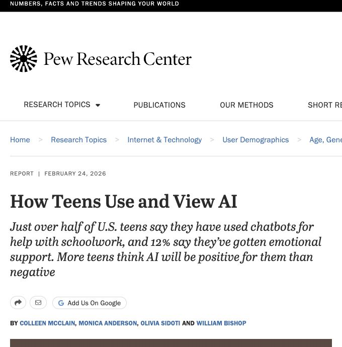

## 今日の流れ

**復習**　何を数える？　どの公式？

**10分チャレンジ3問**　自分で式を組み立てる。各10分。

**AL 01・02・03**　打率、ガチャ、不良品。ワークシートに接続。

途中の3分チェックは必要に応じて。3つのALは、同じ公式を別の場面で使う練習です。

---

<!-- _class: book-divider -->

## 教科書 · 第2章 第2節

4　離散確率分布の復習

p.118–120

**回数が決まるなら二項分布。まれな発生数ならポアソン近似。**

式の前に、何を数える $X$ なのか決めよう。

---

## Xは何を数える？

| 場面 | 確率変数 $X$ | 取りうる値 |
| --- | --- | --- |
| 5打席 | 安打の本数 | 0, 1, 2, 3, 4, 5 |
| 100回のガチャ | レアの個数 | 0, 1, …, 100 |
| 3,500個を検品 | 不良品の個数 | 0, 1, …, 3500 |

**0個も、立派な結果。**

Xは「当たる確率」ではなく、数える個数。実際に観測した値を小文字xと書く。

---

<!-- _class: book-reference -->

## 二項分布の公式

最重要 / VERY IMPORTANT

$$
\Pr(X=x)={}_nC_x\pi^x(1-\pi)^{n-x}
$$

独立な試行をn回。毎回の成功確率πは同じ。成功回数Xを数える。教科書 p.118–119。

---

## 式は「並び方 × 1通りの確率」

$$
\underbrace{{}_nC_x}_{\text{並び方}}\ \underbrace{\pi^x}_{\text{成功 }x\text{ 回}}\ \underbrace{(1-\pi)^{n-x}}_{\text{失敗 }n-x\text{ 回}}
$$

ロボット3体・ヤギ2体の **1つの並び** の確率は、$\pi^3(1-\pi)^2$。

その並び方は ${}_5C_3=10$ 通り。10通りの確率を足す。

成功・失敗の順番が違っても、成功回数が同じなら同じXに数える。

---

<!-- _class: book-reference -->

## Cは「順番を区別しない選び方」

$$
{}_nC_x=\frac{n!}{x!(n-x)!}
$$

$$
{}_7C_2=\frac{7\times6}{2\times1}=21
$$

7つの位置から、ロボットが入る2か所を選ぶ。

0!=1。端の結果も扱えるので、nC0=nCn=1になる。教科書 p.119。

---

<!-- _class: news-article -->

## 宿題、どこまでAIに頼る？

元調査の画面 / Pew Research Center 写真：Hill Street Studios / Getty Images

**The New York Times**　2026.02.24

More Than Half of Teens Use Chatbots for Schoolwork, Survey Finds

米国の10代、**10％** が宿題の「全部・大部分」でAIの助けを借りている。

[NYTの記事を読む](https://www.nytimes.com/2026/02/24/technology/schoolwork-chatbot-cheating-pew.html)　[元の調査](https://www.pewresearch.org/internet/2026/02/24/how-teens-use-and-view-ai/)

利用した割合を、不正をした割合と読み替えない。元調査は米国13〜17歳1,458人、2025年9〜10月実施。

---

## 5人のうち、ちょうど2人？

GIVEN / 与えられた値と問題

**調査の数値**：宿題の全部・大部分でAIの助けを借りる割合は10％。

**授業での設定**：同じ割合の集団から5人を独立に選ぶと仮定する。

$$
n=5,\qquad\pi=0.10,\qquad x=2
$$

$X$＝この使い方をしている人の数。

**ちょうど2人が該当する確率 $\Pr(X=2)$ を求めよ。**

5人・独立・確率一定は計算用の仮定。このクラスの実態を推定する問題ではありません。出典：Pew Research Center（2026.02.24）。

---

<!-- _class: book-reference -->

## ニュースの数字を、二項分布へ

FORMULA / 公式と代入

$$
\Pr(X=x)={}_nC_x\pi^x(1-\pi)^{n-x}
$$

$$
\Pr(X=2)={}_5C_2\,(0.10)^2(0.90)^3
$$

**5人のどの2人か** × **該当する2人** × **該当しない3人**

1通りの並びの確率は0.10²×0.90³。その並び方を5C2で数え、全部足します。教科書 p.118–119。

---

<!-- _class: news-solution -->

## 答えは7.29％。何の確率？

SOLUTION / 計算と答え

$$
{}_5C_2=\frac{5\times4}{2\times1}=10
$$

$$
\begin{aligned}\Pr(X=2)&=10\times0.01\times0.729\\&=0.0729=\boxed{7.29\%}\end{aligned}
$$

**5人組を繰り返し作ったとき、ちょうど2人が該当する組は約7.29％。**

個人の割合10％と、5人中ちょうど2人の確率7.29％は別の量。AI利用の善悪や、不正の有無はこの計算では判断できません。

---

<!-- _class: answer-visual -->

## 図で確認　答えは7.29％。何の確率？

ちょうど2人：7.29％。青い1本だけを読む。

青：求めた結果　灰：それ以外

<svg class="answer-visual-chart" xmlns="http://www.w3.org/2000/svg" viewBox="0 0 1120 325" role="img" aria-label="図で確認　答えは7.29％。何の確率？"><g font-family="Hiragino Sans,Noto Sans JP,sans-serif" fill="#40555f"><path d="M95 246H1080" stroke="#d9e1e3"/><text x="80" y="252" text-anchor="end" font-size="18">0%</text><path d="M95 198.5H1080" stroke="#d9e1e3"/><text x="80" y="204.5" text-anchor="end" font-size="18">15%</text><path d="M95 151H1080" stroke="#d9e1e3"/><text x="80" y="157" text-anchor="end" font-size="18">30%</text><path d="M95 103.5H1080" stroke="#d9e1e3"/><text x="80" y="109.5" text-anchor="end" font-size="18">45%</text><path d="M95 56H1080" stroke="#d9e1e3"/><text x="80" y="62" text-anchor="end" font-size="18">60%</text><rect data-count="0" data-probability="0.5904900000000001" x="121.26666666666665" y="59.011499999999955" width="111.63333333333334" height="186.98850000000004" fill="#bdcbd0"/><text x="177.08333333333331" y="49.011499999999955" text-anchor="middle" fill="#40555f" font-size="19">59.0%</text><text x="177.08333333333331" y="275" text-anchor="middle" font-size="18">0</text><rect data-count="1" data-probability="0.32805" x="285.43333333333334" y="142.1175" width="111.63333333333334" height="103.88250000000001" fill="#bdcbd0"/><text x="341.25" y="132.1175" text-anchor="middle" fill="#40555f" font-size="19">32.8%</text><text x="341.25" y="275" text-anchor="middle" font-size="18">1</text><rect data-count="2" data-probability="0.07290000000000002" x="449.59999999999997" y="222.915" width="111.63333333333334" height="23.085000000000008" fill="#176d82"/><text x="505.41666666666663" y="212.915" text-anchor="middle" fill="#176d82" font-size="19">7.3%</text><text x="505.41666666666663" y="275" text-anchor="middle" font-size="18">2</text><rect data-count="3" data-probability="0.008100000000000001" x="613.7666666666665" y="243.435" width="111.63333333333334" height="2.565000000000001" fill="#bdcbd0"/><text x="669.5833333333333" y="233.435" text-anchor="middle" fill="#40555f" font-size="19">0.8%</text><text x="669.5833333333333" y="275" text-anchor="middle" font-size="18">3</text><rect data-count="4" data-probability="0.0004500000000000001" x="777.9333333333333" y="245.8575" width="111.63333333333334" height="0.14250000000000004" fill="#bdcbd0"/><text x="833.75" y="235.8575" text-anchor="middle" fill="#40555f" font-size="19">0.05%</text><text x="833.75" y="275" text-anchor="middle" font-size="18">4</text><rect data-count="5" data-probability="0.000010000000000000003" x="942.0999999999999" y="245.99683333333334" width="111.63333333333334" height="0.0031666666666666675" fill="#bdcbd0"/><text x="997.9166666666666" y="235.99683333333334" text-anchor="middle" fill="#40555f" font-size="19">&lt;0.01%</text><text x="997.9166666666666" y="275" text-anchor="middle" font-size="18">5</text><path d="M95 246H1080" stroke="#71848e"/><text x="1080" y="314" text-anchor="end" font-size="20">X（人）</text></g></svg>

 

---

<!-- _class: challenge -->

## チャレンジ①　平均個数と、ばらつきは？

自分で解く　3分 ／ 教科書 p.119–120

$X$＝5人のうち、宿題の全部・大部分でAIの助けを借りる人の数。

$n=5,\quad\pi=0.1$。独立・一定の確率を仮定する。

**(1)** 同じ条件の組・期間を繰り返すとき、$X$ の期待値と分散を求めよ。

**(2)** 期待値を「起こる確率」と言い換えてよいか？

**(3)** 現実では、独立・一定の確率という仮定が崩れるのはどんな場合か？

期待値は個数の単位、分散はその単位の2乗。前の確率問題と同じXを使う。

---

<!-- _class: challenge-check worked-answer -->

## 答え合わせ①　期待値は、確率ではなく個数

① 与えられた条件

$X$＝5人のうち、宿題の全部・大部分でAIの助けを借りる人の数。

$n=5,\quad\pi=0.1$。独立・一定の確率を仮定する。

② 公式（文字のまま）

$$
\begin{aligned}E(X)&=n\pi\\\operatorname{Var}(X)&=n\pi(1-\pi)\end{aligned}
$$

③ 数値を代入・計算

$$
\begin{aligned}E(X)&=5\times0.1=0.5\\\operatorname{Var}(X)&=5\times0.1\times0.9\\&=0.45\end{aligned}
$$

④ 答え・意味

期待値 0.5人。分散 0.45人²。

同じ条件を繰り返した平均であり、毎回この個数になる保証ではない。

期待値を％にしても、事象の確率にはならない。仮定が崩れる例：友人同士でAIの使い方が似る。学校や課題によって割合が変わる。

---

<!-- _class: answer-visual -->

## 図で確認　期待値は、確率ではなく個数

期待値0.5人、分散0.45人²。

灰：各結果の確率　赤い破線：期待値

<svg class="answer-visual-chart" xmlns="http://www.w3.org/2000/svg" viewBox="0 0 1120 325" role="img" aria-label="図で確認　期待値は、確率ではなく個数"><g font-family="Hiragino Sans,Noto Sans JP,sans-serif" fill="#40555f"><path d="M95 246H1080" stroke="#d9e1e3"/><text x="80" y="252" text-anchor="end" font-size="18">0%</text><path d="M95 198.5H1080" stroke="#d9e1e3"/><text x="80" y="204.5" text-anchor="end" font-size="18">15%</text><path d="M95 151H1080" stroke="#d9e1e3"/><text x="80" y="157" text-anchor="end" font-size="18">30%</text><path d="M95 103.5H1080" stroke="#d9e1e3"/><text x="80" y="109.5" text-anchor="end" font-size="18">45%</text><path d="M95 56H1080" stroke="#d9e1e3"/><text x="80" y="62" text-anchor="end" font-size="18">60%</text><rect data-count="0" data-probability="0.5904900000000001" x="121.26666666666665" y="59.011499999999955" width="111.63333333333334" height="186.98850000000004" fill="#bdcbd0"/><text x="177.08333333333331" y="49.011499999999955" text-anchor="middle" fill="#40555f" font-size="19">59.0%</text><text x="177.08333333333331" y="275" text-anchor="middle" font-size="18">0</text><rect data-count="1" data-probability="0.32805" x="285.43333333333334" y="142.1175" width="111.63333333333334" height="103.88250000000001" fill="#bdcbd0"/><text x="341.25" y="132.1175" text-anchor="middle" fill="#40555f" font-size="19">32.8%</text><text x="341.25" y="275" text-anchor="middle" font-size="18">1</text><rect data-count="2" data-probability="0.07290000000000002" x="449.59999999999997" y="222.915" width="111.63333333333334" height="23.085000000000008" fill="#bdcbd0"/><text x="505.41666666666663" y="212.915" text-anchor="middle" fill="#40555f" font-size="19">7.3%</text><text x="505.41666666666663" y="275" text-anchor="middle" font-size="18">2</text><rect data-count="3" data-probability="0.008100000000000001" x="613.7666666666665" y="243.435" width="111.63333333333334" height="2.565000000000001" fill="#bdcbd0"/><text x="669.5833333333333" y="233.435" text-anchor="middle" fill="#40555f" font-size="19">0.8%</text><text x="669.5833333333333" y="275" text-anchor="middle" font-size="18">3</text><rect data-count="4" data-probability="0.0004500000000000001" x="777.9333333333333" y="245.8575" width="111.63333333333334" height="0.14250000000000004" fill="#bdcbd0"/><text x="833.75" y="235.8575" text-anchor="middle" fill="#40555f" font-size="19">0.05%</text><text x="833.75" y="275" text-anchor="middle" font-size="18">4</text><rect data-count="5" data-probability="0.000010000000000000003" x="942.0999999999999" y="245.99683333333334" width="111.63333333333334" height="0.0031666666666666675" fill="#bdcbd0"/><text x="997.9166666666666" y="235.99683333333334" text-anchor="middle" fill="#40555f" font-size="19">&lt;0.01%</text><text x="997.9166666666666" y="275" text-anchor="middle" font-size="18">5</text><path d="M259.16666666666663 42V250" stroke="#9b5146" stroke-width="3" stroke-dasharray="7 5"/><text x="259.16666666666663" y="26" text-anchor="middle" fill="#9b5146" font-size="21">平均 0.5人</text><path d="M95 246H1080" stroke="#71848e"/><text x="1080" y="314" text-anchor="end" font-size="20">X（人）</text></g></svg>

平均は赤い破線。分散 0.45人² は、この平均からの距離の2乗を確率で重みづけした値。 

---

## 「ちょうど」と「以上」は違う

$$
\Pr(X=1)\neq\Pr(X\ge1)
$$

**ちょうど1個**：1個だけ。2個は含まない。

**1個以上**：1個、2個、3個、…全部。

$$
\Pr(X\ge1)=1-\Pr(X=0)
$$

少なくとも1個の反対は、1個もない。ガチャで使う一番大切な読み替え。

---

<!-- _class: challenge -->

## チャレンジ②　5回のシュートで、2〜3回成功

自分で解く　3分 ／ 教科書 p.118–120

ロボットがシュートを5回打つ。毎回の成功率は40％、各回は独立。

$X$＝成功回数。**2回以上、3回以下** 成功する確率を求めよ。

まず、含まれる $x$ の値と、確率を足す式を書こう。

---

<!-- _class: challenge-check worked-answer -->

## 答え合わせ②　2回と3回の確率を足す

① 与えられた条件

$n=5,\ \pi=0.4$。$X=2$ または $X=3$。

② 公式（文字のまま）

$$
\begin{aligned}\Pr(X=x)&={}_nC_x\pi^x(1-\pi)^{n-x}\\\Pr(a\le X\le b)&=\sum_{x=a}^{b}\Pr(X=x)\end{aligned}
$$

③ 数値を代入・計算

$$
\begin{aligned}\Pr(X=2)&={}_5C_2(0.4)^2(0.6)^3\\&=0.3456\\\Pr(X=3)&={}_5C_3(0.4)^3(0.6)^2\\&=0.2304\\\Pr(2\le X\le3)&=0.3456+0.2304=0.576\end{aligned}
$$

④ 答え・意味

2〜3回成功する確率は57.6％。

同じ5回で「ちょうど2回」と「ちょうど3回」は同時に起こらないので、確率を足せる。

---

<!-- _class: answer-visual -->

## 図で確認　2回と3回の確率を足す

2〜3回成功：57.6％。

青：2回 34.56％　＋　黄：3回 23.04％

<svg class="answer-visual-chart" xmlns="http://www.w3.org/2000/svg" viewBox="0 0 1120 325" role="img" aria-label="図で確認　2回と3回の確率を足す"><g font-family="Hiragino Sans,Noto Sans JP,sans-serif" fill="#40555f"><path d="M95 246H1080" stroke="#d9e1e3"/><text x="80" y="252" text-anchor="end" font-size="18">0%</text><path d="M95 198.5H1080" stroke="#d9e1e3"/><text x="80" y="204.5" text-anchor="end" font-size="18">10%</text><path d="M95 151H1080" stroke="#d9e1e3"/><text x="80" y="157" text-anchor="end" font-size="18">20%</text><path d="M95 103.5H1080" stroke="#d9e1e3"/><text x="80" y="109.5" text-anchor="end" font-size="18">30%</text><path d="M95 56H1080" stroke="#d9e1e3"/><text x="80" y="62" text-anchor="end" font-size="18">40%</text><rect data-count="0" data-probability="0.07775999999999998" x="121.26666666666665" y="209.06400000000002" width="111.63333333333334" height="36.935999999999986" fill="#bdcbd0"/><text x="177.08333333333331" y="199.06400000000002" text-anchor="middle" fill="#40555f" font-size="19">7.8%</text><text x="177.08333333333331" y="275" text-anchor="middle" font-size="18">0</text><rect data-count="1" data-probability="0.2592" x="285.43333333333334" y="122.88000000000002" width="111.63333333333334" height="123.11999999999998" fill="#bdcbd0"/><text x="341.25" y="112.88000000000002" text-anchor="middle" fill="#40555f" font-size="19">25.9%</text><text x="341.25" y="275" text-anchor="middle" font-size="18">1</text><rect data-count="2" data-probability="0.3456" x="449.59999999999997" y="81.84" width="111.63333333333334" height="164.16" fill="#176d82"/><text x="505.41666666666663" y="71.84" text-anchor="middle" fill="#176d82" font-size="19">34.6%</text><text x="505.41666666666663" y="275" text-anchor="middle" font-size="18">2</text><rect data-count="3" data-probability="0.23040000000000005" x="613.7666666666665" y="136.56" width="111.63333333333334" height="109.44000000000001" fill="#be8530"/><text x="669.5833333333333" y="126.56" text-anchor="middle" fill="#be8530" font-size="19">23.0%</text><text x="669.5833333333333" y="275" text-anchor="middle" font-size="18">3</text><rect data-count="4" data-probability="0.07680000000000002" x="777.9333333333333" y="209.51999999999998" width="111.63333333333334" height="36.480000000000004" fill="#bdcbd0"/><text x="833.75" y="199.51999999999998" text-anchor="middle" fill="#40555f" font-size="19">7.7%</text><text x="833.75" y="275" text-anchor="middle" font-size="18">4</text><rect data-count="5" data-probability="0.010240000000000003" x="942.0999999999999" y="241.136" width="111.63333333333334" height="4.864000000000001" fill="#bdcbd0"/><text x="997.9166666666666" y="231.136" text-anchor="middle" fill="#40555f" font-size="19">1.0%</text><text x="997.9166666666666" y="275" text-anchor="middle" font-size="18">5</text><path d="M95 246H1080" stroke="#71848e"/><text x="1080" y="314" text-anchor="end" font-size="20">X（回）</text></g></svg>

 

---

<!-- _class: book-reference -->

## 期待値と分散は「個数」の性質

最重要 / VERY IMPORTANT

$$
E(X)=n\pi,\qquad\operatorname{Var}(X)=n\pi(1-\pi)
$$

**期待値**：同じセットを繰り返したときの平均個数。

**分散**：セットごとの個数のばらつき。単位は個²。

期待値0.05個は、当たる確率5％という意味ではない。教科書 p.119–120。

---

<!-- _class: book-divider -->

## 教科書 · 第2章 第2節

ポアソン近似

p.120

試行回数 $n$ が大きく、成功確率 $\pi$ が小さいとき。

$\lambda=n\pi$ を使い、まれな発生数を近似する。

---

<!-- _class: book-reference -->

## ポアソン分布の公式

$$
\Pr(X=x)=\frac{\lambda^xe^{-\lambda}}{x!},\qquad E(X)=\operatorname{Var}(X)=\lambda
$$

**確率は配布表で読む。** $e$ の数値を計算する必要はない。

[ポアソン分布表を開く](https://yohman.github.io/26-2-StatsB/viewer.html?p=&file=other+material%2F2025+yoh%2F06_%5BAL%5D%E7%A2%BA%E7%8E%87%E5%88%86%E5%B8%83_1_%E9%9B%A2%E6%95%A3%E7%A2%BA%E7%8E%87%E5%88%86%E5%B8%83+%E3%83%9D%E3%82%A2%E3%82%BD%E3%83%B3%2F%E3%83%9D%E3%82%A2%E3%82%BD%E3%83%B3%E5%88%86%E5%B8%83%E8%A1%A8.pdf&title=%E3%83%9D%E3%82%A2%E3%82%BD%E3%83%B3%E5%88%86%E5%B8%83%E8%A1%A8&week=W04&return=agenda.html%3Fp%23week-04)

ポアソンモデルの式は等式。二項分布をポアソンで置き換えるときは近似。教科書 p.120。

---

<!-- _class: book-reference -->

## λは「数えたい期間の平均個数」

$$
\boxed{\lambda=rt}
$$

$r$＝単位時間あたりの平均回数。$t$＝観測する時間。

$$
2\ \text{件/時間}\times1.5\ \text{時間}=3\ \text{件}
$$

| 与えられたもの | 平均個数の求め方 |
| --- | --- |
| 試行回数と成功率 | $\lambda=n\pi$（二項分布の近似） |
| 単位時間あたりの頻度と期間 | $\lambda=rt$（時間内の発生数のモデル） |

時間の単位をそろえる。90分は1.5時間。一定頻度・独立な発生を仮定する。教科書p.120のポアソン分布を時間の例へ応用。

---

<!-- _class: challenge -->

## チャレンジ③　90分間で、1件以上の注文

自分で解く　3分 ／ 教科書 p.118–120

ロボット配達所への注文は平均 **1時間に2件**。
独立に、一定の頻度で届くポアソンモデルを仮定する。

$X$＝90分間の注文件数。

**(1)** $\lambda$ は？　**(2)** 1件以上届く確率は？

**(3)** この90分間の期待値と分散は？

配布のポアソン分布表を使おう。

---

<!-- _class: challenge-check worked-answer -->

## 答え合わせ③　90分に合わせて平均を変える

① 与えられた条件

$r=2$件/時間、$t=90/60=1.5$時間。$X$は90分の件数。

② 公式（文字のまま）

$$
\begin{aligned}\lambda&=rt\\\Pr(X\ge1)&=1-\Pr(X=0)\\E(X)&=\operatorname{Var}(X)=\lambda\end{aligned}
$$

③ 数値を代入・計算

$$
\begin{aligned}\lambda&=2\times1.5=3\\\text{表の }\mu=3.0,\ x=0&:\quad\Pr(X=0)\approx0.050\\\Pr(X\ge1)&\approx1-0.050=0.950\\E(X)&=3,\quad\operatorname{Var}(X)=3\end{aligned}
$$

④ 答え・意味

1件以上：約95.0％。期待値3件、分散3件²。

表のμと公式のλは同じ平均。丸めた表の値を使用。<a href="https://yohman.github.io/26-2-StatsB/viewer.html?p=&file=other+material%2F2025+yoh%2F06_%5BAL%5D%E7%A2%BA%E7%8E%87%E5%88%86%E5%B8%83_1_%E9%9B%A2%E6%95%A3%E7%A2%BA%E7%8E%87%E5%88%86%E5%B8%83+%E3%83%9D%E3%82%A2%E3%82%BD%E3%83%B3%2F%E3%83%9D%E3%82%A2%E3%82%BD%E3%83%B3%E5%88%86%E5%B8%83%E8%A1%A8.pdf&title=%E3%83%9D%E3%82%A2%E3%82%BD%E3%83%B3%E5%88%86%E5%B8%83%E8%A1%A8&week=W04&return=agenda.html%3Fp%23week-04">ポアソン分布表を開く</a>

---

<!-- _class: answer-visual -->

## 図で確認　90分に合わせて平均を変える

1件以上：約95.0％。平均3件、分散3件²。

青：求めた結果　灰：それ以外

<svg class="answer-visual-chart" xmlns="http://www.w3.org/2000/svg" viewBox="0 0 1120 325" role="img" aria-label="図で確認　90分に合わせて平均を変える"><g font-family="Hiragino Sans,Noto Sans JP,sans-serif" fill="#40555f"><path d="M95 246H1080" stroke="#d9e1e3"/><text x="80" y="252" text-anchor="end" font-size="18">0%</text><path d="M95 198.5H1080" stroke="#d9e1e3"/><text x="80" y="204.5" text-anchor="end" font-size="18">7.5%</text><path d="M95 151H1080" stroke="#d9e1e3"/><text x="80" y="157" text-anchor="end" font-size="18">15%</text><path d="M95 103.5H1080" stroke="#d9e1e3"/><text x="80" y="109.5" text-anchor="end" font-size="18">22.5%</text><path d="M95 56H1080" stroke="#d9e1e3"/><text x="80" y="62" text-anchor="end" font-size="18">30%</text><rect data-count="0" data-probability="0.049787068367863944" x="107.12307692307692" y="214.46819003368617" width="51.52307692307693" height="31.531809966313833" fill="#bdcbd0"/><text x="132.8846153846154" y="275" text-anchor="middle" font-size="18">0</text><rect data-count="1" data-probability="0.14936120510359183" x="182.8923076923077" y="151.40457010105848" width="51.52307692307693" height="94.5954298989415" fill="#176d82"/><text x="208.65384615384616" y="141.40457010105848" text-anchor="middle" fill="#176d82" font-size="19">14.9%</text><text x="208.65384615384616" y="275" text-anchor="middle" font-size="18">1</text><rect data-count="2" data-probability="0.22404180765538773" x="258.66153846153844" y="104.10685515158775" width="51.52307692307693" height="141.89314484841225" fill="#176d82"/><text x="284.4230769230769" y="94.10685515158775" text-anchor="middle" fill="#176d82" font-size="19">22.4%</text><text x="284.4230769230769" y="275" text-anchor="middle" font-size="18">2</text><rect data-count="3" data-probability="0.22404180765538773" x="334.4307692307693" y="104.10685515158775" width="51.52307692307693" height="141.89314484841225" fill="#176d82"/><text x="360.19230769230774" y="94.10685515158775" text-anchor="middle" fill="#176d82" font-size="19">22.4%</text><text x="360.19230769230774" y="275" text-anchor="middle" font-size="18">3</text><rect data-count="4" data-probability="0.1680313557415408" x="410.2" y="139.5801413636908" width="51.52307692307693" height="106.41985863630919" fill="#176d82"/><text x="435.96153846153845" y="129.5801413636908" text-anchor="middle" fill="#176d82" font-size="19">16.8%</text><text x="435.96153846153845" y="275" text-anchor="middle" font-size="18">4</text><rect data-count="5" data-probability="0.10081881344492448" x="485.9692307692308" y="182.1480848182145" width="51.52307692307693" height="63.8519151817855" fill="#176d82"/><text x="511.7307692307693" y="172.1480848182145" text-anchor="middle" fill="#176d82" font-size="19">10.1%</text><text x="511.7307692307693" y="275" text-anchor="middle" font-size="18">5</text><rect data-count="6" data-probability="0.05040940672246224" x="561.7384615384615" y="214.07404240910725" width="51.52307692307693" height="31.92595759089275" fill="#176d82"/><text x="587.5" y="204.07404240910725" text-anchor="middle" fill="#176d82" font-size="19">5.0%</text><text x="587.5" y="275" text-anchor="middle" font-size="18">6</text><rect data-count="7" data-probability="0.021604031452483817" x="637.5076923076924" y="232.31744674676025" width="51.52307692307693" height="13.682553253239751" fill="#176d82"/><text x="663.2692307692308" y="222.31744674676025" text-anchor="middle" fill="#176d82" font-size="19">2.2%</text><text x="663.2692307692308" y="275" text-anchor="middle" font-size="18">7</text><rect data-count="8" data-probability="0.00810151179468143" x="713.2769230769231" y="240.8690425300351" width="51.52307692307693" height="5.1309574699649065" fill="#176d82"/><text x="739.0384615384615" y="230.8690425300351" text-anchor="middle" fill="#176d82" font-size="19">0.8%</text><text x="739.0384615384615" y="275" text-anchor="middle" font-size="18">8</text><rect data-count="9" data-probability="0.0027005039315604767" x="789.0461538461539" y="244.28968084334502" width="51.52307692307693" height="1.7103191566549685" fill="#176d82"/><text x="814.8076923076924" y="234.28968084334502" text-anchor="middle" fill="#176d82" font-size="19">0.3%</text><text x="814.8076923076924" y="275" text-anchor="middle" font-size="18">9</text><rect data-count="10" data-probability="0.000810151179468143" x="864.8153846153846" y="245.4869042530035" width="51.52307692307693" height="0.5130957469964905" fill="#176d82"/><text x="890.5769230769231" y="235.4869042530035" text-anchor="middle" fill="#176d82" font-size="19">0.08%</text><text x="890.5769230769231" y="275" text-anchor="middle" font-size="18">10</text><rect data-count="11" data-probability="0.0002209503216731299" x="940.5846153846155" y="245.8600647962737" width="51.52307692307693" height="0.13993520372631563" fill="#176d82"/><text x="966.3461538461539" y="235.8600647962737" text-anchor="middle" fill="#176d82" font-size="19">0.02%</text><text x="966.3461538461539" y="275" text-anchor="middle" font-size="18">11</text><rect data-count="12+" data-probability="0.00007138662897421266" x="1016.3538461538462" y="245.95478846831634" width="51.52307692307693" height="0.045211531683668024" fill="#176d82"/><text x="1042.1153846153848" y="235.95478846831634" text-anchor="middle" fill="#176d82" font-size="19">0.01%</text><text x="1042.1153846153848" y="275" text-anchor="middle" font-size="18">12+</text><path d="M360.19230769230774 42V250" stroke="#9b5146" stroke-width="3" stroke-dasharray="7 5"/><text x="360.19230769230774" y="26" text-anchor="middle" fill="#9b5146" font-size="21">平均 3件</text><path d="M95 246H1080" stroke="#71848e"/><text x="1080" y="314" text-anchor="end" font-size="20">X（件）　末尾はまとめた確率</text></g></svg>

平均は赤い破線。分散 3件² は、この平均からの距離の2乗を確率で重みづけした値。 解答は配布表の丸め値。棒は丸め前のモデル。

---

## モデルを選ぶ、最短の質問

| 質問 | 二項分布 | ポアソン近似 | 時間内のポアソン |
| --- | --- | --- | --- |
| 与えられたもの | $n$回・成功率$\pi$ | 大きい$n$・小さい$\pi$ | 頻度$r$・期間$t$ |
| 平均 | $n\pi$ | $\lambda=n\pi$ | $\lambda=rt$ |
| 分散 | $n\pi(1-\pi)$ | $\lambda$ | $\lambda$ |

独立性、確率・頻度の一定性を確認する。ポアソン近似は元の二項分布を置き換える。時間のモデルは、指定した期間内の発生数を数える。

---

<!-- _class: challenge -->

## チャレンジ④　計算する前に、モデルを選ぶ

自分で解く　3分 ／ 教科書 p.118–120

各場面で使うモデルと、その理由を答えよ。**Cは、通常の二項分布をそのまま使えるか？**

| 場面 | 与えられた条件 |
| --- | --- |
| A ロボットのシュート | 独立な5回、毎回40％成功 |
| B 工場の不良品 | 独立な2,500個、不良率0.2％。ポアソンで近似せよ |
| C 天井つきガチャ | 外れるたび、次の当たり確率が上がる |
| D 配達所の注文 | 平均2件/時間、独立・一定頻度。90分間を数える |

---

<!-- _class: challenge-check worked-answer -->

## 答え合わせ④　何が固定されているか

① 与えられた条件

Aは独立・確率一定の5回。Bは多数の製品と小さい不良率。

Cは確率が変わる。Dは時間内の発生数。

② 公式（文字のまま）

$$
\begin{aligned}\text{二項: }X&\sim\mathrm{Bin}(n,\pi)\\\text{ポアソン: }X&\sim\mathrm{Pois}(\lambda)\\\lambda&=n\pi\ \text{または}\ rt\end{aligned}
$$

③ 数値を代入・計算

$$
\begin{aligned}\mathrm{A}:\quad n&=5,\quad\pi=0.4\\\mathrm{B}:\quad\lambda&=2500\times0.002=5\\\mathrm{C}:\quad\pi&\text{ が一定でない}\\\mathrm{D}:\quad\lambda&=2\times1.5=3\end{aligned}
$$

④ 答え・意味

A：二項。B：指定されたポアソン近似。

C：通常の二項をそのまま使えない。D：ポアソンモデル。

「まれだから」だけで決めず、独立性・確率や頻度の一定性を確認する。Cは確率の変化を含む別のモデルが必要。

---

<!-- _class: answer-visual -->

## 図で確認　条件からモデルを選ぶ

<table class="answer-models"><tr><th>場面</th><th>確認する条件</th><th>答え</th></tr><tr><td>A シュート</td><td>5回・独立・成功率一定</td><td>二項分布</td></tr><tr><td>B 不良品</td><td>多数・低い不良率・近似の指定</td><td>ポアソン近似 λ＝5</td></tr><tr><td>C 天井つきガチャ</td><td>外れるほど成功率が上がる</td><td>通常の二項は使えない</td></tr><tr><td>D 注文</td><td>一定頻度 × 90分</td><td>ポアソン λ＝3</td></tr></table>

「独立」「一定」を確認してから、式を選ぶ。

---

<!-- _class: challenge -->

## チャレンジ⑤　7台の配送ロボット

自分で解く　10分　／　教科書 p.118–120

各ロボットが時間内に到着する確率は **80％**。7台は独立に配達する。

**(1)** ちょうど5台が間に合う確率は？

**(2)** 1台以上が遅れる確率は？

**(3)** 間に合う台数の期待値と分散は？

教科書・電卓可。公式を文字で書き、数値を代入し、答えの意味まで説明しよう。

---

<!-- _class: challenge-check worked-answer -->

## 答え合わせ⑤　遅れるのは、全台成功の反対

① 与えられた条件

$X$ は時間内に到着した台数。$n=7,\ \pi=0.8$。

② 公式（文字のまま）

$$
\begin{aligned}\Pr(X=x)&={}_nC_x\pi^x(1-\pi)^{n-x}\\\Pr(X<n)&=1-\Pr(X=n)\\E(X)&=n\pi\\\operatorname{Var}(X)&=n\pi(1-\pi)\end{aligned}
$$

③ 数値を代入・計算

$$
\begin{aligned}\Pr(X=5)&={}_7C_5(0.8)^5(0.2)^2\\&=0.2752512\\\Pr(X\le6)&=1-(0.8)^7=0.7902848\\E(X)&=7\times0.8=5.6\\\operatorname{Var}(X)&=7\times0.8\times0.2=1.12\end{aligned}
$$

④ 答え・意味

ちょうど5台：約27.53％。1台以上遅れる：約79.03％。

期待値5.6台、分散1.12台²。Xは遅れた台数ではなく、時間内に到着した台数。

---

<!-- _class: answer-visual -->

## 図で確認　遅れるのは、全台成功の反対

ちょうど5台：27.53％。1台以上遅れる：79.03％。

青：ちょうど5台　青＋黄：6台以下＝少なくとも1台遅れる

<svg class="answer-visual-chart" xmlns="http://www.w3.org/2000/svg" viewBox="0 0 1120 325" role="img" aria-label="図で確認　遅れるのは、全台成功の反対"><g font-family="Hiragino Sans,Noto Sans JP,sans-serif" fill="#40555f"><path d="M95 246H1080" stroke="#d9e1e3"/><text x="80" y="252" text-anchor="end" font-size="18">0%</text><path d="M95 198.5H1080" stroke="#d9e1e3"/><text x="80" y="204.5" text-anchor="end" font-size="18">10%</text><path d="M95 151H1080" stroke="#d9e1e3"/><text x="80" y="157" text-anchor="end" font-size="18">20%</text><path d="M95 103.5H1080" stroke="#d9e1e3"/><text x="80" y="109.5" text-anchor="end" font-size="18">30%</text><path d="M95 56H1080" stroke="#d9e1e3"/><text x="80" y="62" text-anchor="end" font-size="18">40%</text><rect data-count="0" data-probability="0.00001279999999999998" x="114.69999999999999" y="245.99392" width="83.72500000000001" height="0.006079999999999991" fill="#be8530"/><text x="156.5625" y="235.99392" text-anchor="middle" fill="#be8530" font-size="19">&lt;0.01%</text><text x="156.5625" y="275" text-anchor="middle" font-size="18">0</text><rect data-count="1" data-probability="0.00035839999999999955" x="237.825" y="245.82976" width="83.72500000000001" height="0.17023999999999978" fill="#be8530"/><text x="279.6875" y="235.82976" text-anchor="middle" fill="#be8530" font-size="19">0.04%</text><text x="279.6875" y="275" text-anchor="middle" font-size="18">1</text><rect data-count="2" data-probability="0.004300799999999996" x="360.95" y="243.95712" width="83.72500000000001" height="2.042879999999998" fill="#be8530"/><text x="402.8125" y="233.95712" text-anchor="middle" fill="#be8530" font-size="19">0.4%</text><text x="402.8125" y="275" text-anchor="middle" font-size="18">2</text><rect data-count="3" data-probability="0.028671999999999982" x="484.075" y="232.38080000000002" width="83.72500000000001" height="13.61919999999999" fill="#be8530"/><text x="525.9375" y="222.38080000000002" text-anchor="middle" fill="#be8530" font-size="19">2.9%</text><text x="525.9375" y="275" text-anchor="middle" font-size="18">3</text><rect data-count="4" data-probability="0.11468799999999994" x="607.2" y="191.52320000000003" width="83.72500000000001" height="54.476799999999976" fill="#be8530"/><text x="649.0625" y="181.52320000000003" text-anchor="middle" fill="#be8530" font-size="19">11.5%</text><text x="649.0625" y="275" text-anchor="middle" font-size="18">4</text><rect data-count="5" data-probability="0.2752511999999999" x="730.325" y="115.25568000000004" width="83.72500000000001" height="130.74431999999996" fill="#176d82"/><text x="772.1875" y="105.25568000000004" text-anchor="middle" fill="#176d82" font-size="19">27.5%</text><text x="772.1875" y="275" text-anchor="middle" font-size="18">5</text><rect data-count="6" data-probability="0.36700160000000004" x="853.45" y="71.67423999999997" width="83.72500000000001" height="174.32576000000003" fill="#be8530"/><text x="895.3125" y="61.67423999999997" text-anchor="middle" fill="#be8530" font-size="19">36.7%</text><text x="895.3125" y="275" text-anchor="middle" font-size="18">6</text><rect data-count="7" data-probability="0.20971520000000007" x="976.575" y="146.38527999999997" width="83.72500000000001" height="99.61472000000003" fill="#bdcbd0"/><text x="1018.4375" y="136.38527999999997" text-anchor="middle" fill="#40555f" font-size="19">21.0%</text><text x="1018.4375" y="275" text-anchor="middle" font-size="18">7</text><path d="M846.0625000000001 42V250" stroke="#9b5146" stroke-width="3" stroke-dasharray="7 5"/><text x="846.0625000000001" y="26" text-anchor="middle" fill="#9b5146" font-size="21">平均 5.6台</text><path d="M95 246H1080" stroke="#71848e"/><text x="1080" y="314" text-anchor="end" font-size="20">X（台）</text></g></svg>

平均は赤い破線。分散 1.12台² は、この平均からの距離の2乗を確率で重みづけした値。 

---

<!-- _class: challenge -->

## チャレンジ⑥　80回のカプセル抽選

自分で解く　10分　／　教科書 p.119–120

1回の当たり確率は **1％**。80回、独立に抽選する。確率は変わらない。

**(1)** 1回以上当たる確率は？

**(2)** 当たり個数の期待値と分散は？

**(3)** 「80回×1％＝80％だから、当たる確率80％」は正しい？

教科書・電卓可。公式を文字で書き、数値を代入し、答えの意味まで説明しよう。

---

<!-- _class: challenge-check worked-answer -->

## 答え合わせ⑥　期待個数と当選確率を分ける

① 与えられた条件

$X$ は当たり個数。$n=80,\ \pi=0.01$。

② 公式（文字のまま）

$$
\begin{aligned}\Pr(X\ge1)&=1-(1-\pi)^n\\E(X)&=n\pi\\\operatorname{Var}(X)&=n\pi(1-\pi)\end{aligned}
$$

③ 数値を代入・計算

$$
\begin{aligned}\Pr(X\ge1)&=1-(0.99)^{80}\\&\approx0.552477\\E(X)&=80\times0.01=0.8\\\operatorname{Var}(X)&=80\times0.01\times0.99\\&=0.792\end{aligned}
$$

④ 答え・意味

1回以上当たる：約55.25％。期待値0.8個、分散0.792個²。

nπは平均個数。1個以上当たる確率とは別の量なので、80％とは言えない。

---

<!-- _class: answer-visual -->

## 図で確認　期待個数と当選確率を分ける

1個以上：55.25％。平均0.8個、分散0.792個²。

青：求めた結果　灰：それ以外

<svg class="answer-visual-chart" xmlns="http://www.w3.org/2000/svg" viewBox="0 0 1120 325" role="img" aria-label="図で確認　期待個数と当選確率を分ける"><g font-family="Hiragino Sans,Noto Sans JP,sans-serif" fill="#40555f"><path d="M95 246H1080" stroke="#d9e1e3"/><text x="80" y="252" text-anchor="end" font-size="18">0%</text><path d="M95 198.5H1080" stroke="#d9e1e3"/><text x="80" y="204.5" text-anchor="end" font-size="18">12.5%</text><path d="M95 151H1080" stroke="#d9e1e3"/><text x="80" y="157" text-anchor="end" font-size="18">25%</text><path d="M95 103.5H1080" stroke="#d9e1e3"/><text x="80" y="109.5" text-anchor="end" font-size="18">37.5%</text><path d="M95 56H1080" stroke="#d9e1e3"/><text x="80" y="62" text-anchor="end" font-size="18">50%</text><rect data-count="0" data-probability="0.4475232137638106" x="117.5142857142857" y="75.94117876975199" width="95.6857142857143" height="170.05882123024801" fill="#bdcbd0"/><text x="165.35714285714286" y="65.94117876975199" text-anchor="middle" fill="#40555f" font-size="19">44.8%</text><text x="165.35714285714286" y="275" text-anchor="middle" font-size="18">0</text><rect data-count="1" data-probability="0.36163492021318033" x="258.2285714285714" y="108.57873031899146" width="95.6857142857143" height="137.42126968100854" fill="#176d82"/><text x="306.07142857142856" y="98.57873031899146" text-anchor="middle" fill="#176d82" font-size="19">36.2%</text><text x="306.07142857142856" y="275" text-anchor="middle" font-size="18">1</text><rect data-count="2" data-probability="0.14428868028707698" x="398.9428571428572" y="191.17030149091076" width="95.6857142857143" height="54.82969850908925" fill="#176d82"/><text x="446.78571428571433" y="181.17030149091076" text-anchor="middle" fill="#176d82" font-size="19">14.4%</text><text x="446.78571428571433" y="275" text-anchor="middle" font-size="18">2</text><rect data-count="3" data-probability="0.03789399684307073" x="539.6571428571428" y="231.60028119963312" width="95.6857142857143" height="14.399718800366877" fill="#176d82"/><text x="587.5" y="221.60028119963312" text-anchor="middle" fill="#176d82" font-size="19">3.8%</text><text x="587.5" y="275" text-anchor="middle" font-size="18">3</text><rect data-count="4" data-probability="0.007368277163930419" x="680.3714285714286" y="243.20005467770645" width="95.6857142857143" height="2.799945322293559" fill="#176d82"/><text x="728.2142857142858" y="233.20005467770645" text-anchor="middle" fill="#176d82" font-size="19">0.7%</text><text x="728.2142857142858" y="275" text-anchor="middle" font-size="18">4</text><rect data-count="5" data-probability="0.001131291039310529" x="821.0857142857143" y="245.570109405062" width="95.6857142857143" height="0.429890594938001" fill="#176d82"/><text x="868.9285714285714" y="235.570109405062" text-anchor="middle" fill="#176d82" font-size="19">0.1%</text><text x="868.9285714285714" y="275" text-anchor="middle" font-size="18">5</text><rect data-count="6+" data-probability="0.0001596206896204988" x="961.8000000000001" y="245.9393441379442" width="95.6857142857143" height="0.060655862055789544" fill="#176d82"/><text x="1009.6428571428572" y="235.9393441379442" text-anchor="middle" fill="#176d82" font-size="19">0.02%</text><text x="1009.6428571428572" y="275" text-anchor="middle" font-size="18">6+</text><path d="M277.92857142857144 42V250" stroke="#9b5146" stroke-width="3" stroke-dasharray="7 5"/><text x="277.92857142857144" y="26" text-anchor="middle" fill="#9b5146" font-size="21">平均 0.8個</text><path d="M95 246H1080" stroke="#71848e"/><text x="1080" y="314" text-anchor="end" font-size="20">X（個）　末尾はまとめた確率</text></g></svg>

平均は赤い破線。分散 0.792個² は、この平均からの距離の2乗を確率で重みづけした値。 

---

<!-- _class: challenge -->

## チャレンジ⑦　2,500個のセンサーを出荷

自分で解く　10分　／　教科書 p.120

不良率は **1,000個あたり2個**。2,500個を出荷する。
不良品数 $X$ はポアソン分布で近似できるとする。

**(1)** $\lambda$ と、期待値・分散は？

**(2)** 不良品が1個以下である確率を、配布表で求めよ。

**(3)** 1個以下の反対は、何個以上？

教科書・電卓可。公式を文字で書き、数値を代入し、答えの意味まで説明しよう。

---

<!-- _class: challenge-check worked-answer -->

## 答え合わせ⑦　1個以下は、0個と1個

① 与えられた条件

$n=2500,\ \pi=2/1000=0.002$。ポアソン近似を使う。

② 公式（文字のまま）

$$
\begin{aligned}\lambda&=n\pi\\E(X)&=\operatorname{Var}(X)=\lambda\\\Pr(X\le1)&=\Pr(X=0)+\Pr(X=1)\end{aligned}
$$

③ 数値を代入・計算

$$
\begin{aligned}\lambda&=2500\times0.002=5\\E(X)&\approx5,\quad\operatorname{Var}(X)\approx5\\\text{表の }\mu=5.0&:\ P_0=0.007,\ P_1=0.034\\\Pr(X\le1)&\approx0.007+0.034=0.041\end{aligned}
$$

④ 答え・意味

不良品1個以下：約4.1％。その反対は2個以上。

期待値5個、近似分散5個²。表の丸め値を使用。不良品は独立・不良率一定と仮定。

---

<!-- _class: answer-visual -->

## 図で確認　1個以下は、0個と1個

0個と1個を足して約4.1％。平均5個、近似分散5個²。

青：求めた結果　灰：それ以外

<svg class="answer-visual-chart" xmlns="http://www.w3.org/2000/svg" viewBox="0 0 1120 325" role="img" aria-label="図で確認　1個以下は、0個と1個"><g font-family="Hiragino Sans,Noto Sans JP,sans-serif" fill="#40555f"><path d="M95 246H1080" stroke="#d9e1e3"/><text x="80" y="252" text-anchor="end" font-size="18">0%</text><path d="M95 198.5H1080" stroke="#d9e1e3"/><text x="80" y="204.5" text-anchor="end" font-size="18">5%</text><path d="M95 151H1080" stroke="#d9e1e3"/><text x="80" y="157" text-anchor="end" font-size="18">10%</text><path d="M95 103.5H1080" stroke="#d9e1e3"/><text x="80" y="109.5" text-anchor="end" font-size="18">15%</text><path d="M95 56H1080" stroke="#d9e1e3"/><text x="80" y="62" text-anchor="end" font-size="18">20%</text><rect data-count="0" data-probability="0.006737946999085467" x="104.27058823529411" y="239.59895035086882" width="39.4" height="6.401049649131193" fill="#176d82"/><text x="123.97058823529412" y="229.59895035086882" text-anchor="middle" fill="#176d82" font-size="19">0.7%</text><text x="123.97058823529412" y="275" text-anchor="middle" font-size="18">0</text><rect data-count="1" data-probability="0.03368973499542734" x="162.21176470588236" y="213.99475175434404" width="39.4" height="32.00524824565597" fill="#176d82"/><text x="181.91176470588235" y="203.99475175434404" text-anchor="middle" fill="#176d82" font-size="19">3.4%</text><text x="181.91176470588235" y="275" text-anchor="middle" font-size="18">1</text><rect data-count="2" data-probability="0.08422433748856833" x="220.1529411764706" y="165.98687938586008" width="39.4" height="80.01312061413992" fill="#bdcbd0"/><text x="239.85294117647058" y="275" text-anchor="middle" font-size="18">2</text><rect data-count="3" data-probability="0.14037389581428056" x="278.0941176470588" y="112.64479897643349" width="39.4" height="133.3552010235665" fill="#bdcbd0"/><text x="297.7941176470588" y="275" text-anchor="middle" font-size="18">3</text><rect data-count="4" data-probability="0.1754673697678507" x="336.0352941176471" y="79.30599872054182" width="39.4" height="166.69400127945818" fill="#bdcbd0"/><text x="355.7352941176471" y="275" text-anchor="middle" font-size="18">4</text><rect data-count="5" data-probability="0.1754673697678507" x="393.97647058823526" y="79.30599872054182" width="39.4" height="166.69400127945818" fill="#bdcbd0"/><text x="413.67647058823525" y="275" text-anchor="middle" font-size="18">5</text><rect data-count="6" data-probability="0.1462228081398756" x="451.91764705882355" y="107.0883322671182" width="39.4" height="138.9116677328818" fill="#bdcbd0"/><text x="471.61764705882354" y="275" text-anchor="middle" font-size="18">6</text><rect data-count="7" data-probability="0.10444486295705399" x="509.8588235294117" y="146.77738019079874" width="39.4" height="99.22261980920128" fill="#bdcbd0"/><text x="529.5588235294117" y="275" text-anchor="middle" font-size="18">7</text><rect data-count="8" data-probability="0.06527803934815875" x="567.8" y="183.9858626192492" width="39.4" height="62.01413738075081" fill="#bdcbd0"/><text x="587.5" y="275" text-anchor="middle" font-size="18">8</text><rect data-count="9" data-probability="0.03626557741564375" x="625.7411764705881" y="211.54770145513845" width="39.4" height="34.452298544861556" fill="#bdcbd0"/><text x="645.4411764705882" y="275" text-anchor="middle" font-size="18">9</text><rect data-count="10" data-probability="0.018132788707821874" x="683.6823529411764" y="228.77385072756923" width="39.4" height="17.226149272430778" fill="#bdcbd0"/><text x="703.3823529411765" y="275" text-anchor="middle" font-size="18">10</text><rect data-count="11" data-probability="0.00824217668537358" x="741.6235294117646" y="238.1699321488951" width="39.4" height="7.830067851104899" fill="#bdcbd0"/><text x="761.3235294117646" y="275" text-anchor="middle" font-size="18">11</text><rect data-count="12" data-probability="0.0034342402855723248" x="799.5647058823529" y="242.73747172870628" width="39.4" height="3.262528271293708" fill="#bdcbd0"/><text x="819.2647058823529" y="275" text-anchor="middle" font-size="18">12</text><rect data-count="13" data-probability="0.001320861648297048" x="857.5058823529411" y="244.7451814341178" width="39.4" height="1.2548185658821955" fill="#bdcbd0"/><text x="877.2058823529411" y="275" text-anchor="middle" font-size="18">13</text><rect data-count="14" data-probability="0.00047173630296323143" x="915.4470588235293" y="245.55185051218493" width="39.4" height="0.44814948781506986" fill="#bdcbd0"/><text x="935.1470588235294" y="275" text-anchor="middle" font-size="18">14</text><rect data-count="15" data-probability="0.00015724543432107713" x="973.3882352941175" y="245.85061683739497" width="39.4" height="0.14938316260502327" fill="#bdcbd0"/><text x="993.0882352941176" y="275" text-anchor="middle" font-size="18">15</text><rect data-count="16+" data-probability="0.00006900824185562815" x="1031.3294117647058" y="245.93444217023716" width="39.4" height="0.06555782976284674" fill="#bdcbd0"/><text x="1051.0294117647059" y="275" text-anchor="middle" font-size="18">16+</text><path d="M413.67647058823525 42V250" stroke="#9b5146" stroke-width="3" stroke-dasharray="7 5"/><text x="413.67647058823525" y="26" text-anchor="middle" fill="#9b5146" font-size="21">平均 5個</text><path d="M95 246H1080" stroke="#71848e"/><text x="1080" y="314" text-anchor="end" font-size="20">X（個）　末尾はまとめた確率</text></g></svg>

平均は赤い破線。分散 5個² は、この平均からの距離の2乗を確率で重みづけした値。 解答は配布表の丸め値。棒は丸め前のモデル。

---

<!-- _class: book-divider -->

## 教科書 · 第2章 第2節

AL　3つのシートを解く

p.118–120

**01 打率**　全ての結果を並べる。

**02 ガチャ**　余事象で、1個以上を求める。

**03 不良品**　ポアソン近似で、平均と分散を読む。

---

## AL 01　5打席で、何本打つ？

⚾ × 5

$X$＝安打数。$n=5$、$\pi=0.32$、$1-\pi=0.68$。

**0本から5本まで、全部の確率を計算する。**

シート「打率の事例_応用」。D6に0.32、D7に5。F7:F12はx=0〜5。

---

<!-- _class: explained -->

## AL 01　ワークシートの4列は、式の4部分

$$
\underbrace{{}_nC_x}_{H\text{列}}\ \underbrace{\pi^x}_{I\text{列}}\ \underbrace{(1-\pi)^{n-x}}_{J\text{列}}=\underbrace{\Pr(X=x)}_{G\text{列}}
$$

| 列 | 入れるもの | x=3 の場合 |
| --- | --- | --- |
| H | 組合せ | $\,{}_5C_3=10$ |
| I | 成功の確率 | $0.32^3=0.032768$ |
| J | 失敗の確率 | $0.68^2=0.4624$ |
| G | H × I × J | $0.151519232$ |

Excelなら、H10=COMBIN($D$7,F10)、I10=$D$6^F10、J10=(1-$D$6)^($D$7-F10)、G10=H10*I10*J10。

---

<!-- _class: answer-visual -->

## 図で確認　AL 01　ワークシートの4列は、式の4部分

H×I×Jで得た0.151519232は、青い3本安打の棒の高さ。

青：求めた結果　灰：それ以外

<svg class="answer-visual-chart" xmlns="http://www.w3.org/2000/svg" viewBox="0 0 1120 325" role="img" aria-label="図で確認　AL 01　ワークシートの4列は、式の4部分"><g font-family="Hiragino Sans,Noto Sans JP,sans-serif" fill="#40555f"><path d="M95 246H1080" stroke="#d9e1e3"/><text x="80" y="252" text-anchor="end" font-size="18">0%</text><path d="M95 198.5H1080" stroke="#d9e1e3"/><text x="80" y="204.5" text-anchor="end" font-size="18">10%</text><path d="M95 151H1080" stroke="#d9e1e3"/><text x="80" y="157" text-anchor="end" font-size="18">20%</text><path d="M95 103.5H1080" stroke="#d9e1e3"/><text x="80" y="109.5" text-anchor="end" font-size="18">30%</text><path d="M95 56H1080" stroke="#d9e1e3"/><text x="80" y="62" text-anchor="end" font-size="18">40%</text><rect data-count="0" data-probability="0.14539335679999993" x="121.26666666666665" y="176.93815552000004" width="111.63333333333334" height="69.06184447999996" fill="#bdcbd0"/><text x="177.08333333333331" y="166.93815552000004" text-anchor="middle" fill="#40555f" font-size="19">14.5%</text><text x="177.08333333333331" y="275" text-anchor="middle" font-size="18">0</text><rect data-count="1" data-probability="0.3421020159999999" x="285.43333333333334" y="83.50154240000006" width="111.63333333333334" height="162.49845759999994" fill="#bdcbd0"/><text x="341.25" y="73.50154240000006" text-anchor="middle" fill="#40555f" font-size="19">34.2%</text><text x="341.25" y="275" text-anchor="middle" font-size="18">1</text><rect data-count="2" data-probability="0.32197836799999996" x="449.59999999999997" y="93.06027520000004" width="111.63333333333334" height="152.93972479999996" fill="#bdcbd0"/><text x="505.41666666666663" y="83.06027520000004" text-anchor="middle" fill="#40555f" font-size="19">32.2%</text><text x="505.41666666666663" y="275" text-anchor="middle" font-size="18">2</text><rect data-count="3" data-probability="0.151519232" x="613.7666666666665" y="174.02836480000002" width="111.63333333333334" height="71.9716352" fill="#176d82"/><text x="669.5833333333333" y="164.02836480000002" text-anchor="middle" fill="#176d82" font-size="19">15.2%</text><text x="669.5833333333333" y="275" text-anchor="middle" font-size="18">3</text><rect data-count="4" data-probability="0.03565158399999999" x="777.9333333333333" y="229.06549760000001" width="111.63333333333334" height="16.934502399999996" fill="#bdcbd0"/><text x="833.75" y="219.06549760000001" text-anchor="middle" fill="#40555f" font-size="19">3.6%</text><text x="833.75" y="275" text-anchor="middle" font-size="18">4</text><rect data-count="5" data-probability="0.0033554432000000006" x="942.0999999999999" y="244.40616448" width="111.63333333333334" height="1.59383552" fill="#bdcbd0"/><text x="997.9166666666666" y="234.40616448" text-anchor="middle" fill="#40555f" font-size="19">0.3%</text><text x="997.9166666666666" y="275" text-anchor="middle" font-size="18">5</text><path d="M95 246H1080" stroke="#71848e"/><text x="1080" y="314" text-anchor="end" font-size="20">X（本）</text></g></svg>

 

---

<!-- _class: explained al-table -->

## AL 01　6つの結果で、100％になる

| $x$ | $\,{}_5C_x$ | $0.32^x$ | $0.68^{5-x}$ | $\Pr(X=x)$ |
| --- | --- | --- | --- | --- |
| 0 | 1 | 1.000000 | 0.145393 | 14.54％ |
| 1 | 5 | 0.320000 | 0.213814 | 34.21％ |
| 2 | 10 | 0.102400 | 0.314432 | 32.20％ |
| 3 | 10 | 0.032768 | 0.462400 | 15.15％ |
| 4 | 5 | 0.010486 | 0.680000 | 3.57％ |
| 5 | 1 | 0.003355 | 1.000000 | 0.34％ |

$$
\sum_{x=0}^{5}\Pr(X=x)=1
$$

最も起こりやすいのは1本。期待値は5×0.32=1.6本。最頻値と平均は同じとは限らない。途中計算では丸めず、最後に表示を丸める。

---

<!-- _class: challenge -->

## チャレンジ⑧　1本が最多なのに、平均は1.6本？

自分で解く　3分 ／ 教科書 p.118–120

打率0.32、5打席の選手。前のスライドの確率表を使おう。

**(1)** 最も起こりやすい安打数は何本？

**(2)** 期待値は何本？　1試合でその本数を打てる？

**(3)** (1)と(2)が違っても、矛盾しない理由を説明しよう。

---

<!-- _class: challenge-check worked-answer -->

## 答え合わせ⑧　最頻値と、長い目で見た平均

① 与えられた条件

$n=5,\ \pi=0.32$。表で最も高い確率は $\Pr(X=1)\approx0.3421$。

② 公式（文字のまま）

$$
\begin{aligned}E(X)&=\sum_{x=0}^{n}x\Pr(X=x)\\&=n\pi\end{aligned}
$$

③ 数値を代入・計算

$$
\begin{aligned}E(X)&=0\Pr(X=0)+1\Pr(X=1)\\&\quad+\cdots+5\Pr(X=5)\\&=5\times0.32=1.6\end{aligned}
$$

④ 答え・意味

最頻値は1本。期待値は1.6本。

1試合の本数は整数。1.6本は多くの試合を繰り返した平均。

最頻値は「一番高い棒」。期待値は「全ての本数を、その確率で重みづけした平均」。

---

<!-- _class: answer-visual -->

## 図で確認　最頻値と、長い目で見た平均

最多は1本。期待値は1.6本。異なる意味を持つ2つの値。

青：求めた結果　灰：それ以外

<svg class="answer-visual-chart" xmlns="http://www.w3.org/2000/svg" viewBox="0 0 1120 325" role="img" aria-label="図で確認　最頻値と、長い目で見た平均"><g font-family="Hiragino Sans,Noto Sans JP,sans-serif" fill="#40555f"><path d="M95 246H1080" stroke="#d9e1e3"/><text x="80" y="252" text-anchor="end" font-size="18">0%</text><path d="M95 198.5H1080" stroke="#d9e1e3"/><text x="80" y="204.5" text-anchor="end" font-size="18">10%</text><path d="M95 151H1080" stroke="#d9e1e3"/><text x="80" y="157" text-anchor="end" font-size="18">20%</text><path d="M95 103.5H1080" stroke="#d9e1e3"/><text x="80" y="109.5" text-anchor="end" font-size="18">30%</text><path d="M95 56H1080" stroke="#d9e1e3"/><text x="80" y="62" text-anchor="end" font-size="18">40%</text><rect data-count="0" data-probability="0.14539335679999993" x="121.26666666666665" y="176.93815552000004" width="111.63333333333334" height="69.06184447999996" fill="#bdcbd0"/><text x="177.08333333333331" y="166.93815552000004" text-anchor="middle" fill="#40555f" font-size="19">14.5%</text><text x="177.08333333333331" y="275" text-anchor="middle" font-size="18">0</text><rect data-count="1" data-probability="0.3421020159999999" x="285.43333333333334" y="83.50154240000006" width="111.63333333333334" height="162.49845759999994" fill="#176d82"/><text x="341.25" y="73.50154240000006" text-anchor="middle" fill="#176d82" font-size="19">34.2%</text><text x="341.25" y="275" text-anchor="middle" font-size="18">1</text><rect data-count="2" data-probability="0.32197836799999996" x="449.59999999999997" y="93.06027520000004" width="111.63333333333334" height="152.93972479999996" fill="#bdcbd0"/><text x="505.41666666666663" y="83.06027520000004" text-anchor="middle" fill="#40555f" font-size="19">32.2%</text><text x="505.41666666666663" y="275" text-anchor="middle" font-size="18">2</text><rect data-count="3" data-probability="0.151519232" x="613.7666666666665" y="174.02836480000002" width="111.63333333333334" height="71.9716352" fill="#bdcbd0"/><text x="669.5833333333333" y="164.02836480000002" text-anchor="middle" fill="#40555f" font-size="19">15.2%</text><text x="669.5833333333333" y="275" text-anchor="middle" font-size="18">3</text><rect data-count="4" data-probability="0.03565158399999999" x="777.9333333333333" y="229.06549760000001" width="111.63333333333334" height="16.934502399999996" fill="#bdcbd0"/><text x="833.75" y="219.06549760000001" text-anchor="middle" fill="#40555f" font-size="19">3.6%</text><text x="833.75" y="275" text-anchor="middle" font-size="18">4</text><rect data-count="5" data-probability="0.0033554432000000006" x="942.0999999999999" y="244.40616448" width="111.63333333333334" height="1.59383552" fill="#bdcbd0"/><text x="997.9166666666666" y="234.40616448" text-anchor="middle" fill="#40555f" font-size="19">0.3%</text><text x="997.9166666666666" y="275" text-anchor="middle" font-size="18">5</text><path d="M439.75 42V250" stroke="#9b5146" stroke-width="3" stroke-dasharray="7 5"/><text x="439.75" y="26" text-anchor="middle" fill="#9b5146" font-size="21">平均 1.6本</text><path d="M95 246H1080" stroke="#71848e"/><text x="1080" y="314" text-anchor="end" font-size="20">X（本）</text></g></svg>

平均は赤い破線。分散 1.088本² は、この平均からの距離の2乗を確率で重みづけした値。 

---

<!-- _class: try -->

## AL 01　1試合と、100試合を比べる

1試合では、何本打つかは分からない。

**100試合** の実測を、公式の確率分布と比べよう。

棒を選ぶ代わりに、$x$ のスライダーで **1つの式** を確かめる。

[やってみよう！](https://yohman.github.io/26-2-StatsB/agenda.html?p&activity=al4-hits#week-04)

理論の緑の枠は固定。実測のオレンジだけが変わる。100試合は、5打席の試合を100回繰り返すこと。

---

## 100回引いたら、当たる？

100回

レア率 **0.05％**。100回なら、もう当たりそう？

ここでは「当たりそう」を、**公式で説明できる** ようにする。

---

## AL 02　0.05％を、式に入る数にする

$$
0.05\%=\frac{0.05}{100}=0.0005
$$

**レアはロボット。通常はヤギ。** $X$ はレアの個数。

シート「ガチャの事例」。D6=0.0005、D7=100。0.05をそのまま入れると5％になり、100倍違う。独立・排出率一定・天井なし。

---

<!-- _class: challenge-check worked-answer -->

## AL 02　1個以上は、0個の反対

① 与えられた条件

$n=100,\ \pi=0.0005,\ 1-\pi=0.9995$。求めるのは $X\ge1$。

② 公式（文字のまま）

$$
\begin{aligned}\Pr(X=0)&={}_nC_0\pi^0(1-\pi)^n\\\Pr(X\ge1)&=1-\Pr(X=0)\\&=1-(1-\pi)^n\end{aligned}
$$

③ 数値を代入・計算

$$
\begin{aligned}\Pr(X=0)&=1\times1\times(0.9995)^{100}\\&\approx0.95121753\\\Pr(X\ge1)&=1-0.95121753\\&\approx0.04878247\end{aligned}
$$

④ 答え・意味

100回引いてレア1個以上：約4.88％。0個：約95.12％。

D9=1-G7。D10=SUM(G8:G107)でも確認できる。4.878247…％を小数第2位まで表示すると4.88％。

---

<!-- _class: answer-visual -->

## 図で確認　AL 02　1個以上は、0個の反対

灰の0個は95.12％。青の1個以上を全部足して4.88％。

青：求めた結果　灰：それ以外

<svg class="answer-visual-chart" xmlns="http://www.w3.org/2000/svg" viewBox="0 0 1120 325" role="img" aria-label="図で確認　AL 02　1個以上は、0個の反対"><g font-family="Hiragino Sans,Noto Sans JP,sans-serif" fill="#40555f"><path d="M95 246H1080" stroke="#d9e1e3"/><text x="80" y="252" text-anchor="end" font-size="18">0%</text><path d="M95 198.5H1080" stroke="#d9e1e3"/><text x="80" y="204.5" text-anchor="end" font-size="18">25%</text><path d="M95 151H1080" stroke="#d9e1e3"/><text x="80" y="157" text-anchor="end" font-size="18">50%</text><path d="M95 103.5H1080" stroke="#d9e1e3"/><text x="80" y="109.5" text-anchor="end" font-size="18">75%</text><path d="M95 56H1080" stroke="#d9e1e3"/><text x="80" y="62" text-anchor="end" font-size="18">100%</text><rect data-count="0" data-probability="0.9512175302423342" x="126.52" y="65.26866925395649" width="133.96" height="180.7313307460435" fill="#bdcbd0"/><text x="193.5" y="55.26866925395649" text-anchor="middle" fill="#40555f" font-size="19">95.1%</text><text x="193.5" y="275" text-anchor="middle" font-size="18">0</text><rect data-count="1" data-probability="0.04758466884653998" x="323.52" y="236.9589129191574" width="133.96" height="9.041087080842596" fill="#176d82"/><text x="390.5" y="226.9589129191574" text-anchor="middle" fill="#176d82" font-size="19">4.8%</text><text x="390.5" y="275" text-anchor="middle" font-size="18">1</text><rect data-count="2" data-probability="0.0011783097088062674" x="520.52" y="245.77612115532682" width="133.96" height="0.2238788446731908" fill="#176d82"/><text x="587.5" y="235.77612115532682" text-anchor="middle" fill="#176d82" font-size="19">0.1%</text><text x="587.5" y="275" text-anchor="middle" font-size="18">2</text><rect data-count="3" data-probability="0.00001925535292029585" x="717.52" y="245.99634148294516" width="133.96" height="0.0036585170548562116" fill="#176d82"/><text x="784.5" y="235.99634148294516" text-anchor="middle" fill="#176d82" font-size="19">&lt;0.01%</text><text x="784.5" y="275" text-anchor="middle" font-size="18">3</text><rect data-count="4+" data-probability="2.3584939923271264e-7" x="914.52" y="245.99995518861414" width="133.96" height="0.0000448113858542154" fill="#176d82"/><text x="981.5" y="235.99995518861414" text-anchor="middle" fill="#176d82" font-size="19">&lt;0.01%</text><text x="981.5" y="275" text-anchor="middle" font-size="18">4+</text><path d="M95 246H1080" stroke="#71848e"/><text x="1080" y="314" text-anchor="end" font-size="20">X（個）　末尾はまとめた確率</text></g></svg>

 

---

<!-- _class: challenge-check worked-answer -->

## AL 02　「期待値0.05個」の意味

① 与えられた条件

$X$ は100回で出るレア個数。$n=100,\ \pi=0.0005$。

② 公式（文字のまま）

$$
\begin{aligned}E(X)&=n\pi\\\operatorname{Var}(X)&=n\pi(1-\pi)\end{aligned}
$$

③ 数値を代入・計算

$$
\begin{aligned}E(X)&=100\times0.0005=0.05\\\operatorname{Var}(X)&=100\times0.0005\times0.9995\\&=0.049975\end{aligned}
$$

④ 答え・意味

期待値0.05個。分散0.049975個²。

D12=期待値、D13=分散。100回セットを20セット行うと、合計レアの期待個数は1個。ただし必ず1個当たる保証ではない。

---

<!-- _class: answer-visual -->

## 図で確認　AL 02　「期待値0.05個」の意味

平均0.05個、分散0.049975個²。ほとんどの100回セットは0個。

灰：各結果の確率　赤い破線：期待値

<svg class="answer-visual-chart" xmlns="http://www.w3.org/2000/svg" viewBox="0 0 1120 325" role="img" aria-label="図で確認　AL 02　「期待値0.05個」の意味"><g font-family="Hiragino Sans,Noto Sans JP,sans-serif" fill="#40555f"><path d="M95 246H1080" stroke="#d9e1e3"/><text x="80" y="252" text-anchor="end" font-size="18">0%</text><path d="M95 198.5H1080" stroke="#d9e1e3"/><text x="80" y="204.5" text-anchor="end" font-size="18">25%</text><path d="M95 151H1080" stroke="#d9e1e3"/><text x="80" y="157" text-anchor="end" font-size="18">50%</text><path d="M95 103.5H1080" stroke="#d9e1e3"/><text x="80" y="109.5" text-anchor="end" font-size="18">75%</text><path d="M95 56H1080" stroke="#d9e1e3"/><text x="80" y="62" text-anchor="end" font-size="18">100%</text><rect data-count="0" data-probability="0.9512175302423342" x="126.52" y="65.26866925395649" width="133.96" height="180.7313307460435" fill="#bdcbd0"/><text x="193.5" y="55.26866925395649" text-anchor="middle" fill="#40555f" font-size="19">95.1%</text><text x="193.5" y="275" text-anchor="middle" font-size="18">0</text><rect data-count="1" data-probability="0.04758466884653998" x="323.52" y="236.9589129191574" width="133.96" height="9.041087080842596" fill="#bdcbd0"/><text x="390.5" y="226.9589129191574" text-anchor="middle" fill="#40555f" font-size="19">4.8%</text><text x="390.5" y="275" text-anchor="middle" font-size="18">1</text><rect data-count="2" data-probability="0.0011783097088062674" x="520.52" y="245.77612115532682" width="133.96" height="0.2238788446731908" fill="#bdcbd0"/><text x="587.5" y="235.77612115532682" text-anchor="middle" fill="#40555f" font-size="19">0.1%</text><text x="587.5" y="275" text-anchor="middle" font-size="18">2</text><rect data-count="3" data-probability="0.00001925535292029585" x="717.52" y="245.99634148294516" width="133.96" height="0.0036585170548562116" fill="#bdcbd0"/><text x="784.5" y="235.99634148294516" text-anchor="middle" fill="#40555f" font-size="19">&lt;0.01%</text><text x="784.5" y="275" text-anchor="middle" font-size="18">3</text><rect data-count="4+" data-probability="2.3584939923271264e-7" x="914.52" y="245.99995518861414" width="133.96" height="0.0000448113858542154" fill="#bdcbd0"/><text x="981.5" y="235.99995518861414" text-anchor="middle" fill="#40555f" font-size="19">&lt;0.01%</text><text x="981.5" y="275" text-anchor="middle" font-size="18">4+</text><path d="M203.35000000000002 42V250" stroke="#9b5146" stroke-width="3" stroke-dasharray="7 5"/><text x="203.35000000000002" y="26" text-anchor="middle" fill="#9b5146" font-size="21">平均 0.05個</text><path d="M95 246H1080" stroke="#71848e"/><text x="1080" y="314" text-anchor="end" font-size="20">X（個）　末尾はまとめた確率</text></g></svg>

平均は赤い破線。分散 0.049975個² は、この平均からの距離の2乗を確率で重みづけした値。 

---

<!-- _class: try -->

## AL 02　ロボットと一緒に、100回セットを引く

**1セット＝100回のガチャ。**

1セットだけでは、ほとんどレア0個。

100セット・1,000セット試して、**レアが出たセットの割合** を比べよう。

[やってみよう！](https://yohman.github.io/26-2-StatsB/agenda.html?p&activity=al4-gacha#week-04)

期待個数と、1個以上出る確率は別の量。次の1回のレア率は、外れ続けても0.05％のまま。

---

## AL 03　3,500個を出荷するロボット工場

📦 × 3500

$$
\pi=\frac{2}{1000}=0.002,\qquad n=3500
$$

$X$＝不良品の個数。**ポアソン分布で近似する** と指定されている。

シート「不良品の事例」。D7=2/1000、D8=3500。不良品を「起こる」と数える。

---

<!-- _class: challenge-check worked-answer -->

## AL 03　平均個数が、ポアソンの母数

① 与えられた条件

$n=3500,\ \pi=0.002$。独立・不良率一定を仮定し、ポアソン近似。

② 公式（文字のまま）

$$
\begin{aligned}\lambda&=n\pi\\E(X)&=\lambda\\\operatorname{Var}(X)&=\lambda\end{aligned}
$$

③ 数値を代入・計算

$$
\begin{aligned}\lambda&=3500\times0.002=7\\E(X)&\approx7\\\operatorname{Var}(X)&\approx7\end{aligned}
$$

④ 答え・意味

予測される不良品は平均7個。近似の分散は7個²。

D10=期待値、D11=分散。毎便7個と決まっているわけではない。出荷する便ごとにXは変わる。

---

<!-- _class: answer-visual -->

## 図で確認　AL 03　平均個数が、ポアソンの母数

平均7個。近似の分散7個²。便ごとの不良品数は変わる。

灰：各結果の確率　赤い破線：期待値

<svg class="answer-visual-chart" xmlns="http://www.w3.org/2000/svg" viewBox="0 0 1120 325" role="img" aria-label="図で確認　AL 03　平均個数が、ポアソンの母数"><g font-family="Hiragino Sans,Noto Sans JP,sans-serif" fill="#40555f"><path d="M95 246H1080" stroke="#d9e1e3"/><text x="80" y="252" text-anchor="end" font-size="18">0%</text><path d="M95 198.5H1080" stroke="#d9e1e3"/><text x="80" y="204.5" text-anchor="end" font-size="18">5%</text><path d="M95 151H1080" stroke="#d9e1e3"/><text x="80" y="157" text-anchor="end" font-size="18">10%</text><path d="M95 103.5H1080" stroke="#d9e1e3"/><text x="80" y="109.5" text-anchor="end" font-size="18">15%</text><path d="M95 56H1080" stroke="#d9e1e3"/><text x="80" y="62" text-anchor="end" font-size="18">20%</text><rect data-count="0" data-probability="0.0009118819655545162" x="102.50476190476189" y="245.13371213272322" width="31.8952380952381" height="0.8662878672767904" fill="#bdcbd0"/><text x="118.45238095238095" y="275" text-anchor="middle" font-size="18">0</text><rect data-count="1" data-probability="0.006383173758881614" x="149.40952380952382" y="239.93598492906247" width="31.8952380952381" height="6.064015070937533" fill="#bdcbd0"/><text x="165.35714285714286" y="275" text-anchor="middle" font-size="18">1</text><rect data-count="2" data-probability="0.022341108156085646" x="196.31428571428572" y="224.77594725171863" width="31.8952380952381" height="21.224052748281363" fill="#bdcbd0"/><text x="212.26190476190476" y="275" text-anchor="middle" font-size="18">2</text><rect data-count="3" data-probability="0.052129252364199845" x="243.2190476190476" y="196.47721025401015" width="31.8952380952381" height="49.52278974598985" fill="#bdcbd0"/><text x="259.16666666666663" y="275" text-anchor="middle" font-size="18">3</text><rect data-count="4" data-probability="0.09122619163734973" x="290.1238095238095" y="159.33511794451778" width="31.8952380952381" height="86.66488205548224" fill="#bdcbd0"/><text x="306.07142857142856" y="275" text-anchor="middle" font-size="18">4</text><rect data-count="5" data-probability="0.12771666829228961" x="337.0285714285714" y="124.66916512232487" width="31.8952380952381" height="121.33083487767513" fill="#bdcbd0"/><text x="352.9761904761905" y="275" text-anchor="middle" font-size="18">5</text><rect data-count="6" data-probability="0.1490027796743379" x="383.93333333333334" y="104.44735930937901" width="31.8952380952381" height="141.552640690621" fill="#bdcbd0"/><text x="399.8809523809524" y="275" text-anchor="middle" font-size="18">6</text><rect data-count="7" data-probability="0.1490027796743379" x="430.8380952380952" y="104.44735930937901" width="31.8952380952381" height="141.552640690621" fill="#bdcbd0"/><text x="446.7857142857143" y="275" text-anchor="middle" font-size="18">7</text><rect data-count="8" data-probability="0.13037743221504566" x="477.74285714285713" y="122.14143939570663" width="31.8952380952381" height="123.85856060429337" fill="#bdcbd0"/><text x="493.6904761904762" y="275" text-anchor="middle" font-size="18">8</text><rect data-count="9" data-probability="0.10140466950059107" x="524.6476190476191" y="149.6655639744385" width="31.8952380952381" height="96.3344360255615" fill="#bdcbd0"/><text x="540.5952380952381" y="275" text-anchor="middle" font-size="18">9</text><rect data-count="10" data-probability="0.07098326865041374" x="571.552380952381" y="178.56589478210697" width="31.8952380952381" height="67.43410521789305" fill="#bdcbd0"/><text x="587.5" y="275" text-anchor="middle" font-size="18">10</text><rect data-count="11" data-probability="0.0451711709593542" x="618.4571428571429" y="203.08738758861352" width="31.8952380952381" height="42.91261241138648" fill="#bdcbd0"/><text x="634.4047619047619" y="275" text-anchor="middle" font-size="18">11</text><rect data-count="12" data-probability="0.02634984972628995" x="665.3619047619048" y="220.96764276002455" width="31.8952380952381" height="25.03235723997545" fill="#bdcbd0"/><text x="681.3095238095239" y="275" text-anchor="middle" font-size="18">12</text><rect data-count="13" data-probability="0.014188380621848434" x="712.2666666666667" y="232.521038409244" width="31.8952380952381" height="13.478961590756013" fill="#bdcbd0"/><text x="728.2142857142857" y="275" text-anchor="middle" font-size="18">13</text><rect data-count="14" data-probability="0.007094190310924217" x="759.1714285714286" y="239.260519204622" width="31.8952380952381" height="6.7394807953780065" fill="#bdcbd0"/><text x="775.1190476190476" y="275" text-anchor="middle" font-size="18">14</text><rect data-count="15" data-probability="0.003310622145097968" x="806.0761904761905" y="242.85490896215694" width="31.8952380952381" height="3.145091037843069" fill="#bdcbd0"/><text x="822.0238095238095" y="275" text-anchor="middle" font-size="18">15</text><rect data-count="16" data-probability="0.001448397188480361" x="852.9809523809524" y="244.62402267094365" width="31.8952380952381" height="1.3759773290563428" fill="#bdcbd0"/><text x="868.9285714285714" y="275" text-anchor="middle" font-size="18">16</text><rect data-count="17" data-probability="0.0005963988423154427" x="899.8857142857144" y="245.43342109980034" width="31.8952380952381" height="0.5665789001996705" fill="#bdcbd0"/><text x="915.8333333333334" y="275" text-anchor="middle" font-size="18">17</text><rect data-count="18" data-probability="0.00023193288312267217" x="946.7904761904763" y="245.77966376103348" width="31.8952380952381" height="0.22033623896653853" fill="#bdcbd0"/><text x="962.7380952380953" y="275" text-anchor="middle" font-size="18">18</text><rect data-count="19" data-probability="0.00008544895693993185" x="993.6952380952381" y="245.91882349090707" width="31.8952380952381" height="0.08117650909293525" fill="#bdcbd0"/><text x="1009.6428571428571" y="275" text-anchor="middle" font-size="18">19</text><rect data-count="20+" data-probability="0.000044402476539695535" x="1040.6" y="245.9578176472873" width="31.8952380952381" height="0.04218235271271076" fill="#bdcbd0"/><text x="1056.547619047619" y="275" text-anchor="middle" font-size="18">20+</text><path d="M446.7857142857143 42V250" stroke="#9b5146" stroke-width="3" stroke-dasharray="7 5"/><text x="446.7857142857143" y="26" text-anchor="middle" fill="#9b5146" font-size="21">平均 7個</text><path d="M95 246H1080" stroke="#71848e"/><text x="1080" y="314" text-anchor="end" font-size="20">X（個）　末尾はまとめた確率</text></g></svg>

平均は赤い破線。分散 7個² は、この平均からの距離の2乗を確率で重みづけした値。 

---

<!-- _class: book-reference -->

## AL 03　なぜ分散も7でよい？

$$
\begin{aligned}\text{二項の正確な分散}&=3500\times0.002\times0.998=6.986\\\text{ポアソン近似の分散}&=\lambda=7\end{aligned}
$$

$1-\pi=0.998$ は、ほぼ1。だから近似では **7** を使う。

**平均は、二項でもポアソン近似でも7。**

問題が「ポアソン分布で近似」と指定しているので、ALの分散は7。6.986と7を混ぜない。教科書 p.120。

---

<!-- _class: answer-visual -->

## 図で確認　AL 03　なぜ分散も7でよい？

二項の分散6.986個²、ポアソン近似7個²。

灰：各結果の確率　赤い破線：期待値

<svg class="answer-visual-chart" xmlns="http://www.w3.org/2000/svg" viewBox="0 0 1120 325" role="img" aria-label="図で確認　AL 03　なぜ分散も7でよい？"><g font-family="Hiragino Sans,Noto Sans JP,sans-serif" fill="#40555f"><path d="M95 246H1080" stroke="#d9e1e3"/><text x="80" y="252" text-anchor="end" font-size="18">0%</text><path d="M95 198.5H1080" stroke="#d9e1e3"/><text x="80" y="204.5" text-anchor="end" font-size="18">5%</text><path d="M95 151H1080" stroke="#d9e1e3"/><text x="80" y="157" text-anchor="end" font-size="18">10%</text><path d="M95 103.5H1080" stroke="#d9e1e3"/><text x="80" y="109.5" text-anchor="end" font-size="18">15%</text><path d="M95 56H1080" stroke="#d9e1e3"/><text x="80" y="62" text-anchor="end" font-size="18">20%</text><rect data-count="0" data-probability="0.0009118819655545162" x="102.50476190476189" y="245.13371213272322" width="31.8952380952381" height="0.8662878672767904" fill="#bdcbd0"/><text x="118.45238095238095" y="275" text-anchor="middle" font-size="18">0</text><rect data-count="1" data-probability="0.006383173758881614" x="149.40952380952382" y="239.93598492906247" width="31.8952380952381" height="6.064015070937533" fill="#bdcbd0"/><text x="165.35714285714286" y="275" text-anchor="middle" font-size="18">1</text><rect data-count="2" data-probability="0.022341108156085646" x="196.31428571428572" y="224.77594725171863" width="31.8952380952381" height="21.224052748281363" fill="#bdcbd0"/><text x="212.26190476190476" y="275" text-anchor="middle" font-size="18">2</text><rect data-count="3" data-probability="0.052129252364199845" x="243.2190476190476" y="196.47721025401015" width="31.8952380952381" height="49.52278974598985" fill="#bdcbd0"/><text x="259.16666666666663" y="275" text-anchor="middle" font-size="18">3</text><rect data-count="4" data-probability="0.09122619163734973" x="290.1238095238095" y="159.33511794451778" width="31.8952380952381" height="86.66488205548224" fill="#bdcbd0"/><text x="306.07142857142856" y="275" text-anchor="middle" font-size="18">4</text><rect data-count="5" data-probability="0.12771666829228961" x="337.0285714285714" y="124.66916512232487" width="31.8952380952381" height="121.33083487767513" fill="#bdcbd0"/><text x="352.9761904761905" y="275" text-anchor="middle" font-size="18">5</text><rect data-count="6" data-probability="0.1490027796743379" x="383.93333333333334" y="104.44735930937901" width="31.8952380952381" height="141.552640690621" fill="#bdcbd0"/><text x="399.8809523809524" y="275" text-anchor="middle" font-size="18">6</text><rect data-count="7" data-probability="0.1490027796743379" x="430.8380952380952" y="104.44735930937901" width="31.8952380952381" height="141.552640690621" fill="#bdcbd0"/><text x="446.7857142857143" y="275" text-anchor="middle" font-size="18">7</text><rect data-count="8" data-probability="0.13037743221504566" x="477.74285714285713" y="122.14143939570663" width="31.8952380952381" height="123.85856060429337" fill="#bdcbd0"/><text x="493.6904761904762" y="275" text-anchor="middle" font-size="18">8</text><rect data-count="9" data-probability="0.10140466950059107" x="524.6476190476191" y="149.6655639744385" width="31.8952380952381" height="96.3344360255615" fill="#bdcbd0"/><text x="540.5952380952381" y="275" text-anchor="middle" font-size="18">9</text><rect data-count="10" data-probability="0.07098326865041374" x="571.552380952381" y="178.56589478210697" width="31.8952380952381" height="67.43410521789305" fill="#bdcbd0"/><text x="587.5" y="275" text-anchor="middle" font-size="18">10</text><rect data-count="11" data-probability="0.0451711709593542" x="618.4571428571429" y="203.08738758861352" width="31.8952380952381" height="42.91261241138648" fill="#bdcbd0"/><text x="634.4047619047619" y="275" text-anchor="middle" font-size="18">11</text><rect data-count="12" data-probability="0.02634984972628995" x="665.3619047619048" y="220.96764276002455" width="31.8952380952381" height="25.03235723997545" fill="#bdcbd0"/><text x="681.3095238095239" y="275" text-anchor="middle" font-size="18">12</text><rect data-count="13" data-probability="0.014188380621848434" x="712.2666666666667" y="232.521038409244" width="31.8952380952381" height="13.478961590756013" fill="#bdcbd0"/><text x="728.2142857142857" y="275" text-anchor="middle" font-size="18">13</text><rect data-count="14" data-probability="0.007094190310924217" x="759.1714285714286" y="239.260519204622" width="31.8952380952381" height="6.7394807953780065" fill="#bdcbd0"/><text x="775.1190476190476" y="275" text-anchor="middle" font-size="18">14</text><rect data-count="15" data-probability="0.003310622145097968" x="806.0761904761905" y="242.85490896215694" width="31.8952380952381" height="3.145091037843069" fill="#bdcbd0"/><text x="822.0238095238095" y="275" text-anchor="middle" font-size="18">15</text><rect data-count="16" data-probability="0.001448397188480361" x="852.9809523809524" y="244.62402267094365" width="31.8952380952381" height="1.3759773290563428" fill="#bdcbd0"/><text x="868.9285714285714" y="275" text-anchor="middle" font-size="18">16</text><rect data-count="17" data-probability="0.0005963988423154427" x="899.8857142857144" y="245.43342109980034" width="31.8952380952381" height="0.5665789001996705" fill="#bdcbd0"/><text x="915.8333333333334" y="275" text-anchor="middle" font-size="18">17</text><rect data-count="18" data-probability="0.00023193288312267217" x="946.7904761904763" y="245.77966376103348" width="31.8952380952381" height="0.22033623896653853" fill="#bdcbd0"/><text x="962.7380952380953" y="275" text-anchor="middle" font-size="18">18</text><rect data-count="19" data-probability="0.00008544895693993185" x="993.6952380952381" y="245.91882349090707" width="31.8952380952381" height="0.08117650909293525" fill="#bdcbd0"/><text x="1009.6428571428571" y="275" text-anchor="middle" font-size="18">19</text><rect data-count="20+" data-probability="0.000044402476539695535" x="1040.6" y="245.9578176472873" width="31.8952380952381" height="0.04218235271271076" fill="#bdcbd0"/><text x="1056.547619047619" y="275" text-anchor="middle" font-size="18">20+</text><path d="M446.7857142857143 42V250" stroke="#9b5146" stroke-width="3" stroke-dasharray="7 5"/><text x="446.7857142857143" y="26" text-anchor="middle" fill="#9b5146" font-size="21">平均 7個</text><path d="M95 246H1080" stroke="#71848e"/><text x="1080" y="314" text-anchor="end" font-size="20">X（個）　末尾はまとめた確率</text></g></svg>

平均は赤い破線。分散 7個² は、この平均からの距離の2乗を確率で重みづけした値。 棒はポアソン近似。平均はどちらも7個。分散の差は0.014個²。

---

<!-- _class: try -->

## AL 03　毎便7個とは限らない

1便ずつ検品し、不良品が何個あったかを見る。

便を増やして、**平均個数** と **便ごとの分布** を確認する。

[やってみよう！](https://yohman.github.io/26-2-StatsB/agenda.html?p&activity=al4-defects#week-04)

実験では3,500個を独立に判定する二項モデルを使い、緑のポアソン近似と比べる。近似なので完全一致を強制しない。

---

## 提出前のチェック

**01 打率**　0〜5本の確率を全部書いた？　合計は1？

**02 ガチャ**　0.05％を0.0005にした？　個数と確率を分けた？

**03 不良品**　$\lambda=7$？　近似の分散も7？

ワークシートに入力し、指定セルの値を **UNIPA** の小テストで回答。

締切と提出方法は、授業予定ページ・UNIPAの最新案内を確認。

