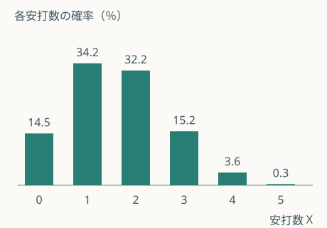

## 100回引いたら、当たる？

100回

レア率 **0.05％**。100回なら、もう当たりそう？

今日は「当たりそう」を、**公式で説明できる** ようにする。

---

## 今日の流れ

**復習**　何を数える？　どの公式？

**チャレンジ3問**　自分で式を組み立てる。各10分。

**AL 01・02・03**　打率、ガチャ、不良品。ワークシートに接続。

3つのALは、同じ公式を別の場面で使う練習です。

---

<!-- _class: book-divider -->

## 教科書 · 第2章 第2節

4　離散確率分布の復習

p.118–120

**回数が決まるなら二項分布。まれな発生数ならポアソン近似。**

式の前に、何を数える $X$ なのか決めよう。

---

## Xは何を数える？

| 場面 | 確率変数 $X$ | 取りうる値 |
| --- | --- | --- |
| 5打席 | 安打の本数 | 0, 1, 2, 3, 4, 5 |
| 100回のガチャ | レアの個数 | 0, 1, …, 100 |
| 3,500個を検品 | 不良品の個数 | 0, 1, …, 3500 |

**0個も、立派な結果。**

Xは「当たる確率」ではなく、数える個数。実際に観測した値を小文字xと書く。

---

<!-- _class: book-reference -->

## 二項分布の公式

最重要 / VERY IMPORTANT

$$
\Pr(X=x)={}_nC_x\pi^x(1-\pi)^{n-x}
$$

独立な試行をn回。毎回の成功確率πは同じ。成功回数Xを数える。教科書 p.118–119。

---

## 式は「並び方 × 1通りの確率」

$$
\underbrace{{}_nC_x}_{\text{並び方}}\ \underbrace{\pi^x}_{\text{成功 }x\text{ 回}}\ \underbrace{(1-\pi)^{n-x}}_{\text{失敗 }n-x\text{ 回}}
$$

ロボット3体・ヤギ2体の **1つの並び** の確率は、$\pi^3(1-\pi)^2$。

その並び方は ${}_5C_3=10$ 通り。10通りの確率を足す。

成功・失敗の順番が違っても、成功回数が同じなら同じXに数える。

---

<!-- _class: book-reference -->

## Cは「順番を区別しない選び方」

$$
{}_nC_x=\frac{n!}{x!(n-x)!}
$$

$$
{}_7C_2=\frac{7\times6}{2\times1}=21
$$

7つの位置から、ロボットが入る2か所を選ぶ。

0!=1。端の結果も扱えるので、nC0=nCn=1になる。教科書 p.119。

---

## 「ちょうど」と「以上」は違う

$$
\Pr(X=1)\neq\Pr(X\ge1)
$$

**ちょうど1個**：1個だけ。2個は含まない。

**1個以上**：1個、2個、3個、…全部。

$$
\Pr(X\ge1)=1-\Pr(X=0)
$$

少なくとも1個の反対は、1個もない。ガチャで使う一番大切な読み替え。

---

<!-- _class: book-reference -->

## 期待値と分散は「個数」の性質

最重要 / VERY IMPORTANT

$$
E(X)=n\pi,\qquad\operatorname{Var}(X)=n\pi(1-\pi)
$$

**期待値**：同じセットを繰り返したときの平均個数。

**分散**：セットごとの個数のばらつき。単位は個²。

期待値0.05個は、当たる確率5％という意味ではない。教科書 p.119–120。

---

<!-- _class: book-divider -->

## 教科書 · 第2章 第2節

ポアソン近似

p.120

試行回数 $n$ が大きく、成功確率 $\pi$ が小さいとき。

$\lambda=n\pi$ を使い、まれな発生数を近似する。

---

<!-- _class: book-reference -->

## ポアソン分布の公式

$$
\Pr(X=x)=\frac{\lambda^xe^{-\lambda}}{x!},\qquad E(X)=\operatorname{Var}(X)=\lambda
$$

**確率は配布表で読む。** $e$ の数値を計算する必要はない。

[ポアソン分布表を開く](https://yohman.github.io/26-2-StatsB/viewer.html?file=other+material%2F2025+yoh%2F06_%5BAL%5D%E7%A2%BA%E7%8E%87%E5%88%86%E5%B8%83_1_%E9%9B%A2%E6%95%A3%E7%A2%BA%E7%8E%87%E5%88%86%E5%B8%83+%E3%83%9D%E3%82%A2%E3%82%BD%E3%83%B3%2F%E3%83%9D%E3%82%A2%E3%82%BD%E3%83%B3%E5%88%86%E5%B8%83%E8%A1%A8.pdf&title=%E3%83%9D%E3%82%A2%E3%82%BD%E3%83%B3%E5%88%86%E5%B8%83%E8%A1%A8&week=W04&return=agenda.html%23week-04)

ポアソンモデルの式は等式。二項分布をポアソンで置き換えるときは近似。教科書 p.120。

---

## モデルを選ぶ、最短の質問

| 質問 | 二項分布 | ポアソン近似 |
| --- | --- | --- |
| 何が与えられた？ | $n$ 回・成功率 $\pi$ | 大きい $n$・小さい $\pi$ |
| 数えるもの | $n$ 回中の成功数 | まれな発生数 |
| 平均 | $n\pi$ | $\lambda=n\pi$ |
| 分散 | $n\pi(1-\pi)$ | $\lambda$ |

5打席32％は二項。3,500個中、不良率0.2％は今回の課題ではポアソン近似。

---

<!-- _class: challenge -->

## チャレンジ①　7台の配送ロボット

自分で解く　10分　／　教科書 p.118–120

各ロボットが時間内に到着する確率は **80％**。7台は独立に配達する。

**(1)** ちょうど5台が間に合う確率は？

**(2)** 1台以上が遅れる確率は？

**(3)** 間に合う台数の期待値と分散は？

教科書・電卓可。公式を文字で書き、数値を代入し、答えの意味まで説明しよう。

---

<!-- _class: challenge-check worked-answer -->

## 答え合わせ①　遅れるのは、全台成功の反対

① 与えられた条件

$X$ は時間内に到着した台数。$n=7,\ \pi=0.8$。

② 公式（文字のまま）

$$
\begin{aligned}\Pr(X=x)&={}_nC_x\pi^x(1-\pi)^{n-x}\\\Pr(X<n)&=1-\Pr(X=n)\\E(X)&=n\pi\\\operatorname{Var}(X)&=n\pi(1-\pi)\end{aligned}
$$

③ 数値を代入・計算

$$
\begin{aligned}\Pr(X=5)&={}_7C_5(0.8)^5(0.2)^2\\&=0.2752512\\\Pr(X\le6)&=1-(0.8)^7=0.7902848\\E(X)&=7\times0.8=5.6\\\operatorname{Var}(X)&=7\times0.8\times0.2=1.12\end{aligned}
$$

④ 答え・意味

ちょうど5台：約27.53％。1台以上遅れる：約79.03％。

期待値5.6台、分散1.12台²。Xは遅れた台数ではなく、時間内に到着した台数。

---

<!-- _class: challenge -->

## チャレンジ②　80回のカプセル抽選

自分で解く　10分　／　教科書 p.119–120

1回の当たり確率は **1％**。80回、独立に抽選する。確率は変わらない。

**(1)** 1回以上当たる確率は？

**(2)** 当たり個数の期待値と分散は？

**(3)** 「80回×1％＝80％だから、当たる確率80％」は正しい？

教科書・電卓可。公式を文字で書き、数値を代入し、答えの意味まで説明しよう。

---

<!-- _class: challenge-check worked-answer -->

## 答え合わせ②　期待個数と当選確率を分ける

① 与えられた条件

$X$ は当たり個数。$n=80,\ \pi=0.01$。

② 公式（文字のまま）

$$
\begin{aligned}\Pr(X\ge1)&=1-(1-\pi)^n\\E(X)&=n\pi\\\operatorname{Var}(X)&=n\pi(1-\pi)\end{aligned}
$$

③ 数値を代入・計算

$$
\begin{aligned}\Pr(X\ge1)&=1-(0.99)^{80}\\&\approx0.552477\\E(X)&=80\times0.01=0.8\\\operatorname{Var}(X)&=80\times0.01\times0.99\\&=0.792\end{aligned}
$$

④ 答え・意味

1回以上当たる：約55.25％。期待値0.8個、分散0.792個²。

nπは平均個数。1個以上当たる確率とは別の量なので、80％とは言えない。

---

<!-- _class: challenge -->

## チャレンジ③　2,500個のセンサーを出荷

自分で解く　10分　／　教科書 p.120

不良率は **1,000個あたり2個**。2,500個を出荷する。
不良品数 $X$ はポアソン分布で近似できるとする。

**(1)** $\lambda$ と、期待値・分散は？

**(2)** 不良品が1個以下である確率を、配布表で求めよ。

**(3)** 1個以下の反対は、何個以上？

教科書・電卓可。公式を文字で書き、数値を代入し、答えの意味まで説明しよう。

---

<!-- _class: challenge-check worked-answer -->

## 答え合わせ③　1個以下は、0個と1個

① 与えられた条件

$n=2500,\ \pi=2/1000=0.002$。ポアソン近似を使う。

② 公式（文字のまま）

$$
\begin{aligned}\lambda&=n\pi\\E(X)&=\operatorname{Var}(X)=\lambda\\\Pr(X\le1)&=\Pr(X=0)+\Pr(X=1)\end{aligned}
$$

③ 数値を代入・計算

$$
\begin{aligned}\lambda&=2500\times0.002=5\\E(X)&\approx5,\quad\operatorname{Var}(X)\approx5\\\text{表の }\mu=5.0&:\ P_0=0.007,\ P_1=0.034\\\Pr(X\le1)&\approx0.007+0.034=0.041\end{aligned}
$$

④ 答え・意味

不良品1個以下：約4.1％。その反対は2個以上。

期待値5個、近似分散5個²。表の丸め値を使用。不良品は独立・不良率一定と仮定。

---

<!-- _class: book-divider -->

## 教科書 · 第2章 第2節

AL　3つのシートを解く

p.118–120

**01 打率**　全ての結果を並べる。

**02 ガチャ**　余事象で、1個以上を求める。

**03 不良品**　ポアソン近似で、平均と分散を読む。

---

## AL 01　5打席で、何本打つ？

⚾ × 5

$X$＝安打数。$n=5$、$\pi=0.32$、$1-\pi=0.68$。

**0本から5本まで、全部の確率を計算する。**

シート「打率の事例_応用」。D6に0.32、D7に5。F7:F12はx=0〜5。

---

<!-- _class: explained -->

## AL 01　ワークシートの4列は、式の4部分

$$
\underbrace{{}_nC_x}_{H\text{列}}\ \underbrace{\pi^x}_{I\text{列}}\ \underbrace{(1-\pi)^{n-x}}_{J\text{列}}=\underbrace{\Pr(X=x)}_{G\text{列}}
$$

| 列 | 入れるもの | x=3 の場合 |
| --- | --- | --- |
| H | 組合せ | $\,{}_5C_3=10$ |
| I | 成功の確率 | $0.32^3=0.032768$ |
| J | 失敗の確率 | $0.68^2=0.4624$ |
| G | H × I × J | $0.151519232$ |

Excelなら、H10=COMBIN($D$7,F10)、I10=$D$6^F10、J10=(1-$D$6)^($D$7-F10)、G10=H10*I10*J10。

---

<!-- _class: explained al-table -->

## AL 01　6つの結果で、100％になる

| $x$ | $\,{}_5C_x$ | $0.32^x$ | $0.68^{5-x}$ | $\Pr(X=x)$ |
| --- | --- | --- | --- | --- |
| 0 | 1 | 1.000000 | 0.145393 | 14.54％ |
| 1 | 5 | 0.320000 | 0.213814 | 34.21％ |
| 2 | 10 | 0.102400 | 0.314432 | 32.20％ |
| 3 | 10 | 0.032768 | 0.462400 | 15.15％ |
| 4 | 5 | 0.010486 | 0.680000 | 3.57％ |
| 5 | 1 | 0.003355 | 1.000000 | 0.34％ |

$$
\sum_{x=0}^{5}\Pr(X=x)=1
$$

最も起こりやすいのは1本。期待値は5×0.32=1.6本。最頻値と平均は同じとは限らない。途中計算では丸めず、最後に表示を丸める。

---

<!-- _class: try -->

## AL 01　1試合と、100試合を比べる

1試合では、何本打つかは分からない。

**100試合** の実測を、公式の確率分布と比べよう。

棒を選ぶ代わりに、$x$ のスライダーで **1つの式** を確かめる。

[やってみよう！](https://yohman.github.io/26-2-StatsB/agenda.html?activity=al4-hits#week-04)

理論の緑の枠は固定。実測のオレンジだけが変わる。100試合は、5打席の試合を100回繰り返すこと。

---

## AL 02　0.05％を、式に入る数にする

$$
0.05\%=\frac{0.05}{100}=0.0005
$$

**レアはロボット。通常はヤギ。** $X$ はレアの個数。

シート「ガチャの事例」。D6=0.0005、D7=100。0.05をそのまま入れると5％になり、100倍違う。独立・排出率一定・天井なし。

---

<!-- _class: challenge-check worked-answer -->

## AL 02　1個以上は、0個の反対

① 与えられた条件

$n=100,\ \pi=0.0005,\ 1-\pi=0.9995$。求めるのは $X\ge1$。

② 公式（文字のまま）

$$
\begin{aligned}\Pr(X=0)&={}_nC_0\pi^0(1-\pi)^n\\\Pr(X\ge1)&=1-\Pr(X=0)\\&=1-(1-\pi)^n\end{aligned}
$$

③ 数値を代入・計算

$$
\begin{aligned}\Pr(X=0)&=1\times1\times(0.9995)^{100}\\&\approx0.95121753\\\Pr(X\ge1)&=1-0.95121753\\&\approx0.04878247\end{aligned}
$$

④ 答え・意味

100回引いてレア1個以上：約4.88％。0個：約95.12％。

D9=1-G7。D10=SUM(G8:G107)でも確認できる。4.878247…％を小数第2位まで表示すると4.88％。

---

<!-- _class: challenge-check worked-answer -->

## AL 02　「期待値0.05個」の意味

① 与えられた条件

$X$ は100回で出るレア個数。$n=100,\ \pi=0.0005$。

② 公式（文字のまま）

$$
\begin{aligned}E(X)&=n\pi\\\operatorname{Var}(X)&=n\pi(1-\pi)\end{aligned}
$$

③ 数値を代入・計算

$$
\begin{aligned}E(X)&=100\times0.0005=0.05\\\operatorname{Var}(X)&=100\times0.0005\times0.9995\\&=0.049975\end{aligned}
$$

④ 答え・意味

期待値0.05個。分散0.049975個²。

D12=期待値、D13=分散。100回セットを20セット行うと、合計レアの期待個数は1個。ただし必ず1個当たる保証ではない。

---

<!-- _class: try -->

## AL 02　ロボットと一緒に、100回セットを引く

**1セット＝100回のガチャ。**

1セットだけでは、ほとんどレア0個。

100セット・1,000セット試して、**レアが出たセットの割合** を比べよう。

[やってみよう！](https://yohman.github.io/26-2-StatsB/agenda.html?activity=al4-gacha#week-04)

期待個数と、1個以上出る確率は別の量。次の1回のレア率は、外れ続けても0.05％のまま。

---

## AL 03　3,500個を出荷するロボット工場

📦 × 3500

$$
\pi=\frac{2}{1000}=0.002,\qquad n=3500
$$

$X$＝不良品の個数。**ポアソン分布で近似する** と指定されている。

シート「不良品の事例」。D7=2/1000、D8=3500。不良品を「起こる」と数える。

---

<!-- _class: challenge-check worked-answer -->

## AL 03　平均個数が、ポアソンの母数

① 与えられた条件

$n=3500,\ \pi=0.002$。独立・不良率一定を仮定し、ポアソン近似。

② 公式（文字のまま）

$$
\begin{aligned}\lambda&=n\pi\\E(X)&=\lambda\\\operatorname{Var}(X)&=\lambda\end{aligned}
$$

③ 数値を代入・計算

$$
\begin{aligned}\lambda&=3500\times0.002=7\\E(X)&\approx7\\\operatorname{Var}(X)&\approx7\end{aligned}
$$

④ 答え・意味

予測される不良品は平均7個。近似の分散は7個²。

D10=期待値、D11=分散。毎便7個と決まっているわけではない。出荷する便ごとにXは変わる。

---

<!-- _class: book-reference -->

## AL 03　なぜ分散も7でよい？

$$
\begin{aligned}\text{二項の正確な分散}&=3500\times0.002\times0.998=6.986\\\text{ポアソン近似の分散}&=\lambda=7\end{aligned}
$$

$1-\pi=0.998$ は、ほぼ1。だから近似では **7** を使う。

**平均は、二項でもポアソン近似でも7。**

問題が「ポアソン分布で近似」と指定しているので、ALの分散は7。6.986と7を混ぜない。教科書 p.120。

---

<!-- _class: try -->

## AL 03　毎便7個とは限らない

1便ずつ検品し、不良品が何個あったかを見る。

便を増やして、**平均個数** と **便ごとの分布** を確認する。

[やってみよう！](https://yohman.github.io/26-2-StatsB/agenda.html?activity=al4-defects#week-04)

実験では3,500個を独立に判定する二項モデルを使い、緑のポアソン近似と比べる。近似なので完全一致を強制しない。

---

## 提出前のチェック

**01 打率**　0〜5本の確率を全部書いた？　合計は1？

**02 ガチャ**　0.05％を0.0005にした？　個数と確率を分けた？

**03 不良品**　$\lambda=7$？　近似の分散も7？

ワークシートに入力し、指定セルの値を **UNIPA** の小テストで回答。

締切と提出方法は、授業予定ページ・UNIPAの最新案内を確認。

