

<!-- _class: race-media race-video -->

## パリ2024 · 男子100m決勝

<a class="media-link" href="https://www.youtube.com/watch?v=GHw-eTs4Yes">▶ 動画を見る / Watch the race</a>

---

<!-- _class: race-media race-finish -->

## この写真だけで、分かる？

Photo © Dan Vernon / World Athletics

---

<!-- _class: race-media race-scan -->

## 0.005秒を、見る。

<a class="media-link" href="https://www.hodinkee.com/articles/olympics-2024-mens-100m-photo-finish">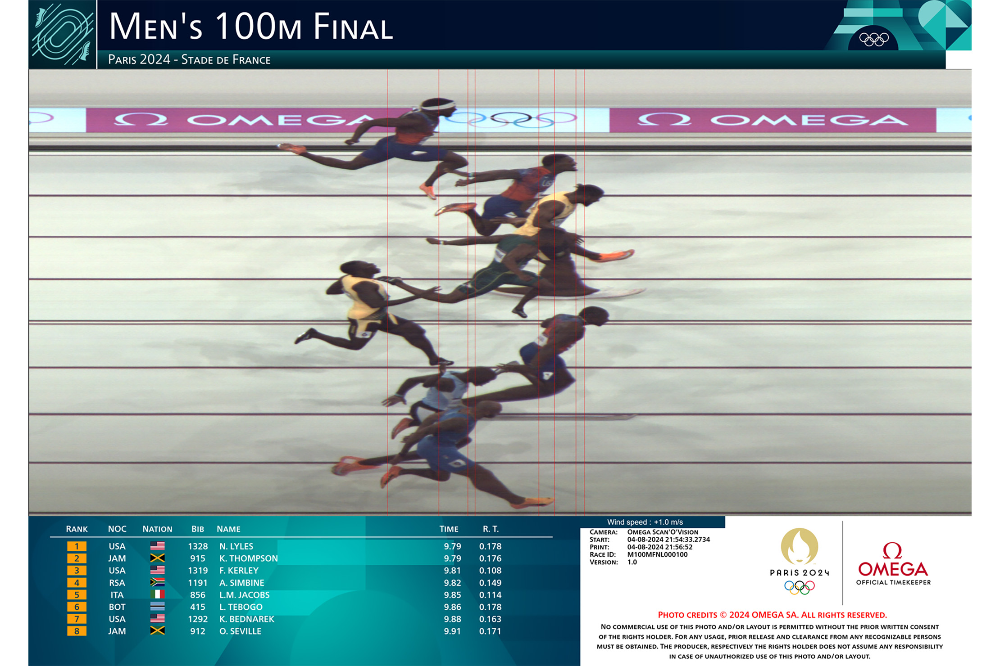OMEGAの写真判定について ↗</a>Photo courtesy OMEGA · judging-area crop

---

<!-- _class: watch-bridge -->

## 今度は、自分で1秒。

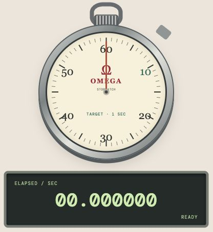

<h3>ぴったり1秒で、 止められる？</h3>
1.000000 秒
<a href="https://yohman.github.io/26-2-StatsB/agenda.html?p&amp;activity=w5-stopwatch#week-05">やってみよう！</a><small>授業用の再現 / Classroom recreation OMEGA公式の計測器ではありません。</small>

---

<!-- _class: explain has-stat-terms -->

## 今日のゴール：<ruby>標<rt>ひょう</rt></ruby><ruby>準<rt>じゅん</rt></ruby><ruby>化<rt>か</rt></ruby>して、表で読む

<ruby>標<rt>ひょう</rt></ruby><ruby>準<rt>じゅん</rt></ruby><ruby>偏<rt>へん</rt></ruby><ruby>差<rt>さ</rt></ruby>を確認する。

値をzに直す。

右・左・<ruby>区<rt>く</rt></ruby><ruby>間<rt>かん</rt></ruby>の面積を、表から求める。

**このあと何度か、自分で解く時間を取ります。**

<aside class="stat-terms" aria-label="統計用語 / Statistical terms"><ruby>標<rt>ひょう</rt></ruby><ruby>準<rt>じゅん</rt></ruby><ruby>化<rt>か</rt></ruby>Standardization<ruby>標<rt>ひょう</rt></ruby><ruby>準<rt>じゅん</rt></ruby><ruby>得<rt>とく</rt></ruby><ruby>点<rt>てん</rt></ruby>Z-score</aside>

---

<!-- _class: precision has-stat-terms -->

## 身長、何cmまで測る？

$$
160\quad 160.0\quad 160.000\ldots
$$

「ぴったり160cm」と「155〜165cm」は、同じ？

<aside class="formula-ref">教科書 p.121–122 · <ruby>確<rt>かく</rt></ruby><ruby>率<rt>りつ</rt></ruby><ruby>密<rt>みつ</rt></ruby><ruby>度<rt>ど</rt></ruby>と面積（例への適用）</aside>

<aside class="stat-terms" aria-label="統計用語 / Statistical terms"><ruby>測<rt>そく</rt></ruby><ruby>定<rt>てい</rt></ruby><ruby>精<rt>せい</rt></ruby><ruby>度<rt>ど</rt></ruby>Measurement precision</aside>

---

<!-- _class: hero-math has-stat-terms -->

## <ruby>1<rt>いっ</rt></ruby><ruby>点<rt>てん</rt></ruby>の<ruby>確<rt>かく</rt></ruby><ruby>率<rt>りつ</rt></ruby>

$$
\Pr(X=160)=0
$$

<aside class="formula-ref">教科書 p.121–122 · <ruby>確<rt>かく</rt></ruby><ruby>率<rt>りつ</rt></ruby><ruby>密<rt>みつ</rt></ruby><ruby>度<rt>ど</rt></ruby>と面積（例への適用）</aside>

<aside class="stat-terms" aria-label="統計用語 / Statistical terms"><ruby>確<rt>かく</rt></ruby><ruby>率<rt>りつ</rt></ruby><ruby>変<rt>へん</rt></ruby><ruby>数<rt>すう</rt></ruby>Random variable<ruby>1<rt>いっ</rt></ruby><ruby>点<rt>てん</rt></ruby>の<ruby>確<rt>かく</rt></ruby><ruby>率<rt>りつ</rt></ruby>Point probability</aside>

---

<!-- _class: explain has-stat-terms -->

## 155〜165cmなら、<ruby>区<rt>く</rt></ruby><ruby>間<rt>かん</rt></ruby>に幅がある

$$
\Pr(155\le X\le165)>0
$$

ぴったり160cmという1点の幅は0。

155〜165cmという<ruby>区<rt>く</rt></ruby><ruby>間<rt>かん</rt></ruby>には、10cmの幅がある。

<aside class="formula-ref">教科書 p.121–122 · <ruby>確<rt>かく</rt></ruby><ruby>率<rt>りつ</rt></ruby><ruby>密<rt>みつ</rt></ruby><ruby>度<rt>ど</rt></ruby>と面積（例への適用）</aside>

<aside class="stat-terms" aria-label="統計用語 / Statistical terms"><ruby>区<rt>く</rt></ruby><ruby>間<rt>かん</rt></ruby>Interval<ruby>区<rt>く</rt></ruby><ruby>間<rt>かん</rt></ruby>の<ruby>確<rt>かく</rt></ruby><ruby>率<rt>りつ</rt></ruby>Interval probability</aside>

---

<!-- _class: book-divider has-stat-terms -->

## 教科書 · 第2章 第2節

5　<ruby>連<rt>れん</rt></ruby><ruby>続<rt>ぞく</rt></ruby><ruby>確<rt>かく</rt></ruby><ruby>率<rt>りつ</rt></ruby><ruby>分<rt>ぶん</rt></ruby><ruby>布<rt>ぷ</rt></ruby>

p.121–122

<aside class="stat-terms" aria-label="統計用語 / Statistical terms"><ruby>連<rt>れん</rt></ruby><ruby>続<rt>ぞく</rt></ruby><ruby>確<rt>かく</rt></ruby><ruby>率<rt>りつ</rt></ruby><ruby>分<rt>ぶん</rt></ruby><ruby>布<rt>ぷ</rt></ruby>Continuous probability distribution</aside>

---

<!-- _class: model-visual has-stat-terms -->

## ロボットの身長は、160cm付近に集まる

同じ型のロボットでも、身長には小さな違いがある。

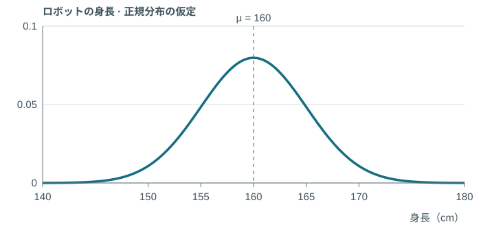

授業用モデル：<ruby>平<rt>へい</rt></ruby><ruby>均<rt>きん</rt></ruby>160cm、<ruby>標<rt>ひょう</rt></ruby><ruby>準<rt>じゅん</rt></ruby><ruby>偏<rt>へん</rt></ruby><ruby>差<rt>さ</rt></ruby>5cmの<ruby>正<rt>せい</rt></ruby><ruby>規<rt>き</rt></ruby><ruby>分<rt>ぶん</rt></ruby><ruby>布<rt>ぷ</rt></ruby>。

<aside class="stat-terms" aria-label="統計用語 / Statistical terms"><ruby>確<rt>かく</rt></ruby><ruby>率<rt>りつ</rt></ruby><ruby>密<rt>みつ</rt></ruby><ruby>度<rt>ど</rt></ruby><ruby>関<rt>かん</rt></ruby><ruby>数<rt>すう</rt></ruby>Probability density function (PDF)<ruby>正<rt>せい</rt></ruby><ruby>規<rt>き</rt></ruby><ruby>分<rt>ぶん</rt></ruby><ruby>布<rt>ぷ</rt></ruby>Normal distribution</aside>

---

<!-- _class: visual-link has-stat-terms -->

## 155〜165cmの<ruby>確<rt>かく</rt></ruby><ruby>率<rt>りつ</rt></ruby>は、この面積

曲線の高さではなく、155〜165cmの下の面積を見る。

<aside class="stat-terms" aria-label="統計用語 / Statistical terms"><ruby>区<rt>く</rt></ruby><ruby>間<rt>かん</rt></ruby>の<ruby>確<rt>かく</rt></ruby><ruby>率<rt>りつ</rt></ruby>Interval probability</aside>

---

<!-- _class: hero-math long has-stat-terms -->

## <ruby>区<rt>く</rt></ruby><ruby>間<rt>かん</rt></ruby>の<ruby>確<rt>かく</rt></ruby><ruby>率<rt>りつ</rt></ruby>

$$
\Pr(a\le X\le b)=\int_a^b f(x)\,dx
$$

<aside class="formula-ref">教科書 p.121–122 · <ruby>確<rt>かく</rt></ruby><ruby>率<rt>りつ</rt></ruby><ruby>密<rt>みつ</rt></ruby><ruby>度<rt>ど</rt></ruby>と面積（例への適用）</aside>

<aside class="stat-terms" aria-label="統計用語 / Statistical terms"><ruby>定<rt>てい</rt></ruby><ruby>積<rt>せき</rt></ruby><ruby>分<rt>ぶん</rt></ruby>Definite integral<ruby>区<rt>く</rt></ruby><ruby>間<rt>かん</rt></ruby>の<ruby>確<rt>かく</rt></ruby><ruby>率<rt>りつ</rt></ruby>Interval probability</aside>

---

<!-- _class: explain has-stat-terms -->

## <ruby>確<rt>かく</rt></ruby><ruby>率<rt>りつ</rt></ruby><ruby>密<rt>みつ</rt></ruby><ruby>度<rt>ど</rt></ruby>には、いろいろな形がある

釣鐘型は、<ruby>正<rt>せい</rt></ruby><ruby>規<rt>き</rt></ruby><ruby>分<rt>ぶん</rt></ruby><ruby>布<rt>ぷ</rt></ruby>の形。

値の集まり方が違えば、密度の形も変わる。

**どの形でも、<ruby>区<rt>く</rt></ruby><ruby>間<rt>かん</rt></ruby>の<ruby>確<rt>かく</rt></ruby><ruby>率<rt>りつ</rt></ruby>は曲線の下の面積。**

<aside class="stat-terms" aria-label="統計用語 / Statistical terms"><ruby>確<rt>かく</rt></ruby><ruby>率<rt>りつ</rt></ruby><ruby>密<rt>みつ</rt></ruby><ruby>度<rt>ど</rt></ruby><ruby>関<rt>かん</rt></ruby><ruby>数<rt>すう</rt></ruby>Probability density function (PDF)<ruby>正<rt>せい</rt></ruby><ruby>規<rt>き</rt></ruby><ruby>分<rt>ぶん</rt></ruby><ruby>布<rt>ぷ</rt></ruby>Normal distribution</aside>

---

<!-- _class: race-media queue-story queue-history -->

## ラーメン店の行列

---

<!-- _class: race-media queue-story queue-bowl -->

## なんでんかんでんのラーメン

---

<!-- _class: race-media queue-story queue-portrait -->

## 王道家、この行列、何分待つ？

---

<!-- _class: race-media queue-story queue-bowl -->

## 王道家のラーメンとご飯

---

<!-- _class: model-visual queue-model has-stat-terms -->

## 待ち時間なら、こんな形も考えられる

列に並んでから座れるまでの時間を、X分とする。

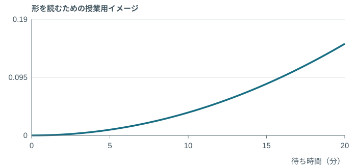

身長の釣鐘型とは、違う形。

<small>形を読むための仮定です。王道家の実測データではありません。</small>

<aside class="stat-terms" aria-label="統計用語 / Statistical terms"><ruby>確<rt>かく</rt></ruby><ruby>率<rt>りつ</rt></ruby><ruby>密<rt>みつ</rt></ruby><ruby>度<rt>ど</rt></ruby><ruby>関<rt>かん</rt></ruby><ruby>数<rt>すう</rt></ruby>Probability density function (PDF)<ruby>確<rt>かく</rt></ruby><ruby>率<rt>りつ</rt></ruby>Probability</aside>

---

<!-- _class: model-visual queue-model has-stat-terms -->

## 全体の面積は、1＝100％

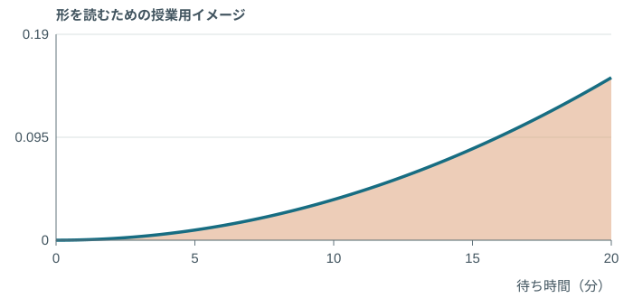

どんな形の<ruby>確<rt>かく</rt></ruby><ruby>率<rt>りつ</rt></ruby><ruby>密<rt>みつ</rt></ruby><ruby>度<rt>ど</rt></ruby>でも、全体の面積は1。

<small>この図の0〜20分は授業用の仮定。王道家の実測データではありません。</small>

<small class="book-note">教科書 p.121 · 全体の<ruby>確<rt>かく</rt></ruby><ruby>率<rt>りつ</rt></ruby>は1</small>

<aside class="stat-terms" aria-label="統計用語 / Statistical terms"><ruby>確<rt>かく</rt></ruby><ruby>率<rt>りつ</rt></ruby><ruby>密<rt>みつ</rt></ruby><ruby>度<rt>ど</rt></ruby><ruby>関<rt>かん</rt></ruby><ruby>数<rt>すう</rt></ruby>Probability density function (PDF)<ruby>確<rt>かく</rt></ruby><ruby>率<rt>りつ</rt></ruby>Probability</aside>

---

<!-- _class: model-visual queue-model has-stat-terms -->

## <ruby>区<rt>く</rt></ruby><ruby>間<rt>かん</rt></ruby>の<ruby>確<rt>かく</rt></ruby><ruby>率<rt>りつ</rt></ruby>は、その部分の面積

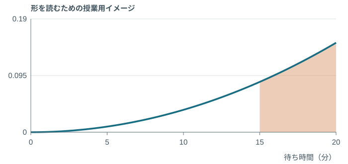

色の面積＝15〜20分待つ<ruby>確<rt>かく</rt></ruby><ruby>率<rt>りつ</rt></ruby>。

0〜5分待つより、15〜20分待つほうが起こりやすい。

<small>同じ5分幅の面積を比較。授業用の仮定で、王道家の実測データではありません。</small>

<aside class="stat-terms" aria-label="統計用語 / Statistical terms"><ruby>定<rt>てい</rt></ruby><ruby>積<rt>せき</rt></ruby><ruby>分<rt>ぶん</rt></ruby>Definite integral<ruby>区<rt>く</rt></ruby><ruby>間<rt>かん</rt></ruby>の<ruby>確<rt>かく</rt></ruby><ruby>率<rt>りつ</rt></ruby>Interval probability</aside>

---

<!-- _class: worked has-stat-terms -->

## ロボットが、155〜165cmに収まる<ruby>確<rt>かく</rt></ruby><ruby>率<rt>りつ</rt></ruby>

$$
\Pr(a\le X\le b)=\int_a^b f(x)\,dx
$$

$$
\Pr(155\le X\le165)=\int_{155}^{165}f(x)\,dx
$$

出荷条件が155〜165cmなら、色の面積が条件を満たす割合。

<small>授業用の仮定：ロボットの身長は<ruby>平<rt>へい</rt></ruby><ruby>均<rt>きん</rt></ruby>160cm、<ruby>標<rt>ひょう</rt></ruby><ruby>準<rt>じゅん</rt></ruby><ruby>偏<rt>へん</rt></ruby><ruby>差<rt>さ</rt></ruby>5cmの<ruby>正<rt>せい</rt></ruby><ruby>規<rt>き</rt></ruby><ruby>分<rt>ぶん</rt></ruby><ruby>布<rt>ぷ</rt></ruby>。実測データではありません。</small>

<aside class="formula-ref">教科書 p.121–122 · <ruby>確<rt>かく</rt></ruby><ruby>率<rt>りつ</rt></ruby><ruby>密<rt>みつ</rt></ruby><ruby>度<rt>ど</rt></ruby>と面積（例への適用）</aside>

<aside class="stat-terms" aria-label="統計用語 / Statistical terms"><ruby>定<rt>てい</rt></ruby><ruby>積<rt>せき</rt></ruby><ruby>分<rt>ぶん</rt></ruby>Definite integral<ruby>区<rt>く</rt></ruby><ruby>間<rt>かん</rt></ruby>の<ruby>確<rt>かく</rt></ruby><ruby>率<rt>りつ</rt></ruby>Interval probability</aside>

---

<!-- _class: worked has-stat-terms -->

## 160cm以下のロボットは、何割？

$$
F(c)=\Pr(X\le c)
$$

$$
F(160)=\Pr(X\le160)=0.50
$$

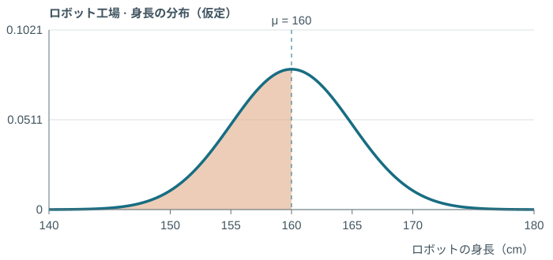

160cm以下＝左側から160cmまで、すべて含める。

<small>授業用の仮定：ロボットの身長は<ruby>平<rt>へい</rt></ruby><ruby>均<rt>きん</rt></ruby>160cm、<ruby>標<rt>ひょう</rt></ruby><ruby>準<rt>じゅん</rt></ruby><ruby>偏<rt>へん</rt></ruby><ruby>差<rt>さ</rt></ruby>5cmの<ruby>正<rt>せい</rt></ruby><ruby>規<rt>き</rt></ruby><ruby>分<rt>ぶん</rt></ruby><ruby>布<rt>ぷ</rt></ruby>。実測データではありません。</small>

<aside class="formula-ref">教科書 p.121–122 · 分布関数と<ruby>区<rt>く</rt></ruby><ruby>間<rt>かん</rt></ruby>の<ruby>確<rt>かく</rt></ruby><ruby>率<rt>りつ</rt></ruby></aside>

<aside class="stat-terms" aria-label="統計用語 / Statistical terms"><ruby>累<rt>るい</rt></ruby><ruby>積<rt>せき</rt></ruby><ruby>分<rt>ぶん</rt></ruby><ruby>布<rt>ぷ</rt></ruby><ruby>関<rt>かん</rt></ruby><ruby>数<rt>すう</rt></ruby>Cumulative distribution function (CDF)<ruby>累<rt>るい</rt></ruby><ruby>積<rt>せき</rt></ruby><ruby>確<rt>かく</rt></ruby><ruby>率<rt>りつ</rt></ruby>Cumulative probability</aside>

---

<!-- _class: model-visual robot-example has-stat-terms -->

## 密度の図：160cmまでの「面積」

$$
\Pr(X\le160)=0.50
$$

色の面積が50％。曲線の高さを50％とは読まない。

<small>授業用の仮定：ロボットの身長は<ruby>平<rt>へい</rt></ruby><ruby>均<rt>きん</rt></ruby>160cm、<ruby>標<rt>ひょう</rt></ruby><ruby>準<rt>じゅん</rt></ruby><ruby>偏<rt>へん</rt></ruby><ruby>差<rt>さ</rt></ruby>5cmの<ruby>正<rt>せい</rt></ruby><ruby>規<rt>き</rt></ruby><ruby>分<rt>ぶん</rt></ruby><ruby>布<rt>ぷ</rt></ruby>。実測データではありません。</small>

<aside class="formula-ref">教科書 p.121–122 · 分布関数と<ruby>区<rt>く</rt></ruby><ruby>間<rt>かん</rt></ruby>の<ruby>確<rt>かく</rt></ruby><ruby>率<rt>りつ</rt></ruby></aside>

<aside class="stat-terms" aria-label="統計用語 / Statistical terms"><ruby>累<rt>るい</rt></ruby><ruby>積<rt>せき</rt></ruby><ruby>分<rt>ぶん</rt></ruby><ruby>布<rt>ぷ</rt></ruby><ruby>関<rt>かん</rt></ruby><ruby>数<rt>すう</rt></ruby>Cumulative distribution function (CDF)<ruby>累<rt>るい</rt></ruby><ruby>積<rt>せき</rt></ruby><ruby>確<rt>かく</rt></ruby><ruby>率<rt>りつ</rt></ruby>Cumulative probability</aside>

---

<!-- _class: model-visual robot-example has-stat-terms -->

## 累積分布の図：同じ50％を「高さ」にする

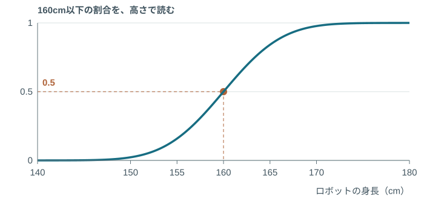

$$
F(160)=0.50
$$

横160cmから上へ進むと、縦0.50＝50％。

<small>授業用の仮定：ロボットの身長は<ruby>平<rt>へい</rt></ruby><ruby>均<rt>きん</rt></ruby>160cm、<ruby>標<rt>ひょう</rt></ruby><ruby>準<rt>じゅん</rt></ruby><ruby>偏<rt>へん</rt></ruby><ruby>差<rt>さ</rt></ruby>5cmの<ruby>正<rt>せい</rt></ruby><ruby>規<rt>き</rt></ruby><ruby>分<rt>ぶん</rt></ruby><ruby>布<rt>ぷ</rt></ruby>。実測データではありません。</small>

<aside class="formula-ref">教科書 p.121–122 · 分布関数と<ruby>区<rt>く</rt></ruby><ruby>間<rt>かん</rt></ruby>の<ruby>確<rt>かく</rt></ruby><ruby>率<rt>りつ</rt></ruby></aside>

<aside class="stat-terms" aria-label="統計用語 / Statistical terms"><ruby>累<rt>るい</rt></ruby><ruby>積<rt>せき</rt></ruby><ruby>分<rt>ぶん</rt></ruby><ruby>布<rt>ぷ</rt></ruby><ruby>関<rt>かん</rt></ruby><ruby>数<rt>すう</rt></ruby>Cumulative distribution function (CDF)<ruby>累<rt>るい</rt></ruby><ruby>積<rt>せき</rt></ruby><ruby>確<rt>かく</rt></ruby><ruby>率<rt>りつ</rt></ruby>Cumulative probability</aside>

---

<!-- _class: book-divider has-stat-terms -->

## 教科書 · 第2章 第2節

5　① <ruby>正<rt>せい</rt></ruby><ruby>規<rt>き</rt></ruby><ruby>分<rt>ぶん</rt></ruby><ruby>布<rt>ぷ</rt></ruby>

p.122–123

<aside class="stat-terms" aria-label="統計用語 / Statistical terms"><ruby>正<rt>せい</rt></ruby><ruby>規<rt>き</rt></ruby><ruby>分<rt>ぶん</rt></ruby><ruby>布<rt>ぷ</rt></ruby>Normal distribution<ruby>平<rt>へい</rt></ruby><ruby>均<rt>きん</rt></ruby>Mean<ruby>標<rt>ひょう</rt></ruby><ruby>準<rt>じゅん</rt></ruby><ruby>偏<rt>へん</rt></ruby><ruby>差<rt>さ</rt></ruby>Standard deviation</aside>

---

<!-- _class: model-visual has-stat-terms -->

## <ruby>正<rt>せい</rt></ruby><ruby>規<rt>き</rt></ruby><ruby>分<rt>ぶん</rt></ruby><ruby>布<rt>ぷ</rt></ruby>：中心と、ばらつき

$$
X\sim N(\mu,\sigma^2)\qquad E(X)=\mu,\quad\operatorname{Var}(X)=\sigma^2
$$

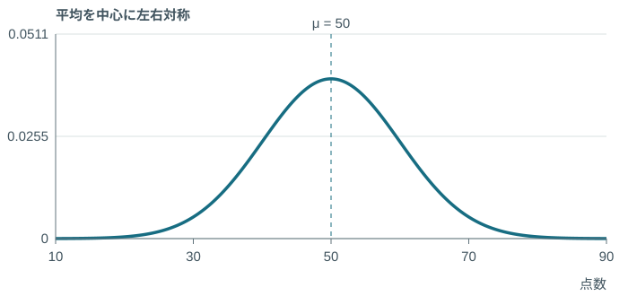

<aside class="formula-ref">教科書 p.122–123・129 · <ruby>正<rt>せい</rt></ruby><ruby>規<rt>き</rt></ruby><ruby>分<rt>ぶん</rt></ruby><ruby>布<rt>ぷ</rt></ruby>、<ruby>平<rt>へい</rt></ruby><ruby>均<rt>きん</rt></ruby>と<ruby>分<rt>ぶん</rt></ruby><ruby>散<rt>さん</rt></ruby></aside>

<aside class="stat-terms" aria-label="統計用語 / Statistical terms"><ruby>正<rt>せい</rt></ruby><ruby>規<rt>き</rt></ruby><ruby>分<rt>ぶん</rt></ruby><ruby>布<rt>ぷ</rt></ruby>Normal distribution<ruby>期<rt>き</rt></ruby><ruby>待<rt>たい</rt></ruby><ruby>値<rt>ち</rt></ruby>Expected value<ruby>分<rt>ぶん</rt></ruby><ruby>散<rt>さん</rt></ruby>Variance</aside>

---

<!-- _class: single-visual has-stat-terms -->

## <ruby>標<rt>ひょう</rt></ruby><ruby>準<rt>じゅん</rt></ruby><ruby>偏<rt>へん</rt></ruby><ruby>差<rt>さ</rt></ruby>が小さいと、狭い山

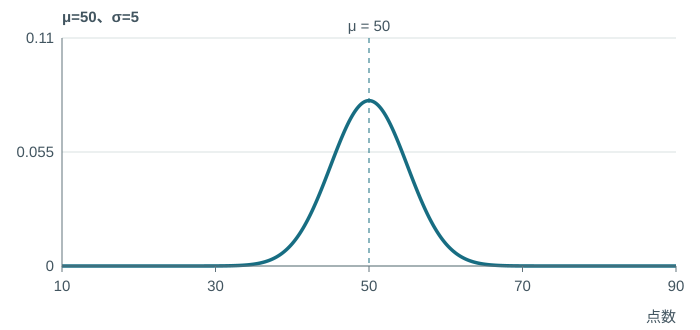

<aside class="stat-terms" aria-label="統計用語 / Statistical terms"><ruby>標<rt>ひょう</rt></ruby><ruby>準<rt>じゅん</rt></ruby><ruby>偏<rt>へん</rt></ruby><ruby>差<rt>さ</rt></ruby>Standard deviation<ruby>正<rt>せい</rt></ruby><ruby>規<rt>き</rt></ruby><ruby>分<rt>ぶん</rt></ruby><ruby>布<rt>ぷ</rt></ruby>Normal distribution</aside>

---

<!-- _class: single-visual has-stat-terms -->

## <ruby>標<rt>ひょう</rt></ruby><ruby>準<rt>じゅん</rt></ruby><ruby>偏<rt>へん</rt></ruby><ruby>差<rt>さ</rt></ruby>が大きいと、広い山

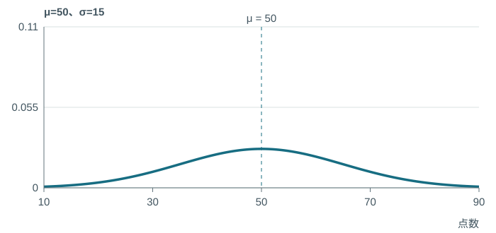

<aside class="stat-terms" aria-label="統計用語 / Statistical terms"><ruby>標<rt>ひょう</rt></ruby><ruby>準<rt>じゅん</rt></ruby><ruby>偏<rt>へん</rt></ruby><ruby>差<rt>さ</rt></ruby>Standard deviation<ruby>正<rt>せい</rt></ruby><ruby>規<rt>き</rt></ruby><ruby>分<rt>ぶん</rt></ruby><ruby>布<rt>ぷ</rt></ruby>Normal distribution</aside>

---

<!-- _class: explain has-stat-terms -->

## <ruby>分<rt>ぶん</rt></ruby><ruby>散<rt>さん</rt></ruby>と<ruby>標<rt>ひょう</rt></ruby><ruby>準<rt>じゅん</rt></ruby><ruby>偏<rt>へん</rt></ruby><ruby>差<rt>さ</rt></ruby>を、取り違えない

<ruby>分<rt>ぶん</rt></ruby><ruby>散<rt>さん</rt></ruby>は、<ruby>標<rt>ひょう</rt></ruby><ruby>準<rt>じゅん</rt></ruby><ruby>偏<rt>へん</rt></ruby><ruby>差<rt>さ</rt></ruby>を2乗したもの。

$$
\sigma^2=36\quad\Rightarrow\quad \sigma=\sqrt{36}=6
$$

**<ruby>標<rt>ひょう</rt></ruby><ruby>準<rt>じゅん</rt></ruby><ruby>化<rt>か</rt></ruby>で割るのは、36ではなく6。**

<aside class="formula-ref">教科書 p.123 · <ruby>標<rt>ひょう</rt></ruby><ruby>準<rt>じゅん</rt></ruby><ruby>化<rt>か</rt></ruby>の考え方をXに適用 ／ 津村18</aside>

<aside class="stat-terms" aria-label="統計用語 / Statistical terms"><ruby>標<rt>ひょう</rt></ruby><ruby>準<rt>じゅん</rt></ruby><ruby>化<rt>か</rt></ruby>Standardization<ruby>標<rt>ひょう</rt></ruby><ruby>準<rt>じゅん</rt></ruby><ruby>得<rt>とく</rt></ruby><ruby>点<rt>てん</rt></ruby>Z-score</aside>

---

<!-- _class: hero-math long has-stat-terms -->

## <ruby>正<rt>せい</rt></ruby><ruby>規<rt>き</rt></ruby><ruby>分<rt>ぶん</rt></ruby><ruby>布<rt>ぷ</rt></ruby>の密度

$$
f(x)=\frac{1}{\sqrt{2\pi\sigma^2}}\exp\left(-\frac{(x-\mu)^2}{2\sigma^2}\right)
$$

<aside class="formula-ref">教科書 p.122 · <ruby>正<rt>せい</rt></ruby><ruby>規<rt>き</rt></ruby><ruby>分<rt>ぶん</rt></ruby><ruby>布<rt>ぷ</rt></ruby>の<ruby>確<rt>かく</rt></ruby><ruby>率<rt>りつ</rt></ruby><ruby>密<rt>みつ</rt></ruby><ruby>度<rt>ど</rt></ruby></aside>

<aside class="stat-terms" aria-label="統計用語 / Statistical terms"><ruby>確<rt>かく</rt></ruby><ruby>率<rt>りつ</rt></ruby><ruby>密<rt>みつ</rt></ruby><ruby>度<rt>ど</rt></ruby><ruby>関<rt>かん</rt></ruby><ruby>数<rt>すう</rt></ruby>Probability density function (PDF)<ruby>正<rt>せい</rt></ruby><ruby>規<rt>き</rt></ruby><ruby>分<rt>ぶん</rt></ruby><ruby>布<rt>ぷ</rt></ruby>Normal distribution</aside>

---

<!-- _class: hero-math long has-stat-terms -->

## <ruby>標<rt>ひょう</rt></ruby><ruby>準<rt>じゅん</rt></ruby><ruby>化<rt>か</rt></ruby>の公式

$$
Z=\frac{X-E(X)}{\sqrt{\operatorname{Var}(X)}}=\frac{X-\mu}{\sigma}
$$

<aside class="formula-ref">教科書 p.123 · <ruby>標<rt>ひょう</rt></ruby><ruby>準<rt>じゅん</rt></ruby><ruby>化<rt>か</rt></ruby>の考え方をXに適用 ／ 津村18</aside>

<aside class="stat-terms" aria-label="統計用語 / Statistical terms"><ruby>標<rt>ひょう</rt></ruby><ruby>準<rt>じゅん</rt></ruby><ruby>化<rt>か</rt></ruby>Standardization<ruby>標<rt>ひょう</rt></ruby><ruby>準<rt>じゅん</rt></ruby><ruby>得<rt>とく</rt></ruby><ruby>点<rt>てん</rt></ruby>Z-score</aside>

---

<!-- _class: worked has-stat-terms -->

## 60点は、<ruby>標<rt>ひょう</rt></ruby><ruby>準<rt>じゅん</rt></ruby><ruby>偏<rt>へん</rt></ruby><ruby>差<rt>さ</rt></ruby>1個ぶん上

$$
z=\frac{x-\mu}{\sigma}
$$

$$
z=\frac{60-50}{10}=1
$$

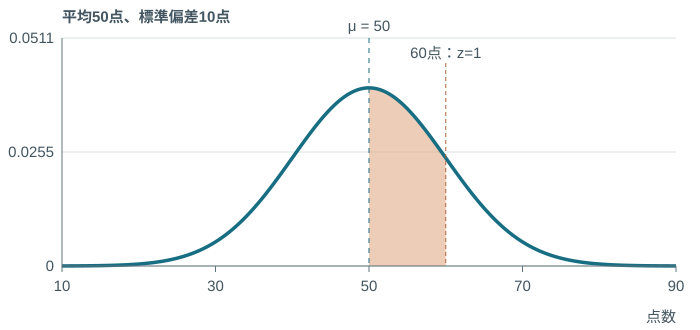

仮定：<ruby>平<rt>へい</rt></ruby><ruby>均<rt>きん</rt></ruby>50点、<ruby>標<rt>ひょう</rt></ruby><ruby>準<rt>じゅん</rt></ruby><ruby>偏<rt>へん</rt></ruby><ruby>差<rt>さ</rt></ruby>10点の<ruby>正<rt>せい</rt></ruby><ruby>規<rt>き</rt></ruby><ruby>分<rt>ぶん</rt></ruby><ruby>布<rt>ぷ</rt></ruby>。

[やってみよう！](https://yohman.github.io/26-2-StatsB/agenda.html?p&activity=w5-normal#week-05)

<aside class="formula-ref">教科書 p.123 · <ruby>標<rt>ひょう</rt></ruby><ruby>準<rt>じゅん</rt></ruby><ruby>化<rt>か</rt></ruby>の考え方をXに適用 ／ 津村18</aside>

<aside class="stat-terms" aria-label="統計用語 / Statistical terms"><ruby>標<rt>ひょう</rt></ruby><ruby>準<rt>じゅん</rt></ruby><ruby>化<rt>か</rt></ruby>Standardization<ruby>標<rt>ひょう</rt></ruby><ruby>準<rt>じゅん</rt></ruby><ruby>得<rt>とく</rt></ruby><ruby>点<rt>てん</rt></ruby>Z-score</aside>

---

<!-- _class: challenge has-stat-terms -->

## チャレンジ①　ロボットの身長をzに直す

自分で解く　3分

<ruby>正<rt>せい</rt></ruby><ruby>規<rt>き</rt></ruby><ruby>分<rt>ぶん</rt></ruby><ruby>布<rt>ぷ</rt></ruby>を仮定。<ruby>平<rt>へい</rt></ruby><ruby>均<rt>きん</rt></ruby>160cm、<ruby>分<rt>ぶん</rt></ruby><ruby>散<rt>さん</rt></ruby>49cm²。

**<ruby>標<rt>ひょう</rt></ruby><ruby>準<rt>じゅん</rt></ruby><ruby>偏<rt>へん</rt></ruby><ruby>差<rt>さ</rt></ruby>は？ 身長146cmと167cmを、それぞれzに直すと？**

<aside class="stat-terms" aria-label="統計用語 / Statistical terms"><ruby>標<rt>ひょう</rt></ruby><ruby>準<rt>じゅん</rt></ruby><ruby>化<rt>か</rt></ruby>Standardization<ruby>標<rt>ひょう</rt></ruby><ruby>準<rt>じゅん</rt></ruby><ruby>得<rt>とく</rt></ruby><ruby>点<rt>てん</rt></ruby>Z-score</aside>

---

<!-- _class: worked practice-answer has-stat-terms -->

## 答え合わせ① · <ruby>標<rt>ひょう</rt></ruby><ruby>準<rt>じゅん</rt></ruby><ruby>偏<rt>へん</rt></ruby><ruby>差<rt>さ</rt></ruby>を出してから、<ruby>標<rt>ひょう</rt></ruby><ruby>準<rt>じゅん</rt></ruby><ruby>化<rt>か</rt></ruby>

① 与えられた条件：<ruby>平<rt>へい</rt></ruby><ruby>均<rt>きん</rt></ruby>160cm、<ruby>分<rt>ぶん</rt></ruby><ruby>散<rt>さん</rt></ruby>49cm²、身長146cm・167cm。

② 公式（文字のまま）

$$
z=\frac{x-\mu}{\sigma}
$$

③ 代入・計算

$$
\sigma=\sqrt{49}=7
$$

$$
z_1=\frac{146-160}{7}=-2
$$

$$
z_2=\frac{167-160}{7}=1
$$

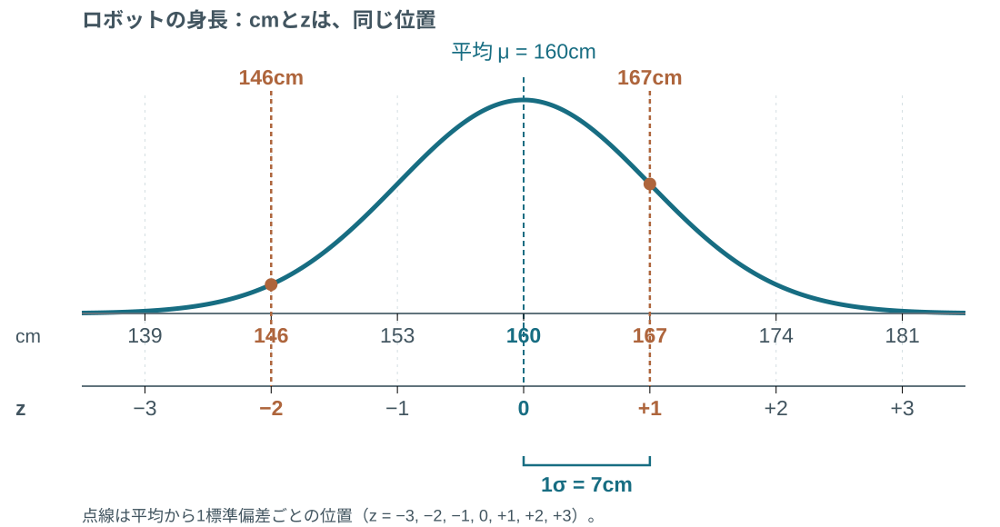

④ 答え・意味：146cmは<ruby>平<rt>へい</rt></ruby><ruby>均<rt>きん</rt></ruby>より2個分下。167cmは1個分上。zは<ruby>確<rt>かく</rt></ruby><ruby>率<rt>りつ</rt></ruby>ではなく位置。

<aside class="formula-ref">教科書 p.123 · <ruby>標<rt>ひょう</rt></ruby><ruby>準<rt>じゅん</rt></ruby><ruby>化<rt>か</rt></ruby>の考え方をXに適用 ／ 津村18</aside>

<aside class="stat-terms" aria-label="統計用語 / Statistical terms"><ruby>標<rt>ひょう</rt></ruby><ruby>準<rt>じゅん</rt></ruby><ruby>化<rt>か</rt></ruby>Standardization<ruby>標<rt>ひょう</rt></ruby><ruby>準<rt>じゅん</rt></ruby><ruby>得<rt>とく</rt></ruby><ruby>点<rt>てん</rt></ruby>Z-score</aside>

---

<!-- _class: book-divider has-stat-terms -->

## 教科書 · 第2章 第2節

5　② <ruby>標<rt>ひょう</rt></ruby><ruby>準<rt>じゅん</rt></ruby><ruby>正<rt>せい</rt></ruby><ruby>規<rt>き</rt></ruby><ruby>分<rt>ぶん</rt></ruby><ruby>布<rt>ぷ</rt></ruby><ruby>表<rt>ひょう</rt></ruby>の読み方

p.124–125

<aside class="stat-terms" aria-label="統計用語 / Statistical terms"><ruby>標<rt>ひょう</rt></ruby><ruby>準<rt>じゅん</rt></ruby><ruby>正<rt>せい</rt></ruby><ruby>規<rt>き</rt></ruby><ruby>分<rt>ぶん</rt></ruby><ruby>布<rt>ぷ</rt></ruby><ruby>表<rt>ひょう</rt></ruby>Standard normal table<ruby>上<rt>うわ</rt></ruby><ruby>側<rt>がわ</rt></ruby><ruby>確<rt>かく</rt></ruby><ruby>率<rt>りつ</rt></ruby>Upper-tail probability</aside>

---

<!-- _class: model-visual has-stat-terms -->

## この表は、右側の面積

$$
\Pr(Z>z)
$$

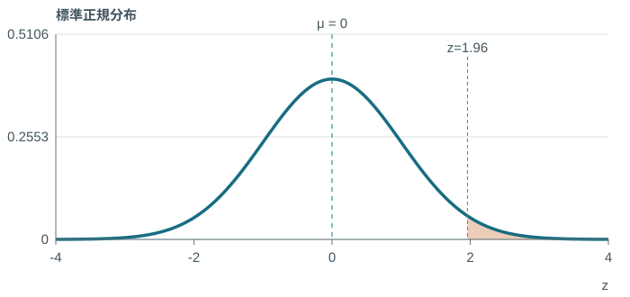

[標準正規分布表を開く](https://yohman.github.io/26-2-StatsB/viewer.html?p=&file=materials%2F2026-yoh%2Fweek05%2Fnormal-upper-tail-table.html&title=%E6%A8%99%E6%BA%96%E6%AD%A3%E8%A6%8F%E5%88%86%E5%B8%83%E8%A1%A8%EF%BC%9A%E4%B8%8A%E5%81%B4%E7%A2%BA%E7%8E%87&week=W05&return=agenda.html%3Fp%23week-05)

<aside class="formula-ref">教科書 p.124 · <ruby>上<rt>うわ</rt></ruby><ruby>側<rt>がわ</rt></ruby><ruby>確<rt>かく</rt></ruby><ruby>率<rt>りつ</rt></ruby>と表の読み方</aside>

<aside class="stat-terms" aria-label="統計用語 / Statistical terms"><ruby>標<rt>ひょう</rt></ruby><ruby>準<rt>じゅん</rt></ruby><ruby>正<rt>せい</rt></ruby><ruby>規<rt>き</rt></ruby><ruby>分<rt>ぶん</rt></ruby><ruby>布<rt>ぷ</rt></ruby><ruby>表<rt>ひょう</rt></ruby>Standard normal table<ruby>上<rt>うわ</rt></ruby><ruby>側<rt>がわ</rt></ruby><ruby>確<rt>かく</rt></ruby><ruby>率<rt>りつ</rt></ruby>Upper-tail probability</aside>

---

<!-- _class: lookup stage-1 has-stat-terms -->

## まず、1.9の行

<table class="lookup-table"><thead><tr><th>z</th><th>0.04</th><th>0.05</th><th class="">0.06</th></tr></thead><tbody><tr class=""><th class="">1.8</th><td class="">0.03288</td><td class="">0.03216</td><td class="">0.03144</td></tr><tr class="focus-row"><th class="">1.9</th><td class="">0.02619</td><td class="">0.02559</td><td class="">0.02500</td></tr><tr class=""><th class="">2.0</th><td class="">0.02068</td><td class="">0.02018</td><td class="">0.01970</td></tr></tbody></table>

<aside class="stat-terms" aria-label="統計用語 / Statistical terms"><ruby>標<rt>ひょう</rt></ruby><ruby>準<rt>じゅん</rt></ruby><ruby>正<rt>せい</rt></ruby><ruby>規<rt>き</rt></ruby><ruby>分<rt>ぶん</rt></ruby><ruby>布<rt>ぷ</rt></ruby><ruby>表<rt>ひょう</rt></ruby>Standard normal table<ruby>上<rt>うわ</rt></ruby><ruby>側<rt>がわ</rt></ruby><ruby>確<rt>かく</rt></ruby><ruby>率<rt>りつ</rt></ruby>Upper-tail probability</aside>

---

<!-- _class: lookup stage-2 has-stat-terms -->

## 次に、0.06の列

<table class="lookup-table"><thead><tr><th>z</th><th>0.04</th><th>0.05</th><th class="focus-col">0.06</th></tr></thead><tbody><tr class=""><th class="">1.8</th><td class="">0.03288</td><td class="">0.03216</td><td class="focus-col">0.03144</td></tr><tr class="focus-row"><th class="">1.9</th><td class="">0.02619</td><td class="">0.02559</td><td class="focus-col">0.02500</td></tr><tr class=""><th class="">2.0</th><td class="">0.02068</td><td class="">0.02018</td><td class="focus-col">0.01970</td></tr></tbody></table>

<aside class="stat-terms" aria-label="統計用語 / Statistical terms"><ruby>標<rt>ひょう</rt></ruby><ruby>準<rt>じゅん</rt></ruby><ruby>正<rt>せい</rt></ruby><ruby>規<rt>き</rt></ruby><ruby>分<rt>ぶん</rt></ruby><ruby>布<rt>ぷ</rt></ruby><ruby>表<rt>ひょう</rt></ruby>Standard normal table<ruby>上<rt>うわ</rt></ruby><ruby>側<rt>がわ</rt></ruby><ruby>確<rt>かく</rt></ruby><ruby>率<rt>りつ</rt></ruby>Upper-tail probability</aside>

---

<!-- _class: lookup stage-3 has-stat-terms -->

## 交点は、0.02500

<table class="lookup-table"><thead><tr><th>z</th><th>0.04</th><th>0.05</th><th class="focus-col">0.06</th></tr></thead><tbody><tr class=""><th class="">1.8</th><td class="">0.03288</td><td class="">0.03216</td><td class="focus-col">0.03144</td></tr><tr class="focus-row"><th class="">1.9</th><td class="">0.02619</td><td class="">0.02559</td><td class="focus-cell">0.02500</td></tr><tr class=""><th class="">2.0</th><td class="">0.02068</td><td class="">0.02018</td><td class="focus-col">0.01970</td></tr></tbody></table>

<aside class="stat-terms" aria-label="統計用語 / Statistical terms"><ruby>標<rt>ひょう</rt></ruby><ruby>準<rt>じゅん</rt></ruby><ruby>正<rt>せい</rt></ruby><ruby>規<rt>き</rt></ruby><ruby>分<rt>ぶん</rt></ruby><ruby>布<rt>ぷ</rt></ruby><ruby>表<rt>ひょう</rt></ruby>Standard normal table<ruby>上<rt>うわ</rt></ruby><ruby>側<rt>がわ</rt></ruby><ruby>確<rt>かく</rt></ruby><ruby>率<rt>りつ</rt></ruby>Upper-tail probability</aside>

---

<!-- _class: worked has-stat-terms -->

## 1.96より右は、2.5％

$$
\Pr(Z>1.96)=0.02500=2.5\%
$$

<aside class="formula-ref">教科書 p.124 · <ruby>上<rt>うわ</rt></ruby><ruby>側<rt>がわ</rt></ruby><ruby>確<rt>かく</rt></ruby><ruby>率<rt>りつ</rt></ruby>と表の読み方</aside>

<aside class="stat-terms" aria-label="統計用語 / Statistical terms"><ruby>標<rt>ひょう</rt></ruby><ruby>準<rt>じゅん</rt></ruby><ruby>正<rt>せい</rt></ruby><ruby>規<rt>き</rt></ruby><ruby>分<rt>ぶん</rt></ruby><ruby>布<rt>ぷ</rt></ruby><ruby>表<rt>ひょう</rt></ruby>Standard normal table<ruby>上<rt>うわ</rt></ruby><ruby>側<rt>がわ</rt></ruby><ruby>確<rt>かく</rt></ruby><ruby>率<rt>りつ</rt></ruby>Upper-tail probability</aside>

---

<!-- _class: challenge has-stat-terms -->

## チャレンジ②　行と列を、自分で探す

自分で解く　3分

Zは<ruby>標<rt>ひょう</rt></ruby><ruby>準<rt>じゅん</rt></ruby><ruby>正<rt>せい</rt></ruby><ruby>規<rt>き</rt></ruby><ruby>分<rt>ぶん</rt></ruby><ruby>布<rt>ぷ</rt></ruby>に従う。z＝1.28。

**$\Pr(Z>1.28)$ は？ 行・列・表の値・百分率を書く。**

<aside class="formula-ref">教科書 p.124 · <ruby>上<rt>うわ</rt></ruby><ruby>側<rt>がわ</rt></ruby><ruby>確<rt>かく</rt></ruby><ruby>率<rt>りつ</rt></ruby>と表の読み方</aside>

<aside class="stat-terms" aria-label="統計用語 / Statistical terms"><ruby>標<rt>ひょう</rt></ruby><ruby>準<rt>じゅん</rt></ruby><ruby>正<rt>せい</rt></ruby><ruby>規<rt>き</rt></ruby><ruby>分<rt>ぶん</rt></ruby><ruby>布<rt>ぷ</rt></ruby><ruby>表<rt>ひょう</rt></ruby>Standard normal table<ruby>上<rt>うわ</rt></ruby><ruby>側<rt>がわ</rt></ruby><ruby>確<rt>かく</rt></ruby><ruby>率<rt>りつ</rt></ruby>Upper-tail probability</aside>

---

<!-- _class: worked practice-answer has-stat-terms -->

## 答え合わせ② · 1.2の行、0.08の列

① 与えられた条件：<ruby>標<rt>ひょう</rt></ruby><ruby>準<rt>じゅん</rt></ruby><ruby>正<rt>せい</rt></ruby><ruby>規<rt>き</rt></ruby><ruby>分<rt>ぶん</rt></ruby><ruby>布<rt>ぷ</rt></ruby>、z＝1.28。

② 公式（文字のまま）

$$
\Pr(Z>z)
$$

③ 代入・計算

$$
1.28=1.2+0.08
$$

$$
\Pr(Z>1.28)=0.10027
$$

$$
0.10027\times100=10.027\%
$$

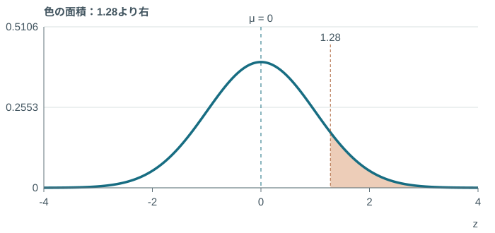

④ 答え・意味：1.28より右の<ruby>確<rt>かく</rt></ruby><ruby>率<rt>りつ</rt></ruby>は約10.03％。

<aside class="formula-ref">教科書 p.124 · <ruby>上<rt>うわ</rt></ruby><ruby>側<rt>がわ</rt></ruby><ruby>確<rt>かく</rt></ruby><ruby>率<rt>りつ</rt></ruby>と表の読み方</aside>

<aside class="stat-terms" aria-label="統計用語 / Statistical terms"><ruby>標<rt>ひょう</rt></ruby><ruby>準<rt>じゅん</rt></ruby><ruby>正<rt>せい</rt></ruby><ruby>規<rt>き</rt></ruby><ruby>分<rt>ぶん</rt></ruby><ruby>布<rt>ぷ</rt></ruby><ruby>表<rt>ひょう</rt></ruby>Standard normal table<ruby>上<rt>うわ</rt></ruby><ruby>側<rt>がわ</rt></ruby><ruby>確<rt>かく</rt></ruby><ruby>率<rt>りつ</rt></ruby>Upper-tail probability</aside>

---

<!-- _class: worked has-stat-terms -->

## −1.96より左も、2.5％

$$
\Pr(Z<-1.96)=\Pr(Z>1.96)=2.5\%
$$

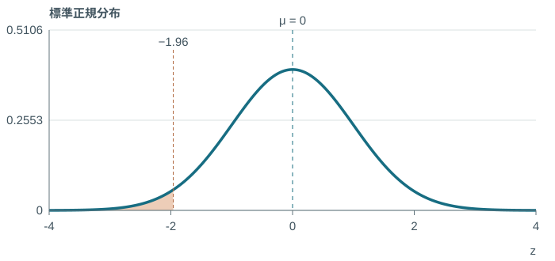

左右対称なので、同じ距離の尾は同じ面積。

<aside class="formula-ref">教科書 p.124–125 · 左右対称・全体から引く</aside>

<aside class="stat-terms" aria-label="統計用語 / Statistical terms"><ruby>下<rt>した</rt></ruby><ruby>側<rt>がわ</rt></ruby><ruby>確<rt>かく</rt></ruby><ruby>率<rt>りつ</rt></ruby>Lower-tail probability<ruby>上<rt>うわ</rt></ruby><ruby>側<rt>がわ</rt></ruby><ruby>確<rt>かく</rt></ruby><ruby>率<rt>りつ</rt></ruby>Upper-tail probability</aside>

---

<!-- _class: challenge has-stat-terms -->

## チャレンジ③　マイナスのzなら、どちら側？

自分で解く　3分

Zは<ruby>標<rt>ひょう</rt></ruby><ruby>準<rt>じゅん</rt></ruby><ruby>正<rt>せい</rt></ruby><ruby>規<rt>き</rt></ruby><ruby>分<rt>ぶん</rt></ruby><ruby>布<rt>ぷ</rt></ruby>に従う。

**$\Pr(Z<-0.84)$ を求め、曲線に求める部分を塗る。**

<aside class="formula-ref">教科書 p.124–125 · 左右対称・全体から引く</aside>

<aside class="stat-terms" aria-label="統計用語 / Statistical terms"><ruby>下<rt>した</rt></ruby><ruby>側<rt>がわ</rt></ruby><ruby>確<rt>かく</rt></ruby><ruby>率<rt>りつ</rt></ruby>Lower-tail probability<ruby>上<rt>うわ</rt></ruby><ruby>側<rt>がわ</rt></ruby><ruby>確<rt>かく</rt></ruby><ruby>率<rt>りつ</rt></ruby>Upper-tail probability</aside>

---

<!-- _class: worked practice-answer has-stat-terms -->

## 答え合わせ③ · 左右対称を使う

① 与えられた条件：<ruby>標<rt>ひょう</rt></ruby><ruby>準<rt>じゅん</rt></ruby><ruby>正<rt>せい</rt></ruby><ruby>規<rt>き</rt></ruby><ruby>分<rt>ぶん</rt></ruby><ruby>布<rt>ぷ</rt></ruby>、境界は−0.84。

② 公式（文字のまま）

$$
\Pr(Z<-z)=\Pr(Z>z)
$$

③ 代入・計算

$$
\Pr(Z<-0.84)=\Pr(Z>0.84)
$$

$$
=0.20045=20.045\%
$$

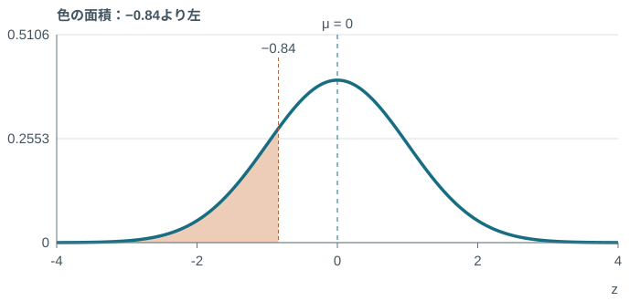

④ 答え・意味：0.8の行・0.04の列。約20.05％。

<aside class="formula-ref">教科書 p.124–125 · 左右対称・全体から引く</aside>

<aside class="stat-terms" aria-label="統計用語 / Statistical terms"><ruby>下<rt>した</rt></ruby><ruby>側<rt>がわ</rt></ruby><ruby>確<rt>かく</rt></ruby><ruby>率<rt>りつ</rt></ruby>Lower-tail probability<ruby>上<rt>うわ</rt></ruby><ruby>側<rt>がわ</rt></ruby><ruby>確<rt>かく</rt></ruby><ruby>率<rt>りつ</rt></ruby>Upper-tail probability</aside>

---

<!-- _class: worked has-stat-terms -->

## ＋1.96より左は、97.5％

$$
\Pr(Z<z)=1-\Pr(Z>z)
$$

$$
\Pr(Z<1.96)=1-0.02500=97.5\%
$$

<aside class="formula-ref">教科書 p.124–125 · 左右対称・全体から引く</aside>

<aside class="stat-terms" aria-label="統計用語 / Statistical terms"><ruby>下<rt>した</rt></ruby><ruby>側<rt>がわ</rt></ruby><ruby>確<rt>かく</rt></ruby><ruby>率<rt>りつ</rt></ruby>Lower-tail probability<ruby>上<rt>うわ</rt></ruby><ruby>側<rt>がわ</rt></ruby><ruby>確<rt>かく</rt></ruby><ruby>率<rt>りつ</rt></ruby>Upper-tail probability</aside>

---

<!-- _class: challenge has-stat-terms -->

## チャレンジ④　表の値が、そのまま答えになる？

自分で解く　3分

Zは<ruby>標<rt>ひょう</rt></ruby><ruby>準<rt>じゅん</rt></ruby><ruby>正<rt>せい</rt></ruby><ruby>規<rt>き</rt></ruby><ruby>分<rt>ぶん</rt></ruby><ruby>布<rt>ぷ</rt></ruby>に従う。

**$\Pr(Z<1.35)$ を求める。表はどちら側の面積を示している？**

<aside class="formula-ref">教科書 p.124–125 · 左右対称・全体から引く</aside>

<aside class="stat-terms" aria-label="統計用語 / Statistical terms"><ruby>下<rt>した</rt></ruby><ruby>側<rt>がわ</rt></ruby><ruby>確<rt>かく</rt></ruby><ruby>率<rt>りつ</rt></ruby>Lower-tail probability<ruby>上<rt>うわ</rt></ruby><ruby>側<rt>がわ</rt></ruby><ruby>確<rt>かく</rt></ruby><ruby>率<rt>りつ</rt></ruby>Upper-tail probability</aside>

---

<!-- _class: worked practice-answer has-stat-terms -->

## 答え合わせ④ · 全体1から、右の尾を引く

① 与えられた条件：<ruby>標<rt>ひょう</rt></ruby><ruby>準<rt>じゅん</rt></ruby><ruby>正<rt>せい</rt></ruby><ruby>規<rt>き</rt></ruby><ruby>分<rt>ぶん</rt></ruby><ruby>布<rt>ぷ</rt></ruby>、境界は1.35。

② 公式（文字のまま）

$$
\Pr(Z<z)=1-\Pr(Z>z)
$$

③ 代入・計算

$$
\Pr(Z>1.35)=0.08851
$$

$$
\Pr(Z<1.35)=1-0.08851
$$

$$
=0.91149=91.149\%
$$

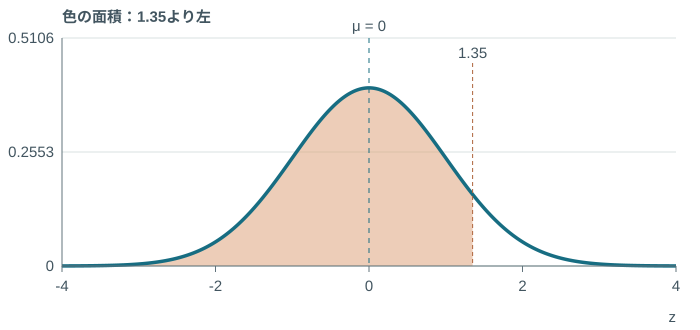

④ 答え・意味：1.3の行・0.05の列。求める左側は約91.15％。

<aside class="formula-ref">教科書 p.124–125 · 左右対称・全体から引く</aside>

<aside class="stat-terms" aria-label="統計用語 / Statistical terms"><ruby>下<rt>した</rt></ruby><ruby>側<rt>がわ</rt></ruby><ruby>確<rt>かく</rt></ruby><ruby>率<rt>りつ</rt></ruby>Lower-tail probability<ruby>上<rt>うわ</rt></ruby><ruby>側<rt>がわ</rt></ruby><ruby>確<rt>かく</rt></ruby><ruby>率<rt>りつ</rt></ruby>Upper-tail probability</aside>

---

<!-- _class: worked has-stat-terms -->

## 真ん中は、両方の尾を引く

$$
\Pr(-1<Z<1)=1-\Pr(Z>1)-\Pr(Z>1)
$$

$$
1-2(0.15866)=0.68268\approx68.27\%
$$

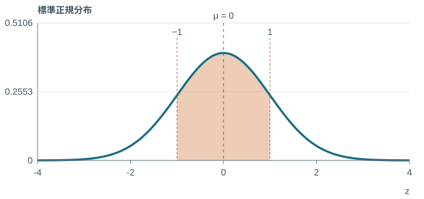

教科書の<ruby>丸<rt>まる</rt></ruby>め値では68.28％。

[やってみよう！](https://yohman.github.io/26-2-StatsB/agenda.html?p&activity=w5-table#week-05)

<aside class="formula-ref">教科書 p.122・125 · <ruby>区<rt>く</rt></ruby><ruby>間<rt>かん</rt></ruby>の差と両側の尾</aside>

<aside class="stat-terms" aria-label="統計用語 / Statistical terms"><ruby>中<rt>ちゅう</rt></ruby><ruby>央<rt>おう</rt></ruby>の<ruby>区<rt>く</rt></ruby><ruby>間<rt>かん</rt></ruby><ruby>確<rt>かく</rt></ruby><ruby>率<rt>りつ</rt></ruby>Central interval probability<ruby>上<rt>うわ</rt></ruby><ruby>側<rt>がわ</rt></ruby><ruby>確<rt>かく</rt></ruby><ruby>率<rt>りつ</rt></ruby>Upper-tail probability</aside>

---

<!-- _class: challenge has-stat-terms -->

## チャレンジ⑤　左右の幅が違う<ruby>区<rt>く</rt></ruby><ruby>間<rt>かん</rt></ruby>

自分で解く　4分

Zは<ruby>標<rt>ひょう</rt></ruby><ruby>準<rt>じゅん</rt></ruby><ruby>正<rt>せい</rt></ruby><ruby>規<rt>き</rt></ruby><ruby>分<rt>ぶん</rt></ruby><ruby>布<rt>ぷ</rt></ruby>に従う。

**$\Pr(-0.50<Z<1.50)$ は？ 左右の尾を別々に求める。**

<aside class="formula-ref">教科書 p.122・125 · <ruby>区<rt>く</rt></ruby><ruby>間<rt>かん</rt></ruby>の差と両側の尾</aside>

<aside class="stat-terms" aria-label="統計用語 / Statistical terms"><ruby>中<rt>ちゅう</rt></ruby><ruby>央<rt>おう</rt></ruby>の<ruby>区<rt>く</rt></ruby><ruby>間<rt>かん</rt></ruby><ruby>確<rt>かく</rt></ruby><ruby>率<rt>りつ</rt></ruby>Central interval probability<ruby>上<rt>うわ</rt></ruby><ruby>側<rt>がわ</rt></ruby><ruby>確<rt>かく</rt></ruby><ruby>率<rt>りつ</rt></ruby>Upper-tail probability</aside>

---

<!-- _class: worked practice-answer has-stat-terms -->

## 答え合わせ⑤ · 異なる二つの尾を引く

① 与えられた条件：<ruby>標<rt>ひょう</rt></ruby><ruby>準<rt>じゅん</rt></ruby><ruby>正<rt>せい</rt></ruby><ruby>規<rt>き</rt></ruby><ruby>分<rt>ぶん</rt></ruby><ruby>布<rt>ぷ</rt></ruby>、<ruby>区<rt>く</rt></ruby><ruby>間<rt>かん</rt></ruby>−0.50〜1.50。

② 公式（文字のまま）

$$
\Pr(a<Z<b)=F(b)-F(a)
$$

③ 代入・計算

$$
F(-0.50)=0.30854
$$

$$
F(1.50)=1-0.06681=0.93319
$$

$$
0.93319-0.30854=0.62465
$$

$$
=62.465\%
$$

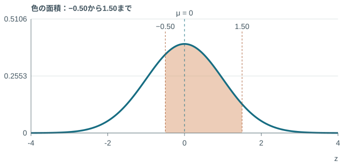

④ 答え・意味：約62.47％。同じ尾を2回引かない。

<aside class="formula-ref">教科書 p.122・125 · <ruby>区<rt>く</rt></ruby><ruby>間<rt>かん</rt></ruby>の差と両側の尾</aside>

<aside class="stat-terms" aria-label="統計用語 / Statistical terms"><ruby>中<rt>ちゅう</rt></ruby><ruby>央<rt>おう</rt></ruby>の<ruby>区<rt>く</rt></ruby><ruby>間<rt>かん</rt></ruby><ruby>確<rt>かく</rt></ruby><ruby>率<rt>りつ</rt></ruby>Central interval probability<ruby>上<rt>うわ</rt></ruby><ruby>側<rt>がわ</rt></ruby><ruby>確<rt>かく</rt></ruby><ruby>率<rt>りつ</rt></ruby>Upper-tail probability</aside>

---

<!-- _class: challenge has-stat-terms -->

## チャレンジ⑥　70点以上は、何％？

自分で解く　5分

得点 $X\sim N(50,100)$。

**70点以上の<ruby>確<rt>かく</rt></ruby><ruby>率<rt>りつ</rt></ruby>を、<ruby>上<rt>うわ</rt></ruby><ruby>側<rt>がわ</rt></ruby><ruby>確<rt>かく</rt></ruby><ruby>率<rt>りつ</rt></ruby>の表で求めよう。**

<aside class="formula-ref">教科書 p.123–125 · <ruby>標<rt>ひょう</rt></ruby><ruby>準<rt>じゅん</rt></ruby><ruby>化<rt>か</rt></ruby>と表の例への適用</aside>

<aside class="stat-terms" aria-label="統計用語 / Statistical terms"><ruby>標<rt>ひょう</rt></ruby><ruby>準<rt>じゅん</rt></ruby><ruby>化<rt>か</rt></ruby>Standardization<ruby>上<rt>うわ</rt></ruby><ruby>側<rt>がわ</rt></ruby><ruby>確<rt>かく</rt></ruby><ruby>率<rt>りつ</rt></ruby>Upper-tail probability</aside>

---

<!-- _class: worked practice-answer has-stat-terms -->

## 答え合わせ⑥ · 元の点数から、<ruby>上<rt>うわ</rt></ruby><ruby>側<rt>がわ</rt></ruby><ruby>確<rt>かく</rt></ruby><ruby>率<rt>りつ</rt></ruby>へ

① 与えられた条件：<ruby>平<rt>へい</rt></ruby><ruby>均<rt>きん</rt></ruby>50点、<ruby>分<rt>ぶん</rt></ruby><ruby>散<rt>さん</rt></ruby>100点²、境界70点。

② 公式（文字のまま）

$$
z=\frac{x-\mu}{\sigma}
$$

③ 代入・計算

$$
\sigma=\sqrt{100}=10,\quad z=\frac{70-50}{10}=2
$$

$$
\Pr(X\ge70)=\Pr(Z\ge2)
$$

$$
=0.02275=2.275\%
$$

④ 答え・意味：表の2.0行・0.00列。70点以上は約2.28％。

<aside class="formula-ref">教科書 p.123–125 · <ruby>標<rt>ひょう</rt></ruby><ruby>準<rt>じゅん</rt></ruby><ruby>化<rt>か</rt></ruby>と表の例への適用</aside>

<aside class="stat-terms" aria-label="統計用語 / Statistical terms"><ruby>標<rt>ひょう</rt></ruby><ruby>準<rt>じゅん</rt></ruby><ruby>化<rt>か</rt></ruby>Standardization<ruby>上<rt>うわ</rt></ruby><ruby>側<rt>がわ</rt></ruby><ruby>確<rt>かく</rt></ruby><ruby>率<rt>りつ</rt></ruby>Upper-tail probability</aside>

---

<!-- _class: statement has-stat-terms -->

## ここからは、ALに自分で取り組もう。

<ruby>標<rt>ひょう</rt></ruby><ruby>準<rt>じゅん</rt></ruby><ruby>偏<rt>へん</rt></ruby><ruby>差<rt>さ</rt></ruby>を確認。zに直す。表を読み、面積を選ぶ。

[ALワークシートを開く](https://yohman.github.io/26-2-StatsB/viewer.html?p&file=assets%2Fworksheet-previews%2Fw05%2Findex.html&title=AL&week=W05&source=weeks%2F05-continuous-distributions-i%2F05_AL用ワークシート.xlsx)

[標準正規分布表を開く](https://yohman.github.io/26-2-StatsB/viewer.html?p=&file=materials%2F2026-yoh%2Fweek05%2Fnormal-upper-tail-table.html&title=%E6%A8%99%E6%BA%96%E6%AD%A3%E8%A6%8F%E5%88%86%E5%B8%83%E8%A1%A8%EF%BC%9A%E4%B8%8A%E5%81%B4%E7%A2%BA%E7%8E%87&week=W05&return=agenda.html%3Fp%23week-05)

各セルの答えは示しません。

<aside class="stat-terms" aria-label="統計用語 / Statistical terms"><ruby>標<rt>ひょう</rt></ruby><ruby>準<rt>じゅん</rt></ruby><ruby>化<rt>か</rt></ruby>Standardization<ruby>標<rt>ひょう</rt></ruby><ruby>準<rt>じゅん</rt></ruby><ruby>正<rt>せい</rt></ruby><ruby>規<rt>き</rt></ruby><ruby>分<rt>ぶん</rt></ruby><ruby>布<rt>ぷ</rt></ruby><ruby>表<rt>ひょう</rt></ruby>Standard normal table</aside>
