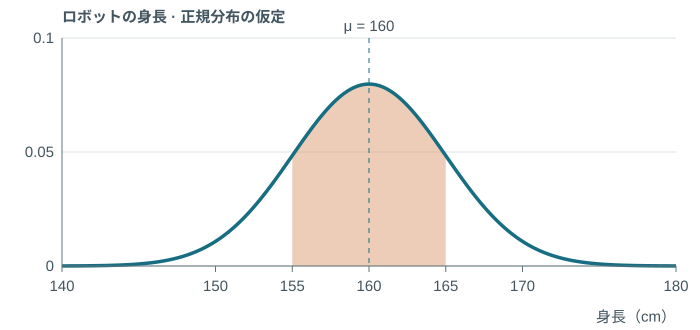
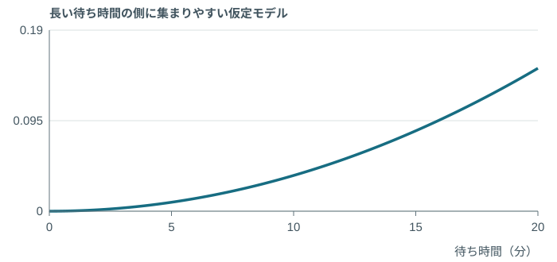
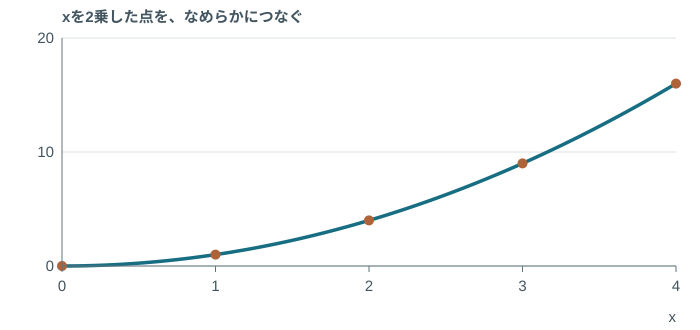
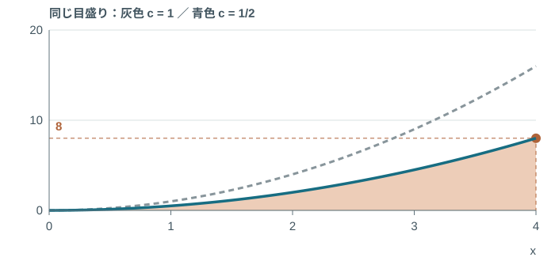
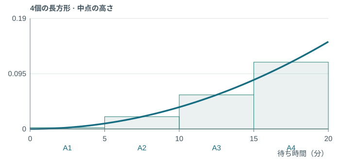
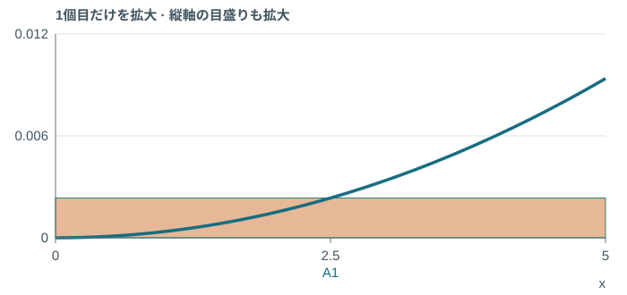
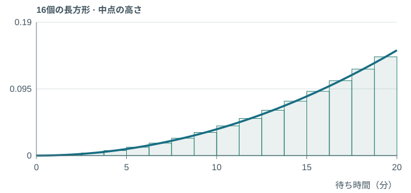
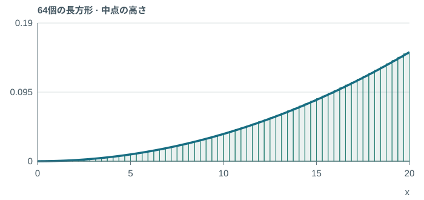
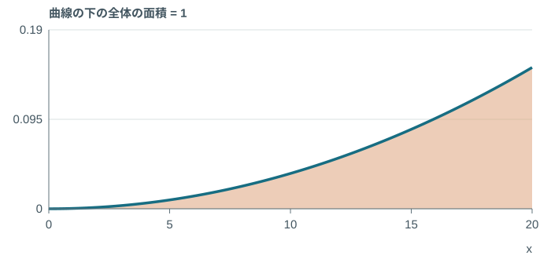
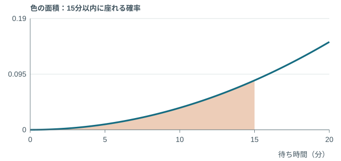

<!-- _class: race-media race-video -->

## パリ2024 · 男子100m決勝

<a class="media-link" href="https://www.youtube.com/watch?v=GHw-eTs4Yes">▶ 動画を見る / Watch the race</a>

---

<!-- _class: race-media race-finish -->

## この写真だけで、分かる？

Photo © Dan Vernon / World Athletics

---

<!-- _class: race-media race-scan -->

## 0.005秒を、見る。

<a class="media-link" href="https://www.hodinkee.com/articles/olympics-2024-mens-100m-photo-finish">OMEGAの写真判定について ↗</a>Photo courtesy OMEGA · judging-area crop

---

<!-- _class: watch-bridge -->

## 今度は、自分で1秒。

<h3>ぴったり1秒で、 止められる？</h3>
1.000000 秒
<a href="https://yohman.github.io/26-2-StatsB/agenda.html?p&amp;activity=w5-stopwatch#week-05">やってみよう！</a><small>授業用の再現 / Classroom recreation OMEGA公式の計測器ではありません。</small>

---

<!-- _class: precision has-stat-terms -->

## 身長、何cmまで測る？

$$
160\quad 160.0\quad 160.000\ldots
$$

「ぴったり160cm」と「155〜165cm」は、同じ？

<aside class="stat-terms" aria-label="統計用語 / Statistical terms"><ruby>測<rt>そく</rt></ruby><ruby>定<rt>てい</rt></ruby><ruby>精<rt>せい</rt></ruby><ruby>度<rt>ど</rt></ruby>Measurement precision</aside>

---

<!-- _class: hero-math has-stat-terms -->

## <ruby>1<rt>いっ</rt></ruby><ruby>点<rt>てん</rt></ruby>の<ruby>確<rt>かく</rt></ruby><ruby>率<rt>りつ</rt></ruby>

$$
\Pr(X=160)=0
$$

<aside class="stat-terms" aria-label="統計用語 / Statistical terms"><ruby>確<rt>かく</rt></ruby><ruby>率<rt>りつ</rt></ruby><ruby>変<rt>へん</rt></ruby><ruby>数<rt>すう</rt></ruby>Random variable<ruby>1<rt>いっ</rt></ruby><ruby>点<rt>てん</rt></ruby>の<ruby>確<rt>かく</rt></ruby><ruby>率<rt>りつ</rt></ruby>Point probability</aside>

---

<!-- _class: explain has-stat-terms -->

## 155〜165cmなら、<ruby>区<rt>く</rt></ruby><ruby>間<rt>かん</rt></ruby>に幅がある

$$
\Pr(155\le X\le165)>0
$$

ぴったり160cmという1点の幅は0。

155〜165cmという<ruby>区<rt>く</rt></ruby><ruby>間<rt>かん</rt></ruby>には、10cmの幅がある。

<aside class="stat-terms" aria-label="統計用語 / Statistical terms"><ruby>区<rt>く</rt></ruby><ruby>間<rt>かん</rt></ruby>Interval<ruby>区<rt>く</rt></ruby><ruby>間<rt>かん</rt></ruby>の<ruby>確<rt>かく</rt></ruby><ruby>率<rt>りつ</rt></ruby>Interval probability</aside>

---

<!-- _class: book-divider has-stat-terms -->

## 教科書 · 第2章 第2節

5　<ruby>連<rt>れん</rt></ruby><ruby>続<rt>ぞく</rt></ruby><ruby>確<rt>かく</rt></ruby><ruby>率<rt>りつ</rt></ruby><ruby>分<rt>ぶん</rt></ruby><ruby>布<rt>ぷ</rt></ruby>

p.121–122

<aside class="stat-terms" aria-label="統計用語 / Statistical terms"><ruby>連<rt>れん</rt></ruby><ruby>続<rt>ぞく</rt></ruby><ruby>確<rt>かく</rt></ruby><ruby>率<rt>りつ</rt></ruby><ruby>分<rt>ぶん</rt></ruby><ruby>布<rt>ぷ</rt></ruby>Continuous probability distribution</aside>

---

<!-- _class: model-visual has-stat-terms -->

## ロボットの身長は、160cm付近に集まる

同じ型のロボットでも、身長には小さな違いがある。

授業用モデル：<ruby>平<rt>へい</rt></ruby><ruby>均<rt>きん</rt></ruby>160cm、<ruby>標<rt>ひょう</rt></ruby><ruby>準<rt>じゅん</rt></ruby><ruby>偏<rt>へん</rt></ruby><ruby>差<rt>さ</rt></ruby>5cmの<ruby>正<rt>せい</rt></ruby><ruby>規<rt>き</rt></ruby><ruby>分<rt>ぶん</rt></ruby><ruby>布<rt>ぷ</rt></ruby>。

<aside class="stat-terms" aria-label="統計用語 / Statistical terms"><ruby>確<rt>かく</rt></ruby><ruby>率<rt>りつ</rt></ruby><ruby>密<rt>みつ</rt></ruby><ruby>度<rt>ど</rt></ruby><ruby>関<rt>かん</rt></ruby><ruby>数<rt>すう</rt></ruby>Probability density function (PDF)<ruby>正<rt>せい</rt></ruby><ruby>規<rt>き</rt></ruby><ruby>分<rt>ぶん</rt></ruby><ruby>布<rt>ぷ</rt></ruby>Normal distribution</aside>

---

<!-- _class: visual-link has-stat-terms -->

## 155〜165cmの<ruby>確<rt>かく</rt></ruby><ruby>率<rt>りつ</rt></ruby>は、この面積

曲線の高さではなく、155〜165cmの下の面積を見る。

<aside class="stat-terms" aria-label="統計用語 / Statistical terms"><ruby>区<rt>く</rt></ruby><ruby>間<rt>かん</rt></ruby>の<ruby>確<rt>かく</rt></ruby><ruby>率<rt>りつ</rt></ruby>Interval probability</aside>

---

<!-- _class: hero-math long has-stat-terms -->

## <ruby>区<rt>く</rt></ruby><ruby>間<rt>かん</rt></ruby>の<ruby>確<rt>かく</rt></ruby><ruby>率<rt>りつ</rt></ruby>

$$
\Pr(a\le X\le b)=\int_a^b f(x)\,dx
$$

<aside class="stat-terms" aria-label="統計用語 / Statistical terms"><ruby>区<rt>く</rt></ruby><ruby>間<rt>かん</rt></ruby>の<ruby>確<rt>かく</rt></ruby><ruby>率<rt>りつ</rt></ruby>Interval probability<ruby>定<rt>てい</rt></ruby><ruby>積<rt>せき</rt></ruby><ruby>分<rt>ぶん</rt></ruby>Definite integral</aside>

---

<!-- _class: worked robot-height-answer has-stat-terms -->

## ロボットの身長：155〜165cmの<ruby>確<rt>かく</rt></ruby><ruby>率<rt>りつ</rt></ruby>

授業用モデル：<ruby>平<rt>へい</rt></ruby><ruby>均<rt>きん</rt></ruby>160cm、<ruby>標<rt>ひょう</rt></ruby><ruby>準<rt>じゅん</rt></ruby><ruby>偏<rt>へん</rt></ruby><ruby>差<rt>さ</rt></ruby>5cm。

$$
\Pr(155\le X\le165)=\int_{155}^{165}f(x)\,dx
$$

$$
\begin{aligned}z_a&=\frac{155-160}{5}=-1\\z_b&=\frac{165-160}{5}=1\end{aligned}
$$

$$
\Pr(155\le X\le165)=\Pr(-1\le Z\le1)
$$

$$
=1-2(0.15866)=0.68268\approx68.27\%
$$

表の1.0行・0.00列：右の尾は0.15866。 左右の尾を、全体1から引く。

身長155〜165cmに入る<ruby>確<rt>かく</rt></ruby><ruby>率<rt>りつ</rt></ruby>は、約68.27％。

<aside class="stat-terms" aria-label="統計用語 / Statistical terms"><ruby>標<rt>ひょう</rt></ruby><ruby>準<rt>じゅん</rt></ruby><ruby>化<rt>か</rt></ruby>Standardization<ruby>区<rt>く</rt></ruby><ruby>間<rt>かん</rt></ruby>の<ruby>確<rt>かく</rt></ruby><ruby>率<rt>りつ</rt></ruby>Interval probability</aside>

---

<!-- _class: explain has-stat-terms -->

## <ruby>確<rt>かく</rt></ruby><ruby>率<rt>りつ</rt></ruby><ruby>密<rt>みつ</rt></ruby><ruby>度<rt>ど</rt></ruby>には、いろいろな形がある

釣鐘型は、<ruby>正<rt>せい</rt></ruby><ruby>規<rt>き</rt></ruby><ruby>分<rt>ぶん</rt></ruby><ruby>布<rt>ぷ</rt></ruby>の形。

値の集まり方が違えば、密度の形も変わる。

**どの形でも、<ruby>区<rt>く</rt></ruby><ruby>間<rt>かん</rt></ruby>の<ruby>確<rt>かく</rt></ruby><ruby>率<rt>りつ</rt></ruby>は曲線の下の面積。**

<aside class="stat-terms" aria-label="統計用語 / Statistical terms"><ruby>確<rt>かく</rt></ruby><ruby>率<rt>りつ</rt></ruby><ruby>密<rt>みつ</rt></ruby><ruby>度<rt>ど</rt></ruby><ruby>関<rt>かん</rt></ruby><ruby>数<rt>すう</rt></ruby>Probability density function (PDF)<ruby>正<rt>せい</rt></ruby><ruby>規<rt>き</rt></ruby><ruby>分<rt>ぶん</rt></ruby><ruby>布<rt>ぷ</rt></ruby>Normal distribution</aside>

---

<!-- _class: race-media queue-story queue-history -->

## ラーメン店の行列

---

<!-- _class: race-media queue-story queue-bowl -->

## なんでんかんでんのラーメン

---

<!-- _class: race-media queue-story queue-portrait -->

## 王道家、この行列、何分待つ？

---

<!-- _class: race-media queue-story queue-bowl -->

## 王道家のラーメンとご飯

---

<!-- _class: model-visual queue-model has-stat-terms -->

## 待ち時間なら、こんな形も考えられる

列に並んでから座れるまでの時間を、X分とする。

0〜5分待つより、15〜20分待つほうが起こりやすい。

<small>授業用の仮定：0〜20分。王道家の実測データではありません。</small>

<aside class="stat-terms" aria-label="統計用語 / Statistical terms"><ruby>確<rt>かく</rt></ruby><ruby>率<rt>りつ</rt></ruby><ruby>密<rt>みつ</rt></ruby><ruby>度<rt>ど</rt></ruby><ruby>関<rt>かん</rt></ruby><ruby>数<rt>すう</rt></ruby>Probability density function (PDF)</aside>

---

<!-- _class: worked quadratic-shape has-stat-terms -->

## x²は、こんな曲線をつくる

$$
y=x^2
$$

| x | x² |
|---|---|
| 0 | 0 |
| 1 | 1 |
| 2 | 4 |
| 3 | 9 |
| 4 | 16 |

xが大きいほど、増え方も大きくなる。上向きの曲線すべてが<ruby>二<rt>に</rt></ruby><ruby>次<rt>じ</rt></ruby><ruby>関<rt>かん</rt></ruby><ruby>数<rt>すう</rt></ruby>ではない。

<aside class="stat-terms" aria-label="統計用語 / Statistical terms"><ruby>二<rt>に</rt></ruby><ruby>次<rt>じ</rt></ruby><ruby>関<rt>かん</rt></ruby><ruby>数<rt>すう</rt></ruby>Quadratic function</aside>

---

<!-- _class: worked quadratic-scaling has-stat-terms -->

## cは、曲線の高さを調整する倍率

$$
y=cx^2
$$

$$
x=4:\quad 1\times4^2=16
$$

$$
x=4:\quad \frac12\times4^2=8
$$

cを半分にすると、すべての高さも、下の面積も半分。まだ全体の面積は1ではない。

<aside class="stat-terms" aria-label="統計用語 / Statistical terms"><ruby>確<rt>かく</rt></ruby><ruby>率<rt>りつ</rt></ruby>Probability</aside>

---

<!-- _class: explain quadratic-assumption has-stat-terms -->

## ここからは、授業用の仮定モデル

$$
f(x)=cx^2\qquad(0\le x\le b)
$$

形はx²、上限は20分と仮定する。

$b$：上限。$c$：全体の面積を1にする倍率。

**王道家の実測データではありません。**

<aside class="stat-terms" aria-label="統計用語 / Statistical terms"><ruby>確<rt>かく</rt></ruby><ruby>率<rt>りつ</rt></ruby><ruby>密<rt>みつ</rt></ruby><ruby>度<rt>ど</rt></ruby><ruby>関<rt>かん</rt></ruby><ruby>数<rt>すう</rt></ruby>Probability density function (PDF)</aside>

---

<!-- _class: calculation has-stat-terms -->

## 全体の面積を1にして、cを決める

$$
\int_0^b cx^2\,dx=1
$$

$$
c\left[\frac{x^3}{3}\right]_0^b=\frac{cb^3}{3}=1
$$

$$
c=\frac{3}{b^3}
$$

<aside class="stat-terms" aria-label="統計用語 / Statistical terms"><ruby>定<rt>てい</rt></ruby><ruby>積<rt>せき</rt></ruby><ruby>分<rt>ぶん</rt></ruby>Definite integral<ruby>確<rt>かく</rt></ruby><ruby>率<rt>りつ</rt></ruby>Probability</aside>

---

<!-- _class: worked has-stat-terms -->

## 上限20分なら、8000は20の3乗

$$
c=\frac{3}{b^3}
$$

$$
b=20\quad\Rightarrow\quad c=\frac{3}{20^3}=\frac{3}{8000}
$$

$$
f(x)=cx^2=\frac{3x^2}{8000}
$$

3は積分から。8000は上限20分の3乗から。

<aside class="stat-terms" aria-label="統計用語 / Statistical terms"><ruby>確<rt>かく</rt></ruby><ruby>率<rt>りつ</rt></ruby><ruby>密<rt>みつ</rt></ruby><ruby>度<rt>ど</rt></ruby><ruby>関<rt>かん</rt></ruby><ruby>数<rt>すう</rt></ruby>Probability density function (PDF)<ruby>確<rt>かく</rt></ruby><ruby>率<rt>りつ</rt></ruby>Probability</aside>

---

<!-- _class: model-visual queue-model has-stat-terms -->

## この待ち時間を、4個の長方形で<ruby>近<rt>きん</rt></ruby><ruby>似<rt>じ</rt></ruby>する

列に並んでから、席に案内されるまで。

$$
f(x)=\frac{3x^2}{8000}\qquad(0\le x\le20)
$$

<small>授業用の仮定：0〜20分。王道家の実測データではありません。</small>

<aside class="stat-terms" aria-label="統計用語 / Statistical terms"><ruby>近<rt>きん</rt></ruby><ruby>似<rt>じ</rt></ruby>Approximation<ruby>確<rt>かく</rt></ruby><ruby>率<rt>りつ</rt></ruby><ruby>密<rt>みつ</rt></ruby><ruby>度<rt>ど</rt></ruby><ruby>関<rt>かん</rt></ruby><ruby>数<rt>すう</rt></ruby>Probability density function (PDF)</aside>

---

<!-- _class: worked has-stat-terms -->

## 1個目は、「幅 × 高さ」

$$
\Delta x=\frac{20}{4}=5,\qquad x_1^*=2.5
$$

$$
f(2.5)=\frac{3(2.5)^2}{8000}=0.00234375
$$

$$
A_1=5\times0.00234375=0.01171875
$$

0〜5分で座れる<ruby>確<rt>かく</rt></ruby><ruby>率<rt>りつ</rt></ruby>の<ruby>近<rt>きん</rt></ruby><ruby>似<rt>じ</rt></ruby>：約1.17％。

<aside class="stat-terms" aria-label="統計用語 / Statistical terms"><ruby>近<rt>きん</rt></ruby><ruby>似<rt>じ</rt></ruby>Approximation</aside>

---

<!-- _class: worked has-stat-terms -->

## 4個を足すと、98.4375％

$$
S_4=\sum_{i=1}^{4}A_i
$$

$$
\begin{aligned}S_4={}&0.01171875+0.10546875\\&+0.29296875+0.57421875\end{aligned}
$$

$$
=0.984375=98.4375\%
$$

長方形の合計は、曲線の下の面積1の<ruby>近<rt>きん</rt></ruby><ruby>似<rt>じ</rt></ruby>。

<aside class="stat-terms" aria-label="統計用語 / Statistical terms"><ruby>近<rt>きん</rt></ruby><ruby>似<rt>じ</rt></ruby>Approximation</aside>

---

<!-- _class: worked has-stat-terms -->

## 16個なら、99.9023％

$$
\Delta x=\frac{20}{16}=1.25
$$

$$
S_{16}=1.25\bigl[f(0.625)+\cdots+f(19.375)\bigr]
$$

$$
=0.9990234375\approx99.9023\%
$$

最初の面積：$1.25\times f(0.625)=0.00018310546875$

<aside class="stat-terms" aria-label="統計用語 / Statistical terms"><ruby>近<rt>きん</rt></ruby><ruby>似<rt>じ</rt></ruby>Approximation</aside>

---

<!-- _class: worked has-stat-terms -->

## 64個なら、99.9939％

$$
\Delta x=\frac{20}{64}=0.3125
$$

$$
S_{64}=0.3125\bigl[f(0.15625)+\cdots+f(19.84375)\bigr]
$$

$$
=0.9999389648\ldots\approx99.9939\%
$$

最初の面積：$0.3125\times f(0.15625)\approx0.00000286102$

<aside class="stat-terms" aria-label="統計用語 / Statistical terms"><ruby>近<rt>きん</rt></ruby><ruby>似<rt>じ</rt></ruby>Approximation</aside>

---

<!-- _class: worked has-stat-terms -->

## 積分なら、面積はちょうど1。

$$
\int_0^{20}\frac{3x^2}{8000}\,dx
$$

$$
=\left[\frac{x^3}{8000}\right]_0^{20}
$$

$$
=\frac{20^3-0^3}{8000}=1
$$

0〜20分のどこかで座れる<ruby>確<rt>かく</rt></ruby><ruby>率<rt>りつ</rt></ruby>＝100％（この仮定モデルでは）。

<aside class="stat-terms" aria-label="統計用語 / Statistical terms"><ruby>定<rt>てい</rt></ruby><ruby>積<rt>せき</rt></ruby><ruby>分<rt>ぶん</rt></ruby>Definite integral</aside>

---

<!-- _class: worked has-stat-terms -->

## 15分以内に座れる<ruby>確<rt>かく</rt></ruby><ruby>率<rt>りつ</rt></ruby>は？

$$
\Pr(X\le a)=\int_0^a f(x)\,dx
$$

$$
\Pr(X\le15)=\int_0^{15}\frac{3x^2}{8000}\,dx
$$

$$
=\left[\frac{x^3}{8000}\right]_0^{15}=\frac{3375}{8000}
$$

$$
=0.421875=42.1875\%
$$

与えられた密度から計算。この授業用モデルでは、約42.2％。

<aside class="stat-terms" aria-label="統計用語 / Statistical terms"><ruby>区<rt>く</rt></ruby><ruby>間<rt>かん</rt></ruby>の<ruby>確<rt>かく</rt></ruby><ruby>率<rt>りつ</rt></ruby>Interval probability<ruby>定<rt>てい</rt></ruby><ruby>積<rt>せき</rt></ruby><ruby>分<rt>ぶん</rt></ruby>Definite integral</aside>

---

<!-- _class: explain has-stat-terms -->

## 小さな面積を、全部足す

$$
\sum_i f(x_i)\Delta x\ \longrightarrow\ \int_a^b f(x)\,dx
$$

小片は「高さ × 幅」。全体の面積は $\int_{-\infty}^{\infty}f(x)\,dx=1$。

<aside class="stat-terms" aria-label="統計用語 / Statistical terms"><ruby>定<rt>てい</rt></ruby><ruby>積<rt>せき</rt></ruby><ruby>分<rt>ぶん</rt></ruby>Definite integral</aside>

---

<!-- _class: model-visual has-stat-terms -->

## 別のモデル：待ち時間が一様なら？

今度は、0〜20分の<ruby>一<rt>いち</rt></ruby><ruby>様<rt>よう</rt></ruby><ruby>分<rt>ぶん</rt></ruby><ruby>布<rt>ぷ</rt></ruby>を仮定。

$$
f(x)=\frac1{20}\quad(0\le x\le20)
$$

<aside class="stat-terms" aria-label="統計用語 / Statistical terms"><ruby>一<rt>いち</rt></ruby><ruby>様<rt>よう</rt></ruby><ruby>分<rt>ぶん</rt></ruby><ruby>布<rt>ぷ</rt></ruby>Uniform distribution<ruby>確<rt>かく</rt></ruby><ruby>率<rt>りつ</rt></ruby><ruby>密<rt>みつ</rt></ruby><ruby>度<rt>ど</rt></ruby><ruby>関<rt>かん</rt></ruby><ruby>数<rt>すう</rt></ruby>Probability density function (PDF)</aside>

---

<!-- _class: challenge has-stat-terms -->

## チャレンジ①　ラーメンの待ち時間

自分で解く　5分

待ち時間 $X$ は、0〜20分の<ruby>一<rt>いち</rt></ruby><ruby>様<rt>よう</rt></ruby><ruby>分<rt>ぶん</rt></ruby><ruby>布<rt>ぷ</rt></ruby>。

**5分以上10分以下、待つ<ruby>確<rt>かく</rt></ruby><ruby>率<rt>りつ</rt></ruby>は？**

<aside class="stat-terms" aria-label="統計用語 / Statistical terms"><ruby>一<rt>いち</rt></ruby><ruby>様<rt>よう</rt></ruby><ruby>分<rt>ぶん</rt></ruby><ruby>布<rt>ぷ</rt></ruby>Uniform distribution<ruby>区<rt>く</rt></ruby><ruby>間<rt>かん</rt></ruby>の<ruby>確<rt>かく</rt></ruby><ruby>率<rt>りつ</rt></ruby>Interval probability</aside>

---

<!-- _class: calculation answer has-stat-terms -->

## 答え合わせ① · 面積の計算

$$
\Pr(a\le X\le b)=\int_a^b f(x)\,dx
$$

$$
\Pr(5\le X\le10)=\int_5^{10}\frac1{20}\,dx
$$

$$
=(10-5)\times\frac1{20}=0.25=25\%
$$

<aside class="stat-terms" aria-label="統計用語 / Statistical terms"><ruby>区<rt>く</rt></ruby><ruby>間<rt>かん</rt></ruby>の<ruby>確<rt>かく</rt></ruby><ruby>率<rt>りつ</rt></ruby>Interval probability<ruby>定<rt>てい</rt></ruby><ruby>積<rt>せき</rt></ruby><ruby>分<rt>ぶん</rt></ruby>Definite integral</aside>

---

<!-- _class: visual-link has-stat-terms -->

## この面積が、25％

[やってみよう！](https://yohman.github.io/26-2-StatsB/agenda.html?p&activity=w5-area#week-05)

<aside class="stat-terms" aria-label="統計用語 / Statistical terms"><ruby>区<rt>く</rt></ruby><ruby>間<rt>かん</rt></ruby>の<ruby>確<rt>かく</rt></ruby><ruby>率<rt>りつ</rt></ruby>Interval probability</aside>

---

<!-- _class: hero-math long has-stat-terms -->

## <ruby>累<rt>るい</rt></ruby><ruby>積<rt>せき</rt></ruby><ruby>分<rt>ぶん</rt></ruby><ruby>布<rt>ぷ</rt></ruby><ruby>関<rt>かん</rt></ruby><ruby>数<rt>すう</rt></ruby>

$$
F(c)=\Pr(X\le c)=\int_{-\infty}^{c}f(x)\,dx
$$

<aside class="stat-terms" aria-label="統計用語 / Statistical terms"><ruby>累<rt>るい</rt></ruby><ruby>積<rt>せき</rt></ruby><ruby>分<rt>ぶん</rt></ruby><ruby>布<rt>ぷ</rt></ruby><ruby>関<rt>かん</rt></ruby><ruby>数<rt>すう</rt></ruby>Cumulative distribution function (CDF)</aside>

---

<!-- _class: single-visual has-stat-terms -->

## $f(x)$：cまでの面積

<aside class="stat-terms" aria-label="統計用語 / Statistical terms"><ruby>確<rt>かく</rt></ruby><ruby>率<rt>りつ</rt></ruby><ruby>密<rt>みつ</rt></ruby><ruby>度<rt>ど</rt></ruby><ruby>関<rt>かん</rt></ruby><ruby>数<rt>すう</rt></ruby>Probability density function (PDF)<ruby>累<rt>るい</rt></ruby><ruby>積<rt>せき</rt></ruby><ruby>確<rt>かく</rt></ruby><ruby>率<rt>りつ</rt></ruby>Cumulative probability</aside>

---

<!-- _class: single-visual has-stat-terms -->

## $F(c)$：その面積を、高さにする

<aside class="stat-terms" aria-label="統計用語 / Statistical terms"><ruby>累<rt>るい</rt></ruby><ruby>積<rt>せき</rt></ruby><ruby>分<rt>ぶん</rt></ruby><ruby>布<rt>ぷ</rt></ruby><ruby>関<rt>かん</rt></ruby><ruby>数<rt>すう</rt></ruby>Cumulative distribution function (CDF)<ruby>累<rt>るい</rt></ruby><ruby>積<rt>せき</rt></ruby><ruby>確<rt>かく</rt></ruby><ruby>率<rt>りつ</rt></ruby>Cumulative probability</aside>

---

<!-- _class: explain has-stat-terms -->

## 別の店では、20〜60分なら？

$$
F(20)=0.10,\qquad F(60)=0.90
$$

20分以内は10％、60分以内は90％。

**20分より長く、60分以内に呼ばれる<ruby>確<rt>かく</rt></ruby><ruby>率<rt>りつ</rt></ruby>は？**

<aside class="stat-terms" aria-label="統計用語 / Statistical terms"><ruby>累<rt>るい</rt></ruby><ruby>積<rt>せき</rt></ruby><ruby>確<rt>かく</rt></ruby><ruby>率<rt>りつ</rt></ruby>Cumulative probability</aside>

---

<!-- _class: worked has-stat-terms -->

## <ruby>累<rt>るい</rt></ruby><ruby>積<rt>せき</rt></ruby><ruby>確<rt>かく</rt></ruby><ruby>率<rt>りつ</rt></ruby>の差で、80％

$$
\Pr(a<X\le b)=F(b)-F(a)
$$

$$
\Pr(20<X\le60)=0.90-0.10=80\%
$$

[やってみよう！](https://yohman.github.io/26-2-StatsB/agenda.html?p&activity=w5-cdf#week-05)

<aside class="stat-terms" aria-label="統計用語 / Statistical terms"><ruby>累<rt>るい</rt></ruby><ruby>積<rt>せき</rt></ruby><ruby>分<rt>ぶん</rt></ruby><ruby>布<rt>ぷ</rt></ruby><ruby>関<rt>かん</rt></ruby><ruby>数<rt>すう</rt></ruby>Cumulative distribution function (CDF)<ruby>区<rt>く</rt></ruby><ruby>間<rt>かん</rt></ruby>の<ruby>確<rt>かく</rt></ruby><ruby>率<rt>りつ</rt></ruby>Interval probability</aside>

---

<!-- _class: book-divider has-stat-terms -->

## 教科書 · 第2章 第2節

6　<ruby>確<rt>かく</rt></ruby><ruby>率<rt>りつ</rt></ruby>分布の<ruby>平<rt>へい</rt></ruby><ruby>均<rt>きん</rt></ruby><ruby>値<rt>ち</rt></ruby>と<ruby>分<rt>ぶん</rt></ruby><ruby>散<rt>さん</rt></ruby>

p.129

<aside class="stat-terms" aria-label="統計用語 / Statistical terms"><ruby>期<rt>き</rt></ruby><ruby>待<rt>たい</rt></ruby><ruby>値<rt>ち</rt></ruby>Expected value<ruby>分<rt>ぶん</rt></ruby><ruby>散<rt>さん</rt></ruby>Variance</aside>

---

<!-- _class: hero-math has-stat-terms -->

## <ruby>連<rt>れん</rt></ruby><ruby>続<rt>ぞく</rt></ruby><ruby>変<rt>へん</rt></ruby><ruby>数<rt>すう</rt></ruby>の<ruby>期<rt>き</rt></ruby><ruby>待<rt>たい</rt></ruby><ruby>値<rt>ち</rt></ruby>

$$
E(X)=\int_{-\infty}^{\infty}xf(x)\,dx
$$

<aside class="stat-terms" aria-label="統計用語 / Statistical terms"><ruby>期<rt>き</rt></ruby><ruby>待<rt>たい</rt></ruby><ruby>値<rt>ち</rt></ruby>Expected value</aside>

---

<!-- _class: worked has-stat-terms -->

## 配達ロボットの期待時間は、6分

$$
E(X)=\int_0^{12}x\frac1{12}\,dx
$$

$$
=\left[\frac{x^2}{24}\right]_0^{12}=6\text{ 分}
$$

授業用モデル：0〜12分の<ruby>一<rt>いち</rt></ruby><ruby>様<rt>よう</rt></ruby><ruby>分<rt>ぶん</rt></ruby><ruby>布<rt>ぷ</rt></ruby>、密度1/12。

<aside class="stat-terms" aria-label="統計用語 / Statistical terms"><ruby>期<rt>き</rt></ruby><ruby>待<rt>たい</rt></ruby><ruby>値<rt>ち</rt></ruby>Expected value<ruby>一<rt>いち</rt></ruby><ruby>様<rt>よう</rt></ruby><ruby>分<rt>ぶん</rt></ruby><ruby>布<rt>ぷ</rt></ruby>Uniform distribution</aside>

---

<!-- _class: hero-math long has-stat-terms -->

## <ruby>分<rt>ぶん</rt></ruby><ruby>散<rt>さん</rt></ruby>

$$
\operatorname{Var}(X)=\int_{-\infty}^{\infty}(x-\mu)^2f(x)\,dx
$$

<aside class="stat-terms" aria-label="統計用語 / Statistical terms"><ruby>分<rt>ぶん</rt></ruby><ruby>散<rt>さん</rt></ruby>Variance</aside>

---

<!-- _class: calculation has-stat-terms -->

## <ruby>分<rt>ぶん</rt></ruby><ruby>散<rt>さん</rt></ruby>から、<ruby>標<rt>ひょう</rt></ruby><ruby>準<rt>じゅん</rt></ruby><ruby>偏<rt>へん</rt></ruby><ruby>差<rt>さ</rt></ruby>へ

$$
\operatorname{Var}(X)=\int_0^{12}(x-6)^2\frac1{12}\,dx
$$

$$
=\left[\frac{(x-6)^3}{36}\right]_0^{12}=12\text{ 分}^2
$$

$$
\sigma=\sqrt{\operatorname{Var}(X)}=\sqrt{12}\approx3.46\text{ 分}
$$

<aside class="stat-terms" aria-label="統計用語 / Statistical terms"><ruby>分<rt>ぶん</rt></ruby><ruby>散<rt>さん</rt></ruby>Variance<ruby>標<rt>ひょう</rt></ruby><ruby>準<rt>じゅん</rt></ruby><ruby>偏<rt>へん</rt></ruby><ruby>差<rt>さ</rt></ruby>Standard deviation</aside>

---

<!-- _class: visual-link has-stat-terms -->

## 中心と、ばらつきを見る

[やってみよう！](https://yohman.github.io/26-2-StatsB/agenda.html?p&activity=w5-moments#week-05)

<aside class="stat-terms" aria-label="統計用語 / Statistical terms"><ruby>期<rt>き</rt></ruby><ruby>待<rt>たい</rt></ruby><ruby>値<rt>ち</rt></ruby>Expected value<ruby>標<rt>ひょう</rt></ruby><ruby>準<rt>じゅん</rt></ruby><ruby>偏<rt>へん</rt></ruby><ruby>差<rt>さ</rt></ruby>Standard deviation</aside>

---

<!-- _class: book-divider has-stat-terms -->

## 教科書 · 第2章 第2節

5　① <ruby>正<rt>せい</rt></ruby><ruby>規<rt>き</rt></ruby><ruby>分<rt>ぶん</rt></ruby><ruby>布<rt>ぷ</rt></ruby>

p.122–123

<aside class="stat-terms" aria-label="統計用語 / Statistical terms"><ruby>正<rt>せい</rt></ruby><ruby>規<rt>き</rt></ruby><ruby>分<rt>ぶん</rt></ruby><ruby>布<rt>ぷ</rt></ruby>Normal distribution</aside>

---

<!-- _class: model-visual has-stat-terms -->

## <ruby>正<rt>せい</rt></ruby><ruby>規<rt>き</rt></ruby><ruby>分<rt>ぶん</rt></ruby><ruby>布<rt>ぷ</rt></ruby>：中心と、ばらつき

$$
X\sim N(\mu,\sigma^2)\qquad E(X)=\mu,\quad\operatorname{Var}(X)=\sigma^2
$$

<aside class="stat-terms" aria-label="統計用語 / Statistical terms"><ruby>正<rt>せい</rt></ruby><ruby>規<rt>き</rt></ruby><ruby>分<rt>ぶん</rt></ruby><ruby>布<rt>ぷ</rt></ruby>Normal distribution<ruby>平<rt>へい</rt></ruby><ruby>均<rt>きん</rt></ruby>Mean<ruby>分<rt>ぶん</rt></ruby><ruby>散<rt>さん</rt></ruby>Variance</aside>

---

<!-- _class: single-visual has-stat-terms -->

## <ruby>標<rt>ひょう</rt></ruby><ruby>準<rt>じゅん</rt></ruby><ruby>偏<rt>へん</rt></ruby><ruby>差<rt>さ</rt></ruby>が小さいと、狭い山

<aside class="stat-terms" aria-label="統計用語 / Statistical terms"><ruby>標<rt>ひょう</rt></ruby><ruby>準<rt>じゅん</rt></ruby><ruby>偏<rt>へん</rt></ruby><ruby>差<rt>さ</rt></ruby>Standard deviation</aside>

---

<!-- _class: single-visual has-stat-terms -->

## <ruby>標<rt>ひょう</rt></ruby><ruby>準<rt>じゅん</rt></ruby><ruby>偏<rt>へん</rt></ruby><ruby>差<rt>さ</rt></ruby>が大きいと、広い山

<aside class="stat-terms" aria-label="統計用語 / Statistical terms"><ruby>標<rt>ひょう</rt></ruby><ruby>準<rt>じゅん</rt></ruby><ruby>偏<rt>へん</rt></ruby><ruby>差<rt>さ</rt></ruby>Standard deviation</aside>

---

<!-- _class: hero-math long has-stat-terms -->

## <ruby>正<rt>せい</rt></ruby><ruby>規<rt>き</rt></ruby><ruby>分<rt>ぶん</rt></ruby><ruby>布<rt>ぷ</rt></ruby>の密度

$$
f(x)=\frac1{\sigma\sqrt{2\pi}}\exp\!\left[-\frac{(x-\mu)^2}{2\sigma^2}\right]
$$

<aside class="stat-terms" aria-label="統計用語 / Statistical terms"><ruby>正<rt>せい</rt></ruby><ruby>規<rt>き</rt></ruby><ruby>分<rt>ぶん</rt></ruby><ruby>布<rt>ぷ</rt></ruby>Normal distribution<ruby>確<rt>かく</rt></ruby><ruby>率<rt>りつ</rt></ruby><ruby>密<rt>みつ</rt></ruby><ruby>度<rt>ど</rt></ruby><ruby>関<rt>かん</rt></ruby><ruby>数<rt>すう</rt></ruby>Probability density function (PDF)</aside>

---

<!-- _class: hero-math long has-stat-terms -->

## <ruby>標<rt>ひょう</rt></ruby><ruby>準<rt>じゅん</rt></ruby><ruby>化<rt>か</rt></ruby>の公式

$$
Z=\frac{X-E(X)}{\sqrt{\operatorname{Var}(X)}}=\frac{X-\mu}{\sigma}
$$

<aside class="stat-terms" aria-label="統計用語 / Statistical terms"><ruby>標<rt>ひょう</rt></ruby><ruby>準<rt>じゅん</rt></ruby><ruby>化<rt>か</rt></ruby>Standardization<ruby>標<rt>ひょう</rt></ruby><ruby>準<rt>じゅん</rt></ruby><ruby>正<rt>せい</rt></ruby><ruby>規<rt>き</rt></ruby><ruby>分<rt>ぶん</rt></ruby><ruby>布<rt>ぷ</rt></ruby>Standard normal distribution</aside>

---

<!-- _class: worked has-stat-terms -->

## 60点は、<ruby>標<rt>ひょう</rt></ruby><ruby>準<rt>じゅん</rt></ruby><ruby>偏<rt>へん</rt></ruby><ruby>差<rt>さ</rt></ruby>1個ぶん上

$$
z=\frac{x-\mu}{\sigma}
$$

$$
z=\frac{60-50}{10}=1
$$

仮定：<ruby>平<rt>へい</rt></ruby><ruby>均<rt>きん</rt></ruby>50点、<ruby>標<rt>ひょう</rt></ruby><ruby>準<rt>じゅん</rt></ruby><ruby>偏<rt>へん</rt></ruby><ruby>差<rt>さ</rt></ruby>10点の<ruby>正<rt>せい</rt></ruby><ruby>規<rt>き</rt></ruby><ruby>分<rt>ぶん</rt></ruby><ruby>布<rt>ぷ</rt></ruby>。

[やってみよう！](https://yohman.github.io/26-2-StatsB/agenda.html?p&activity=w5-normal#week-05)

<aside class="stat-terms" aria-label="統計用語 / Statistical terms"><ruby>平<rt>へい</rt></ruby><ruby>均<rt>きん</rt></ruby>Mean<ruby>標<rt>ひょう</rt></ruby><ruby>準<rt>じゅん</rt></ruby><ruby>偏<rt>へん</rt></ruby><ruby>差<rt>さ</rt></ruby>Standard deviation<ruby>標<rt>ひょう</rt></ruby><ruby>準<rt>じゅん</rt></ruby><ruby>得<rt>とく</rt></ruby><ruby>点<rt>てん</rt></ruby>Z-score</aside>

---

<!-- _class: book-divider has-stat-terms -->

## 教科書 · 第2章 第2節

5　② <ruby>標<rt>ひょう</rt></ruby><ruby>準<rt>じゅん</rt></ruby><ruby>正<rt>せい</rt></ruby><ruby>規<rt>き</rt></ruby><ruby>分<rt>ぶん</rt></ruby><ruby>布<rt>ぷ</rt></ruby><ruby>表<rt>ひょう</rt></ruby>の読み方

p.124–125

<aside class="stat-terms" aria-label="統計用語 / Statistical terms"><ruby>標<rt>ひょう</rt></ruby><ruby>準<rt>じゅん</rt></ruby><ruby>正<rt>せい</rt></ruby><ruby>規<rt>き</rt></ruby><ruby>分<rt>ぶん</rt></ruby><ruby>布<rt>ぷ</rt></ruby><ruby>表<rt>ひょう</rt></ruby>Standard normal table</aside>

---

<!-- _class: model-visual has-stat-terms -->

## この表は、右側の面積

$$
Q(z)=\Pr(Z>z)
$$

[標準正規分布表を開く](https://yohman.github.io/26-2-StatsB/viewer.html?p=&file=materials%2F2026-yoh%2Fweek05%2Fnormal-upper-tail-table.html&title=%E6%A8%99%E6%BA%96%E6%AD%A3%E8%A6%8F%E5%88%86%E5%B8%83%E8%A1%A8%EF%BC%9A%E4%B8%8A%E5%81%B4%E7%A2%BA%E7%8E%87&week=W05&return=agenda.html%3Fp%23week-05)

<aside class="stat-terms" aria-label="統計用語 / Statistical terms"><ruby>上<rt>うわ</rt></ruby><ruby>側<rt>がわ</rt></ruby><ruby>確<rt>かく</rt></ruby><ruby>率<rt>りつ</rt></ruby>Upper-tail probability</aside>

---

<!-- _class: lookup stage-1 has-stat-terms -->

## まず、1.9の行

<table class="lookup-table"><thead><tr><th>z</th><th>0.04</th><th>0.05</th><th class="">0.06</th></tr></thead><tbody><tr class=""><th class="">1.8</th><td class="">0.03288</td><td class="">0.03216</td><td class="">0.03144</td></tr><tr class="focus-row"><th class="">1.9</th><td class="">0.02619</td><td class="">0.02559</td><td class="">0.02500</td></tr><tr class=""><th class="">2.0</th><td class="">0.02068</td><td class="">0.02018</td><td class="">0.01970</td></tr></tbody></table>

<aside class="stat-terms" aria-label="統計用語 / Statistical terms"><ruby>標<rt>ひょう</rt></ruby><ruby>準<rt>じゅん</rt></ruby><ruby>正<rt>せい</rt></ruby><ruby>規<rt>き</rt></ruby><ruby>分<rt>ぶん</rt></ruby><ruby>布<rt>ぷ</rt></ruby><ruby>表<rt>ひょう</rt></ruby>Standard normal table</aside>

---

<!-- _class: lookup stage-2 has-stat-terms -->

## 次に、0.06の列

<table class="lookup-table"><thead><tr><th>z</th><th>0.04</th><th>0.05</th><th class="focus-col">0.06</th></tr></thead><tbody><tr class=""><th class="">1.8</th><td class="">0.03288</td><td class="">0.03216</td><td class="focus-col">0.03144</td></tr><tr class="focus-row"><th class="">1.9</th><td class="">0.02619</td><td class="">0.02559</td><td class="focus-col">0.02500</td></tr><tr class=""><th class="">2.0</th><td class="">0.02068</td><td class="">0.02018</td><td class="focus-col">0.01970</td></tr></tbody></table>

<aside class="stat-terms" aria-label="統計用語 / Statistical terms"><ruby>標<rt>ひょう</rt></ruby><ruby>準<rt>じゅん</rt></ruby><ruby>正<rt>せい</rt></ruby><ruby>規<rt>き</rt></ruby><ruby>分<rt>ぶん</rt></ruby><ruby>布<rt>ぷ</rt></ruby><ruby>表<rt>ひょう</rt></ruby>Standard normal table</aside>

---

<!-- _class: lookup stage-3 has-stat-terms -->

## 交点は、0.02500

<table class="lookup-table"><thead><tr><th>z</th><th>0.04</th><th>0.05</th><th class="focus-col">0.06</th></tr></thead><tbody><tr class=""><th class="">1.8</th><td class="">0.03288</td><td class="">0.03216</td><td class="focus-col">0.03144</td></tr><tr class="focus-row"><th class="">1.9</th><td class="">0.02619</td><td class="">0.02559</td><td class="focus-cell">0.02500</td></tr><tr class=""><th class="">2.0</th><td class="">0.02068</td><td class="">0.02018</td><td class="focus-col">0.01970</td></tr></tbody></table>

<aside class="stat-terms" aria-label="統計用語 / Statistical terms"><ruby>標<rt>ひょう</rt></ruby><ruby>準<rt>じゅん</rt></ruby><ruby>正<rt>せい</rt></ruby><ruby>規<rt>き</rt></ruby><ruby>分<rt>ぶん</rt></ruby><ruby>布<rt>ぷ</rt></ruby><ruby>表<rt>ひょう</rt></ruby>Standard normal table</aside>

---

<!-- _class: worked has-stat-terms -->

## 1.96より右は、2.5％

$$
\Pr(Z>1.96)=0.02500=2.5\%
$$

<aside class="stat-terms" aria-label="統計用語 / Statistical terms"><ruby>上<rt>うわ</rt></ruby><ruby>側<rt>がわ</rt></ruby><ruby>確<rt>かく</rt></ruby><ruby>率<rt>りつ</rt></ruby>Upper-tail probability</aside>

---

<!-- _class: worked has-stat-terms -->

## −1.96より左も、2.5％

$$
\Pr(Z<-1.96)=\Pr(Z>1.96)=2.5\%
$$

左右対称なので、同じ距離の尾は同じ面積。

<aside class="stat-terms" aria-label="統計用語 / Statistical terms"><ruby>下<rt>した</rt></ruby><ruby>側<rt>がわ</rt></ruby><ruby>確<rt>かく</rt></ruby><ruby>率<rt>りつ</rt></ruby>Lower-tail probability</aside>

---

<!-- _class: worked has-stat-terms -->

## ＋1.96より左は、97.5％

$$
\Pr(Z<z)=1-Q(z)
$$

$$
\Pr(Z<1.96)=1-0.02500=97.5\%
$$

<aside class="stat-terms" aria-label="統計用語 / Statistical terms"><ruby>累<rt>るい</rt></ruby><ruby>積<rt>せき</rt></ruby><ruby>確<rt>かく</rt></ruby><ruby>率<rt>りつ</rt></ruby>Cumulative probability</aside>

---

<!-- _class: worked has-stat-terms -->

## 真ん中は、両方の尾を引く

$$
\Pr(-1<Z<1)=1-Q(1)-Q(1)
$$

$$
1-2(0.15866)=0.68268\approx68.27\%
$$

教科書の<ruby>丸<rt>まる</rt></ruby>め値では68.28％。

[やってみよう！](https://yohman.github.io/26-2-StatsB/agenda.html?p&activity=w5-table#week-05)

<aside class="stat-terms" aria-label="統計用語 / Statistical terms"><ruby>中<rt>ちゅう</rt></ruby><ruby>央<rt>おう</rt></ruby>の<ruby>区<rt>く</rt></ruby><ruby>間<rt>かん</rt></ruby><ruby>確<rt>かく</rt></ruby><ruby>率<rt>りつ</rt></ruby>Central interval probability</aside>

---

<!-- _class: challenge has-stat-terms -->

## チャレンジ②　70点以上は、何％？

自分で解く　5分

得点 $X\sim N(50,100)$。

**70点以上の<ruby>確<rt>かく</rt></ruby><ruby>率<rt>りつ</rt></ruby>を、<ruby>上<rt>うわ</rt></ruby><ruby>側<rt>がわ</rt></ruby><ruby>確<rt>かく</rt></ruby><ruby>率<rt>りつ</rt></ruby>の表で求めよう。**

<aside class="stat-terms" aria-label="統計用語 / Statistical terms"><ruby>標<rt>ひょう</rt></ruby><ruby>準<rt>じゅん</rt></ruby><ruby>化<rt>か</rt></ruby>Standardization<ruby>標<rt>ひょう</rt></ruby><ruby>準<rt>じゅん</rt></ruby><ruby>偏<rt>へん</rt></ruby><ruby>差<rt>さ</rt></ruby>Standard deviation</aside>

---

<!-- _class: worked has-stat-terms -->

## 答え合わせ② · 70点以上

$$
z=\frac{x-\mu}{\sigma}=\frac{70-50}{\sqrt{100}}=2
$$

$$
Q(2)=0.02275
$$

$$
\Pr(X\ge70)=\Pr(Z\ge2)=2.275\%
$$

表：2.0の行、0.00の列。

<aside class="stat-terms" aria-label="統計用語 / Statistical terms"><ruby>標<rt>ひょう</rt></ruby><ruby>準<rt>じゅん</rt></ruby><ruby>化<rt>か</rt></ruby>Standardization<ruby>上<rt>うわ</rt></ruby><ruby>側<rt>がわ</rt></ruby><ruby>確<rt>かく</rt></ruby><ruby>率<rt>りつ</rt></ruby>Upper-tail probability</aside>

---

<!-- _class: challenge has-stat-terms -->

## チャレンジ③　30点から70点なら？

自分で解く　5分

同じく、得点 $X\sim N(50,100)$。

**30点以上70点以下の<ruby>確<rt>かく</rt></ruby><ruby>率<rt>りつ</rt></ruby>を求めよう。**

<aside class="stat-terms" aria-label="統計用語 / Statistical terms"><ruby>標<rt>ひょう</rt></ruby><ruby>準<rt>じゅん</rt></ruby><ruby>化<rt>か</rt></ruby>Standardization<ruby>中<rt>ちゅう</rt></ruby><ruby>央<rt>おう</rt></ruby>の<ruby>区<rt>く</rt></ruby><ruby>間<rt>かん</rt></ruby><ruby>確<rt>かく</rt></ruby><ruby>率<rt>りつ</rt></ruby>Central interval probability</aside>

---

<!-- _class: worked has-stat-terms -->

## 答え合わせ③ · 30〜70点

$$
30\le X\le70\quad\Longleftrightarrow\quad-2\le Z\le2
$$

$$
\Pr(-z<Z<z)=1-2Q(z)
$$

$$
\Pr(-2\le Z\le2)=1-2(0.02275)=95.45\%
$$

<aside class="stat-terms" aria-label="統計用語 / Statistical terms"><ruby>標<rt>ひょう</rt></ruby><ruby>準<rt>じゅん</rt></ruby><ruby>化<rt>か</rt></ruby>Standardization<ruby>中<rt>ちゅう</rt></ruby><ruby>央<rt>おう</rt></ruby>の<ruby>区<rt>く</rt></ruby><ruby>間<rt>かん</rt></ruby><ruby>確<rt>かく</rt></ruby><ruby>率<rt>りつ</rt></ruby>Central interval probability</aside>

---

<!-- _class: statement has-stat-terms -->

## <ruby>確<rt>かく</rt></ruby><ruby>率<rt>りつ</rt></ruby>は、面積。

ここからは、ALワークシートに自分で取り組もう。

<aside class="stat-terms" aria-label="統計用語 / Statistical terms"><ruby>確<rt>かく</rt></ruby><ruby>率<rt>りつ</rt></ruby>Probability<ruby>確<rt>かく</rt></ruby><ruby>率<rt>りつ</rt></ruby><ruby>密<rt>みつ</rt></ruby><ruby>度<rt>ど</rt></ruby><ruby>関<rt>かん</rt></ruby><ruby>数<rt>すう</rt></ruby>Probability density function (PDF)</aside>

---

<!-- _class: calculation has-stat-terms -->

## 補足：1人の点数と、n人の<ruby>平<rt>へい</rt></ruby><ruby>均<rt>きん</rt></ruby>

教科書 p.123

$$
\text{1人：}\quad Z=\frac{X-\mu}{\sigma}
$$

$$
\text{平均：}\quad Z=\frac{\bar X-\mu}{\sigma/\sqrt n}
$$

<aside class="stat-terms" aria-label="統計用語 / Statistical terms"><ruby>標<rt>ひょう</rt></ruby><ruby>本<rt>ほん</rt></ruby><ruby>平<rt>へい</rt></ruby><ruby>均<rt>きん</rt></ruby>Sample mean<ruby>標<rt>ひょう</rt></ruby><ruby>準<rt>じゅん</rt></ruby><ruby>誤<rt>ご</rt></ruby><ruby>差<rt>さ</rt></ruby>Standard error</aside>

---

<!-- _class: statement has-stat-terms -->

## <ruby>標<rt>ひょう</rt></ruby><ruby>準<rt>じゅん</rt></ruby><ruby>化<rt>か</rt></ruby>だけでは、形は変わらない。

<ruby>平<rt>へい</rt></ruby><ruby>均<rt>きん</rt></ruby>0・<ruby>標<rt>ひょう</rt></ruby><ruby>準<rt>じゅん</rt></ruby><ruby>偏<rt>へん</rt></ruby><ruby>差<rt>さ</rt></ruby>1にそろえても、
もとの分布が正規とは限らない。

<aside class="stat-terms" aria-label="統計用語 / Statistical terms"><ruby>標<rt>ひょう</rt></ruby><ruby>準<rt>じゅん</rt></ruby><ruby>化<rt>か</rt></ruby>Standardization<ruby>正<rt>せい</rt></ruby><ruby>規<rt>き</rt></ruby><ruby>分<rt>ぶん</rt></ruby><ruby>布<rt>ぷ</rt></ruby>Normal distribution</aside>
