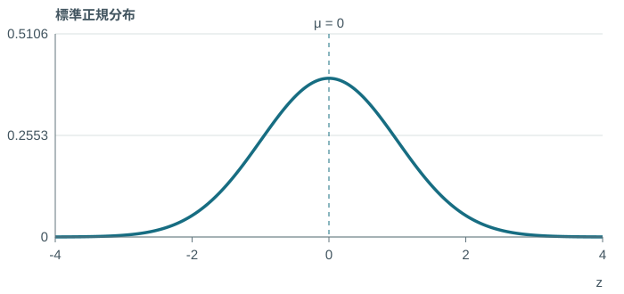
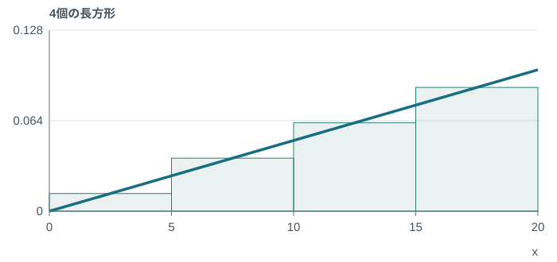
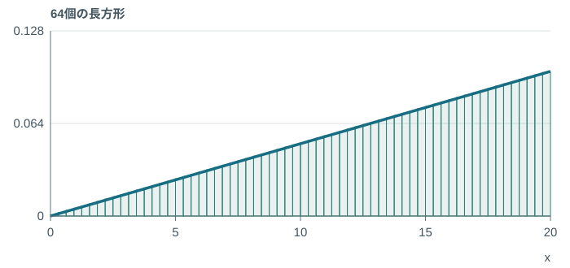
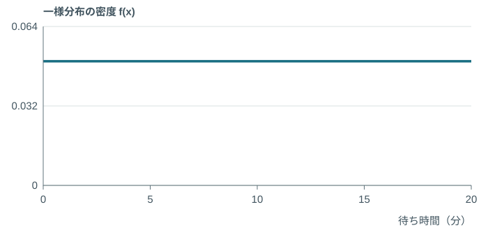
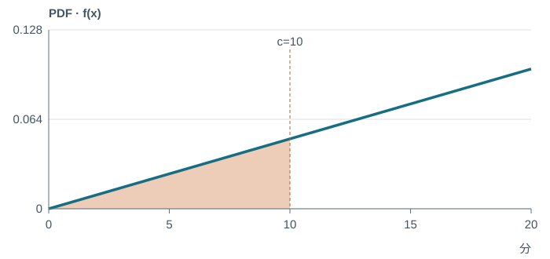
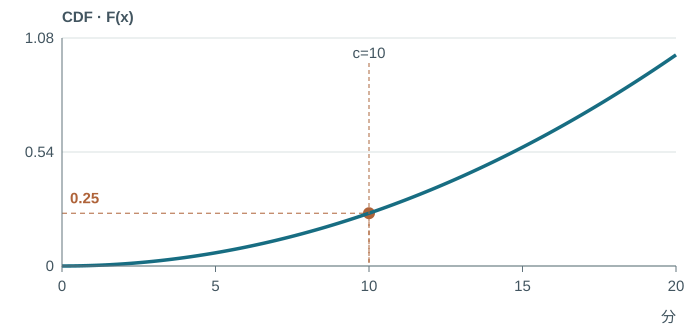
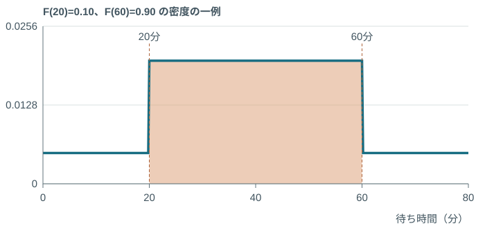
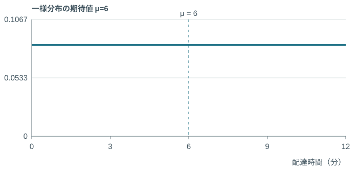
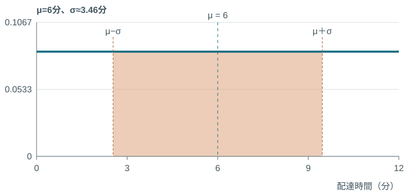
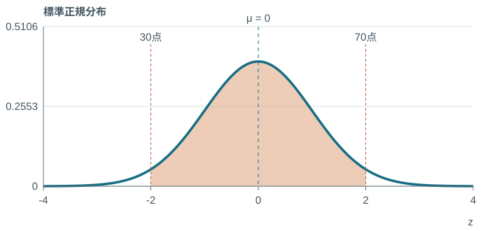

<!-- _class: race-media race-video -->

## パリ2024 · 男子100m決勝

<a class="media-link" href="https://www.youtube.com/watch?v=GHw-eTs4Yes">▶ 動画を見る / Watch the race</a>

---

<!-- _class: race-media race-finish -->

## この写真だけで、分かる？

Photo © Dan Vernon / World Athletics

---

<!-- _class: race-media race-scan -->

## 0.005秒を、見る。

<a class="media-link" href="https://www.hodinkee.com/articles/olympics-2024-mens-100m-photo-finish">OMEGAの写真判定について ↗</a>Photo courtesy OMEGA · judging-area crop

---

<!-- _class: watch-bridge -->

## 今度は、自分で1秒。

<h3>ぴったり1秒で、 止められる？</h3>
1.000000 秒
<a href="https://yohman.github.io/26-2-StatsB/agenda.html?p&amp;activity=w5-stopwatch#week-05">やってみよう！</a><small>授業用の再現 / Classroom recreation OMEGA公式の計測器ではありません。</small>

---

<!-- _class: precision -->

## 身長、何cmまで測る？

$$
160\quad 160.0\quad 160.000\ldots
$$

どこまで正確に測りますか？

---

<!-- _class: hero-math -->

## 1点の確率

$$
\Pr(X=160)=0
$$

---

<!-- _class: explain -->

## 「160cmと記録」は、区間の話

$$
\Pr(159.5\le X<160.5)>0
$$

1点の幅は0。丸めた記録には、幅がある。

---

<!-- _class: book-divider -->

## 教科書 · 第2章 第2節

5　連続確率分布

p.121–122

---

<!-- _class: single-visual -->

## 確率密度 $f(x)$

---

<!-- _class: single-visual -->

## 区間に入る確率は、この面積

---

<!-- _class: hero-math long -->

## 区間の確率

$$
\Pr(a\le X\le b)=\int_a^b f(x)\,dx
$$

---

<!-- _class: single-visual -->

## 大きな長方形で近似する

---

<!-- _class: single-visual -->

## さらに、細かく

---

<!-- _class: explain -->

## 小さな面積を、全部足す

$$
\sum_i f(x_i)\Delta x\ \longrightarrow\ \int_a^b f(x)\,dx
$$

小片は「高さ × 幅」。全体の面積は $\int_{-\infty}^{\infty}f(x)\,dx=1$。

---

<!-- _class: model-visual -->

## ラーメン、あと何分？

授業用モデル：待ち時間は0〜20分で一様。

$$
f(x)=\frac1{20}\quad(0\le x\le20)
$$

---

<!-- _class: challenge -->

## チャレンジ①　ラーメンの待ち時間

自分で解く　5分

待ち時間 $X$ は、0〜20分の一様分布。

**5分以上10分以下、待つ確率は？**

---

<!-- _class: calculation answer -->

## 答え合わせ① · 面積の計算

$$
\Pr(a\le X\le b)=\int_a^b f(x)\,dx
$$

$$
\Pr(5\le X\le10)=\int_5^{10}\frac1{20}\,dx
$$

$$
=(10-5)\times\frac1{20}=0.25=25\%
$$

---

<!-- _class: visual-link -->

## この面積が、25％

[やってみよう！](https://yohman.github.io/26-2-StatsB/agenda.html?p&activity=w5-area#week-05)

---

<!-- _class: hero-math long -->

## 累積分布関数

$$
F(c)=\Pr(X\le c)=\int_{-\infty}^{c}f(x)\,dx
$$

---

<!-- _class: single-visual -->

## $f(x)$：cまでの面積

---

<!-- _class: single-visual -->

## $F(c)$：その面積を、高さにする

---

<!-- _class: explain -->

## 別の店では、20〜60分なら？

$$
F(20)=0.10,\qquad F(60)=0.90
$$

20分以内は10％、60分以内は90％。

**20分より長く、60分以内に呼ばれる確率は？**

---

<!-- _class: worked -->

## 累積確率の差で、80％

$$
\Pr(a<X\le b)=F(b)-F(a)
$$

$$
\Pr(20<X\le60)=0.90-0.10=80\%
$$

[やってみよう！](https://yohman.github.io/26-2-StatsB/agenda.html?p&activity=w5-cdf#week-05)

---

<!-- _class: book-divider -->

## 教科書 · 第2章 第2節

6　確率分布の平均値と分散

p.129

---

<!-- _class: hero-math -->

## 連続変数の期待値

$$
E(X)=\int_{-\infty}^{\infty}xf(x)\,dx
$$

---

<!-- _class: worked -->

## 配達ロボットの期待時間は、6分

$$
E(X)=\int_0^{12}x\frac1{12}\,dx
$$

$$
=\left[\frac{x^2}{24}\right]_0^{12}=6\text{ 分}
$$

授業用モデル：0〜12分の一様分布、密度1/12。

---

<!-- _class: hero-math long -->

## 分散

$$
\operatorname{Var}(X)=\int_{-\infty}^{\infty}(x-\mu)^2f(x)\,dx
$$

---

<!-- _class: calculation -->

## 分散から、標準偏差へ

$$
\operatorname{Var}(X)=\int_0^{12}(x-6)^2\frac1{12}\,dx
$$

$$
=\left[\frac{(x-6)^3}{36}\right]_0^{12}=12\text{ 分}^2
$$

$$
\sigma=\sqrt{\operatorname{Var}(X)}=\sqrt{12}\approx3.46\text{ 分}
$$

---

<!-- _class: visual-link -->

## 中心と、ばらつきを見る

[やってみよう！](https://yohman.github.io/26-2-StatsB/agenda.html?p&activity=w5-moments#week-05)

---

<!-- _class: book-divider -->

## 教科書 · 第2章 第2節

5　① 正規分布

p.122–123

---

<!-- _class: model-visual -->

## 正規分布：中心と、ばらつき

$$
X\sim N(\mu,\sigma^2)\qquad E(X)=\mu,\quad\operatorname{Var}(X)=\sigma^2
$$

---

<!-- _class: single-visual -->

## 標準偏差が小さいと、狭い山

---

<!-- _class: single-visual -->

## 標準偏差が大きいと、広い山

---

<!-- _class: hero-math long -->

## 正規分布の密度

$$
f(x)=\frac1{\sigma\sqrt{2\pi}}\exp\!\left[-\frac{(x-\mu)^2}{2\sigma^2}\right]
$$

---

<!-- _class: hero-math long -->

## 標準化の公式

$$
Z=\frac{X-E(X)}{\sqrt{\operatorname{Var}(X)}}=\frac{X-\mu}{\sigma}
$$

---

<!-- _class: worked -->

## 60点は、標準偏差1個ぶん上

$$
z=\frac{x-\mu}{\sigma}
$$

$$
z=\frac{60-50}{10}=1
$$

仮定：平均50点、標準偏差10点の正規分布。

[やってみよう！](https://yohman.github.io/26-2-StatsB/agenda.html?p&activity=w5-normal#week-05)

---

<!-- _class: book-divider -->

## 教科書 · 第2章 第2節

5　② 標準正規分布表の読み方

p.124–125

---

<!-- _class: model-visual -->

## この表は、右側の面積

$$
Q(z)=\Pr(Z>z)
$$

[標準正規分布表を開く](https://yohman.github.io/26-2-StatsB/viewer.html?p=&file=materials%2F2026-yoh%2Fweek05%2Fnormal-upper-tail-table.html&title=%E6%A8%99%E6%BA%96%E6%AD%A3%E8%A6%8F%E5%88%86%E5%B8%83%E8%A1%A8%EF%BC%9A%E4%B8%8A%E5%81%B4%E7%A2%BA%E7%8E%87&week=W05&return=agenda.html%3Fp%23week-05)

---

<!-- _class: lookup stage-1 -->

## まず、1.9の行

<table class="lookup-table"><thead><tr><th>z</th><th>0.04</th><th>0.05</th><th class="">0.06</th></tr></thead><tbody><tr class=""><th class="">1.8</th><td class="">0.03288</td><td class="">0.03216</td><td class="">0.03144</td></tr><tr class="focus-row"><th class="">1.9</th><td class="">0.02619</td><td class="">0.02559</td><td class="">0.02500</td></tr><tr class=""><th class="">2.0</th><td class="">0.02068</td><td class="">0.02018</td><td class="">0.01970</td></tr></tbody></table>

---

<!-- _class: lookup stage-2 -->

## 次に、0.06の列

<table class="lookup-table"><thead><tr><th>z</th><th>0.04</th><th>0.05</th><th class="focus-col">0.06</th></tr></thead><tbody><tr class=""><th class="">1.8</th><td class="">0.03288</td><td class="">0.03216</td><td class="focus-col">0.03144</td></tr><tr class="focus-row"><th class="">1.9</th><td class="">0.02619</td><td class="">0.02559</td><td class="focus-col">0.02500</td></tr><tr class=""><th class="">2.0</th><td class="">0.02068</td><td class="">0.02018</td><td class="focus-col">0.01970</td></tr></tbody></table>

---

<!-- _class: lookup stage-3 -->

## 交点は、0.02500

<table class="lookup-table"><thead><tr><th>z</th><th>0.04</th><th>0.05</th><th class="focus-col">0.06</th></tr></thead><tbody><tr class=""><th class="">1.8</th><td class="">0.03288</td><td class="">0.03216</td><td class="focus-col">0.03144</td></tr><tr class="focus-row"><th class="">1.9</th><td class="">0.02619</td><td class="">0.02559</td><td class="focus-cell">0.02500</td></tr><tr class=""><th class="">2.0</th><td class="">0.02068</td><td class="">0.02018</td><td class="focus-col">0.01970</td></tr></tbody></table>

---

<!-- _class: worked -->

## 1.96より右は、2.5％

$$
\Pr(Z>1.96)=0.02500=2.5\%
$$

---

<!-- _class: worked -->

## −1.96より左も、2.5％

$$
\Pr(Z<-1.96)=\Pr(Z>1.96)=2.5\%
$$

左右対称なので、同じ距離の尾は同じ面積。

---

<!-- _class: worked -->

## ＋1.96より左は、97.5％

$$
\Pr(Z<z)=1-Q(z)
$$

$$
\Pr(Z<1.96)=1-0.02500=97.5\%
$$

---

<!-- _class: worked -->

## 真ん中は、両方の尾を引く

$$
\Pr(-1<Z<1)=1-Q(1)-Q(1)
$$

$$
1-2(0.15866)=0.68268\approx68.27\%
$$

教科書の丸め値では68.28％。

[やってみよう！](https://yohman.github.io/26-2-StatsB/agenda.html?p&activity=w5-table#week-05)

---

<!-- _class: challenge -->

## チャレンジ②　70点以上は、何％？

自分で解く　5分

得点 $X\sim N(50,100)$。

**70点以上の確率を、上側確率の表で求めよう。**

---

<!-- _class: worked -->

## 答え合わせ② · 70点以上

$$
z=\frac{x-\mu}{\sigma}=\frac{70-50}{\sqrt{100}}=2
$$

$$
Q(2)=0.02275
$$

$$
\Pr(X\ge70)=\Pr(Z\ge2)=2.275\%
$$

表：2.0の行、0.00の列。

---

<!-- _class: challenge -->

## チャレンジ③　30点から70点なら？

自分で解く　5分

同じく、得点 $X\sim N(50,100)$。

**30点以上70点以下の確率を求めよう。**

---

<!-- _class: worked -->

## 答え合わせ③ · 30〜70点

$$
30\le X\le70\quad\Longleftrightarrow\quad-2\le Z\le2
$$

$$
\Pr(-z<Z<z)=1-2Q(z)
$$

$$
\Pr(-2\le Z\le2)=1-2(0.02275)=95.45\%
$$

---

<!-- _class: statement -->

## 確率は、面積。

ここからは、ALワークシートに自分で取り組もう。

---

<!-- _class: calculation -->

## 補足：1人の点数と、n人の平均

教科書 p.123

$$
\text{1人：}\quad Z=\frac{X-\mu}{\sigma}
$$

$$
\text{平均：}\quad Z=\frac{\bar X-\mu}{\sigma/\sqrt n}
$$

---

<!-- _class: statement -->

## 標準化だけでは、形は変わらない。

平均0・標準偏差1にそろえても、
もとの分布が正規とは限らない。
