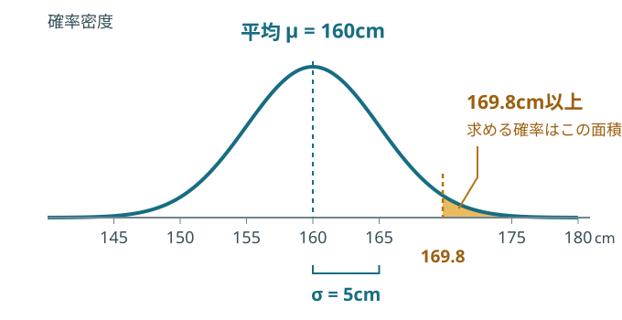

<!-- _class: book-divider -->

## 教科書 · 第2章 第2節

5　連続確率分布

p.121–128

ロボットは **何体？** から、身長は **何cm？** へ。

測定値には小数もある。**ある範囲に入る確率**を、面積で求める。

この後の例：高さ制限に通れる？　工場の平均は正しい？　品質は安定している？

---

<!-- _class: book-reference explained -->

## 連続の確率：身長がある範囲に入る割合

身長を $X$ とする。**160.000…cmぴったり**より、**155〜165cm**を考える。

$$
\Pr(155<X\le165)=\int_{155}^{165}f(x)\,dx=F(165)-F(155)
$$

**f(x)**：その付近への集まりやすさ。高さそのものは確率ではない。

**F(165) − F(155)**：165cm以下から155cm以下を除き、間の面積を残す。

連続モデルでは一点の確率は0、全範囲の面積は1。丸めた「160.0cm」という測定値は小さな区間を表す。Week 2 AL2の面積と同じ考え方。教科書 p.121。

---

<!-- _class: book-reference explained normal-visual -->

## 正規分布：このロボット、ゲートを通れる？

**問題**　身長は正規分布、平均160cm・標準偏差5cm。169.8cm以上になる確率は？

$$
X\sim N(160,5^2)
$$

$$
Z=\frac{X-\mu}{\sigma}
$$

$$
z=\frac{169.8-160}{5}=1.96
$$

**9.8cmの差は、標準偏差1.96個分。**

[やってみよう！](https://yohman.github.io/26-2-StatsB/agenda.html?activity=normal-w2#week-06)

色の面積が169.8cm以上になる確率。次のスライドで表から読む。右の裾は図の外にも続く。仮想の身長モデル。教科書 p.122–124。

---

<!-- _class: book-reference explained normal-table -->

## 正規分布表：行1.9、列0.06を読む

**求めるもの：高さ制限169.8cmを超える割合。標準化すると z = 1.96。**

| zの行 ＼ 小数第2位の列 | 0.05 | **0.06** | 0.07 |
| --- | --- | --- | --- |
| **1.9** | 0.02559 | **0.02500** | 0.02442 |

$$
\Pr(X>169.8)=\Pr(Z>1.96)=0.025=2.5\%
$$

**このモデルでは約1,000体中25体が高さ制限を超える。**

$$
\Pr(X\le169.8)=0.975,\quad\Pr(150.2<X<169.8)=1-2(0.025)=0.95
$$

[標準正規分布表をビューアーで開く ↗](https://yohman.github.io/26-2-StatsB/viewer.html?file=materials%2F2026-yoh%2Fweek06%2Fstandard-normal-table.pdf&title=%E6%A8%99%E6%BA%96%E6%AD%A3%E8%A6%8F%E5%88%86%E5%B8%83%E8%A1%A8+%2F+Standard+normal+table&week=W06&return=agenda.html%23week-06)

教科書の表は右側の面積。通れる割合は97.5％。中央95％は左右の2.5％ずつを除く。予測割合であり、必ず25体になるわけではない。教科書 p.124–125。

---

<!-- _class: book-reference explained -->

## なぜt分布？　工場の平均を標本で調べる

**問題**　工場は「平均60cm」と説明。でも全ロボットの身長や母標準偏差は分からない。

無作為に **9体** 測ると、平均 **64cm**、標本標準偏差 **6cm**。

$$
T=\frac{\bar X-\mu_0}{s/\sqrt n},\qquad\nu=n-1
$$

**σが未知なので s で推定する。** 広がりも推定する不確かさを、t分布で考慮する。

個体の身長でなく「標本平均のずれ」を評価する。小標本だから自動的にt、ではない。独立な正規母集団の標本を仮定。教科書 p.125–127。

---

<!-- _class: book-reference explained t-worked -->

## tの計算：平均のずれは、どのくらい大きい？

$$
\mathrm{SE}=\frac{s}{\sqrt n}=\frac6{\sqrt9}=2\ \mathrm{cm},\qquad t=\frac{64-60}{2}=2,\quad\nu=8
$$

**標準誤差SE**：標本平均の揺れの大きさを推定したもの。4cmの差はSEの2個分。

両側5％の目安：t表の **自由度8、上側確率0.025** から **2.306**。

$$
|t|=2<2.306
$$

**この標本だけでは、5％水準で「平均60cmと違う」とまでは言えない。**

[やってみよう！](https://yohman.github.io/26-2-StatsB/agenda.html?activity=t-w2#week-06)

t = 2 は確率2％ではない。「違いが示せない」は「平均60cmだと証明した」でもない。ここは後の仮説検定への導入。

<!-- Critical value checked against NIST Student t table: df=8, cumulative 0.975 (upper tail 0.025), 2.306. https://www.itl.nist.gov/div898/handbook/eda/section3/eda3672.htm -->

---

<!-- _class: book-reference explained -->

## なぜカイ二乗？　平均が合っても品質は違う

**問題**　工場の標準偏差は **10cm** という。9体を測ると標本標準偏差は **15cm**。

平均身長が同じでも、大きすぎる・小さすぎるロボットが多ければ、部品が合わない。

$$
\chi^2=\frac{(n-1)s^2}{\sigma_0^2},\qquad\nu=n-1
$$

**標本のばらつきを、工場が主張するばらつきと比べる。**

ここでは分散を調べるカイ二乗分布を使う。s²は不偏分散。平均との差を二乗するためχ²は負にならない。独立な正規母集団の標本を仮定。教科書 p.127–128。

---

<!-- _class: book-reference explained chi-worked -->

## カイ二乗の計算：ばらつきすぎていない？

$$
\chi^2=\frac{(9-1)\times15^2}{10^2}=\frac{8\times225}{100}=18,\qquad\nu=8
$$

「ばらつきが大きすぎる？」なので **右側** を見る。

χ²表の **自由度8、上側確率0.05** の境界は **15.507**。

$$
18>15.507
$$

**工場の標準偏差が10cmなら珍しい大きさ。上側5％の基準を超えた。**

[やってみよう！](https://yohman.github.io/26-2-StatsB/agenda.html?activity=chi-w2#week-06)

18は18％ではない。片側5％の検定の導入で、母標準偏差が10cmを超える証拠と考える。小さすぎる分散や両側の問いでは別の境界を使う。

<!-- Critical value checked against NIST Chi-square table: df=8, cumulative 0.95 (upper tail 0.05), 15.507. https://www.itl.nist.gov/div898/handbook/eda/section3/eda3674.htm -->

---

<!-- _class: book-divider -->

## 教科書 · 第2章 第2節

6　確率分布の平均値と分散

p.129

**なぜ重要？　「平均30分」だけでは、間に合うか分からない。**

配達ロボットAはいつも30分。Bは10分か50分、半々。平均は同じ。

**期待値で通常の水準を、分散で安定性を比べる。**

---

<!-- _class: book-reference explained -->

## 期待値：確率を使って、長期の平均を計算

$$
E(X)=\sum_x x\Pr(X=x)\quad\text{または}\quad E(X)=\int_{-\infty}^{\infty}xf(x)\,dx
$$

離散は足し算、連続は積分。どちらも **値を起こりやすさで重みづけ** する。

$$
E(B)=10\times0.5+50\times0.5=30\ \text{分}
$$

**Bを何度も使うと平均30分。でも1回の配達は10分か50分。**

期待値は予算・人員・平均待ち時間の計画に使える。1回の結果や締切内の到着を保証しない。くじの75円、二項のnπ、ポアソンのλも同じ考え方。教科書 p.129。

---

<!-- _class: book-reference explained variance-worked -->

## 分散：平均からの距離を二乗して平均

$$
\operatorname{Var}(X)=\sum_x(x-\mu_X)^2\Pr(X=x)\quad\text{または}\quad\int_{-\infty}^{\infty}(x-\mu_X)^2f(x)\,dx
$$

Bの配達は平均30分から **−20分か＋20分**。そのまま足すと0になってしまう。

$$
\operatorname{Var}(B)=(-20)^2(0.5)+(20)^2(0.5)=400\ \text{分}^2
$$

$$
\mathrm{SD}(B)=\sqrt{400}=20\ \text{分},\qquad\operatorname{Var}(A)=0
$$

二乗すると早い・遅いが打ち消されない。分散は分²、標準偏差は分。標準偏差20分は、常に±20分に収まるという意味ではない。教科書 p.129。

---

<!-- _class: try explained -->

## 同じ平均30分。40分後の授業に間に合う？

| 配達ロボット | 配達時間 | 期待値 | 分散 | 40分以内に到着 |
| --- | --- | --- | --- | --- |
| A | いつも30分 | 30分 | 0分² | **100％** |
| B | 10分か50分、半々 | 30分 | 400分² | **50％** |

**時間厳守ならA。平均だけで選ぶと、この差を見落とす。**

[やってみよう！](https://yohman.github.io/26-2-StatsB/agenda.html?activity=delivery#week-06)

このスライドは仮想の30分モデル。ラボの初期値はA=10分、B=2分/18分で同じ構造。平均と分散だけでは一般に締切内の確率は決まらない。ここでは全ての結果と確率が分かっている。

---

<!-- _class: explained selection-guide -->

## どの分布？　何を知りたいかで選ぶ

| 質問 | 使うモデル・道具 | 理由 |
| --- | --- | --- |
| 1回の成功？ n回中の成功数？ | ベルヌーイ・二項 | 独立・成功率一定 |
| 一定時間に何件来る？ | ポアソン | 一定の発生率で数える |
| 1体の身長が制限を超える？ | 正規モデルで標準化 | 個体の値の範囲を面積にする |
| 工場の平均は目標と違う？ | t：標本平均の統計量 | 母標準偏差が未知 |
| 工場のばらつきが大きすぎる？ | χ²：標本分散の統計量 | 主張する母分散と比べる |

正規・t・χ²は「好きな曲線を選ぶ」のではない。何を標準化した統計量かが違う。t・χ²の例は独立な正規母集団の標本を仮定。

