

<!-- _class: galton-video -->

## 玉は、どこに集まる？

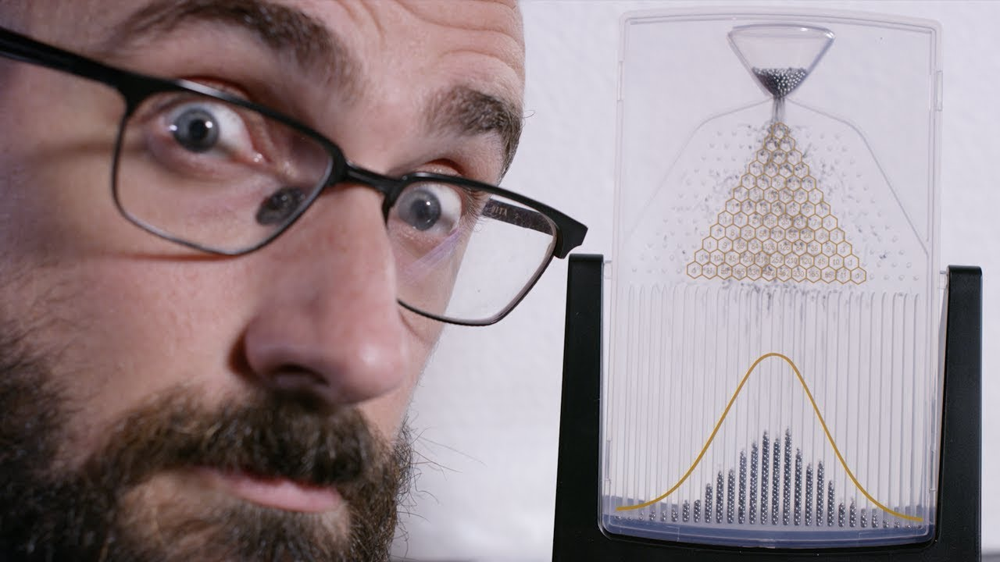

<a class="galton-video-link" href="https://www.youtube.com/watch?v=UCmPmkHqHXk" target="_blank" rel="noopener" aria-label="Galton Boardの動画を見る">▶ 動画を見る</a>

---

<!-- _class: visual -->

## 1回ごとは、左右どちらか

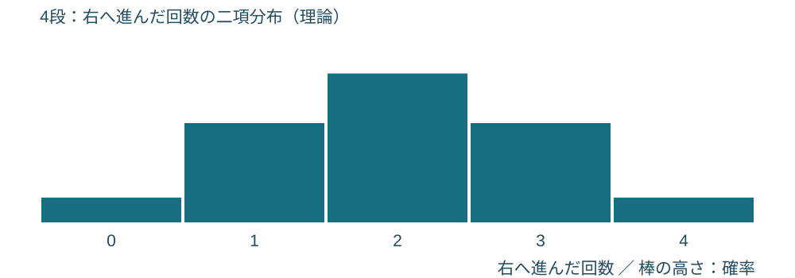

<aside class="formula-ref">教科書 p.118–119</aside>

---

<!-- _class: visual -->

## 段を増やすと、見覚えのある形

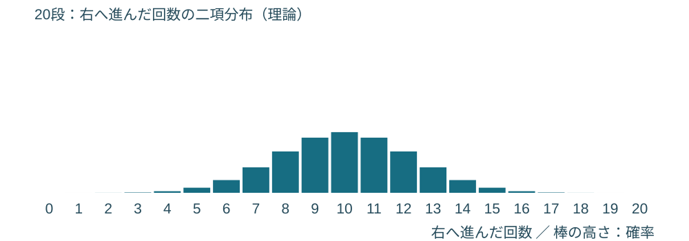

[やってみよう！](https://yohman.github.io/26-2-StatsB/agenda.html?p&activity=w6-board#week-06)

<aside class="formula-ref">教科書 p.122</aside>

---

<!-- _class: history -->

## 1733年、賭けの計算から

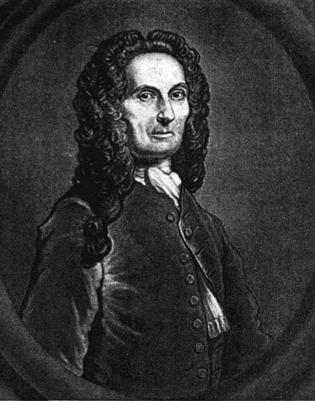

Abraham de Moivre

二項分布を、<ruby>正<rt>せい</rt></ruby><ruby>規<rt>き</rt></ruby><ruby>分<rt>ぶん</rt></ruby><ruby>布<rt>ぷ</rt></ruby>で<ruby>近<rt>きん</rt></ruby><ruby>似<rt>じ</rt></ruby>する。

のちにLaplaceらが一般化。

肖像：Wikimedia Commons / Public domain。歴史：MacTutor・Durham Probability 1。

---

<!-- _class: opening -->

## 今日の問い：何人測れば、<ruby>平<rt>へい</rt></ruby><ruby>均<rt>きん</rt></ruby>を信じられる？

1人の記録。 9人の<ruby>平<rt>へい</rt></ruby><ruby>均<rt>きん</rt></ruby>。 どちらが1秒に近そう？

[私たちのデータを使う](https://yohman.github.io/26-2-StatsB/agenda.html?p&activity=w6-sampling#week-06)

---

<!-- _class: plain -->

## まず、どの人たちについて話す？

<ruby>母<rt>ぼ</rt></ruby><ruby>集<rt>しゅう</rt></ruby><ruby>団<rt>だん</rt></ruby>Population

この教室で、今日測った記録の全体。

その一部を無作為に選ぶのが、<ruby>標<rt>ひょう</rt></ruby><ruby>本<rt>ほん</rt></ruby>Sample。

---

<!-- _class: visual -->

## 標本を替えると、<ruby>平<rt>へい</rt></ruby><ruby>均<rt>きん</rt></ruby>も替わる

「3人を選ぶ → <ruby>平<rt>へい</rt></ruby><ruby>均<rt>きん</rt></ruby>を1つ」 これを繰り返して、<ruby>平<rt>へい</rt></ruby><ruby>均<rt>きん</rt></ruby>の分布を見る。

<aside class="formula-ref">教科書 p.122–123</aside>

---

<!-- _class: hero-math -->

## <ruby>標<rt>ひょう</rt></ruby><ruby>本<rt>ほん</rt></ruby><ruby>平<rt>へい</rt></ruby><ruby>均<rt>きん</rt></ruby>Sample mean

$$
\bar X=\frac{1}{n}\sum_{i=1}^{n}X_i
$$

<aside class="formula-ref">教科書 p.122</aside>

---

<!-- _class: hero-math -->

## <ruby>平<rt>へい</rt></ruby><ruby>均<rt>きん</rt></ruby>の中心は、母<ruby>平<rt>へい</rt></ruby><ruby>均<rt>きん</rt></ruby>

$$
E(\bar X)=\mu,\qquad \operatorname{Var}(\bar X)=\frac{\sigma^2}{n}
$$

<aside class="formula-ref">教科書 p.122–123</aside>

---

<!-- _class: visual -->

## 9人の<ruby>平<rt>へい</rt></ruby><ruby>均<rt>きん</rt></ruby>なら、揺れは3分の1

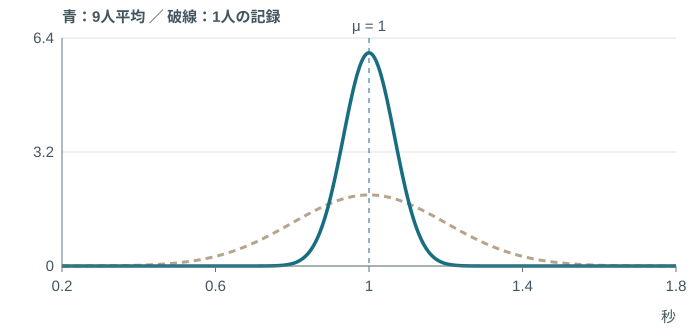

$$
\operatorname{SD}(\bar X)=\frac{\sigma}{\sqrt n}=\frac{0.20}{\sqrt9}=0.0667\ \text{秒}
$$

<aside class="formula-ref">教科書 p.123</aside>

---

<!-- _class: plain -->

## <ruby>中<rt>ちゅう</rt></ruby><ruby>心<rt>しん</rt></ruby><ruby>極<rt>きょく</rt></ruby><ruby>限<rt>げん</rt></ruby><ruby>定<rt>てい</rt></ruby><ruby>理<rt>り</rt></ruby>Central limit theorem

元の分布が歪んでいても、 大きい標本の<ruby>平<rt>へい</rt></ruby><ruby>均<rt>きん</rt></ruby>は、 <ruby>正<rt>せい</rt></ruby><ruby>規<rt>き</rt></ruby><ruby>分<rt>ぶん</rt></ruby><ruby>布<rt>ぷ</rt></ruby>で<ruby>近<rt>きん</rt></ruby><ruby>似<rt>じ</rt></ruby>できる。

独立・同じ分布・有限の<ruby>分<rt>ぶん</rt></ruby><ruby>散<rt>さん</rt></ruby>を仮定。必要なnは元の形により異なる。

<aside class="formula-ref">教科書 p.122</aside>

---

<!-- _class: try -->

## 元の記録と、<ruby>平<rt>へい</rt></ruby><ruby>均<rt>きん</rt></ruby>の分布を並べよう

予想 → 1000標本 → 比較。

元の分布は変わった？ nを増やしたとき、どちらが細くなった？

[やってみよう！](https://yohman.github.io/26-2-StatsB/agenda.html?p&activity=w6-sampling#week-06)

<aside class="formula-ref">教科書 p.122–123</aside>

---

<!-- _class: plain -->

## <ruby>近<rt>きん</rt></ruby><ruby>似<rt>じ</rt></ruby>と、厳密な<ruby>正<rt>せい</rt></ruby><ruby>規<rt>き</rt></ruby><ruby>分<rt>ぶん</rt></ruby><ruby>布<rt>ぷ</rt></ruby>

<ruby>母<rt>ぼ</rt></ruby><ruby>集<rt>しゅう</rt></ruby><ruby>団<rt>だん</rt></ruby>が<ruby>正<rt>せい</rt></ruby><ruby>規<rt>き</rt></ruby><ruby>分<rt>ぶん</rt></ruby><ruby>布<rt>ぷ</rt></ruby>なら、**どのnでも**<ruby>標<rt>ひょう</rt></ruby><ruby>本<rt>ほん</rt></ruby><ruby>平<rt>へい</rt></ruby><ruby>均<rt>きん</rt></ruby>は厳密に<ruby>正<rt>せい</rt></ruby><ruby>規<rt>き</rt></ruby><ruby>分<rt>ぶん</rt></ruby><ruby>布<rt>ぷ</rt></ruby>。

$$
\bar X\sim N\!\left(\mu,\frac{\sigma^2}{n}\right)
$$

それ以外は、条件のもとでnを大きくして<ruby>近<rt>きん</rt></ruby><ruby>似<rt>じ</rt></ruby>。

<aside class="formula-ref">教科書 p.122–123</aside>

---

<!-- _class: plain -->

## 大数の法則と中心極限定理

大数の法則：<ruby>平<rt>へい</rt></ruby><ruby>均<rt>きん</rt></ruby>が、母<ruby>平<rt>へい</rt></ruby><ruby>均<rt>きん</rt></ruby>に近づく。  中心極限定理：<ruby>平<rt>へい</rt></ruby><ruby>均<rt>きん</rt></ruby>の揺れを、<ruby>正<rt>せい</rt></ruby><ruby>規<rt>き</rt></ruby><ruby>分<rt>ぶん</rt></ruby><ruby>布<rt>ぷ</rt></ruby>で<ruby>近<rt>きん</rt></ruby><ruby>似<rt>じ</rt></ruby>。

<aside class="formula-ref">教科書 p.122–123</aside>

---

<!-- _class: challenge -->

## チャレンジ1　学食までの移動時間

自分で解く　4分

架空の3人の記録：**8、10、12分**。

(1) <ruby>標<rt>ひょう</rt></ruby><ruby>本<rt>ほん</rt></ruby><ruby>平<rt>へい</rt></ruby><ruby>均<rt>きん</rt></ruby>は？
(2) 偏差二乗和は？
(3) nで割る標本<ruby>分<rt>ぶん</rt></ruby><ruby>散<rt>さん</rt></ruby>と、n−1で割る不偏<ruby>分<rt>ぶん</rt></ruby><ruby>散<rt>さん</rt></ruby>は？

<aside class="formula-ref">教科書 p.122・126</aside>

---

<!-- _class: worked -->

## 答え合わせ1　分母の違いを分ける

① 与えられた条件

n=3、x=(8,10,12)。

② 公式（文字のまま）

$$
\bar x=\frac{\sum x_i}{n},\quad S^2=\frac{\sum(x_i-\bar x)^2}{n},\quad s^2=\frac{\sum(x_i-\bar x)^2}{n-1}
$$

③ 数値を代入

$$
\bar x=10,\quad\sum(x_i-10)^2=4+0+4=8
$$

④ 標本<ruby>分<rt>ぶん</rt></ruby><ruby>散<rt>さん</rt></ruby> 8/3 ≈ 2.67分² ／ 不偏<ruby>分<rt>ぶん</rt></ruby><ruby>散<rt>さん</rt></ruby> 8/2 = 4分²。

<aside class="formula-ref">教科書 p.122・126</aside>

---

<!-- _class: challenge -->

## チャレンジ2　25人の<ruby>平<rt>へい</rt></ruby><ruby>均<rt>きん</rt></ruby>が、1.08秒を超える？

自分で解く　4分

仮想の正規モデル：母<ruby>平<rt>へい</rt></ruby><ruby>均<rt>きん</rt></ruby>1.00秒、<ruby>母<rt>ぼ</rt></ruby><ruby>標<rt>ひょう</rt></ruby><ruby>準<rt>じゅん</rt></ruby><ruby>偏<rt>へん</rt></ruby><ruby>差<rt>さ</rt></ruby>0.20秒。

独立に25人分を抽出する。Pr(X̄ > 1.08)を求めよ。

ヒント：1人ではなく「<ruby>平<rt>へい</rt></ruby><ruby>均<rt>きん</rt></ruby>」を<ruby>標<rt>ひょう</rt></ruby><ruby>準<rt>じゅん</rt></ruby><ruby>化<rt>か</rt></ruby>する。上側表：Pr(Z > 2.00)=0.02275。

<aside class="formula-ref">教科書 p.123–124</aside>

<aside class="table-resource"><a target="_blank" rel="noopener" href="https://yohman.github.io/26-2-StatsB/viewer.html?p&file=materials%2F2026-yoh%2Fweek06%2Fstandard-normal-table.pdf&title=Standard%20normal%20table&week=W06">標準正規分布表を開く ↗</a></aside>

---

<!-- _class: worked -->

## 答え合わせ2　<ruby>平<rt>へい</rt></ruby><ruby>均<rt>きん</rt></ruby>を<ruby>標<rt>ひょう</rt></ruby><ruby>準<rt>じゅん</rt></ruby><ruby>化<rt>か</rt></ruby>する

① 与えられた条件

μ=1、σ=0.20、n=25、境界1.08秒。

② 公式（文字のまま）

$$
Z=\frac{\bar X-\mu}{\sigma/\sqrt n}
$$

③ 数値を代入

$$
z=\frac{1.08-1}{0.20/\sqrt{25}}=\frac{0.08}{0.04}=2
$$

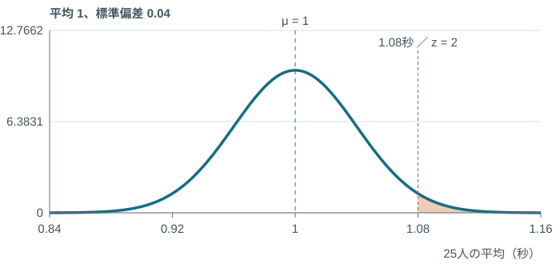

④ Pr(X̄ > 1.08)=Pr(Z > 2)=0.02275=2.275%。

<aside class="formula-ref">教科書 p.123–124</aside>

<aside class="table-resource"><a target="_blank" rel="noopener" href="https://yohman.github.io/26-2-StatsB/viewer.html?p&file=materials%2F2026-yoh%2Fweek06%2Fstandard-normal-table.pdf&title=Standard%20normal%20table&week=W06">標準正規分布表を開く ↗</a></aside>

---

<!-- _class: opening -->

## 1908年、ギネスの醸造所で

少ない実験から、 品質を判断したい。

大量の試験には、時間も費用もかかる。

---

<!-- _class: history -->

## “Student”は、学生のこと？

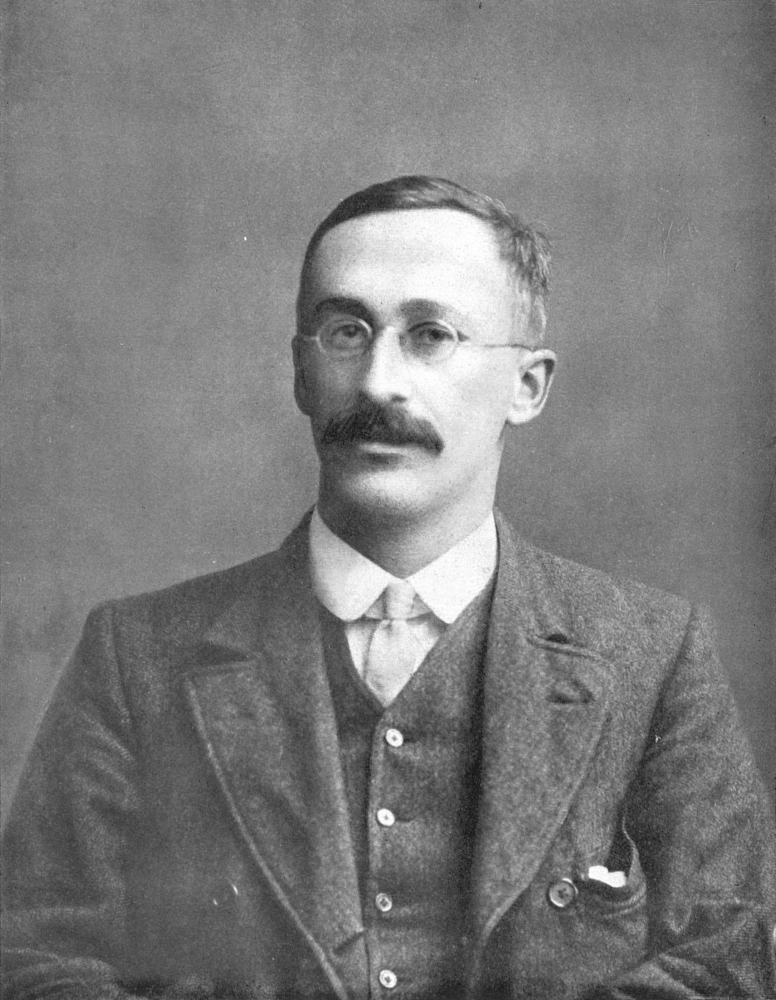

William Sealy Gosset

ギネスの醸造技術者。

論文の署名は <strong>“Student”</strong>。

1908年 “The Probable Error of a Mean”

肖像：Wikimedia Commons / Public domain。論文：Biometrika 6(1), 1–25。

---

<!-- _class: plain -->

## <ruby>母<rt>ぼ</rt></ruby><ruby>標<rt>ひょう</rt></ruby><ruby>準<rt>じゅん</rt></ruby><ruby>偏<rt>へん</rt></ruby><ruby>差<rt>さ</rt></ruby>を、本当に知っている？

前回：σが分かっていた。 今回は：手元の記録から、sを求める。

広がり自体も、標本によって揺れる。

<aside class="formula-ref">教科書 p.125</aside>

---

<!-- _class: hero-math -->

## 母<ruby>分<rt>ぶん</rt></ruby><ruby>散<rt>さん</rt></ruby>が既知なら、Z

$$
Z=\frac{\bar X-\mu}{\sigma/\sqrt n}
$$

<aside class="formula-ref">教科書 p.123・125</aside>

---

<!-- _class: hero-math -->

## 母<ruby>分<rt>ぶん</rt></ruby><ruby>散<rt>さん</rt></ruby>が未知なら、T

$$
T=\frac{\bar X-\mu}{s/\sqrt n}\sim t_{n-1}
$$

<aside class="formula-ref">教科書 p.125–126</aside>

---

<!-- _class: plain -->

## <ruby>自<rt>じ</rt></ruby><ruby>由<rt>ゆう</rt></ruby><ruby>度<rt>ど</rt></ruby>Degrees of freedom

4人の<ruby>平<rt>へい</rt></ruby><ruby>均<rt>きん</rt></ruby>が **10**。

8　＋　9　＋　11　＋　？

最後の値は、自由に選べる？

<aside class="formula-ref">教科書 p.125–126</aside>

---

<!-- _class: plain -->

## <ruby>平<rt>へい</rt></ruby><ruby>均<rt>きん</rt></ruby>を求めたぶん、自由度が1つ減る

4個の値。条件が1つ。 自由度は 4−1 = 3。

一般に、独立な条件がk個なら ν=n−k。

<aside class="formula-ref">教科書 p.125–126</aside>

---

<!-- _class: hero-math -->

## <ruby>標<rt>ひょう</rt></ruby><ruby>本<rt>ほん</rt></ruby><ruby>不<rt>ふ</rt></ruby><ruby>偏<rt>へん</rt></ruby><ruby>分<rt>ぶん</rt></ruby><ruby>散<rt>さん</rt></ruby>Unbiased sample variance

$$
s^2=\frac{1}{n-1}\sum_{i=1}^{n}(X_i-\bar X)^2
$$

<aside class="formula-ref">教科書 p.126</aside>

---

<!-- _class: plain -->

## 不偏：繰り返した推定の<ruby>平<rt>へい</rt></ruby><ruby>均<rt>きん</rt></ruby>が合う

$$
E(s^2)=\sigma^2
$$

一回のs²が、必ず母<ruby>分<rt>ぶん</rt></ruby><ruby>散<rt>さん</rt></ruby>と一致するという意味ではない。

不偏<ruby>標<rt>ひょう</rt></ruby><ruby>準<rt>じゅん</rt></ruby><ruby>偏<rt>へん</rt></ruby><ruby>差<rt>さ</rt></ruby>ではなく、不偏「<ruby>分<rt>ぶん</rt></ruby><ruby>散<rt>さん</rt></ruby>」。平方根s自体は一般に不偏ではない。

<aside class="formula-ref">教科書 p.126（注）</aside>

---

<!-- _class: visual -->

## t分布Student’s t-distribution

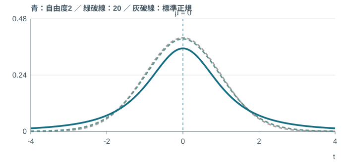

左右対称。小さい自由度ほど、両端に厚み。

<aside class="formula-ref">教科書 p.126</aside>

---

<!-- _class: challenge -->

## チャレンジ3　私たちは、1秒より遅い？

自分で解く　4分

架空の9人の記録：n=9、<ruby>平<rt>へい</rt></ruby><ruby>均<rt>きん</rt></ruby>1.08秒、**s=0.12秒**。

比較する母<ruby>平<rt>へい</rt></ruby><ruby>均<rt>きん</rt></ruby>を1.00秒とする。
(1) <ruby>標<rt>ひょう</rt></ruby><ruby>準<rt>じゅん</rt></ruby><ruby>誤<rt>ご</rt></ruby><ruby>差<rt>さ</rt></ruby> s/√n は？ (2) t と自由度は？

ヒント：差を、<ruby>平<rt>へい</rt></ruby><ruby>均<rt>きん</rt></ruby>の揺れの大きさで割る。

<aside class="formula-ref">教科書 p.125–126</aside>

---

<!-- _class: worked -->

## 答え合わせ3　0.08秒は、揺れの2個分

① 与えられた条件

n=9、x̄=1.08秒、s=0.12秒、μ=1秒。

② 公式（文字のまま）

$$
T=\frac{\bar X-\mu}{s/\sqrt n},\quad\nu=n-1
$$

③ 数値を代入

$$
t=\frac{1.08-1.00}{0.12/\sqrt9}=\frac{0.08}{0.04}=2
$$

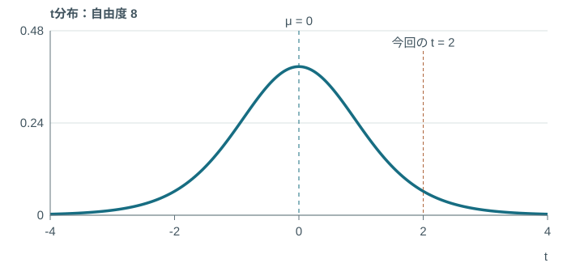

④ t=2、自由度8。2秒でも2%でもない。

<aside class="formula-ref">教科書 p.125–126</aside>

---

<!-- _class: try -->

## 自分たちの記録なら、どうなる？

同じ条件で取った記録を入力。 <ruby>平<rt>へい</rt></ruby><ruby>均<rt>きん</rt></ruby>・s・tを、順番に確かめる。

[やってみよう！](https://yohman.github.io/26-2-StatsB/agenda.html?p&activity=w6-t#week-06)

実測は必ずしも独立・正規ではない。練習や外れ値の影響も観察する。

<aside class="formula-ref">教科書 p.125–126</aside>

---

<!-- _class: plain -->

## 表の読み方が、前回と逆になる

| | <ruby>標<rt>ひょう</rt></ruby><ruby>準<rt>じゅん</rt></ruby><ruby>正<rt>せい</rt></ruby><ruby>規<rt>き</rt></ruby><ruby>分<rt>ぶん</rt></ruby><ruby>布<rt>ぷ</rt></ruby><ruby>表<rt>ひょう</rt></ruby> | t分布表 |
|---|---|---|
| 入れるもの | z | 自由度ν、<ruby>上<rt>うわ</rt></ruby><ruby>側<rt>がわ</rt></ruby><ruby>確<rt>かく</rt></ruby><ruby>率<rt>りつ</rt></ruby>α |
| 出てくるもの | 右側の<ruby>確<rt>かく</rt></ruby><ruby>率<rt>りつ</rt></ruby> | 横軸の境界t |

t表の中身は、<ruby>確<rt>かく</rt></ruby><ruby>率<rt>りつ</rt></ruby>ではない。

<aside class="formula-ref">教科書 p.124・126–127・203</aside>

---

<!-- _class: plain -->

## 行20、列0.025

| 自由度ν ＼ <ruby>上<rt>うわ</rt></ruby><ruby>側<rt>がわ</rt></ruby><ruby>確<rt>かく</rt></ruby><ruby>率<rt>りつ</rt></ruby>α | 0.05 | **0.025** | 0.01 |
|---|---|---|---|
| 10 | 1.8125 | 2.2281 | 2.7638 |
| **20** | 1.7247 | **2.0860** | 2.5280 |
| 30 | 1.6973 | 2.0423 | 2.4573 |

[t表を指して確認](https://yohman.github.io/26-2-StatsB/agenda.html?p&activity=w6-t#week-06)

<aside class="formula-ref">教科書 p.127・203</aside>

---

<!-- _class: visual -->

## 右の面積が2.5%になる境界

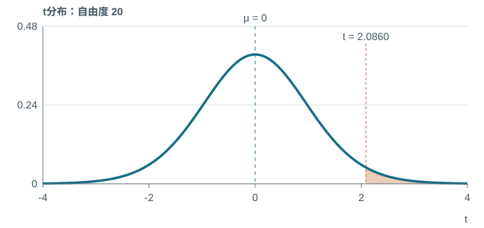

$$
\Pr(T>2.0860)=0.025\quad(\nu=20)
$$

図の外にも裾が続く。数値は統計表の<ruby>丸<rt>まる</rt></ruby>め。

<aside class="formula-ref">教科書 p.127・203</aside>

---

<!-- _class: challenge -->

## チャレンジ4　中央90%を残すには？

自分で解く　4分

Tは**自由度10**のt分布に従う。

Pr(−c &lt; T &lt; c)=0.90となるcを求めよ。

左右の尾はそれぞれ何%？ 表のどの列を読む？

[t表を開く](https://yohman.github.io/26-2-StatsB/agenda.html?p&activity=w6-t#week-06)

<aside class="formula-ref">教科書 p.127・203</aside>

---

<!-- _class: worked -->

## 答え合わせ4　中央90%、左右に5%ずつ

① 与えられた条件

ν=10、中央の<ruby>確<rt>かく</rt></ruby><ruby>率<rt>りつ</rt></ruby>0.90。

② 公式（文字のまま）

$$
\alpha=\frac{1-\text{中央の確率}}{2},\quad c=t_{\alpha}(\nu)
$$

③ 数値を代入

$$
\alpha=\frac{1-0.90}{2}=0.05,\quad c=t_{0.05}(10)=1.8125
$$

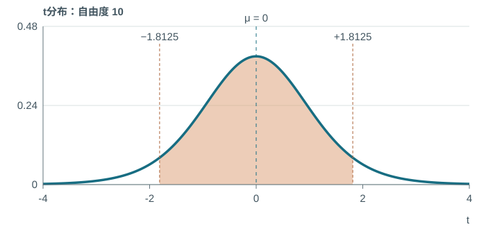

④ Pr(−1.8125 < T < 1.8125)=90%。

<aside class="formula-ref">教科書 p.127・203</aside>

---

<!-- _class: challenge -->

## チャレンジ5　さっきのt=2は、表のどこ？

自分で解く　4分

自由度8で、今回のt=2。

| <ruby>上<rt>うわ</rt></ruby><ruby>側<rt>がわ</rt></ruby><ruby>確<rt>かく</rt></ruby><ruby>率<rt>りつ</rt></ruby>α | 0.05 | 0.025 |
|---|---|---|
| tの境界 | 1.8595 | 2.3060 |

Pr(T &gt; 2) は何%と何%の間？
左右の外側 Pr(｜T｜ &gt; 2) は？

<aside class="formula-ref">教科書 p.127・203</aside>

---

<!-- _class: worked -->

## 答え合わせ5　表にない値も、範囲で読める

① 与えられた条件

ν=8、t=2。境界1.8595と2.3060。

② 公式（文字のまま）

$$
a<b\Rightarrow\Pr(T>a)>\Pr(T>b)
$$

③ 数値を代入

$$
1.8595<2<2.3060\Rightarrow0.025<\Pr(T>2)<0.05
$$

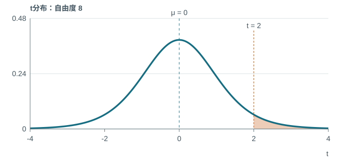

④ 上側2.5〜5%の間。両側は5〜10%の間。

<aside class="formula-ref">教科書 p.127・203</aside>

---

<!-- _class: opening -->

## 品質の話に戻ろう

<ruby>平<rt>へい</rt></ruby><ruby>均<rt>きん</rt></ruby>160cmは、同じ。 でも、全部の部品が合う？

小さすぎるロボット。大きすぎるロボット。

---

<!-- _class: hero-math -->

## カイ二乗分布Chi-square distribution

$$
U=Z_1^2+Z_2^2+\cdots+Z_{\nu}^2\sim\chi^2_{\nu}
$$

Zᵢは独立な標準正規変数。平方和なので、U ≥ 0。

<aside class="formula-ref">教科書 p.127–128</aside>

---

<!-- _class: plain -->

## ロボット3体の、<ruby>標<rt>ひょう</rt></ruby><ruby>準<rt>じゅん</rt></ruby><ruby>化<rt>か</rt></ruby>されたずれ

仮想モデル：独立な身長 X ~ N(160,5²)。

155cm　160cm　170cm

$$
z_i=\frac{x_i-160}{5}\quad\Longrightarrow\quad(-1,0,2)
$$

ここでは既知の母<ruby>平<rt>へい</rt></ruby><ruby>均<rt>きん</rt></ruby>160を使う。<ruby>標<rt>ひょう</rt></ruby><ruby>本<rt>ほん</rt></ruby><ruby>平<rt>へい</rt></ruby><ruby>均<rt>きん</rt></ruby>を引いた残差とは区別。

<aside class="formula-ref">教科書 p.123・128</aside>

---

<!-- _class: challenge -->

## チャレンジ6　ずれを、ひとつの値に

自分で解く　4分

さっきのz値は **−1、0、2**。

(1) U=Σzᵢ²を求めよ。
(2) 独立な標準正規値は何個？ 自由度は？
(3) U=0なら、どんな3体？

<aside class="formula-ref">教科書 p.127–128</aside>

---

<!-- _class: worked -->

## 答え合わせ6　小さすぎても、大きすぎても足す

① 与えられた条件

z=(−1,0,2)、既知のμとσで<ruby>標<rt>ひょう</rt></ruby><ruby>準<rt>じゅん</rt></ruby><ruby>化<rt>か</rt></ruby>。

② 公式（文字のまま）

$$
U=\sum_{i=1}^{\nu}Z_i^2
$$

③ 数値を代入

$$
U=(-1)^2+0^2+2^2=1+0+4=5,\quad\nu=3
$$

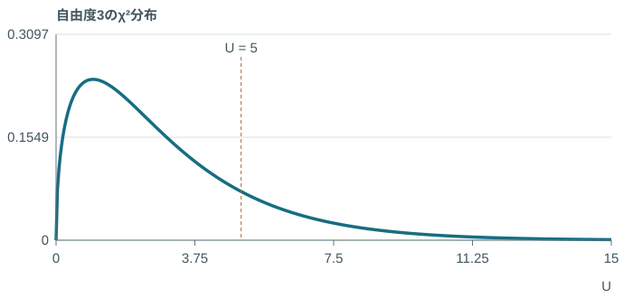

④ U=5、自由度3。U=0なら3体とも160cm。

<aside class="formula-ref">教科書 p.127–128</aside>

---

<!-- _class: visual -->

## 自由度が増えると、形も変わる

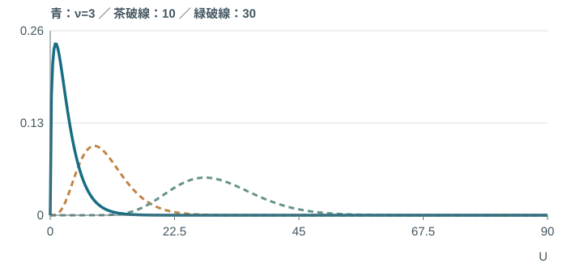

右に長い裾。自由度が大きいほど、相対的な歪みが弱まる。

[やってみよう！](https://yohman.github.io/26-2-StatsB/agenda.html?p&activity=w6-chi#week-06)

<aside class="formula-ref">教科書 p.128</aside>

---

<!-- _class: plain -->

## 中心と広がりも、自由度で決まる

$$
E(U)=\nu,\qquad\operatorname{Var}(U)=2\nu
$$

ν=3なら、<ruby>期<rt>き</rt></ruby><ruby>待<rt>たい</rt></ruby><ruby>値<rt>ち</rt></ruby>3・<ruby>分<rt>ぶん</rt></ruby><ruby>散<rt>さん</rt></ruby>6。
今回のU=5が、必ず<ruby>期<rt>き</rt></ruby><ruby>待<rt>たい</rt></ruby><ruby>値<rt>ち</rt></ruby>と一致する必要はない。

<aside class="formula-ref">教科書 p.128</aside>

---

<!-- _class: decomposition -->

## <ruby>標<rt>ひょう</rt></ruby><ruby>本<rt>ほん</rt></ruby><ruby>平<rt>へい</rt></ruby><ruby>均<rt>きん</rt></ruby>を引くと、自由度はn−1

$$
\sum_{i=1}^{n}\frac{(X_i-\mu)^2}{\sigma^2}=\sum_{i=1}^{n}\frac{(X_i-\bar X)^2}{\sigma^2}+\frac{n(\bar X-\mu)^2}{\sigma^2}
$$

全体のずれ ＝ 標本内のずれ ＋ <ruby>平<rt>へい</rt></ruby><ruby>均<rt>きん</rt></ruby>のずれ。
自由度も n ＝ (n−1) ＋ 1。

<aside class="formula-ref">教科書 p.128</aside>

---

<!-- _class: plain -->

## 今日の3つの道具

| 知りたいこと | 道具 |
|---|---|
| <ruby>標<rt>ひょう</rt></ruby><ruby>本<rt>ほん</rt></ruby><ruby>平<rt>へい</rt></ruby><ruby>均<rt>きん</rt></ruby>は、どのくらい揺れる？ | <ruby>標<rt>ひょう</rt></ruby><ruby>本<rt>ほん</rt></ruby><ruby>平<rt>へい</rt></ruby><ruby>均<rt>きん</rt></ruby>の分布・中心極限定理 |
| σが未知。<ruby>平<rt>へい</rt></ruby><ruby>均<rt>きん</rt></ruby>のずれは？ | t分布（独立な正規標本で厳密） |
| <ruby>標<rt>ひょう</rt></ruby><ruby>準<rt>じゅん</rt></ruby><ruby>化<rt>か</rt></ruby>したずれを二乗して集めると？ | カイ二乗分布 |

<aside class="formula-ref">教科書 p.122–128</aside>

---

<!-- _class: try -->

## AL：ここからは、自分で表を読む

<ruby>標<rt>ひょう</rt></ruby><ruby>準<rt>じゅん</rt></ruby><ruby>正<rt>せい</rt></ruby><ruby>規<rt>き</rt></ruby><ruby>分<rt>ぶん</rt></ruby><ruby>布<rt>ぷ</rt></ruby><ruby>表<rt>ひょう</rt></ruby>とt分布表を使う。

何の分布？ 何が与えられている？ <ruby>確<rt>かく</rt></ruby><ruby>率<rt>りつ</rt></ruby>と境界、どちらを求める？

ワークシートの各セルの答えは、ここでは示しません。

<aside class="formula-ref">教科書 p.123–127・202–203</aside>

---

<!-- _class: optional -->

## 余裕があれば：1人の記録か、<ruby>平<rt>へい</rt></ruby><ruby>均<rt>きん</rt></ruby>か

同じ<ruby>母<rt>ぼ</rt></ruby><ruby>集<rt>しゅう</rt></ruby><ruby>団<rt>だん</rt></ruby>で、n=4からn=16へ。

(1) <ruby>標<rt>ひょう</rt></ruby><ruby>本<rt>ほん</rt></ruby><ruby>平<rt>へい</rt></ruby><ruby>均<rt>きん</rt></ruby>の<ruby>分<rt>ぶん</rt></ruby><ruby>散<rt>さん</rt></ruby>は何倍？
(2) <ruby>標<rt>ひょう</rt></ruby><ruby>本<rt>ほん</rt></ruby><ruby>平<rt>へい</rt></ruby><ruby>均<rt>きん</rt></ruby>の<ruby>標<rt>ひょう</rt></ruby><ruby>準<rt>じゅん</rt></ruby><ruby>偏<rt>へん</rt></ruby><ruby>差<rt>さ</rt></ruby>は何倍？
(3) 元の一人ひとりの分布は変わる？

[やってみよう！](https://yohman.github.io/26-2-StatsB/agenda.html?p&activity=w6-sampling#week-06)

<aside class="formula-ref">教科書 p.122–123</aside>

---

<!-- _class: optional -->

## 歴史の続き、もっと読みたい人へ

[Gossetの1908年論文（Oxford Academic）](https://academic.oup.com/biomet/article-abstract/6/1/1/225634)

[Galtonの1873年の装置（UCL所蔵）](https://collections.ucl.ac.uk/Details/science/60000062)

[de Moivreと1733年の近似（MacTutor）](https://mathshistory.st-andrews.ac.uk/Biographies/De_Moivre/)

Galtonの統計研究には優生学という負の歴史もある。ここでは装置の<ruby>確<rt>かく</rt></ruby><ruby>率<rt>りつ</rt></ruby>モデルを学び、その思想を支持しない。

