

<!-- _class: video -->

## 玉は、どこに集まる？

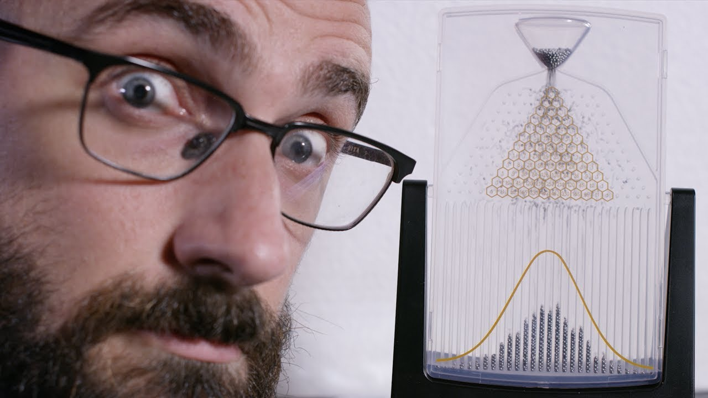

<a class="video-link" target="_blank" rel="noopener" href="https://www.youtube.com/watch?v=zeJD6dqJ5lo">▶ 動画を見る</a>

---

<!-- _class: plain roadmap -->

## 今日の3つ

中心極限定理 t分布 カイ二乗分布

---

<!-- _class: topic title-clt -->

## <ruby>中<rt>ちゅう</rt></ruby><ruby>心<rt>しん</rt></ruby><ruby>極<rt>きょく</rt></ruby><ruby>限<rt>げん</rt></ruby><ruby>定<rt>てい</rt></ruby><ruby>理<rt>り</rt></ruby>Central limit theorem

---

<!-- _class: plain -->

## サイコロを、<ruby>母<rt>ぼ</rt></ruby><ruby>集<rt>しゅう</rt></ruby><ruby>団<rt>だん</rt></ruby>のモデルにする

1　2　3　4　5　6

毎回、公平なサイコロを振る。 4回の出目を集めたら、1つの標本。

<aside class="formula-ref">教科書 p.122</aside>

---

<!-- _class: hero-math -->

## <ruby>標<rt>ひょう</rt></ruby><ruby>本<rt>ほん</rt></ruby><ruby>平<rt>へい</rt></ruby><ruby>均<rt>きん</rt></ruby>

$$
\bar{x}=\frac{1}{n}(x_1+x_2+\cdots+x_n)
$$

<aside class="formula-ref">教科書 p.122（脚注2）</aside>

---

<!-- _class: visual -->

## 4回から、<ruby>平<rt>へい</rt></ruby><ruby>均<rt>きん</rt></ruby>を1つ

$$
\bar{x}=\frac{1}{4}(1+2+5+6)=3.5
$$

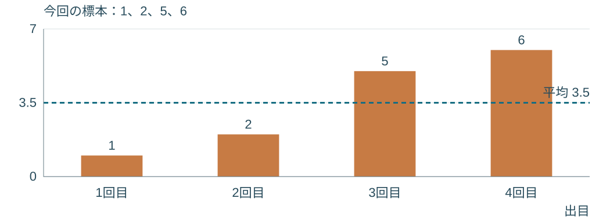

<aside class="formula-ref">教科書 p.122（脚注2に代入）</aside>

---

<!-- _class: visual -->

## 1標本が1回なら

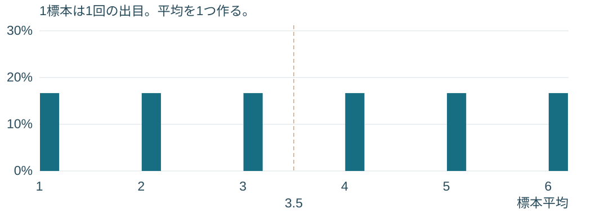
説明用の6組ではなく、全ての出方から求めた理論値。棒は幅0.2の<ruby>区<rt>く</rt></ruby><ruby>間<rt>かん</rt></ruby>の<ruby>確<rt>かく</rt></ruby><ruby>率<rt>りつ</rt></ruby>。

<aside class="formula-ref">教科書 p.122</aside>

---

<!-- _class: dice-samples -->

## 1組4回から、<ruby>平<rt>へい</rt></ruby><ruby>均<rt>きん</rt></ruby>を1つ

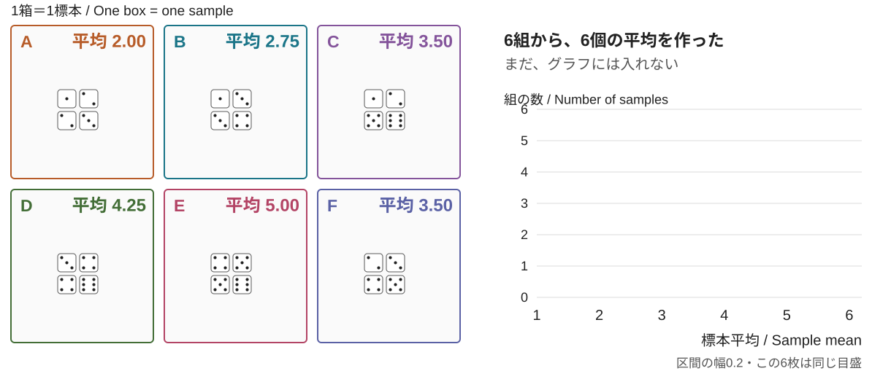

<aside class="formula-ref">教科書 p.122（<ruby>標<rt>ひょう</rt></ruby><ruby>本<rt>ほん</rt></ruby><ruby>平<rt>へい</rt></ruby><ruby>均<rt>きん</rt></ruby>の例）</aside>

---

<!-- _class: dice-samples -->

## 1組25回から、<ruby>平<rt>へい</rt></ruby><ruby>均<rt>きん</rt></ruby>を1つ

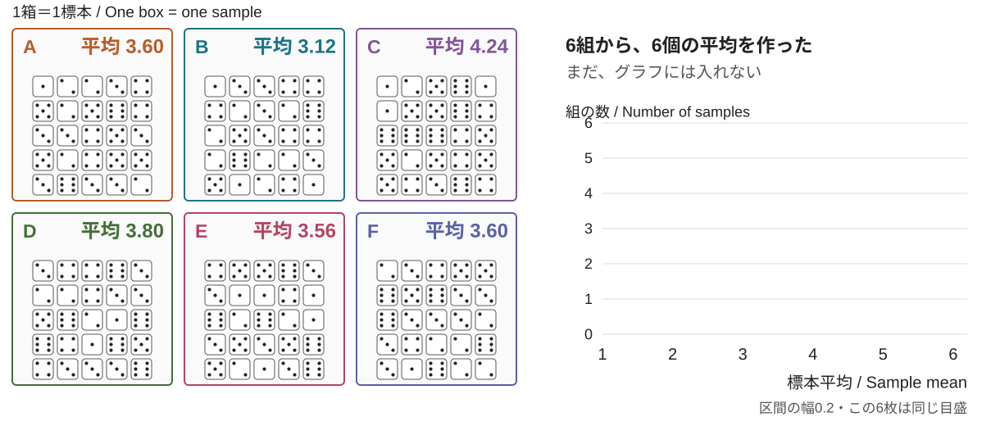

<aside class="formula-ref">教科書 p.122（<ruby>標<rt>ひょう</rt></ruby><ruby>本<rt>ほん</rt></ruby><ruby>平<rt>へい</rt></ruby><ruby>均<rt>きん</rt></ruby>の例）</aside>

---

<!-- _class: dice-samples -->

## <ruby>平<rt>へい</rt></ruby><ruby>均<rt>きん</rt></ruby>を1つ、グラフに入れる（4回）

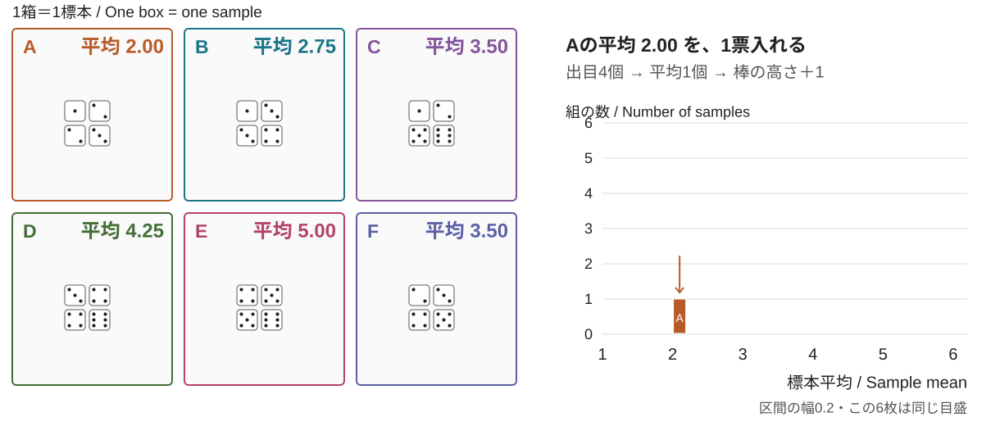

<aside class="formula-ref">教科書 p.122（<ruby>標<rt>ひょう</rt></ruby><ruby>本<rt>ほん</rt></ruby><ruby>平<rt>へい</rt></ruby><ruby>均<rt>きん</rt></ruby>の例）</aside>

---

<!-- _class: dice-samples -->

## <ruby>平<rt>へい</rt></ruby><ruby>均<rt>きん</rt></ruby>を1つ、グラフに入れる（25回）

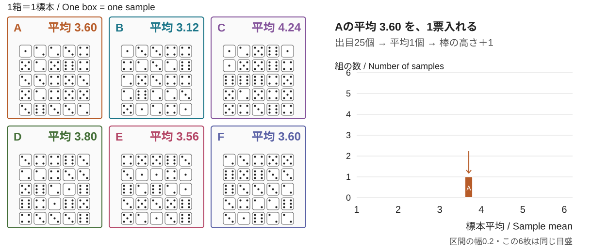

<aside class="formula-ref">教科書 p.122（<ruby>標<rt>ひょう</rt></ruby><ruby>本<rt>ほん</rt></ruby><ruby>平<rt>へい</rt></ruby><ruby>均<rt>きん</rt></ruby>の例）</aside>

---

<!-- _class: dice-samples -->

## 6組の<ruby>平<rt>へい</rt></ruby><ruby>均<rt>きん</rt></ruby>を、グラフに入れる（4回）

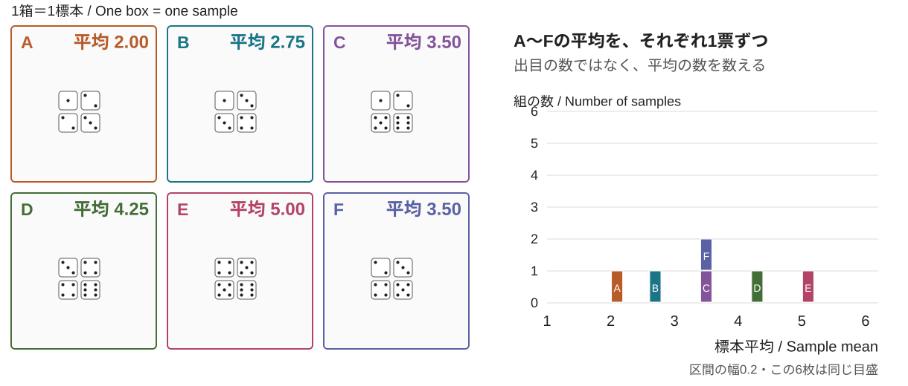

<aside class="formula-ref">教科書 p.122（<ruby>標<rt>ひょう</rt></ruby><ruby>本<rt>ほん</rt></ruby><ruby>平<rt>へい</rt></ruby><ruby>均<rt>きん</rt></ruby>の例）</aside>

---

<!-- _class: dice-samples -->

## 6組の<ruby>平<rt>へい</rt></ruby><ruby>均<rt>きん</rt></ruby>を、グラフに入れる（25回）

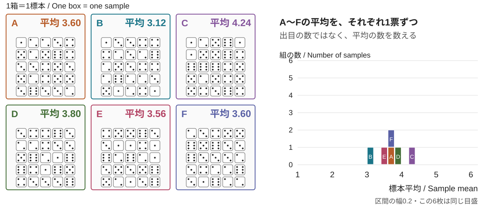

<aside class="formula-ref">教科書 p.122（<ruby>標<rt>ひょう</rt></ruby><ruby>本<rt>ほん</rt></ruby><ruby>平<rt>へい</rt></ruby><ruby>均<rt>きん</rt></ruby>の例）</aside>

---

<!-- _class: visual -->

## 1標本が4回なら

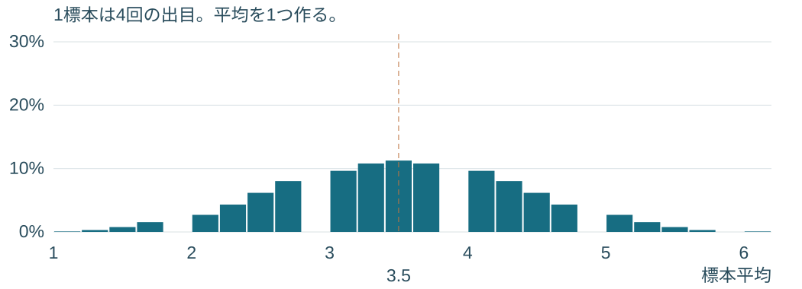
説明用の6組ではなく、全ての出方から求めた理論値。棒は幅0.2の<ruby>区<rt>く</rt></ruby><ruby>間<rt>かん</rt></ruby>の<ruby>確<rt>かく</rt></ruby><ruby>率<rt>りつ</rt></ruby>。

<aside class="formula-ref">教科書 p.122</aside>

---

<!-- _class: visual -->

## 1標本が25回なら

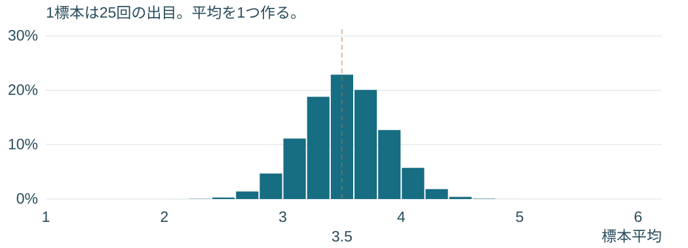
説明用の6組ではなく、全ての出方から求めた理論値。棒は幅0.2の<ruby>区<rt>く</rt></ruby><ruby>間<rt>かん</rt></ruby>の<ruby>確<rt>かく</rt></ruby><ruby>率<rt>りつ</rt></ruby>。

<aside class="formula-ref">教科書 p.122</aside>

---

<!-- _class: plain punch -->

## 変わったのは、<ruby>平<rt>へい</rt></ruby><ruby>均<rt>きん</rt></ruby>の分布

元の出目は、1〜6のまま。 標本を大きくすると、 <ruby>平<rt>へい</rt></ruby><ruby>均<rt>きん</rt></ruby>の分布がベル型に近づく。

独立・同じ分布・有限の<ruby>分<rt>ぶん</rt></ruby><ruby>散<rt>さん</rt></ruby>を仮定。必要な標本の大きさは元の分布による。

<aside class="formula-ref">教科書 p.122</aside>

---

<!-- _class: plain soft-pink -->

## <ruby>母<rt>ぼ</rt></ruby><ruby>集<rt>しゅう</rt></ruby><ruby>団<rt>だん</rt></ruby>が<ruby>正<rt>せい</rt></ruby><ruby>規<rt>き</rt></ruby><ruby>分<rt>ぶん</rt></ruby><ruby>布<rt>ぷ</rt></ruby>なら

標本が小さくても、 <ruby>標<rt>ひょう</rt></ruby><ruby>本<rt>ほん</rt></ruby><ruby>平<rt>へい</rt></ruby><ruby>均<rt>きん</rt></ruby>は厳密に<ruby>正<rt>せい</rt></ruby><ruby>規<rt>き</rt></ruby><ruby>分<rt>ぶん</rt></ruby><ruby>布<rt>ぷ</rt></ruby>。

それ以外では、標本を大きくして<ruby>近<rt>きん</rt></ruby><ruby>似<rt>じ</rt></ruby>。

<aside class="formula-ref">教科書 p.122</aside>

---

<!-- _class: try cta-dice -->

## 自分たちで、<ruby>平<rt>へい</rt></ruby><ruby>均<rt>きん</rt></ruby>を作る

1回・4回・25回。 <ruby>平<rt>へい</rt></ruby><ruby>均<rt>きん</rt></ruby>を1000個作って比較しよう。

[やってみよう！](https://yohman.github.io/26-2-StatsB/agenda.html?p&activity=w6-sampling#week-06)

[ガルトンのボードでも確かめる](https://yohman.github.io/26-2-StatsB/agenda.html?p&activity=w6-board#week-06)

<aside class="formula-ref">教科書 p.122</aside>

---

<!-- _class: hero-math z-transition -->

## 前回：1人の値を、<ruby>標<rt>ひょう</rt></ruby><ruby>準<rt>じゅん</rt></ruby><ruby>化<rt>か</rt></ruby>する

$$
Z=\frac{X-E(X)}{\sqrt{\operatorname{Var}(X)}}=\frac{\textcolor{#B65C16}{X}-\mu}{\textcolor{#13768C}{\sigma}}
$$

1人の値 XIndividual observation個人の<ruby>標<rt>ひょう</rt></ruby><ruby>準<rt>じゅん</rt></ruby><ruby>偏<rt>へん</rt></ruby><ruby>差<rt>さ</rt></ruby> σSD of individual values

<aside class="formula-ref">教科書 p.123（<ruby>標<rt>ひょう</rt></ruby><ruby>準<rt>じゅん</rt></ruby><ruby>化<rt>か</rt></ruby>を1個の値Xに適用・前回の復習）</aside>

---

<!-- _class: hero-math z-transition inverse -->

## 今回は：<ruby>標<rt>ひょう</rt></ruby><ruby>本<rt>ほん</rt></ruby><ruby>平<rt>へい</rt></ruby><ruby>均<rt>きん</rt></ruby>を、<ruby>標<rt>ひょう</rt></ruby><ruby>準<rt>じゅん</rt></ruby><ruby>化<rt>か</rt></ruby>する

$$
Z=\frac{\bar X-E(\bar X)}{\sqrt{Var(\bar X)}}=\frac{\textcolor{#FFB45B}{\bar X}-\mu_x}{\textcolor{#72D6EA}{\sqrt{\frac{\sigma_x^2}{n}}}}
$$

<ruby>標<rt>ひょう</rt></ruby><ruby>本<rt>ほん</rt></ruby><ruby>平<rt>へい</rt></ruby><ruby>均<rt>きん</rt></ruby> X̄Sample mean<ruby>標<rt>ひょう</rt></ruby><ruby>本<rt>ほん</rt></ruby><ruby>平<rt>へい</rt></ruby><ruby>均<rt>きん</rt></ruby>の<ruby>標<rt>ひょう</rt></ruby><ruby>準<rt>じゅん</rt></ruby><ruby>偏<rt>へん</rt></ruby><ruby>差<rt>さ</rt></ruby>SD of sample means

<aside class="formula-ref">教科書 p.123（上段）</aside>

---

<!-- _class: hero-math -->

## 何を、何で割る？

$$
Z=\frac{\bar X-\mu_x}{\sqrt{\frac{\sigma_x^2}{n}}}=\frac{\text{標本平均}-\text{母平均}}{\sqrt{\frac{\text{母分散}}{\text{標本数}}}}
$$

<aside class="formula-ref">教科書 p.123（上段）</aside>

---

<!-- _class: dice-variance -->

## 母<ruby>分<rt>ぶん</rt></ruby><ruby>散<rt>さん</rt></ruby>2.9167は、どこから？

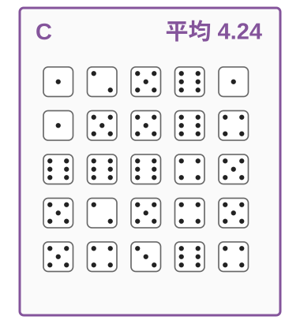

$$
\bar x=\frac{106}{25}=4.24
$$

今回の標本C：25回の<ruby>平<rt>へい</rt></ruby><ruby>均<rt>きん</rt></ruby>

① 母<ruby>平<rt>へい</rt></ruby><ruby>均<rt>きん</rt></ruby>Population mean

$$
\mu_x=\frac{1+2+3+4+5+6}{6}=3.5
$$

② <ruby>平<rt>へい</rt></ruby><ruby>均<rt>きん</rt></ruby>からのずれを、二乗Squared deviations

| 出目 | 1 | 2 | 3 | 4 | 5 | 6 |
|---|---|---|---|---|---|---|
| x−3.5 | −2.5 | −1.5 | −0.5 | 0.5 | 1.5 | 2.5 |
| 二乗 | 6.25 | 2.25 | 0.25 | 0.25 | 2.25 | 6.25 |

③ 6つの二乗を足して、6で割るPopulation variance

$$
\sigma_x^2=\frac{6.25+2.25+0.25+0.25+2.25+6.25}{6}
$$

$$
=\frac{17.5}{6}\approx2.9167
$$

各出目は同じ<ruby>確<rt>かく</rt></ruby><ruby>率<rt>りつ</rt></ruby>1/6。母<ruby>分<rt>ぶん</rt></ruby><ruby>散<rt>さん</rt></ruby>はこの6通りから計算する。 今回の25回の出目から推定した<ruby>分<rt>ぶん</rt></ruby><ruby>散<rt>さん</rt></ruby>ではない。

<aside class="formula-ref">教科書 p.129（離散<ruby>確<rt>かく</rt></ruby><ruby>率<rt>りつ</rt></ruby>分布の<ruby>平<rt>へい</rt></ruby><ruby>均<rt>きん</rt></ruby><ruby>値<rt>ち</rt></ruby>と<ruby>分<rt>ぶん</rt></ruby><ruby>散<rt>さん</rt></ruby>に代入）</aside>

---

<!-- _class: worked reveal-z -->

## サイコロの<ruby>標<rt>ひょう</rt></ruby><ruby>本<rt>ほん</rt></ruby><ruby>平<rt>へい</rt></ruby><ruby>均<rt>きん</rt></ruby>を、Zにする

① 与えられた条件

<ruby>平<rt>へい</rt></ruby><ruby>均<rt>きん</rt></ruby>4.24、μₓ=3.5、σₓ²≈2.9167、n=25。

② 公式（文字のまま）

$$
Z=\frac{\bar X-E(\bar X)}{\sqrt{Var(\bar X)}}=\frac{\bar X-\mu_x}{\sqrt{\frac{\sigma_x^2}{n}}}
$$

③ 数値を代入

$$
z=\frac{4.24-3.5}{\sqrt{2.9167/25}}\approx\frac{0.74}{0.3416}\approx2.17
$$

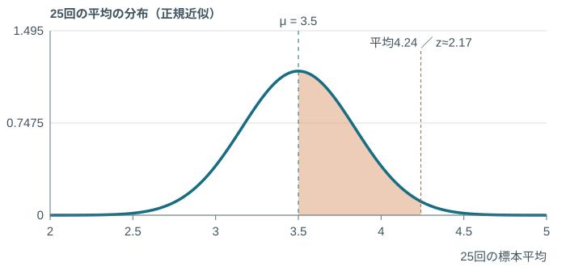

④ <ruby>平<rt>へい</rt></ruby><ruby>均<rt>きん</rt></ruby>3.5より、<ruby>標<rt>ひょう</rt></ruby><ruby>本<rt>ほん</rt></ruby><ruby>平<rt>へい</rt></ruby><ruby>均<rt>きん</rt></ruby>の<ruby>標<rt>ひょう</rt></ruby><ruby>準<rt>じゅん</rt></ruby><ruby>偏<rt>へん</rt></ruby><ruby>差<rt>さ</rt></ruby> 約2.17個分、上。

<aside class="formula-ref">教科書 p.123（<ruby>標<rt>ひょう</rt></ruby><ruby>本<rt>ほん</rt></ruby><ruby>平<rt>へい</rt></ruby><ruby>均<rt>きん</rt></ruby>の<ruby>標<rt>ひょう</rt></ruby><ruby>準<rt>じゅん</rt></ruby><ruby>化<rt>か</rt></ruby>に代入）</aside>

---

<!-- _class: worked reveal-z -->

## サイコロの<ruby>標<rt>ひょう</rt></ruby><ruby>本<rt>ほん</rt></ruby><ruby>平<rt>へい</rt></ruby><ruby>均<rt>きん</rt></ruby>を、Zにする

① 与えられた条件

<ruby>平<rt>へい</rt></ruby><ruby>均<rt>きん</rt></ruby>4.24、μₓ=3.5、σₓ²≈2.9167、n=25。

② 公式（文字のまま）

$$
Z=\frac{\bar X-E(\bar X)}{\sqrt{Var(\bar X)}}=\frac{\bar X-\mu_x}{\sqrt{\frac{\sigma_x^2}{n}}}
$$

③ 数値を代入

$$
z=\frac{4.24-3.5}{\sqrt{2.9167/25}}\approx\frac{0.74}{0.3416}\approx2.17
$$

④ <ruby>平<rt>へい</rt></ruby><ruby>均<rt>きん</rt></ruby>3.5より、<ruby>標<rt>ひょう</rt></ruby><ruby>本<rt>ほん</rt></ruby><ruby>平<rt>へい</rt></ruby><ruby>均<rt>きん</rt></ruby>の<ruby>標<rt>ひょう</rt></ruby><ruby>準<rt>じゅん</rt></ruby><ruby>偏<rt>へん</rt></ruby><ruby>差<rt>さ</rt></ruby> 約2.17個分、上。

<aside class="formula-ref">教科書 p.123（<ruby>標<rt>ひょう</rt></ruby><ruby>本<rt>ほん</rt></ruby><ruby>平<rt>へい</rt></ruby><ruby>均<rt>きん</rt></ruby>の<ruby>標<rt>ひょう</rt></ruby><ruby>準<rt>じゅん</rt></ruby><ruby>化<rt>か</rt></ruby>に代入）</aside>

---

<!-- _class: worked -->

## サイコロの<ruby>標<rt>ひょう</rt></ruby><ruby>本<rt>ほん</rt></ruby><ruby>平<rt>へい</rt></ruby><ruby>均<rt>きん</rt></ruby>を、Zにする

① 与えられた条件

<ruby>平<rt>へい</rt></ruby><ruby>均<rt>きん</rt></ruby>4.24、μₓ=3.5、σₓ²≈2.9167、n=25。

② 公式（文字のまま）

$$
Z=\frac{\bar X-E(\bar X)}{\sqrt{Var(\bar X)}}=\frac{\bar X-\mu_x}{\sqrt{\frac{\sigma_x^2}{n}}}
$$

③ 数値を代入

$$
z=\frac{4.24-3.5}{\sqrt{2.9167/25}}\approx\frac{0.74}{0.3416}\approx2.17
$$

④ <ruby>平<rt>へい</rt></ruby><ruby>均<rt>きん</rt></ruby>3.5より、<ruby>標<rt>ひょう</rt></ruby><ruby>本<rt>ほん</rt></ruby><ruby>平<rt>へい</rt></ruby><ruby>均<rt>きん</rt></ruby>の<ruby>標<rt>ひょう</rt></ruby><ruby>準<rt>じゅん</rt></ruby><ruby>偏<rt>へん</rt></ruby><ruby>差<rt>さ</rt></ruby> 約2.17個分、上。

<aside class="formula-ref">教科書 p.123（<ruby>標<rt>ひょう</rt></ruby><ruby>本<rt>ほん</rt></ruby><ruby>平<rt>へい</rt></ruby><ruby>均<rt>きん</rt></ruby>の<ruby>標<rt>ひょう</rt></ruby><ruby>準<rt>じゅん</rt></ruby><ruby>化<rt>か</rt></ruby>に代入）</aside>

---

<!-- _class: challenge -->

## チャレンジ1　4人の<ruby>平<rt>へい</rt></ruby><ruby>均<rt>きん</rt></ruby>得点は、どのくらい珍しい？

自分で解く　4分

架空の得点モデル：母<ruby>平<rt>へい</rt></ruby><ruby>均<rt>きん</rt></ruby>50点、<ruby>母<rt>ぼ</rt></ruby><ruby>標<rt>ひょう</rt></ruby><ruby>準<rt>じゅん</rt></ruby><ruby>偏<rt>へん</rt></ruby><ruby>差<rt>さ</rt></ruby>10点。 独立な正規<ruby>母<rt>ぼ</rt></ruby><ruby>集<rt>しゅう</rt></ruby><ruby>団<rt>だん</rt></ruby>から4人を抽出し、<ruby>平<rt>へい</rt></ruby><ruby>均<rt>きん</rt></ruby>が60点だった。

(1) Zを求めよ。 (2) <ruby>平<rt>へい</rt></ruby><ruby>均<rt>きん</rt></ruby>が60点を超える<ruby>確<rt>かく</rt></ruby><ruby>率<rt>りつ</rt></ruby>は？

右側の表を使う。小数は表の<ruby>丸<rt>まる</rt></ruby>め。
<aside class="resource"><a target="_blank" rel="noopener" href="https://yohman.github.io/26-2-StatsB/viewer.html?p&file=materials%2F2026-yoh%2Fweek06%2Fstandard-normal-table.pdf&week=W06&title=%E6%A8%99%E6%BA%96%E6%AD%A3%E8%A6%8F%E5%88%86%E5%B8%83%E8%A1%A8"><ruby>標<rt>ひょう</rt></ruby><ruby>準<rt>じゅん</rt></ruby><ruby>正<rt>せい</rt></ruby><ruby>規<rt>き</rt></ruby><ruby>分<rt>ぶん</rt></ruby><ruby>布<rt>ぷ</rt></ruby><ruby>表<rt>ひょう</rt></ruby> ↗</a></aside>

<aside class="formula-ref">教科書 p.123–124</aside>

---

<!-- _class: worked -->

## 答え合わせ1　4人の<ruby>平<rt>へい</rt></ruby><ruby>均<rt>きん</rt></ruby>を、Zにする

① 与えられた条件

μₓ=50、σₓ²=100、n=4、<ruby>平<rt>へい</rt></ruby><ruby>均<rt>きん</rt></ruby>60。

② 公式（文字のまま）

$$
Z=\frac{\bar X-E(\bar X)}{\sqrt{Var(\bar X)}}=\frac{\bar X-\mu_x}{\sqrt{\frac{\sigma_x^2}{n}}}
$$

③ 数値を代入

$$
z=\frac{60-50}{\sqrt{100/4}}=\frac{10}{5}=2
$$

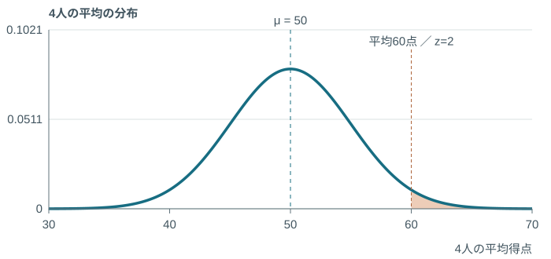

④ 上側表：Pr(Z > 2.00)=0.02275。約2.275%。
<aside class="resource"><a target="_blank" rel="noopener" href="https://yohman.github.io/26-2-StatsB/viewer.html?p&file=materials%2F2026-yoh%2Fweek06%2Fstandard-normal-table.pdf&week=W06&title=%E6%A8%99%E6%BA%96%E6%AD%A3%E8%A6%8F%E5%88%86%E5%B8%83%E8%A1%A8"><ruby>標<rt>ひょう</rt></ruby><ruby>準<rt>じゅん</rt></ruby><ruby>正<rt>せい</rt></ruby><ruby>規<rt>き</rt></ruby><ruby>分<rt>ぶん</rt></ruby><ruby>布<rt>ぷ</rt></ruby><ruby>表<rt>ひょう</rt></ruby> ↗</a></aside>

<aside class="formula-ref">教科書 p.123–124・202（式に代入・上側表）</aside>

---

<!-- _class: visual -->

## 同じ60点でも、zは違う

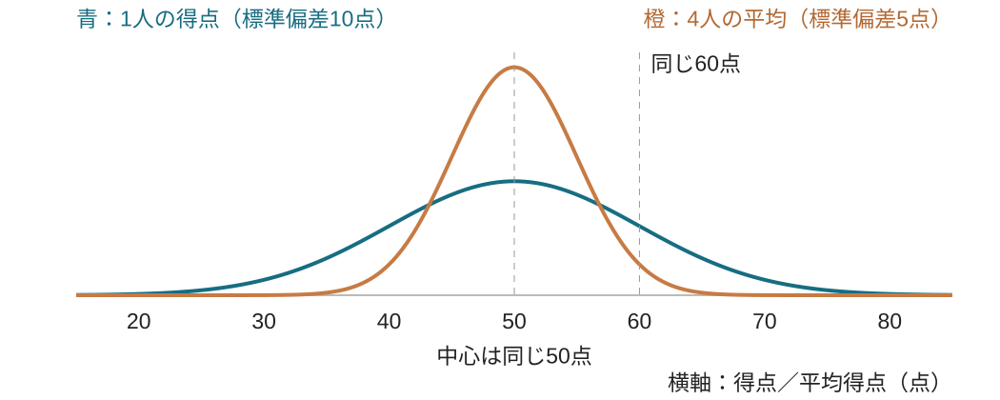

$$
\begin{aligned}\text{1人の60点：}\quad z&=\frac{60-50}{10}=1\\\text{4人の平均60点：}\quad z&=\frac{60-50}{\sqrt{100/4}}=2\end{aligned}
$$

<aside class="formula-ref">教科書 p.123（<ruby>標<rt>ひょう</rt></ruby><ruby>準<rt>じゅん</rt></ruby><ruby>化<rt>か</rt></ruby>の式に代入）</aside>

---

<!-- _class: plain -->

## 中心極限定理で、何ができた？

たくさんの<ruby>標<rt>ひょう</rt></ruby><ruby>本<rt>ほん</rt></ruby><ruby>平<rt>へい</rt></ruby><ruby>均<rt>きん</rt></ruby>の形を、 <ruby>正<rt>せい</rt></ruby><ruby>規<rt>き</rt></ruby><ruby>分<rt>ぶん</rt></ruby><ruby>布<rt>ぷ</rt></ruby>で<ruby>近<rt>きん</rt></ruby><ruby>似<rt>じ</rt></ruby>できる。

だから、<ruby>平<rt>へい</rt></ruby><ruby>均<rt>きん</rt></ruby>について<ruby>確<rt>かく</rt></ruby><ruby>率<rt>りつ</rt></ruby>を考えられる。

<aside class="formula-ref">教科書 p.122–123</aside>

---

<!-- _class: topic title-t -->

## t<ruby>分<rt>ぶん</rt></ruby><ruby>布<rt>ぷ</rt></ruby>Student’s t-distribution

---

<!-- _class: photo-story -->

## “Student”は、誰？

William Sealy Gosset “Student” · 1908

---

<!-- _class: photo-story -->

## 5試合だけで、Curryを語れる？

Stephen Curry 5試合だけで、何が分かる？

---

<!-- _class: visual -->

## この5試合を、標本にする

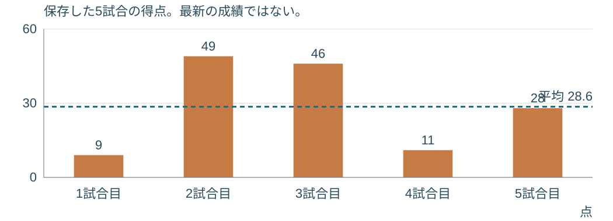
保存した記録：9、49、46、11、28点。比較基準として27.4点を置く。

---

<!-- _class: plain inverse punch -->

## 母<ruby>分<rt>ぶん</rt></ruby><ruby>散<rt>さん</rt></ruby>は、分かっている？

5試合の記録しかない。 母<ruby>分<rt>ぶん</rt></ruby><ruby>散<rt>さん</rt></ruby>は、分からない。

手元の標本から推定した<ruby>分<rt>ぶん</rt></ruby><ruby>散<rt>さん</rt></ruby>を使う。

<aside class="formula-ref">教科書 p.125</aside>

---

<!-- _class: hero-math inverse -->

## 未知の母<ruby>分<rt>ぶん</rt></ruby><ruby>散<rt>さん</rt></ruby>を、推定値に替える

$$
T=\frac{\bar X-\mu_x}{\sqrt{\frac{\widehat{\sigma_x^2}}{n}}}
$$

<aside class="formula-ref">教科書 p.125（下段）</aside>

---

<!-- _class: plain -->

## tを使うときの条件

母<ruby>分<rt>ぶん</rt></ruby><ruby>散<rt>さん</rt></ruby>は未知。 独立な正規<ruby>母<rt>ぼ</rt></ruby><ruby>集<rt>しゅう</rt></ruby><ruby>団<rt>だん</rt></ruby>の標本。

小標本だから、という理由だけでは決まらない。
得点は対戦相手や出場時間にも依存。NBA例は計算の練習モデル。

<aside class="formula-ref">教科書 p.125</aside>

---

<!-- _class: topic title-df -->

## <ruby>自<rt>じ</rt></ruby><ruby>由<rt>ゆう</rt></ruby><ruby>度<rt>ど</rt></ruby>Degrees of freedom

---

<!-- _class: plain -->

## <ruby>平<rt>へい</rt></ruby><ruby>均<rt>きん</rt></ruby>が3なら、xは自由？

2　＋　x　＋　5　＋　1 <ruby>平<rt>へい</rt></ruby><ruby>均<rt>きん</rt></ruby>は3。

合計12だから、x=4。 4個の値に条件1つ。自由度は3。

<aside class="formula-ref">教科書 p.125–126</aside>

---

<!-- _class: topic title-uv -->

## <ruby>標<rt>ひょう</rt></ruby><ruby>本<rt>ほん</rt></ruby><ruby>不<rt>ふ</rt></ruby><ruby>偏<rt>へん</rt></ruby><ruby>分<rt>ぶん</rt></ruby><ruby>散<rt>さん</rt></ruby>Unbiased sample variance

---

<!-- _class: hero-math -->

## 標本不偏<ruby>分<rt>ぶん</rt></ruby><ruby>散<rt>さん</rt></ruby>

$$
\widehat{\sigma_x^2}=\frac{1}{n-1}\sum(X_i-\bar X)^2
$$

<aside class="formula-ref">教科書 p.126（上段）</aside>

---

<!-- _class: plain plum -->

## nで割るか、n−1で割るか

標本<ruby>分<rt>ぶん</rt></ruby><ruby>散<rt>さん</rt></ruby>は、nで割る。 標本不偏<ruby>分<rt>ぶん</rt></ruby><ruby>散<rt>さん</rt></ruby>は、n−1で割る。

不偏：繰り返し推定した値の<ruby>平<rt>へい</rt></ruby><ruby>均<rt>きん</rt></ruby>が、母<ruby>分<rt>ぶん</rt></ruby><ruby>散<rt>さん</rt></ruby>に一致する。1回の値が必ず正解、という意味ではない。

<aside class="formula-ref">教科書 p.126</aside>

---

<!-- _class: challenge plum -->

## チャレンジ2　Curryの5試合を計算する

自分で解く　7分

得点：9、49、46、11、28。

(1) <ruby>標<rt>ひょう</rt></ruby><ruby>本<rt>ほん</rt></ruby><ruby>平<rt>へい</rt></ruby><ruby>均<rt>きん</rt></ruby>を求めよ。
(2) <ruby>平<rt>へい</rt></ruby><ruby>均<rt>きん</rt></ruby>からの偏差を二乗して合計せよ。
(3) 標本不偏<ruby>分<rt>ぶん</rt></ruby><ruby>散<rt>さん</rt></ruby>を求めよ。

小数計算は電卓可。分母をnとn−1で取り違えない。

<aside class="formula-ref">教科書 p.122（脚注2）・126</aside>

---

<!-- _class: worked -->

## 答え合わせ2　まず、<ruby>平<rt>へい</rt></ruby><ruby>均<rt>きん</rt></ruby>28.6点

① 与えられた条件

5試合の得点：9、49、46、11、28。

② 公式（文字のまま）

$$
\bar{x}=\frac{1}{n}(x_1+x_2+\cdots+x_n)
$$

③ 数値を代入

$$
\bar{x}=\frac{9+49+46+11+28}{5}=\frac{143}{5}=28.6
$$

④ この5試合の<ruby>標<rt>ひょう</rt></ruby><ruby>本<rt>ほん</rt></ruby><ruby>平<rt>へい</rt></ruby><ruby>均<rt>きん</rt></ruby>は28.6点。

<aside class="formula-ref">教科書 p.122（脚注2）</aside>

---

<!-- _class: visual-table -->

## <ruby>平<rt>へい</rt></ruby><ruby>均<rt>きん</rt></ruby>28.6との差を、二乗する

| 得点 | 偏差 | 偏差の二乗 |
|---:|---:|---:|
|9|−19.6|384.16|
|49|20.4|416.16|
|46|17.4|302.76|
|11|−17.6|309.76|
|28|−0.6|0.36|
|合計||1413.20|

<aside class="formula-ref">教科書 p.126（偏差二乗和に代入）</aside>

---

<!-- _class: worked -->

## 答え合わせ2　1413.2を、自由度4で割る

① 与えられた条件

n=5、<ruby>平<rt>へい</rt></ruby><ruby>均<rt>きん</rt></ruby>28.6点、偏差二乗和1413.2。

② 公式（文字のまま）

$$
\widehat{\sigma_x^2}=\frac{1}{n-1}\sum(X_i-\bar X)^2
$$

③ 数値を代入

$$
\widehat{\sigma_x^2}=\frac{1413.2}{5-1}=353.3
$$

④ 標本不偏<ruby>分<rt>ぶん</rt></ruby><ruby>散<rt>さん</rt></ruby>は353.3点²。単位は点ではなく点²。

<aside class="formula-ref">教科書 p.126（上段）</aside>

---

<!-- _class: challenge mint -->

## チャレンジ3　比較基準27.4点から、どれだけ離れた？

自分で解く　3分

n=5、<ruby>標<rt>ひょう</rt></ruby><ruby>本<rt>ほん</rt></ruby><ruby>平<rt>へい</rt></ruby><ruby>均<rt>きん</rt></ruby>28.6点、標本不偏<ruby>分<rt>ぶん</rt></ruby><ruby>散<rt>さん</rt></ruby>353.3点²。
比較基準となる母<ruby>平<rt>へい</rt></ruby><ruby>均<rt>きん</rt></ruby>を27.4点と置く。

(1) tを求めよ。 (2) 自由度は？

分母は353.3を5で割ってから平方根。

<aside class="formula-ref">教科書 p.125–126</aside>

---

<!-- _class: worked -->

## 答え合わせ3　差1.2点は、tで約0.143

① 与えられた条件

n=5、<ruby>平<rt>へい</rt></ruby><ruby>均<rt>きん</rt></ruby>28.6、推定<ruby>分<rt>ぶん</rt></ruby><ruby>散<rt>さん</rt></ruby>353.3、基準27.4。

② 公式（文字のまま）

$$
T=\frac{\bar X-\mu_x}{\sqrt{\frac{\widehat{\sigma_x^2}}{n}}}
$$

③ 数値を代入

$$
t=\frac{28.6-27.4}{\sqrt{353.3/5}}=\frac{1.2}{8.406}\approx0.143
$$

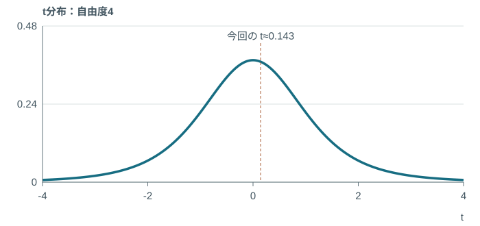

④ t ≈ 0.143、自由度4。点でも%でもない。

<aside class="formula-ref">教科書 p.125（下段）</aside>

---

<!-- _class: visual -->

## 自由度が増えると、標準正規に近づく

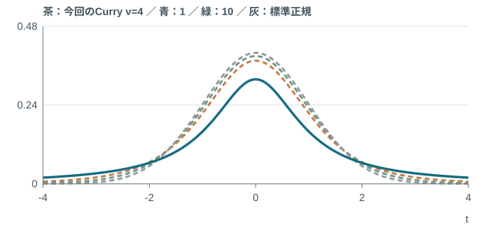

左右対称。小さい自由度では、裾が厚い。

<aside class="formula-ref">教科書 p.126（図10）</aside>

---

<!-- _class: topic title-table -->

## t<ruby>分<rt>ぶん</rt></ruby><ruby>布<rt>ぷ</rt></ruby><ruby>表<rt>ひょう</rt></ruby>Student’s t table

---

<!-- _class: plain -->

## 表に入れるもの、出てくるもの

| | <ruby>標<rt>ひょう</rt></ruby><ruby>準<rt>じゅん</rt></ruby><ruby>正<rt>せい</rt></ruby><ruby>規<rt>き</rt></ruby><ruby>分<rt>ぶん</rt></ruby><ruby>布<rt>ぷ</rt></ruby><ruby>表<rt>ひょう</rt></ruby> | t分布表 |
|---|---|---|
|入れるもの|zの値|自由度ν、<ruby>上<rt>うわ</rt></ruby><ruby>側<rt>がわ</rt></ruby><ruby>確<rt>かく</rt></ruby><ruby>率<rt>りつ</rt></ruby>α|
|交点の値|右側の<ruby>確<rt>かく</rt></ruby><ruby>率<rt>りつ</rt></ruby>|横軸の境界t|

t表の中身は、<ruby>確<rt>かく</rt></ruby><ruby>率<rt>りつ</rt></ruby>ではない。
<aside class="resource"><a target="_blank" rel="noopener" href="https://yohman.github.io/26-2-StatsB/viewer.html?p&file=materials%2F2026-yoh%2Fweek06%2Ft-table.pdf&week=W06&title=t%E5%88%86%E5%B8%83%E8%A1%A8">t分布表 ↗</a></aside>

<aside class="formula-ref">教科書 p.126–127・203</aside>

---

<!-- _class: plain -->

## 自由度20、<ruby>上<rt>うわ</rt></ruby><ruby>側<rt>がわ</rt></ruby><ruby>確<rt>かく</rt></ruby><ruby>率<rt>りつ</rt></ruby>0.025

| 自由度ν ＼ α |0.05|0.025|0.01|
|---|---:|---:|---:|
|10|1.8125|2.2281|2.7638|
|20|1.7247|**2.0860**|2.5280|
|30|1.6973|2.0423|2.4573|

[t表を指して確かめる](https://yohman.github.io/26-2-StatsB/agenda.html?p&activity=w6-t#week-06)<aside class="resource"><a target="_blank" rel="noopener" href="https://yohman.github.io/26-2-StatsB/viewer.html?p&file=materials%2F2026-yoh%2Fweek06%2Ft-table.pdf&week=W06&title=t%E5%88%86%E5%B8%83%E8%A1%A8">t分布表 ↗</a></aside>

<aside class="formula-ref">教科書 p.127（例①）・203</aside>

---

<!-- _class: visual -->

## 2.0860の右側が、2.5%

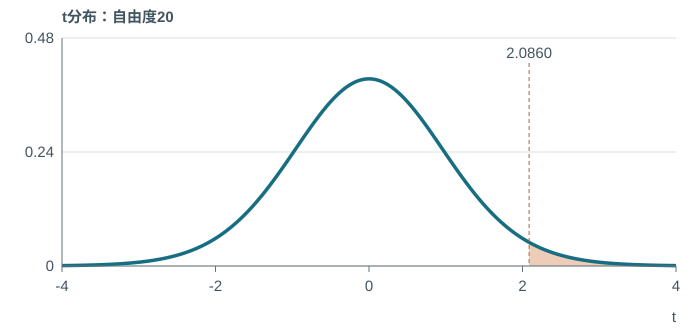

$$
\Pr(T>2.0860)=0.025
$$

<aside class="resource"><a target="_blank" rel="noopener" href="https://yohman.github.io/26-2-StatsB/viewer.html?p&file=materials%2F2026-yoh%2Fweek06%2Ft-table.pdf&week=W06&title=t%E5%88%86%E5%B8%83%E8%A1%A8">t分布表 ↗</a></aside>

<aside class="formula-ref">教科書 p.127（例①）</aside>

---

<!-- _class: challenge paper -->

## チャレンジ4　中央90%を残す境界は？

自分で解く　4分

自由度10のt分布。

中央90%を残す左右の境界を求めよ。
(1) 片側の面積は何%？ (2) どの列を読む？

<aside class="resource"><a target="_blank" rel="noopener" href="https://yohman.github.io/26-2-StatsB/viewer.html?p&file=materials%2F2026-yoh%2Fweek06%2Ft-table.pdf&week=W06&title=t%E5%88%86%E5%B8%83%E8%A1%A8">t分布表 ↗</a></aside>

<aside class="formula-ref">教科書 p.127（例②）・203</aside>

---

<!-- _class: worked -->

## 答え合わせ4　左右5%ずつ、境界は±1.8125

① 与えられた条件

自由度10、中央の面積0.90。

② 公式（文字のまま）

$$
\Pr(-t_{\alpha}(\nu)<T<t_{\alpha}(\nu))=0.90
$$

③ 数値を代入

$$
\alpha=\frac{1-0.90}{2}=0.05,\qquad t_{0.05}(10)=1.8125
$$

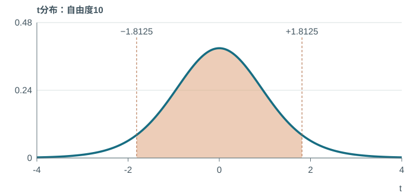

④ Pr(−1.8125 < T < 1.8125)=90%。
<aside class="resource"><a target="_blank" rel="noopener" href="https://yohman.github.io/26-2-StatsB/viewer.html?p&file=materials%2F2026-yoh%2Fweek06%2Ft-table.pdf&week=W06&title=t%E5%88%86%E5%B8%83%E8%A1%A8">t分布表 ↗</a></aside>

<aside class="formula-ref">教科書 p.127（例②）・203</aside>

---

<!-- _class: try -->

## 自分の選手なら、どうなる？

5試合の得点を入れる。 <ruby>平<rt>へい</rt></ruby><ruby>均<rt>きん</rt></ruby>、推定<ruby>分<rt>ぶん</rt></ruby><ruby>散<rt>さん</rt></ruby>、tを順に見る。

[やってみよう！](https://yohman.github.io/26-2-StatsB/agenda.html?p&activity=w6-t#week-06)

授業中はCurryの記録で確認。自分の選手は余裕があれば。

<aside class="formula-ref">教科書 p.125–127</aside>

---

<!-- _class: plain -->

## t分布で、何が変わった？

母<ruby>分<rt>ぶん</rt></ruby><ruby>散<rt>さん</rt></ruby>を知らない。 標本不偏<ruby>分<rt>ぶん</rt></ruby><ruby>散<rt>さん</rt></ruby>で推定する。 自由度に合う表を使う。

<aside class="formula-ref">教科書 p.125–127</aside>

---

<!-- _class: topic title-chi -->

## カイ<ruby>二<rt>に</rt></ruby><ruby>乗<rt>じょう</rt></ruby><ruby>分<rt>ぶん</rt></ruby><ruby>布<rt>ぷ</rt></ruby>Chi-square distribution

---

<!-- _class: photo-story -->

## Karl Pearson

Karl Pearson 1900 · ずれは、偶然の範囲？

---

<!-- _class: plain sunshine -->

## ある大学で、集計上の比率が60:40

男子60%　女子40%

無作為に20人を抽出すると、必ず12人と8人？

説明用の仮想比率。実際の麗澤大学の統計ではない。本人の属性は収集しない。

---

<!-- _class: visual -->

## 基準となる人数は、12人と8人

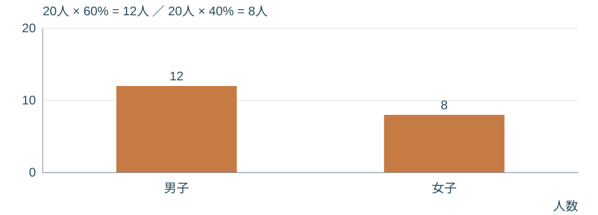
毎回必ず起こる人数、という意味ではない。

---

<!-- _class: visual -->

## 今回の20人は、11人と9人

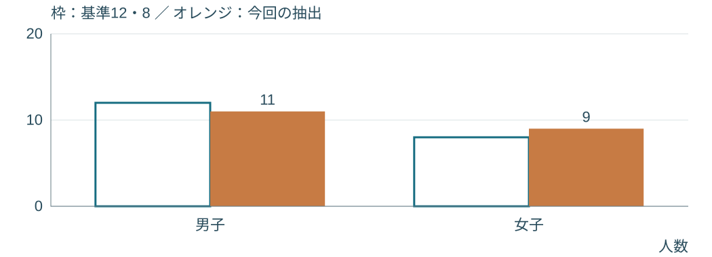
同じ<ruby>母<rt>ぼ</rt></ruby><ruby>集<rt>しゅう</rt></ruby><ruby>団<rt>だん</rt></ruby>からでも、標本は毎回変わる。

---

<!-- _class: visual -->

## 今回の20人は、15人と5人

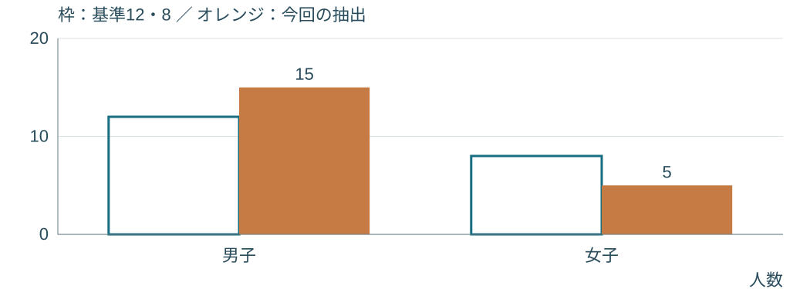
同じ<ruby>母<rt>ぼ</rt></ruby><ruby>集<rt>しゅう</rt></ruby><ruby>団<rt>だん</rt></ruby>からでも、標本は毎回変わる。

---

<!-- _class: plain inverse punch -->

## 「ずれが大きい」を、どう考える？

基準と違うことは、普通にある。 ずれの大きさを、まとめて見たい。

この問いの先にカイ二乗検定がある。今日は、土台となる分布と平方和を学ぶ。

<aside class="formula-ref">教科書 p.127–128（分布の定義）</aside>

---

<!-- _class: hero-math inverse -->

## カイ二乗分布の記号

$$
U\sim\chi^2(\nu)
$$

<aside class="formula-ref">教科書 p.128（冒頭）</aside>

---

<!-- _class: plain punch -->

## 独立な標準正規の値を、二乗して足す

<ruby>標<rt>ひょう</rt></ruby><ruby>準<rt>じゅん</rt></ruby><ruby>正<rt>せい</rt></ruby><ruby>規<rt>き</rt></ruby><ruby>分<rt>ぶん</rt></ruby><ruby>布<rt>ぷ</rt></ruby>の値を、二乗。 独立な値を、ν個足す。

合計は0以上。自由度は、足した独立な値の個数。

<aside class="formula-ref">教科書 p.127（⑤）</aside>

---

<!-- _class: visual -->

## 自由度で、形が変わる

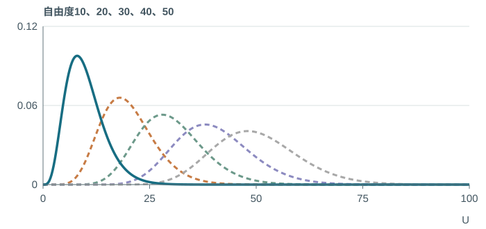

0以上。右に長い裾。自由度が増えると、相対的な歪みが小さくなる。

<aside class="formula-ref">教科書 p.128（図13）</aside>

---

<!-- _class: plain -->

## 今度は、学生3人の身長で考える

160cm　165cm　170cm

仮想の正規<ruby>母<rt>ぼ</rt></ruby><ruby>集<rt>しゅう</rt></ruby><ruby>団<rt>だん</rt></ruby>：母<ruby>平<rt>へい</rt></ruby><ruby>均<rt>きん</rt></ruby>160cm、<ruby>母<rt>ぼ</rt></ruby><ruby>標<rt>ひょう</rt></ruby><ruby>準<rt>じゅん</rt></ruby><ruby>偏<rt>へん</rt></ruby><ruby>差<rt>さ</rt></ruby>5cm。 独立に抽出した3人とする。
実際の全国<ruby>平<rt>へい</rt></ruby><ruby>均<rt>きん</rt></ruby>でも、教室の実測データでもない。

<aside class="formula-ref">教科書 p.128（式に入れる仮想例）</aside>

---

<!-- _class: hero-math paper -->

## 母<ruby>平<rt>へい</rt></ruby><ruby>均<rt>きん</rt></ruby>からの偏差二乗和を、母<ruby>分<rt>ぶん</rt></ruby><ruby>散<rt>さん</rt></ruby>で割る

$$
U_0=\frac{\sum_{i=1}^{n}(x_i-\mu_x)^2}{\sigma_x^2}
$$

<aside class="formula-ref">教科書 p.128（平方和の分解・左辺）</aside>

---

<!-- _class: challenge -->

## チャレンジ5　3人のずれを、ひとつにする

自分で解く　4分

身長160、165、170cm。母<ruby>平<rt>へい</rt></ruby><ruby>均<rt>きん</rt></ruby>160cm、<ruby>母<rt>ぼ</rt></ruby><ruby>標<rt>ひょう</rt></ruby><ruby>準<rt>じゅん</rt></ruby><ruby>偏<rt>へん</rt></ruby><ruby>差<rt>さ</rt></ruby>5cm。

(1) U₀を求めよ。
(2) 独立に抽出した値は何個？ U₀の自由度は？

母<ruby>平<rt>へい</rt></ruby><ruby>均<rt>きん</rt></ruby>は既知。まだ<ruby>標<rt>ひょう</rt></ruby><ruby>本<rt>ほん</rt></ruby><ruby>平<rt>へい</rt></ruby><ruby>均<rt>きん</rt></ruby>を引いていない。

<aside class="formula-ref">教科書 p.128（平方和の式）</aside>

---

<!-- _class: worked -->

## 答え合わせ5　U₀=5、自由度3

① 与えられた条件

n=3、μₓ=160、σₓ²=25。

② 公式（文字のまま）

$$
U_0=\frac{\sum_{i=1}^{n}(x_i-\mu_x)^2}{\sigma_x^2}
$$

③ 数値を代入

$$
\begin{aligned}U_0&=\frac{(160-160)^2+(165-160)^2+(170-160)^2}{25}\\&=\frac{125}{25}=5\end{aligned}
$$

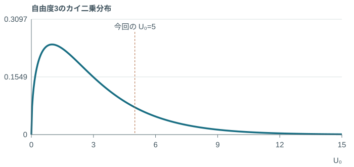

④ U₀=5、自由度3。cmでも%でもない。

<aside class="formula-ref">教科書 p.128（平方和の分解・左辺）</aside>

---

<!-- _class: hero-math long inverse -->

## 平方和の分解

$$
U_0=\frac{\sum_{i=1}^{n}(x_i-\mu_x)^2}{\sigma_x^2}=\frac{\sum_{i=1}^{n}(x_i-\bar X)^2}{\sigma_x^2}+\frac{n(\bar X-\mu_x)^2}{\sigma_x^2}
$$

<aside class="formula-ref">教科書 p.128（平方和の分解）</aside>

---

<!-- _class: visual -->

## 同じ3人なら、5 = 2 + 3

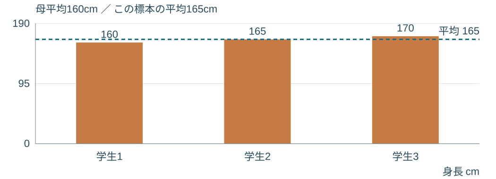

全体のずれ：5。標本内のずれ：2。<ruby>平<rt>へい</rt></ruby><ruby>均<rt>きん</rt></ruby>のずれ：3。
自由度も 3 = 2 + 1。

<aside class="formula-ref">教科書 p.128（平方和の分解に代入）</aside>

---

<!-- _class: plain mint -->

## <ruby>平<rt>へい</rt></ruby><ruby>均<rt>きん</rt></ruby>と<ruby>分<rt>ぶん</rt></ruby><ruby>散<rt>さん</rt></ruby>も、自由度で決まる

<ruby>平<rt>へい</rt></ruby><ruby>均<rt>きん</rt></ruby><ruby>値<rt>ち</rt></ruby>は、自由度ν。 <ruby>分<rt>ぶん</rt></ruby><ruby>散<rt>さん</rt></ruby>は、2ν。

自由度3なら、<ruby>平<rt>へい</rt></ruby><ruby>均<rt>きん</rt></ruby>3・<ruby>分<rt>ぶん</rt></ruby><ruby>散<rt>さん</rt></ruby>6。
今回のU₀=5が、毎回出るわけではない。

[学生の抽出と平方和を試す](https://yohman.github.io/26-2-StatsB/agenda.html?p&activity=w6-chi#week-06)

<aside class="formula-ref">教科書 p.128（冒頭）</aside>

---

<!-- _class: plain paper -->

## 今日の3つを、つなげる

| 問い | 道具 |
|---|---|
|<ruby>標<rt>ひょう</rt></ruby><ruby>本<rt>ほん</rt></ruby><ruby>平<rt>へい</rt></ruby><ruby>均<rt>きん</rt></ruby>を何度も作ると？|中心極限定理|
|母<ruby>分<rt>ぶん</rt></ruby><ruby>散<rt>さん</rt></ruby>が未知なら、<ruby>平<rt>へい</rt></ruby><ruby>均<rt>きん</rt></ruby>の差をどう扱う？|t分布と標本不偏<ruby>分<rt>ぶん</rt></ruby><ruby>散<rt>さん</rt></ruby>|
|独立な標準正規の値を二乗して集めると？|カイ二乗分布|

<aside class="formula-ref">教科書 p.122–128</aside>

---

<!-- _class: try plum -->

## AL：ここからは、自分で表を読む

どの分布？ 自由度は？ <ruby>確<rt>かく</rt></ruby><ruby>率<rt>りつ</rt></ruby>か、境界か？

ワークシートの各セルの解答は示しません。
<aside class="resource"><a target="_blank" rel="noopener" href="https://yohman.github.io/26-2-StatsB/viewer.html?p&file=materials%2F2026-yoh%2Fweek06%2Ft-table.pdf&week=W06&title=t%E5%88%86%E5%B8%83%E8%A1%A8">t分布表 ↗</a></aside>

<aside class="formula-ref">教科書 p.123–127・202–203</aside>
